# EtwTimLogControlProtectionKernelModeReturnMismatch

- RVA: `0x00651E84`–`0x00652386` (길이 `1,282` bytes)
- VA: `0x0000000140651E84`
- 실행 섹션: `.text`
- PDB 이름 있음: `예`; PDB Function 태그: `아니요`
- unwind 정보 RVA: `0x000D3BA4`
- 디코드: `258`개 명령, `1,282/1,282` bytes 표시
- 미해석 바이트: `0` (있으면 어셈블리에 `.byte`로 보존)

> 이 문서는 커널 이미지의 기계어와 PDB 기호를 분석해 생성했습니다. 4번과 5번은 함수 원형과 자료형을 바이너리 사용 방식에서 추정한 C 해석이며 원본 소스 복구 결과는 아닙니다.

## 1. Dependencies

- 직접 호출 지점: **10**; 고유 호출 대상: **7**
- 직접 호출자로 확인된 함수: **1**
- RIP 상대 이미지 참조: **7**

### Outgoing calls
- `0x00651F19` → [memset](../6C/memset_function_006C6C40.md) (function, `0x006C6C40`)
- `0x00651F2E` → [RtlPcToFileName](../3F/RtlPcToFileName_function_003FEBB0.md) (function, `0x003FEBB0`)
- `0x00651FB7` → [memset](../6C/memset_function_006C6C40.md) (function, `0x006C6C40`)
- `0x00651FD1` → [RtlPcToFileName](../3F/RtlPcToFileName_function_003FEBB0.md) (function, `0x003FEBB0`)
- `0x00652053` → [RtlPcToFileHeader](../2F/RtlPcToFileHeader_function_002F1C50.md) (function, `0x002F1C50`)
- `0x006520BF` → [RtlPcToFileHeader](../2F/RtlPcToFileHeader_function_002F1C50.md) (function, `0x002F1C50`)
- `0x00652181` → [EtwWriteEx](../25/EtwWriteEx_function_0025F0D0.md) (function, `0x0025F0D0`)
- `0x006521C3` → [tlgKeywordOn](../42/tlgKeywordOn_function_0042EAA0.md) (function, `0x0042EAA0`)
- `0x00652353` → [tlgWriteTransfer_EtwWriteTransfer](../42/tlgWriteTransfer_EtwWriteTransfer_function_004260E0.md) (function, `0x004260E0`)
- `0x00652362` → [_security_check_cookie](../6A/_security_check_cookie_function_006AC640.md) (function, `0x006AC640`)

### Direct callers
- [KiLogControlProtectionKernelModeReturnMismatch](../5C/KiLogControlProtectionKernelModeReturnMismatch_function_005C8284.md) at `0x005C82F8`

### Static image references
- `0x00651EA7` → RVA `0x00E0A740` (`.data`; read)
- `0x00651F5E` → RVA `0x006CD970` (` ?? ::FNODOBFM::`string'`; read)
- `0x006520D9` → RVA `0x00EFF828` (`.data`; read)
- `0x006520E0` → RVA `0x00022358` (`.rdata`; read)
- `0x00652186` → RVA `0x00002F30` (`.rdata`; read)
- `0x006521A5` → RVA `0x00E09168` (`.data`; read)
- `0x006521E2` → RVA `0x0005515B` (`.rdata`; read)

## 2. Other-region calls and transfers

- 다른 실행 섹션으로 향하는 call: **0**
- 별도 외부 분기/꼬리 이동을 확인하지 못했습니다.

## 3. Assembly (complete function range)

```asm
00651E84  40 55                           push rbp
00651E86  57                              push rdi
00651E87  41 54                           push r12
00651E89  41 55                           push r13
00651E8B  41 57                           push r15
00651E8D  48 81 EC A0 02 00 00            sub rsp, 0x2a0
00651E94  48 8D 6C 24 40                  lea rbp, [rsp + 0x40]
00651E99  48 89 9D 90 02 00 00            mov qword ptr [rbp + 0x290], rbx
00651EA0  48 89 B5 A0 02 00 00            mov qword ptr [rbp + 0x2a0], rsi
00651EA7  48 8B 05 92 88 7B 00            mov rax, qword ptr [rip + 0x7b8892]
00651EAE  48 33 C5                        xor rax, rbp
00651EB1  48 89 85 50 02 00 00            mov qword ptr [rbp + 0x250], rax
00651EB8  48 8B 02                        mov rax, qword ptr [rdx]
00651EBB  45 33 E4                        xor r12d, r12d
00651EBE  48 89 45 10                     mov qword ptr [rbp + 0x10], rax
00651EC2  0F 57 C0                        xorps xmm0, xmm0
00651EC5  48 8B 42 08                     mov rax, qword ptr [rdx + 8]
00651EC9  0F 57 C9                        xorps xmm1, xmm1
00651ECC  48 89 45 18                     mov qword ptr [rbp + 0x18], rax
00651ED0  8B 42 10                        mov eax, dword ptr [rdx + 0x10]
00651ED3  89 45 24                        mov dword ptr [rbp + 0x24], eax
00651ED6  8B 42 14                        mov eax, dword ptr [rdx + 0x14]
00651ED9  89 45 2C                        mov dword ptr [rbp + 0x2c], eax
00651EDC  8B 42 18                        mov eax, dword ptr [rdx + 0x18]
00651EDF  89 45 30                        mov dword ptr [rbp + 0x30], eax
00651EE2  8B 42 1C                        mov eax, dword ptr [rdx + 0x1c]
00651EE5  89 45 20                        mov dword ptr [rbp + 0x20], eax
00651EE8  4C 89 65 08                     mov qword ptr [rbp + 8], r12
00651EEC  0F 11 45 50                     movups xmmword ptr [rbp + 0x50], xmm0
00651EF0  0F 11 4D 60                     movups xmmword ptr [rbp + 0x60], xmm1
00651EF4  83 F9 01                        cmp ecx, 1
00651EF7  0F 85 5B 04 00 00               jne 0x140652358
00651EFD  8B 04 24                        mov eax, dword ptr [rsp]
00651F00  44 89 65 28                     mov dword ptr [rbp + 0x28], r12d
00651F04  8D 79 3F                        lea edi, [rcx + 0x3f]
00651F07  48 2B E7                        sub rsp, rdi
00651F0A  48 8D 5C 24 40                  lea rbx, [rsp + 0x40]
00651F0F  8B 03                           mov eax, dword ptr [rbx]
00651F11  44 8B C7                        mov r8d, edi
00651F14  33 D2                           xor edx, edx
00651F16  48 8B CB                        mov rcx, rbx
00651F19  E8 22 4D 07 00                  call 0x1406c6c40
00651F1E  48 8B 4D 10                     mov rcx, qword ptr [rbp + 0x10]
00651F22  48 8D 55 50                     lea rdx, [rbp + 0x50]
00651F26  66 89 7D 52                     mov word ptr [rbp + 0x52], di
00651F2A  48 89 5D 58                     mov qword ptr [rbp + 0x58], rbx
00651F2E  E8 7D CC DA FF                  call 0x1403febb0
00651F33  41 0F B7 FC                     movzx edi, r12w
00651F37  85 C0                           test eax, eax
00651F39  78 04                           js 0x140651f3f
00651F3B  0F B7 7D 50                     movzx edi, word ptr [rbp + 0x50]
00651F3F  4C 8B 6D 58                     mov r13, qword ptr [rbp + 0x58]
00651F43  BE 06 00 00 00                  mov esi, 6
00651F48  48 C7 85 A8 00 00 00 02 00 00 00  mov qword ptr [rbp + 0xa8], 2
00651F53  48 8D 45 00                     lea rax, [rbp]
00651F57  48 89 85 A0 00 00 00            mov qword ptr [rbp + 0xa0], rax
00651F5E  48 8D 0D 0B BA 07 00            lea rcx, [rip + 0x7ba0b]
00651F65  44 8D 7E 06                     lea r15d, [rsi + 6]
00651F69  66 85 FF                        test di, di
00651F6C  74 12                           je 0x140651f80
00651F6E  0F B7 C7                        movzx eax, di
00651F71  4C 89 AD B0 00 00 00            mov qword ptr [rbp + 0xb0], r13
00651F78  66 D1 E8                        shr ax, 1
00651F7B  0F B7 CF                        movzx ecx, di
00651F7E  EB 0C                           jmp 0x140651f8c
00651F80  48 89 8D B0 00 00 00            mov qword ptr [rbp + 0xb0], rcx
00651F87  8B C6                           mov eax, esi
00651F89  41 8B CF                        mov ecx, r15d
00651F8C  66 89 45 00                     mov word ptr [rbp], ax
00651F90  8B 04 24                        mov eax, dword ptr [rsp]
00651F93  89 8D B8 00 00 00               mov dword ptr [rbp + 0xb8], ecx
00651F99  44 89 A5 BC 00 00 00            mov dword ptr [rbp + 0xbc], r12d
00651FA0  B9 40 00 00 00                  mov ecx, 0x40
00651FA5  48 2B E1                        sub rsp, rcx
00651FA8  48 8D 5C 24 40                  lea rbx, [rsp + 0x40]
00651FAD  8B 03                           mov eax, dword ptr [rbx]
00651FAF  44 8B C1                        mov r8d, ecx
00651FB2  33 D2                           xor edx, edx
00651FB4  48 8B CB                        mov rcx, rbx
00651FB7  E8 84 4C 07 00                  call 0x1406c6c40
00651FBC  48 8B 4D 18                     mov rcx, qword ptr [rbp + 0x18]
00651FC0  48 8D 55 60                     lea rdx, [rbp + 0x60]
00651FC4  B8 40 00 00 00                  mov eax, 0x40
00651FC9  48 89 5D 68                     mov qword ptr [rbp + 0x68], rbx
00651FCD  66 89 45 62                     mov word ptr [rbp + 0x62], ax
00651FD1  E8 DA CB DA FF                  call 0x1403febb0
00651FD6  41 0F B7 DC                     movzx ebx, r12w
00651FDA  85 C0                           test eax, eax
00651FDC  78 04                           js 0x140651fe2
00651FDE  0F B7 5D 60                     movzx ebx, word ptr [rbp + 0x60]
00651FE2  4C 8B 65 68                     mov r12, qword ptr [rbp + 0x68]
00651FE6  48 8D 45 04                     lea rax, [rbp + 4]
00651FEA  48 89 85 C0 00 00 00            mov qword ptr [rbp + 0xc0], rax
00651FF1  48 C7 85 C8 00 00 00 02 00 00 00  mov qword ptr [rbp + 0xc8], 2
00651FFC  66 85 DB                        test bx, bx
00651FFF  74 13                           je 0x140652014
00652001  0F B7 F3                        movzx esi, bx
00652004  4C 89 A5 D0 00 00 00            mov qword ptr [rbp + 0xd0], r12
0065200B  66 D1 EE                        shr si, 1
0065200E  44 0F B7 FB                     movzx r15d, bx
00652012  EB 0E                           jmp 0x140652022
00652014  48 8D 05 55 B9 07 00            lea rax, [rip + 0x7b955]
0065201B  48 89 85 D0 00 00 00            mov qword ptr [rbp + 0xd0], rax
00652022  48 8B 4D 10                     mov rcx, qword ptr [rbp + 0x10]
00652026  48 8D 45 28                     lea rax, [rbp + 0x28]
0065202A  66 89 75 04                     mov word ptr [rbp + 4], si
0065202E  48 8D 55 08                     lea rdx, [rbp + 8]
00652032  33 F6                           xor esi, esi
00652034  44 89 BD D8 00 00 00            mov dword ptr [rbp + 0xd8], r15d
0065203B  89 B5 DC 00 00 00               mov dword ptr [rbp + 0xdc], esi
00652041  48 89 85 E0 00 00 00            mov qword ptr [rbp + 0xe0], rax
00652048  48 C7 85 E8 00 00 00 04 00 00 00  mov qword ptr [rbp + 0xe8], 4
00652053  E8 F8 FB C9 FF                  call 0x1402f1c50
00652058  48 8B 4D 08                     mov rcx, qword ptr [rbp + 8]
0065205C  48 85 C9                        test rcx, rcx
0065205F  74 09                           je 0x14065206a
00652061  48 8B 45 10                     mov rax, qword ptr [rbp + 0x10]
00652065  48 2B C1                        sub rax, rcx
00652068  EB 03                           jmp 0x14065206d
0065206A  48 8B C6                        mov rax, rsi
0065206D  48 8B 4D 18                     mov rcx, qword ptr [rbp + 0x18]
00652071  48 8D 55 08                     lea rdx, [rbp + 8]
00652075  48 89 45 40                     mov qword ptr [rbp + 0x40], rax
00652079  48 8D 45 10                     lea rax, [rbp + 0x10]
0065207D  48 89 85 F0 00 00 00            mov qword ptr [rbp + 0xf0], rax
00652084  48 8D 45 40                     lea rax, [rbp + 0x40]
00652088  48 89 85 00 01 00 00            mov qword ptr [rbp + 0x100], rax
0065208F  48 8D 45 2C                     lea rax, [rbp + 0x2c]
00652093  48 89 85 10 01 00 00            mov qword ptr [rbp + 0x110], rax
0065209A  48 89 75 10                     mov qword ptr [rbp + 0x10], rsi
0065209E  48 C7 85 F8 00 00 00 08 00 00 00  mov qword ptr [rbp + 0xf8], 8
006520A9  48 C7 85 08 01 00 00 08 00 00 00  mov qword ptr [rbp + 0x108], 8
006520B4  48 C7 85 18 01 00 00 04 00 00 00  mov qword ptr [rbp + 0x118], 4
006520BF  E8 8C FB C9 FF                  call 0x1402f1c50
006520C4  48 8B 4D 08                     mov rcx, qword ptr [rbp + 8]
006520C8  48 85 C9                        test rcx, rcx
006520CB  74 09                           je 0x1406520d6
006520CD  48 8B 45 18                     mov rax, qword ptr [rbp + 0x18]
006520D1  48 2B C1                        sub rax, rcx
006520D4  EB 03                           jmp 0x1406520d9
006520D6  48 8B C6                        mov rax, rsi
006520D9  48 8B 0D 48 D7 8A 00            mov rcx, qword ptr [rip + 0x8ad748]
006520E0  48 8D 15 71 02 9D FF            lea rdx, [rip - 0x62fd8f]
006520E7  48 89 45 48                     mov qword ptr [rbp + 0x48], rax
006520EB  45 33 C9                        xor r9d, r9d
006520EE  48 8D 45 18                     lea rax, [rbp + 0x18]
006520F2  48 89 75 18                     mov qword ptr [rbp + 0x18], rsi
006520F6  48 89 85 20 01 00 00            mov qword ptr [rbp + 0x120], rax
006520FD  45 33 C0                        xor r8d, r8d
00652100  48 8D 45 48                     lea rax, [rbp + 0x48]
00652104  48 C7 85 28 01 00 00 08 00 00 00  mov qword ptr [rbp + 0x128], 8
0065210F  48 89 85 30 01 00 00            mov qword ptr [rbp + 0x130], rax
00652116  48 8D 45 30                     lea rax, [rbp + 0x30]
0065211A  48 89 85 40 01 00 00            mov qword ptr [rbp + 0x140], rax
00652121  48 8D 45 20                     lea rax, [rbp + 0x20]
00652125  48 89 85 50 01 00 00            mov qword ptr [rbp + 0x150], rax
0065212C  48 8D 45 24                     lea rax, [rbp + 0x24]
00652130  48 89 85 60 01 00 00            mov qword ptr [rbp + 0x160], rax
00652137  48 8D 85 A0 00 00 00            lea rax, [rbp + 0xa0]
0065213E  48 89 44 24 38                  mov qword ptr [rsp + 0x38], rax
00652143  C7 44 24 30 0D 00 00 00         mov dword ptr [rsp + 0x30], 0xd
0065214B  48 89 74 24 28                  mov qword ptr [rsp + 0x28], rsi
00652150  48 89 74 24 20                  mov qword ptr [rsp + 0x20], rsi
00652155  48 C7 85 38 01 00 00 08 00 00 00  mov qword ptr [rbp + 0x138], 8
00652160  48 C7 85 48 01 00 00 04 00 00 00  mov qword ptr [rbp + 0x148], 4
0065216B  48 C7 85 58 01 00 00 04 00 00 00  mov qword ptr [rbp + 0x158], 4
00652176  48 C7 85 68 01 00 00 04 00 00 00  mov qword ptr [rbp + 0x168], 4
00652181  E8 4A CF C0 FF                  call 0x14025f0d0
00652186  4C 8B 05 A3 0D 9B FF            mov r8, qword ptr [rip - 0x64f25d]
0065218D  66 85 FF                        test di, di
00652190  75 06                           jne 0x140652198
00652192  0F B7 FE                        movzx edi, si
00652195  4D 8B E8                        mov r13, r8
00652198  66 85 DB                        test bx, bx
0065219B  75 05                           jne 0x1406521a2
0065219D  0F B7 DE                        movzx ebx, si
006521A0  EB 03                           jmp 0x1406521a5
006521A2  4D 8B C4                        mov r8, r12
006521A5  83 3D BC 6F 7B 00 05            cmp dword ptr [rip + 0x7b6fbc], 5
006521AC  0F 86 A6 01 00 00               jbe 0x140652358
006521B2  48 BA 00 00 00 00 00 40 00 00   movabs rdx, 0x400000000000
006521BC  48 8D 0D A5 6F 7B 00            lea rcx, [rip + 0x7b6fa5]
006521C3  E8 D8 C8 DD FF                  call 0x14042eaa0
006521C8  84 C0                           test al, al
006521CA  0F 84 88 01 00 00               je 0x140652358
006521D0  48 8D 45 34                     lea rax, [rbp + 0x34]
006521D4  4C 89 85 D0 01 00 00            mov qword ptr [rbp + 0x1d0], r8
006521DB  48 89 85 90 01 00 00            mov qword ptr [rbp + 0x190], rax
006521E2  48 8D 15 72 2F A0 FF            lea rdx, [rip - 0x5fd08e]
006521E9  48 8D 85 B8 01 00 00            lea rax, [rbp + 0x1b8]
006521F0  C7 45 34 01 00 00 00            mov dword ptr [rbp + 0x34], 1
006521F7  48 89 85 A0 01 00 00            mov qword ptr [rbp + 0x1a0], rax
006521FE  48 8D 0D 63 6F 7B 00            lea rcx, [rip + 0x7b6f63]
00652205  0F B7 C7                        movzx eax, di
00652208  45 33 C9                        xor r9d, r9d
0065220B  89 85 B8 01 00 00               mov dword ptr [rbp + 0x1b8], eax
00652211  45 33 C0                        xor r8d, r8d
00652214  48 8D 85 D8 01 00 00            lea rax, [rbp + 0x1d8]
0065221B  48 C7 85 98 01 00 00 04 00 00 00  mov qword ptr [rbp + 0x198], 4
00652226  48 89 85 C0 01 00 00            mov qword ptr [rbp + 0x1c0], rax
0065222D  0F B7 C3                        movzx eax, bx
00652230  89 85 D8 01 00 00               mov dword ptr [rbp + 0x1d8], eax
00652236  48 8B 45 10                     mov rax, qword ptr [rbp + 0x10]
0065223A  48 89 45 70                     mov qword ptr [rbp + 0x70], rax
0065223E  48 8D 45 70                     lea rax, [rbp + 0x70]
00652242  48 89 85 E0 01 00 00            mov qword ptr [rbp + 0x1e0], rax
00652249  48 8B 45 40                     mov rax, qword ptr [rbp + 0x40]
0065224D  48 89 45 78                     mov qword ptr [rbp + 0x78], rax
00652251  48 8D 45 78                     lea rax, [rbp + 0x78]
00652255  48 89 85 F0 01 00 00            mov qword ptr [rbp + 0x1f0], rax
0065225C  48 8B 45 18                     mov rax, qword ptr [rbp + 0x18]
00652260  48 89 85 80 00 00 00            mov qword ptr [rbp + 0x80], rax
00652267  48 8D 85 80 00 00 00            lea rax, [rbp + 0x80]
0065226E  48 89 85 00 02 00 00            mov qword ptr [rbp + 0x200], rax
00652275  48 8B 45 48                     mov rax, qword ptr [rbp + 0x48]
00652279  48 89 85 88 00 00 00            mov qword ptr [rbp + 0x88], rax
00652280  48 8D 85 88 00 00 00            lea rax, [rbp + 0x88]
00652287  48 89 85 10 02 00 00            mov qword ptr [rbp + 0x210], rax
0065228E  8B 45 20                        mov eax, dword ptr [rbp + 0x20]
00652291  89 45 38                        mov dword ptr [rbp + 0x38], eax
00652294  48 8D 45 38                     lea rax, [rbp + 0x38]
00652298  48 89 85 20 02 00 00            mov qword ptr [rbp + 0x220], rax
0065229F  8B 45 24                        mov eax, dword ptr [rbp + 0x24]
006522A2  89 45 08                        mov dword ptr [rbp + 8], eax
006522A5  48 8D 45 08                     lea rax, [rbp + 8]
006522A9  48 89 85 30 02 00 00            mov qword ptr [rbp + 0x230], rax
006522B0  48 8D 85 90 00 00 00            lea rax, [rbp + 0x90]
006522B7  48 89 85 40 02 00 00            mov qword ptr [rbp + 0x240], rax
006522BE  48 8D 85 70 01 00 00            lea rax, [rbp + 0x170]
006522C5  48 89 44 24 28                  mov qword ptr [rsp + 0x28], rax
006522CA  C7 44 24 20 0E 00 00 00         mov dword ptr [rsp + 0x20], 0xe
006522D2  48 C7 85 A8 01 00 00 02 00 00 00  mov qword ptr [rbp + 0x1a8], 2
006522DD  4C 89 AD B0 01 00 00            mov qword ptr [rbp + 0x1b0], r13
006522E4  89 B5 BC 01 00 00               mov dword ptr [rbp + 0x1bc], esi
006522EA  48 C7 85 C8 01 00 00 02 00 00 00  mov qword ptr [rbp + 0x1c8], 2
006522F5  89 B5 DC 01 00 00               mov dword ptr [rbp + 0x1dc], esi
006522FB  48 C7 85 E8 01 00 00 08 00 00 00  mov qword ptr [rbp + 0x1e8], 8
00652306  48 C7 85 F8 01 00 00 08 00 00 00  mov qword ptr [rbp + 0x1f8], 8
00652311  48 C7 85 08 02 00 00 08 00 00 00  mov qword ptr [rbp + 0x208], 8
0065231C  48 C7 85 18 02 00 00 08 00 00 00  mov qword ptr [rbp + 0x218], 8
00652327  48 C7 85 28 02 00 00 04 00 00 00  mov qword ptr [rbp + 0x228], 4
00652332  48 C7 85 38 02 00 00 04 00 00 00  mov qword ptr [rbp + 0x238], 4
0065233D  48 C7 85 90 00 00 00 00 00 00 01  mov qword ptr [rbp + 0x90], 0x1000000
00652348  48 C7 85 48 02 00 00 08 00 00 00  mov qword ptr [rbp + 0x248], 8
00652353  E8 88 3D DD FF                  call 0x1404260e0
00652358  48 8B 8D 50 02 00 00            mov rcx, qword ptr [rbp + 0x250]
0065235F  48 33 CD                        xor rcx, rbp
00652362  E8 D9 A2 05 00                  call 0x1406ac640
00652367  48 8B 9D 90 02 00 00            mov rbx, qword ptr [rbp + 0x290]
0065236E  48 8B B5 A0 02 00 00            mov rsi, qword ptr [rbp + 0x2a0]
00652375  48 8D A5 60 02 00 00            lea rsp, [rbp + 0x260]
0065237C  41 5F                           pop r15
0065237E  41 5D                           pop r13
00652380  41 5C                           pop r12
00652382  5F                              pop rdi
00652383  5D                              pop rbp
00652384  C3                              ret
00652385  CC                              int3
```

## 4. C-style interpretation (structured pseudocode)

```c
__int64 __fastcall EtwTimLogControlProtectionKernelModeReturnMismatch(__int64 a1, __int64 a2, __int64 a3, int a4)
{
    __int64 result;
    __int64 v_r12;
    __int64 v_r13;
    __int64 v_rbx;
    __int64 v_rdi;
    __int64 v_rsi;
    __int64 v_rsp;
    unsigned __int64 v_stack_m118;
    unsigned __int64 v_stack_m120;
    unsigned __int64 v_stack_m128;
    unsigned __int64 v_stack_m130;
    unsigned __int64 v_stack_m138;
    unsigned __int64 v_stack_m140;
    unsigned __int64 v_stack_m148;
    unsigned __int64 v_stack_m150;
    unsigned __int64 v_stack_m158;
    unsigned __int64 v_stack_m160;
    unsigned __int64 v_stack_m168;
    unsigned __int64 v_stack_m170;
    unsigned __int64 v_stack_m178;
    unsigned __int64 v_stack_m180;
    unsigned __int64 v_stack_m188;
    unsigned __int64 v_stack_m190;
    unsigned __int64 v_stack_m198;
    unsigned __int64 v_stack_m1A0;
    unsigned __int64 v_stack_m1A8;
    unsigned int v_stack_m1AC;
    unsigned int v_stack_m1B0;
    unsigned __int64 v_stack_m1B8;
    unsigned __int64 v_stack_m1C0;
    unsigned __int64 v_stack_m1C8;
    unsigned int v_stack_m1CC;
    unsigned int v_stack_m1D0;
    unsigned __int64 v_stack_m1D8;
    unsigned __int64 v_stack_m1E0;
    unsigned __int64 v_stack_m1E8;
    unsigned __int64 v_stack_m1F8;
    unsigned __int64 v_stack_m200;
    unsigned __int64 v_stack_m208;
    unsigned __int64 v_stack_m210;
    unsigned __int64 v_stack_m218;
    unsigned __int64 v_stack_m220;
    unsigned __int16 v_stack_m226;
    unsigned __int64 v_stack_m228;
    unsigned __int64 v_stack_m230;
    unsigned __int16 v_stack_m236;
    unsigned __int64 v_stack_m238;
    unsigned __int64 v_stack_m240;
    unsigned __int64 v_stack_m248;
    unsigned int v_stack_m250;
    unsigned __int64 v_stack_m254;
    unsigned int v_stack_m258;
    unsigned int v_stack_m25C;
    unsigned int v_stack_m260;
    unsigned int v_stack_m264;
    unsigned int v_stack_m268;
    unsigned __int64 v_stack_m270;
    unsigned __int64 v_stack_m278;
    unsigned __int64 v_stack_m28;
    unsigned __int64 v_stack_m280;
    unsigned __int64 v_stack_m284;
    unsigned __int64 v_stack_m288;
    unsigned __int64 v_stack_m290;
    unsigned int v_stack_m298;
    unsigned __int64 v_stack_m2A0;
    unsigned __int64 v_stack_m2A8;
    unsigned int v_stack_m2C8;
    unsigned __int64 v_stack_m38;
    unsigned __int64 v_stack_m40;
    unsigned __int64 v_stack_m48;
    unsigned __int64 v_stack_m50;
    unsigned __int64 v_stack_m58;
    unsigned __int64 v_stack_m60;
    unsigned __int64 v_stack_m68;
    unsigned __int64 v_stack_m70;
    unsigned __int64 v_stack_m78;
    unsigned __int64 v_stack_m80;
    unsigned __int64 v_stack_m88;
    unsigned __int64 v_stack_m90;
    unsigned __int64 v_stack_m98;
    unsigned __int64 v_stack_mA0;
    unsigned __int64 v_stack_mA8;
    unsigned int v_stack_mAC;
    unsigned __int64 v_stack_mB0;
    unsigned __int64 v_stack_mB8;
    unsigned __int64 v_stack_mC0;
    unsigned __int64 v_stack_mC8;
    unsigned int v_stack_mCC;
    unsigned __int64 v_stack_mD0;
    unsigned __int64 v_stack_mD8;
    unsigned __int64 v_stack_mE0;
    unsigned __int64 v_stack_mE8;
    unsigned __int64 v_stack_mF0;
    unsigned __int64 v_stack_mF8;
    unsigned __int64 v_stack_p18;
    unsigned __int64 v_stack_p8;

    v_rsp = (v_rsp) - (672);
    v_stack_p8 = v_rbx;
    v_stack_p18 = v_rsi;
    result = (*(unsigned __int64 *)(v_rip + 8095890)) ^ (v_stack_m288);
    v_stack_m38 = result;
    v_r12 = 0;
    v_stack_m278 = *(unsigned __int64 *)(a2);
    v_stack_m270 = *(unsigned __int64 *)(a2 + 8);
    v_stack_m264 = (unsigned int)((unsigned int)(*(unsigned int *)(a2 + 16)));
    v_stack_m25C = (unsigned int)((unsigned int)(*(unsigned int *)(a2 + 20)));
    v_stack_m258 = (unsigned int)((unsigned int)(*(unsigned int *)(a2 + 24)));
    v_stack_m268 = (unsigned int)((unsigned int)(*(unsigned int *)(a2 + 28)));
    v_stack_m280 = 0;
    v_stack_m238 = v_xmm0;
    v_stack_m228 = v_xmm1;
    if (((unsigned int)(a1)) != 1) goto loc_00652358;
    v_stack_m260 = 0;
    v_rsp = (v_rsp) - (a1 + 63);
    a2 = 0;
    result = memset(v_stack_m288, a2, (unsigned int)((unsigned int)(a1 + 63)), a4);
    v_stack_m236 = (unsigned __int16)(a1 + 63);
    v_stack_m230 = v_stack_m288;
    result = RtlPcToFileName(v_stack_m278, v_stack_m238, (unsigned int)((unsigned int)(a1 + 63)), a4);
    v_rdi = 0;
    if (!(sign_flag)) {
        v_rdi = v_stack_m238;
    }
    v_stack_m1E0 = 2;
    v_stack_m1E8 = v_stack_m288;
    if ((unsigned __int16)(v_rdi) == 0) goto loc_00651F80;
    v_stack_m1D8 = v_stack_m230;
    result = (unsigned __int16)(((unsigned __int16)(v_rdi)) >> (1));
    goto loc_00651F8C;
loc_00651F80:
    v_stack_m1D8 = (unsigned __int16)(v_rdi);
loc_00651F8C:
    v_stack_m288 = 6;
    v_stack_m1D0 = (unsigned int)((unsigned int)((unsigned int)(6 + 6)));
    v_stack_m1CC = 0;
    v_rsp = (v_rsp) - (64);
    a2 = 0;
    result = memset(v_stack_m288, a2, 64, a4);
    v_stack_m220 = v_stack_m288;
    v_stack_m226 = 64;
    result = RtlPcToFileName(v_stack_m270, v_stack_m228, 64, a4);
    v_rbx = 0;
    if (!(sign_flag)) {
        v_rbx = v_stack_m228;
    }
    v_stack_m1C8 = v_stack_m284;
    v_stack_m1C0 = 2;
    if ((unsigned __int16)(v_rbx) == 0) goto loc_00652014;
    v_stack_m1B8 = v_stack_m220;
    v_rsi = (unsigned __int16)(((unsigned __int16)(v_rbx)) >> (1));
    goto loc_00652022;
loc_00652014:
    v_stack_m1B8 = v_rip + 506197;
loc_00652022:
    v_stack_m284 = (unsigned __int16)(v_rsi);
    v_rsi = 0;
    v_stack_m1B0 = (unsigned int)((unsigned __int16)(v_rbx));
    v_stack_m1AC = 0;
    v_stack_m1A8 = v_stack_m260;
    v_stack_m1A0 = 4;
    result = RtlPcToFileHeader(v_stack_m278, v_stack_m280, 64, a4);
    if (v_stack_m280 == 0) goto loc_0065206A;
    result = (v_stack_m278) - (v_stack_m280);
    goto loc_0065206D;
loc_0065206A:
loc_0065206D:
    v_stack_m248 = 0;
    v_stack_m198 = v_stack_m278;
    v_stack_m188 = v_stack_m248;
    v_stack_m178 = v_stack_m25C;
    v_stack_m278 = 0;
    v_stack_m190 = 8;
    v_stack_m180 = 8;
    v_stack_m170 = 4;
    result = RtlPcToFileHeader(v_stack_m270, v_stack_m280, 64, a4);
    if (v_stack_m280 == 0) goto loc_006520D6;
    result = (v_stack_m270) - (v_stack_m280);
    goto loc_006520D9;
loc_006520D6:
loc_006520D9:
    v_stack_m240 = 0;
    a4 = 0;
    v_stack_m270 = 0;
    v_stack_m168 = v_stack_m270;
    a3 = 0;
    v_stack_m160 = 8;
    v_stack_m158 = v_stack_m240;
    v_stack_m148 = v_stack_m258;
    v_stack_m138 = v_stack_m268;
    v_stack_m128 = v_stack_m264;
    v_stack_m290 = v_stack_m1E8;
    v_stack_m298 = 13;
    v_stack_m2A0 = 0;
    v_stack_m2A8 = 0;
    v_stack_m150 = 8;
    v_stack_m140 = 4;
    v_stack_m130 = 4;
    v_stack_m120 = 4;
    result = EtwWriteEx(*(unsigned __int64 *)(v_rip + 9099080), v_rip - 6487439, a3, a4);
    v_r13 = v_stack_m230;
    if ((unsigned __int16)(v_rdi) == 0) {
        v_rdi = 0;
        v_r13 = *(unsigned __int64 *)(v_rip - 6615645);
    }
    if ((unsigned __int16)(v_rbx) != 0) goto loc_006521A2;
    goto loc_006521A5;
loc_006521A2:
loc_006521A5:
    if ((*(unsigned int *)(v_rip + 8089532)) <= 5) goto loc_00652358;
    result = tlgKeywordOn(v_rip + 8089509, v_rip - 6487439, v_stack_m220, a4);
    if ((unsigned __int8)(result) != 0) {
        result = v_stack_m254;
        v_stack_mB8 = v_stack_m220;
        v_stack_mF8 = result;
        a2 = v_rip - 6279310;
        result = v_stack_mD0;
        v_stack_m254 = 1;
        v_stack_mE8 = result;
        a1 = v_rip + 8089443;
        result = (unsigned __int16)(v_rdi);
        a4 = 0;
        v_stack_mD0 = (unsigned int)(result);
        a3 = 0;
        result = v_stack_mB0;
        v_stack_mF0 = 4;
        v_stack_mC8 = result;
        result = 0;
        v_stack_mB0 = (unsigned int)(result);
        result = v_stack_m278;
        v_stack_m218 = result;
        result = v_stack_m218;
        v_stack_mA8 = result;
        result = v_stack_m248;
        v_stack_m210 = result;
        result = v_stack_m210;
        v_stack_m98 = result;
        result = v_stack_m270;
        v_stack_m208 = result;
        result = v_stack_m208;
        v_stack_m88 = result;
        result = v_stack_m240;
        v_stack_m200 = result;
        result = v_stack_m200;
        v_stack_m78 = result;
        result = v_stack_m268;
        v_stack_m250 = (unsigned int)(result);
        result = v_stack_m250;
        v_stack_m68 = result;
        result = v_stack_m264;
        v_stack_m280 = (unsigned int)(result);
        result = v_stack_m280;
        v_stack_m58 = result;
        result = v_stack_m1F8;
        v_stack_m48 = result;
        result = v_stack_m118;
        v_stack_m2A0 = result;
        v_stack_m2A8 = 14;
        v_stack_mE0 = 2;
        v_stack_mD8 = v_r13;
        v_stack_mCC = 0;
        v_stack_mC0 = 2;
        v_stack_mAC = 0;
        v_stack_mA0 = 8;
        v_stack_m90 = 8;
        v_stack_m80 = 8;
        v_stack_m70 = 8;
        v_stack_m60 = 4;
        v_stack_m50 = 4;
        v_stack_m1F8 = 0x1000000ULL;
        v_stack_m40 = 8;
        result = tlgWriteTransfer_EtwWriteTransfer(a1, a2, a3, a4);
    }
    a1 = (v_stack_m38) ^ (v_stack_m288);
    result = _security_check_cookie(a1, a2, a3, a4);
    return result;
}
```

## 5. (Beta) C Style

```c
int64_t EtwTimLogControlProtectionKernelModeReturnMismatch(int64_t Arg1, void *Arg2, int64_t Arg3, int32_t Arg4)
{
    uint8_t *arg2 = (uint8_t *)Arg2;

    int64_t result;
    int64_t local_r12;
    int64_t local_r13;
    int64_t local_rbx;
    int64_t local_rdi;
    int64_t local_rsi;
    int64_t local_rsp;
    uint64_t v_stack_m118;
    uint64_t v_stack_m120;
    uint64_t v_stack_m128;
    uint64_t v_stack_m130;
    uint64_t v_stack_m138;
    uint64_t v_stack_m140;
    uint64_t v_stack_m148;
    uint64_t v_stack_m150;
    uint64_t v_stack_m158;
    uint64_t v_stack_m160;
    uint64_t v_stack_m168;
    uint64_t v_stack_m170;
    uint64_t v_stack_m178;
    uint64_t v_stack_m180;
    uint64_t v_stack_m188;
    uint64_t v_stack_m190;
    uint64_t v_stack_m198;
    uint64_t v_stack_m1A0;
    uint64_t v_stack_m1A8;
    uint32_t v_stack_m1AC;
    uint32_t v_stack_m1B0;
    uint64_t v_stack_m1B8;
    uint64_t v_stack_m1C0;
    uint64_t v_stack_m1C8;
    uint32_t v_stack_m1CC;
    uint32_t v_stack_m1D0;
    uint64_t v_stack_m1D8;
    uint64_t v_stack_m1E0;
    uint64_t v_stack_m1E8;
    uint64_t v_stack_m1F8;
    uint64_t v_stack_m200;
    uint64_t v_stack_m208;
    uint64_t v_stack_m210;
    uint64_t v_stack_m218;
    uint64_t v_stack_m220;
    uint16_t v_stack_m226;
    uint64_t v_stack_m228;
    uint64_t v_stack_m230;
    uint16_t v_stack_m236;
    uint64_t v_stack_m238;
    uint64_t v_stack_m240;
    uint64_t v_stack_m248;
    uint32_t v_stack_m250;
    uint64_t v_stack_m254;
    uint32_t v_stack_m258;
    uint32_t v_stack_m25C;
    uint32_t v_stack_m260;
    uint32_t v_stack_m264;
    uint32_t v_stack_m268;
    uint64_t v_stack_m270;
    uint64_t v_stack_m278;
    uint64_t v_stack_m28;
    uint64_t v_stack_m280;
    uint64_t v_stack_m284;
    uint64_t v_stack_m288;
    uint64_t v_stack_m290;
    uint32_t v_stack_m298;
    uint64_t v_stack_m2A0;
    uint64_t v_stack_m2A8;
    uint32_t v_stack_m2C8;
    uint64_t v_stack_m38;
    uint64_t v_stack_m40;
    uint64_t v_stack_m48;
    uint64_t v_stack_m50;
    uint64_t v_stack_m58;
    uint64_t v_stack_m60;
    uint64_t v_stack_m68;
    uint64_t v_stack_m70;
    uint64_t v_stack_m78;
    uint64_t v_stack_m80;
    uint64_t v_stack_m88;
    uint64_t v_stack_m90;
    uint64_t v_stack_m98;
    uint64_t v_stack_mA0;
    uint64_t v_stack_mA8;
    uint32_t v_stack_mAC;
    uint64_t v_stack_mB0;
    uint64_t v_stack_mB8;
    uint64_t v_stack_mC0;
    uint64_t v_stack_mC8;
    uint32_t v_stack_mCC;
    uint64_t v_stack_mD0;
    uint64_t v_stack_mD8;
    uint64_t v_stack_mE0;
    uint64_t v_stack_mE8;
    uint64_t v_stack_mF0;
    uint64_t v_stack_mF8;
    uint64_t v_stack_p18;
    uint64_t v_stack_p8;

    local_rsp = (local_rsp) - (672);
    v_stack_p8 = local_rbx;
    v_stack_p18 = local_rsi;
    result = (*(uint64_t *)(v_rip + 0x7B8892)) ^ (v_stack_m288);
    v_stack_m38 = result;
    local_r12 = 0;
    v_stack_m278 = *(uint64_t *)(arg2);
    v_stack_m270 = *(uint64_t *)(arg2 + 0x8);
    v_stack_m264 = (uint32_t)((uint32_t)(*(uint32_t *)(arg2 + 0x10)));
    v_stack_m25C = (uint32_t)((uint32_t)(*(uint32_t *)(arg2 + 0x14)));
    v_stack_m258 = (uint32_t)((uint32_t)(*(uint32_t *)(arg2 + 0x18)));
    v_stack_m268 = (uint32_t)((uint32_t)(*(uint32_t *)(arg2 + 0x1C)));
    v_stack_m280 = 0;
    v_stack_m238 = v_xmm0;
    v_stack_m228 = v_xmm1;
    if (((uint32_t)(Arg1)) != 1) goto loc_00652358;
    v_stack_m260 = 0;
    local_rsp = (local_rsp) - (Arg1 + 63);
    Arg2 = 0;
    result = memset(v_stack_m288, Arg2, (uint32_t)((uint32_t)(Arg1 + 63)), Arg4);
    v_stack_m236 = (uint16_t)(Arg1 + 63);
    v_stack_m230 = v_stack_m288;
    result = RtlPcToFileName(v_stack_m278, v_stack_m238, (uint32_t)((uint32_t)(Arg1 + 63)), Arg4);
    local_rdi = 0;
    if (!(sign_flag)) {
        local_rdi = v_stack_m238;
    }
    v_stack_m1E0 = 2;
    v_stack_m1E8 = v_stack_m288;
    if ((uint16_t)(local_rdi) == 0) goto loc_00651F80;
    v_stack_m1D8 = v_stack_m230;
    result = (uint16_t)(((uint16_t)(local_rdi)) >> (1));
    goto loc_00651F8C;
loc_00651F80:
    v_stack_m1D8 = (uint16_t)(local_rdi);
loc_00651F8C:
    v_stack_m288 = 6;
    v_stack_m1D0 = (uint32_t)((uint32_t)((uint32_t)(6 + 6)));
    v_stack_m1CC = 0;
    local_rsp = (local_rsp) - (64);
    Arg2 = 0;
    result = memset(v_stack_m288, Arg2, 64, Arg4);
    v_stack_m220 = v_stack_m288;
    v_stack_m226 = 64;
    result = RtlPcToFileName(v_stack_m270, v_stack_m228, 64, Arg4);
    local_rbx = 0;
    if (!(sign_flag)) {
        local_rbx = v_stack_m228;
    }
    v_stack_m1C8 = v_stack_m284;
    v_stack_m1C0 = 2;
    if ((uint16_t)(local_rbx) == 0) goto loc_00652014;
    v_stack_m1B8 = v_stack_m220;
    local_rsi = (uint16_t)(((uint16_t)(local_rbx)) >> (1));
    goto loc_00652022;
loc_00652014:
    v_stack_m1B8 = v_rip + 506197;
loc_00652022:
    v_stack_m284 = (uint16_t)(local_rsi);
    local_rsi = 0;
    v_stack_m1B0 = (uint32_t)((uint16_t)(local_rbx));
    v_stack_m1AC = 0;
    v_stack_m1A8 = v_stack_m260;
    v_stack_m1A0 = 4;
    result = RtlPcToFileHeader(v_stack_m278, v_stack_m280, 64, Arg4);
    if (v_stack_m280 == 0) goto loc_0065206A;
    result = (v_stack_m278) - (v_stack_m280);
    goto loc_0065206D;
loc_0065206A:
loc_0065206D:
    v_stack_m248 = 0;
    v_stack_m198 = v_stack_m278;
    v_stack_m188 = v_stack_m248;
    v_stack_m178 = v_stack_m25C;
    v_stack_m278 = 0;
    v_stack_m190 = 8;
    v_stack_m180 = 8;
    v_stack_m170 = 4;
    result = RtlPcToFileHeader(v_stack_m270, v_stack_m280, 64, Arg4);
    if (v_stack_m280 == 0) goto loc_006520D6;
    result = (v_stack_m270) - (v_stack_m280);
    goto loc_006520D9;
loc_006520D6:
loc_006520D9:
    v_stack_m240 = 0;
    Arg4 = 0;
    v_stack_m270 = 0;
    v_stack_m168 = v_stack_m270;
    Arg3 = 0;
    v_stack_m160 = 8;
    v_stack_m158 = v_stack_m240;
    v_stack_m148 = v_stack_m258;
    v_stack_m138 = v_stack_m268;
    v_stack_m128 = v_stack_m264;
    v_stack_m290 = v_stack_m1E8;
    v_stack_m298 = 13;
    v_stack_m2A0 = 0;
    v_stack_m2A8 = 0;
    v_stack_m150 = 8;
    v_stack_m140 = 4;
    v_stack_m130 = 4;
    v_stack_m120 = 4;
    result = EtwWriteEx(*(uint64_t *)(v_rip + 0x8AD748), v_rip - 6487439, Arg3, Arg4);
    local_r13 = v_stack_m230;
    if ((uint16_t)(local_rdi) == 0) {
        local_rdi = 0;
        local_r13 = *(uint64_t *)(v_rip - 0x64F25D);
    }
    if ((uint16_t)(local_rbx) != 0) goto loc_006521A2;
    goto loc_006521A5;
loc_006521A2:
loc_006521A5:
    if ((*(uint32_t *)(v_rip + 0x7B6FBC)) <= 5) goto loc_00652358;
    result = tlgKeywordOn(v_rip + 8089509, v_rip - 6487439, v_stack_m220, Arg4);
    if ((uint8_t)(result) != 0) {
        result = v_stack_m254;
        v_stack_mB8 = v_stack_m220;
        v_stack_mF8 = result;
        Arg2 = v_rip - 6279310;
        result = v_stack_mD0;
        v_stack_m254 = 1;
        v_stack_mE8 = result;
        Arg1 = v_rip + 8089443;
        result = (uint16_t)(local_rdi);
        Arg4 = 0;
        v_stack_mD0 = (uint32_t)(result);
        Arg3 = 0;
        result = v_stack_mB0;
        v_stack_mF0 = 4;
        v_stack_mC8 = result;
        result = 0;
        v_stack_mB0 = (uint32_t)(result);
        result = v_stack_m278;
        v_stack_m218 = result;
        result = v_stack_m218;
        v_stack_mA8 = result;
        result = v_stack_m248;
        v_stack_m210 = result;
        result = v_stack_m210;
        v_stack_m98 = result;
        result = v_stack_m270;
        v_stack_m208 = result;
        result = v_stack_m208;
        v_stack_m88 = result;
        result = v_stack_m240;
        v_stack_m200 = result;
        result = v_stack_m200;
        v_stack_m78 = result;
        result = v_stack_m268;
        v_stack_m250 = (uint32_t)(result);
        result = v_stack_m250;
        v_stack_m68 = result;
        result = v_stack_m264;
        v_stack_m280 = (uint32_t)(result);
        result = v_stack_m280;
        v_stack_m58 = result;
        result = v_stack_m1F8;
        v_stack_m48 = result;
        result = v_stack_m118;
        v_stack_m2A0 = result;
        v_stack_m2A8 = 14;
        v_stack_mE0 = 2;
        v_stack_mD8 = local_r13;
        v_stack_mCC = 0;
        v_stack_mC0 = 2;
        v_stack_mAC = 0;
        v_stack_mA0 = 8;
        v_stack_m90 = 8;
        v_stack_m80 = 8;
        v_stack_m70 = 8;
        v_stack_m60 = 4;
        v_stack_m50 = 4;
        v_stack_m1F8 = 0x1000000ULL;
        v_stack_m40 = 8;
        result = tlgWriteTransfer_EtwWriteTransfer(Arg1, Arg2, Arg3, Arg4);
    }
    Arg1 = (v_stack_m38) ^ (v_stack_m288);
    result = _security_check_cookie(Arg1, Arg2, Arg3, Arg4);
    return result;
}
```

### 관측된 메모리 오프셋

구조체 형식이 확인되지 않은 접근은 인자 기준의 오프셋으로만 기록했습니다.

| 기준 인자 | 오프셋 표현 | 폭 (bit) | 접근 |
|---|---:|---:|---|
| `Arg2` | `+ 0x0` | `64` | `R` |
| `Arg2` | `+ 0x8` | `64` | `R` |
| `Arg2` | `+ 0x10` | `32` | `R` |
| `Arg2` | `+ 0x14` | `32` | `R` |
| `Arg2` | `+ 0x18` | `32` | `R` |
| `Arg2` | `+ 0x1C` | `32` | `R` |

## 6. Execution-region graph

[열기: 2D/3D 그래프와 함수 탐색 컨트롤 패널](../../../control-panel.html?section=text&rva=0x00651E84&view=graph)

- 2D 그래프는 위에서 아래로 흐르고, 3D 그래프는 빈 공간을 드래그해 회전합니다. Shift+드래그는 이동, 휠은 확대·축소, 함수 노드 선택은 대상 보고서 이동입니다.

### Static fallback

```mermaid
flowchart TD
  bb_00651E84[BB_00651E84]
  bb_00651EFD[BB_00651EFD]
  bb_00651F3B[BB_00651F3B]
  bb_00651F3F[BB_00651F3F]
  bb_00651F6E[BB_00651F6E]
  bb_00651F80[BB_00651F80]
  bb_00651F8C[BB_00651F8C]
  bb_00651FDE[BB_00651FDE]
  bb_00651FE2[BB_00651FE2]
  bb_00652001[BB_00652001]
  bb_00652014[BB_00652014]
  bb_00652022[BB_00652022]
  bb_00652061[BB_00652061]
  bb_0065206A[BB_0065206A]
  bb_0065206D[BB_0065206D]
  bb_006520CD[BB_006520CD]
  bb_006520D6[BB_006520D6]
  bb_006520D9[BB_006520D9]
  bb_00652192[BB_00652192]
  bb_00652198[BB_00652198]
  bb_0065219D[BB_0065219D]
  bb_006521A2[BB_006521A2]
  bb_006521A5[BB_006521A5]
  bb_006521B2[BB_006521B2]
  bb_006521D0[BB_006521D0]
  bb_00652358[BB_00652358]
  bb_00652385[BB_00652385]
  bb_00651E84 -->|branch| bb_00652358
  bb_00651E84 -->|fallthrough| bb_00651EFD
  bb_00651EFD -->|branch| bb_00651F3F
  bb_00651EFD -->|fallthrough| bb_00651F3B
  bb_00651F3B -->|flow| bb_00651F3F
  bb_00651F3F -->|branch| bb_00651F80
  bb_00651F3F -->|fallthrough| bb_00651F6E
  bb_00651F6E -->|branch| bb_00651F8C
  bb_00651F80 -->|flow| bb_00651F8C
  bb_00651F8C -->|branch| bb_00651FE2
  bb_00651F8C -->|fallthrough| bb_00651FDE
  bb_00651FDE -->|flow| bb_00651FE2
  bb_00651FE2 -->|branch| bb_00652014
  bb_00651FE2 -->|fallthrough| bb_00652001
  bb_00652001 -->|branch| bb_00652022
  bb_00652014 -->|flow| bb_00652022
  bb_00652022 -->|branch| bb_0065206A
  bb_00652022 -->|fallthrough| bb_00652061
  bb_00652061 -->|branch| bb_0065206D
  bb_0065206A -->|flow| bb_0065206D
  bb_0065206D -->|branch| bb_006520D6
  bb_0065206D -->|fallthrough| bb_006520CD
  bb_006520CD -->|branch| bb_006520D9
  bb_006520D6 -->|flow| bb_006520D9
  bb_006520D9 -->|branch| bb_00652198
  bb_006520D9 -->|fallthrough| bb_00652192
  bb_00652192 -->|flow| bb_00652198
  bb_00652198 -->|branch| bb_006521A2
  bb_00652198 -->|fallthrough| bb_0065219D
  bb_0065219D -->|branch| bb_006521A5
  bb_006521A2 -->|flow| bb_006521A5
  bb_006521A5 -->|branch| bb_00652358
  bb_006521A5 -->|fallthrough| bb_006521B2
  bb_006521B2 -->|branch| bb_00652358
  bb_006521B2 -->|fallthrough| bb_006521D0
  bb_006521D0 -->|flow| bb_00652358
```


