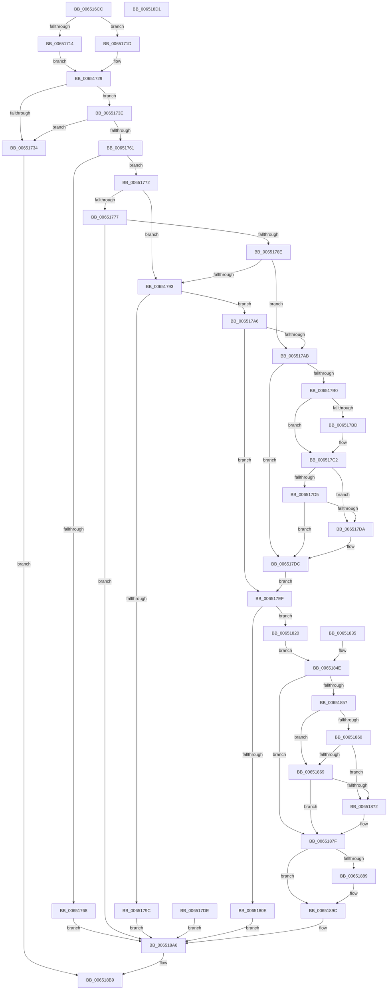

# EtwTraceRaw

- RVA: `0x006516CC`–`0x006518D2` (길이 `518` bytes)
- VA: `0x00000001406516CC`
- 실행 섹션: `.text`
- PDB 이름 있음: `예`; PDB Function 태그: `아니요`
- unwind 정보 RVA: `0x000D39FC`
- 디코드: `137`개 명령, `518/518` bytes 표시
- 미해석 바이트: `0` (있으면 어셈블리에 `.byte`로 보존)

> 이 문서는 커널 이미지의 기계어와 PDB 기호를 분석해 생성했습니다. 4번과 5번은 함수 원형과 자료형을 바이너리 사용 방식에서 추정한 C 해석이며 원본 소스 복구 결과는 아닙니다.

## 1. Dependencies

- 직접 호출 지점: **11**; 고유 호출 대상: **11**
- 직접 호출자로 확인된 함수: **1**
- RIP 상대 이미지 참조: **4**

### Outgoing calls
- `0x0065171D` → [PsGetCurrentServerSiloGlobals](../2F/PsGetCurrentServerSiloGlobals_function_002FE1F0.md) (function, `0x002FE1F0`)
- `0x0065174F` → [EtwpOpenLogger](../2F/EtwpOpenLogger_function_002F77F0.md) (function, `0x002F77F0`)
- `0x0065177F` → [EtwpCheckLoggerControlAccess](../../page/8C/EtwpCheckLoggerControlAccess_function_008C0AE0.md) (function, `0x008C0AE0`)
- `0x006517BD` → [ExRaiseDatatypeMisalignment](../../page/89/ExRaiseDatatypeMisalignment_function_00899FD0.md) (function, `0x00899FD0`)
- `0x00651804` → [EtwpReserveTraceBuffer](../2F/EtwpReserveTraceBuffer_function_002FC8C0.md) (function, `0x002FC8C0`)
- `0x00651814` → [EtwpGetReserveTraceBufferStatus](../44/EtwpGetReserveTraceBufferStatus_function_00446430.md) (function, `0x00446430`)
- `0x0065182E` → [memcpy](../6C/memcpy_function_006C6840.md) (function, `0x006C6840`)
- `0x0065187A` → [EtwpSendTraceEvent](../4B/EtwpSendTraceEvent_function_004B6E10.md) (function, `0x004B6E10`)
- `0x00651897` → [EtwpInvokeEventCallback](../4B/EtwpInvokeEventCallback_function_004B6F0C.md) (function, `0x004B6F0C`)
- `0x006518A1` → [EtwpReleaseTraceBuffer](../3F/EtwpReleaseTraceBuffer_function_003F0D20.md) (function, `0x003F0D20`)
- `0x006518B4` → [EtwpCloseLogger](../41/EtwpCloseLogger_function_00418060.md) (function, `0x00418060`)

### Direct callers
- [sub_006DF40E](../6D/Unknown_function_006DF40E.md) at `0x006DF4F9`

### Static image references
- `0x00651714` → RVA `0x00FC6AA8` (`ALMOSTRO`; read)
- `0x00651857` → RVA `0x00F475DC` (`.data`; read)
- `0x00651860` → RVA `0x00E0AA1C` (`.data`; read)
- `0x00651869` → RVA `0x00F55CB3` (`.data`; read)

## 2. Other-region calls and transfers

- 다른 실행 섹션으로 향하는 call: **2**
  - `0x0065177F` → [EtwpCheckLoggerControlAccess](../../page/8C/EtwpCheckLoggerControlAccess_function_008C0AE0.md) (`.text` → `PAGE`)
  - `0x006517BD` → [ExRaiseDatatypeMisalignment](../../page/89/ExRaiseDatatypeMisalignment_function_00899FD0.md) (`.text` → `PAGE`)
- 별도 외부 분기/꼬리 이동을 확인하지 못했습니다.

## 3. Assembly (complete function range)

```asm
006516CC  4C 8B DC                        mov r11, rsp
006516CF  49 89 5B 18                     mov qword ptr [r11 + 0x18], rbx
006516D3  45 88 4B 20                     mov byte ptr [r11 + 0x20], r9b
006516D7  49 89 53 10                     mov qword ptr [r11 + 0x10], rdx
006516DB  56                              push rsi
006516DC  41 54                           push r12
006516DE  41 55                           push r13
006516E0  41 56                           push r14
006516E2  41 57                           push r15
006516E4  48 83 EC 70                     sub rsp, 0x70
006516E8  45 8A F9                        mov r15b, r9b
006516EB  45 8B E8                        mov r13d, r8d
006516EE  0F 57 C0                        xorps xmm0, xmm0
006516F1  33 C0                           xor eax, eax
006516F3  0F 11 44 24 50                  movups xmmword ptr [rsp + 0x50], xmm0
006516F8  49 89 43 C8                     mov qword ptr [r11 - 0x38], rax
006516FC  41 88 43 08                     mov byte ptr [r11 + 8], al
00651700  33 DB                           xor ebx, ebx
00651702  49 21 43 A8                     and qword ptr [r11 - 0x58], rax
00651706  44 0F B7 E1                     movzx r12d, cx
0065170A  44 89 64 24 30                  mov dword ptr [rsp + 0x30], r12d
0065170F  45 84 C9                        test r9b, r9b
00651712  75 09                           jne 0x14065171d
00651714  4C 8B 35 8D 53 97 00            mov r14, qword ptr [rip + 0x97538d]
0065171B  EB 0C                           jmp 0x140651729
0065171D  E8 CE CA CA FF                  call 0x1402fe1f0
00651722  4C 8B B0 40 03 00 00            mov r14, qword ptr [rax + 0x340]
00651729  4C 89 74 24 38                  mov qword ptr [rsp + 0x38], r14
0065172E  45 3B 66 10                     cmp r12d, dword ptr [r14 + 0x10]
00651732  72 0A                           jb 0x14065173e
00651734  BB 08 00 00 C0                  mov ebx, 0xc0000008
00651739  E9 7B 01 00 00                  jmp 0x1406518b9
0065173E  4C 8D 8C 24 A0 00 00 00         lea r9, [rsp + 0xa0]
00651746  45 8A C7                        mov r8b, r15b
00651749  49 8B D6                        mov rdx, r14
0065174C  41 8B CC                        mov ecx, r12d
0065174F  E8 9C 60 CA FF                  call 0x1402f77f0
00651754  48 8B F0                        mov rsi, rax
00651757  48 89 44 24 48                  mov qword ptr [rsp + 0x48], rax
0065175C  48 85 C0                        test rax, rax
0065175F  74 D3                           je 0x140651734
00651761  8B 40 0C                        mov eax, dword ptr [rax + 0xc]
00651764  84 C0                           test al, al
00651766  79 0A                           jns 0x140651772
00651768  BB 22 00 00 C0                  mov ebx, 0xc0000022
0065176D  E9 34 01 00 00                  jmp 0x1406518a6
00651772  45 84 FF                        test r15b, r15b
00651775  74 1C                           je 0x140651793
00651777  48 8B D6                        mov rdx, rsi
0065177A  B9 00 02 00 00                  mov ecx, 0x200
0065177F  E8 5C F3 26 00                  call 0x1408c0ae0
00651784  8B D8                           mov ebx, eax
00651786  85 C0                           test eax, eax
00651788  0F 88 18 01 00 00               js 0x1406518a6
0065178E  45 84 FF                        test r15b, r15b
00651791  75 18                           jne 0x1406517ab
00651793  F7 46 0C 00 00 00 01            test dword ptr [rsi + 0xc], 0x1000000
0065179A  74 0A                           je 0x1406517a6
0065179C  BB BB 00 00 C0                  mov ebx, 0xc00000bb
006517A1  E9 00 01 00 00                  jmp 0x1406518a6
006517A6  45 84 FF                        test r15b, r15b
006517A9  74 44                           je 0x1406517ef
006517AB  45 85 ED                        test r13d, r13d
006517AE  74 2C                           je 0x1406517dc
006517B0  48 8B 94 24 A8 00 00 00         mov rdx, qword ptr [rsp + 0xa8]
006517B8  F6 C2 03                        test dl, 3
006517BB  74 05                           je 0x1406517c2
006517BD  E8 0E 88 24 00                  call 0x140899fd0
006517C2  4A 8D 0C 2A                     lea rcx, [rdx + r13]
006517C6  48 B8 00 00 FF FF FF 7F 00 00   movabs rax, 0x7fffffff0000
006517D0  48 3B C8                        cmp rcx, rax
006517D3  77 05                           ja 0x1406517da
006517D5  48 3B CA                        cmp rcx, rdx
006517D8  73 02                           jae 0x1406517dc
006517DA  8A 00                           mov al, byte ptr [rax]
006517DC  EB 11                           jmp 0x1406517ef
006517DE  8B D8                           mov ebx, eax
006517E0  44 8B 64 24 30                  mov r12d, dword ptr [rsp + 0x30]
006517E5  4C 8B 74 24 38                  mov r14, qword ptr [rsp + 0x38]
006517EA  E9 B7 00 00 00                  jmp 0x1406518a6
006517EF  83 64 24 20 00                  and dword ptr [rsp + 0x20], 0
006517F4  4C 8D 4C 24 40                  lea r9, [rsp + 0x40]
006517F9  4C 8D 44 24 50                  lea r8, [rsp + 0x50]
006517FE  41 8B D5                        mov edx, r13d
00651801  48 8B CE                        mov rcx, rsi
00651804  E8 B7 B0 CA FF                  call 0x1402fc8c0
00651809  48 85 C0                        test rax, rax
0065180C  75 12                           jne 0x140651820
0065180E  41 8B D5                        mov edx, r13d
00651811  48 8B CE                        mov rcx, rsi
00651814  E8 17 4C DF FF                  call 0x140446430
00651819  8B D8                           mov ebx, eax
0065181B  E9 86 00 00 00                  jmp 0x1406518a6
00651820  4D 8B C5                        mov r8, r13
00651823  48 8B 94 24 A8 00 00 00         mov rdx, qword ptr [rsp + 0xa8]
0065182B  48 8B C8                        mov rcx, rax
0065182E  E8 0D 50 07 00                  call 0x1406c6840
00651833  EB 19                           jmp 0x14065184e
00651835  8B D8                           mov ebx, eax
00651837  44 8A BC 24 B8 00 00 00         mov r15b, byte ptr [rsp + 0xb8]
0065183F  44 8B 64 24 30                  mov r12d, dword ptr [rsp + 0x30]
00651844  48 8B 74 24 48                  mov rsi, qword ptr [rsp + 0x48]
00651849  4C 8B 74 24 38                  mov r14, qword ptr [rsp + 0x38]
0065184E  F7 46 0C 00 00 08 00            test dword ptr [rsi + 0xc], 0x80000
00651855  74 28                           je 0x14065187f
00651857  80 3D 7E 5D 8F 00 00            cmp byte ptr [rip + 0x8f5d7e], 0
0065185E  75 09                           jne 0x140651869
00651860  80 3D B5 91 7B 00 00            cmp byte ptr [rip + 0x7b91b5], 0
00651867  74 09                           je 0x140651872
00651869  80 3D 43 44 90 00 00            cmp byte ptr [rip + 0x904443], 0
00651870  74 0D                           je 0x14065187f
00651872  48 8D 54 24 50                  lea rdx, [rsp + 0x50]
00651877  48 8B CE                        mov rcx, rsi
0065187A  E8 91 55 E6 FF                  call 0x1404b6e10
0065187F  48 83 BE 20 06 00 00 00         cmp qword ptr [rsi + 0x620], 0
00651887  74 13                           je 0x14065189c
00651889  45 8A CF                        mov r9b, r15b
0065188C  45 33 C0                        xor r8d, r8d
0065188F  48 8D 54 24 50                  lea rdx, [rsp + 0x50]
00651894  48 8B CE                        mov rcx, rsi
00651897  E8 70 56 E6 FF                  call 0x1404b6f0c
0065189C  48 8D 4C 24 50                  lea rcx, [rsp + 0x50]
006518A1  E8 7A F4 D9 FF                  call 0x1403f0d20
006518A6  44 8A 84 24 A0 00 00 00         mov r8b, byte ptr [rsp + 0xa0]
006518AE  49 8B D6                        mov rdx, r14
006518B1  41 8B CC                        mov ecx, r12d
006518B4  E8 A7 67 DC FF                  call 0x140418060
006518B9  8B C3                           mov eax, ebx
006518BB  48 8B 9C 24 B0 00 00 00         mov rbx, qword ptr [rsp + 0xb0]
006518C3  48 83 C4 70                     add rsp, 0x70
006518C7  41 5F                           pop r15
006518C9  41 5E                           pop r14
006518CB  41 5D                           pop r13
006518CD  41 5C                           pop r12
006518CF  5E                              pop rsi
006518D0  C3                              ret
006518D1  CC                              int3
```

## 4. C-style interpretation (structured pseudocode)

```c
__int64 __fastcall EtwTraceRaw(unsigned __int16 a1, __int64 a2, int a3, unsigned __int8 a4)
{
    __int64 result;
    __int64 v_rbx;
    __int64 v_rsp;
    unsigned __int64 v_stack_m48;
    unsigned __int64 v_stack_m50;
    unsigned __int64 v_stack_m58;
    unsigned __int64 v_stack_m60;
    unsigned int v_stack_m68;
    unsigned int v_stack_m78;
    unsigned __int64 v_stack_p10;
    unsigned __int64 v_stack_p18;
    unsigned __int8 v_stack_p20;
    unsigned __int64 v_stack_p8;

    *(unsigned __int64 *)(v_rsp + 24) = v_rbx;
    *(unsigned __int8 *)(v_rsp + 32) = a4;
    *(unsigned __int64 *)(v_rsp + 16) = a2;
    v_rsp = (v_rsp) - (112);
    result = 0;
    v_stack_m48 = v_xmm0;
    *(unsigned __int64 *)(v_rsp - 56) = 0;
    *(unsigned __int8 *)(v_rsp + 8) = 0;
    v_rbx = 0;
    v_stack_m68 = a1;
    if (a4 != 0) goto loc_0065171D;
    goto loc_00651729;
loc_0065171D:
    result = PsGetCurrentServerSiloGlobals(a1, a2, a3, a4);
loc_00651729:
    v_stack_m60 = *(unsigned __int64 *)(result + 832);
    if (a1 < (*(unsigned int *)(*(unsigned __int64 *)(result + 832) + 16))) goto loc_0065173E;
loc_00651734:
    goto loc_006518B9;
loc_0065173E:
    result = EtwpOpenLogger((unsigned int)(a1), *(unsigned __int64 *)(result + 832), a4, v_stack_p8);
    v_stack_m50 = result;
    if (result == 0) goto loc_00651734;
    if (!sign_flag) goto loc_00651772;
    goto loc_006518A6;
loc_00651772:
    if (a4 == 0) goto loc_00651793;
    result = EtwpCheckLoggerControlAccess(512, result, a4, v_stack_p8);
    if (sign_flag) goto loc_006518A6;
    if (a4 != 0) goto loc_006517AB;
loc_00651793:
    if (((*(unsigned int *)(result + 12)) & (0x1000000ULL)) == 0) goto loc_006517A6;
    goto loc_006518A6;
loc_006517A6:
    if (a4 == 0) goto loc_006517EF;
loc_006517AB:
    if ((unsigned int)((unsigned int)(a3)) == 0) goto loc_006517DC;
    if ((((unsigned __int8)(v_stack_p10)) & (3)) != 0) {
        result = ExRaiseDatatypeMisalignment(512, v_stack_p10, a4, v_stack_p8);
    }
    if ((v_stack_p10 + (unsigned int)(a3) * 1) > result) goto loc_006517DA;
    if ((v_stack_p10 + (unsigned int)(a3) * 1) < v_stack_p10) {
        result = *(unsigned __int8 *)(result);
    }
    goto loc_006517EF;
loc_006517EF:
    result = EtwpReserveTraceBuffer(result, (unsigned int)((unsigned int)((unsigned int)(a3))), v_stack_m48, v_stack_m58);
    if (result != 0) goto loc_00651820;
    result = EtwpGetReserveTraceBufferStatus(result, (unsigned int)((unsigned int)((unsigned int)(a3))), v_stack_m48, v_stack_m58);
    goto loc_006518A6;
loc_00651820:
    result = memcpy(result, v_stack_p10, (unsigned int)(a3), v_stack_m58);
    goto loc_0065184E;
loc_0065184E:
    if (((*(unsigned int *)(result + 12)) & (0x80000ULL)) == 0) goto loc_0065187F;
    if ((*(unsigned __int8 *)(v_rip + 9395582)) != 0) goto loc_00651869;
    if ((*(unsigned __int8 *)(v_rip + 8098229)) == 0) goto loc_00651872;
loc_00651869:
    if ((*(unsigned __int8 *)(v_rip + 9454659)) != 0) {
        a2 = v_stack_m48;
        a1 = result;
        result = EtwpSendTraceEvent(a1, a2, (unsigned int)(a3), v_stack_m58);
    }
    if ((*(unsigned __int64 *)(result + 1568)) != 0) {
        a4 = a4;
        a3 = 0;
        a2 = v_stack_m48;
        a1 = result;
        result = EtwpInvokeEventCallback(a1, a2, a3, a4);
    }
    result = EtwpReleaseTraceBuffer(v_stack_m48, a2, a3, a4);
loc_006518A6:
    result = EtwpCloseLogger((unsigned int)(a1), *(unsigned __int64 *)(result + 832), v_stack_p8, a4);
loc_006518B9:
    v_rsp = (v_rsp) + (112);
    return (unsigned int)((unsigned int)((unsigned int)((unsigned int)(result))));
}
```

## 5. (Beta) C Style

```c
int64_t EtwTraceRaw(uint16_t Arg1, int64_t Arg2, int32_t Arg3, uint8_t Arg4)
{
    int64_t result;
    int64_t local_rbx;
    int64_t local_rsp;
    uint64_t v_stack_m48;
    uint64_t v_stack_m50;
    uint64_t v_stack_m58;
    uint64_t v_stack_m60;
    uint32_t v_stack_m68;
    uint32_t v_stack_m78;
    uint64_t v_stack_p10;
    uint64_t v_stack_p18;
    uint8_t v_stack_p20;
    uint64_t v_stack_p8;

    *(uint64_t *)(local_rsp + 0x18) = local_rbx;
    *(uint8_t *)(local_rsp + 0x20) = Arg4;
    *(uint64_t *)(local_rsp + 0x10) = Arg2;
    local_rsp = (local_rsp) - (112);
    result = 0;
    v_stack_m48 = v_xmm0;
    *(uint64_t *)(local_rsp - 0x38) = 0;
    *(uint8_t *)(local_rsp + 0x8) = 0;
    local_rbx = 0;
    v_stack_m68 = Arg1;
    if (Arg4 != 0) goto loc_0065171D;
    goto loc_00651729;
loc_0065171D:
    result = PsGetCurrentServerSiloGlobals(Arg1, Arg2, Arg3, Arg4);
loc_00651729:
    v_stack_m60 = *(uint64_t *)(result + 0x340);
    if (Arg1 < (*(uint32_t *)(*(uint64_t *)(result + 0x340) + 0x10))) goto loc_0065173E;
loc_00651734:
    goto loc_006518B9;
loc_0065173E:
    result = EtwpOpenLogger((uint32_t)(Arg1), *(uint64_t *)(result + 0x340), Arg4, v_stack_p8);
    v_stack_m50 = result;
    if (result == 0) goto loc_00651734;
    if (!sign_flag) goto loc_00651772;
    goto loc_006518A6;
loc_00651772:
    if (Arg4 == 0) goto loc_00651793;
    result = EtwpCheckLoggerControlAccess(512, result, Arg4, v_stack_p8);
    if (sign_flag) goto loc_006518A6;
    if (Arg4 != 0) goto loc_006517AB;
loc_00651793:
    if (((*(uint32_t *)(result + 0xC)) & (0x1000000ULL)) == 0) goto loc_006517A6;
    goto loc_006518A6;
loc_006517A6:
    if (Arg4 == 0) goto loc_006517EF;
loc_006517AB:
    if ((uint32_t)((uint32_t)(Arg3)) == 0) goto loc_006517DC;
    if ((((uint8_t)(v_stack_p10)) & (3)) != 0) {
        result = ExRaiseDatatypeMisalignment(512, v_stack_p10, Arg4, v_stack_p8);
    }
    if ((v_stack_p10 + (uint32_t)(Arg3) * 1) > result) goto loc_006517DA;
    if ((v_stack_p10 + (uint32_t)(Arg3) * 1) < v_stack_p10) {
        result = *(uint8_t *)(result);
    }
    goto loc_006517EF;
loc_006517EF:
    result = EtwpReserveTraceBuffer(result, (uint32_t)((uint32_t)((uint32_t)(Arg3))), v_stack_m48, v_stack_m58);
    if (result != 0) goto loc_00651820;
    result = EtwpGetReserveTraceBufferStatus(result, (uint32_t)((uint32_t)((uint32_t)(Arg3))), v_stack_m48, v_stack_m58);
    goto loc_006518A6;
loc_00651820:
    result = memcpy(result, v_stack_p10, (uint32_t)(Arg3), v_stack_m58);
    goto loc_0065184E;
loc_0065184E:
    if (((*(uint32_t *)(result + 0xC)) & (0x80000ULL)) == 0) goto loc_0065187F;
    if ((*(uint8_t *)(v_rip + 0x8F5D7E)) != 0) goto loc_00651869;
    if ((*(uint8_t *)(v_rip + 0x7B91B5)) == 0) goto loc_00651872;
loc_00651869:
    if ((*(uint8_t *)(v_rip + 0x904443)) != 0) {
        Arg2 = v_stack_m48;
        Arg1 = result;
        result = EtwpSendTraceEvent(Arg1, Arg2, (uint32_t)(Arg3), v_stack_m58);
    }
    if ((*(uint64_t *)(result + 0x620)) != 0) {
        Arg4 = Arg4;
        Arg3 = 0;
        Arg2 = v_stack_m48;
        Arg1 = result;
        result = EtwpInvokeEventCallback(Arg1, Arg2, Arg3, Arg4);
    }
    result = EtwpReleaseTraceBuffer(v_stack_m48, Arg2, Arg3, Arg4);
loc_006518A6:
    result = EtwpCloseLogger((uint32_t)(Arg1), *(uint64_t *)(result + 0x340), v_stack_p8, Arg4);
loc_006518B9:
    local_rsp = (local_rsp) + (112);
    return (uint32_t)((uint32_t)((uint32_t)((uint32_t)(result))));
}
```

## 6. Execution-region graph

[열기: 2D/3D 그래프와 함수 탐색 컨트롤 패널](../../../control-panel.html?section=text&rva=0x006516CC&view=graph)

- 2D 그래프는 위에서 아래로 흐르고, 3D 그래프는 빈 공간을 드래그해 회전합니다. Shift+드래그는 이동, 휠은 확대·축소, 함수 노드 선택은 대상 보고서 이동입니다.

### Static fallback


