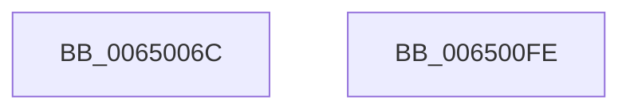

# EtwTraceScbRundown

- RVA: `0x0065006C`–`0x006500FF` (길이 `147` bytes)
- VA: `0x000000014065006C`
- 실행 섹션: `.text`
- PDB 이름 있음: `예`; PDB Function 태그: `아니요`
- unwind 정보 RVA: `0x000BE484`
- 디코드: `34`개 명령, `147/147` bytes 표시
- 미해석 바이트: `0` (있으면 어셈블리에 `.byte`로 보존)

> 이 문서는 커널 이미지의 기계어와 PDB 기호를 분석해 생성했습니다. 4번과 5번은 함수 원형과 자료형을 바이너리 사용 방식에서 추정한 C 해석이며 원본 소스 복구 결과는 아닙니다.

## 1. Dependencies

- 직접 호출 지점: **2**; 고유 호출 대상: **2**
- 직접 호출자로 확인된 함수: **1**
- RIP 상대 이미지 참조: **1**

### Outgoing calls
- `0x006500E7` → [EtwpLogKernelEvent](../25/EtwpLogKernelEvent_function_0025CC00.md) (function, `0x0025CC00`)
- `0x006500F4` → [_security_check_cookie](../6A/_security_check_cookie_function_006AC640.md) (function, `0x006AC640`)

### Direct callers
- [KiLogSingleSchedulingGroupRundown](../5C/KiLogSingleSchedulingGroupRundown_function_005C8B44.md) at `0x005C8B9B`

### Static image references
- `0x00650073` → RVA `0x00E0A740` (`.data`; read)

## 2. Other-region calls and transfers

- 다른 실행 섹션으로 향하는 call: **0**
- 별도 외부 분기/꼬리 이동을 확인하지 못했습니다.

## 3. Assembly (complete function range)

```asm
0065006C  4C 8B DC                        mov r11, rsp
0065006F  48 83 EC 68                     sub rsp, 0x68
00650073  48 8B 05 C6 A6 7B 00            mov rax, qword ptr [rip + 0x7ba6c6]
0065007A  48 33 C4                        xor rax, rsp
0065007D  48 89 44 24 58                  mov qword ptr [rsp + 0x58], rax
00650082  49 83 63 D8 00                  and qword ptr [r11 - 0x28], 0
00650087  44 8B D2                        mov r10d, edx
0065008A  8B 84 24 90 00 00 00            mov eax, dword ptr [rsp + 0x90]
00650091  48 8B D1                        mov rdx, rcx
00650094  0F B6 8C 24 98 00 00 00         movzx ecx, byte ptr [rsp + 0x98]
0065009C  4D 89 43 C8                     mov qword ptr [r11 - 0x38], r8
006500A0  45 8B C2                        mov r8d, r10d
006500A3  45 89 4B D0                     mov dword ptr [r11 - 0x30], r9d
006500A7  41 B9 01 00 00 00               mov r9d, 1
006500AD  89 44 24 3C                     mov dword ptr [rsp + 0x3c], eax
006500B1  41 23 C9                        and ecx, r9d
006500B4  33 C0                           xor eax, eax
006500B6  C7 44 24 28 02 01 60 00         mov dword ptr [rsp + 0x28], 0x600102
006500BE  83 E0 FE                        and eax, 0xfffffffe
006500C1  66 C7 44 24 20 66 05            mov word ptr [rsp + 0x20], 0x566
006500C8  0B C8                           or ecx, eax
006500CA  49 8D 43 C8                     lea rax, [r11 - 0x38]
006500CE  49 89 43 E0                     mov qword ptr [r11 - 0x20], rax
006500D2  83 64 24 54 00                  and dword ptr [rsp + 0x54], 0
006500D7  89 4C 24 40                     mov dword ptr [rsp + 0x40], ecx
006500DB  49 8D 4B E0                     lea rcx, [r11 - 0x20]
006500DF  C7 44 24 50 18 00 00 00         mov dword ptr [rsp + 0x50], 0x18
006500E7  E8 14 CB C0 FF                  call 0x14025cc00
006500EC  48 8B 4C 24 58                  mov rcx, qword ptr [rsp + 0x58]
006500F1  48 33 CC                        xor rcx, rsp
006500F4  E8 47 C5 05 00                  call 0x1406ac640
006500F9  48 83 C4 68                     add rsp, 0x68
006500FD  C3                              ret
006500FE  CC                              int3
```

## 4. C-style interpretation (structured pseudocode)

```c
__int64 __fastcall EtwTraceScbRundown(__int64 a1, int a2, __int64 a3, int a4, unsigned int a5, unsigned __int8 a6)
{
    __int64 result;
    __int64 v_rsp;
    unsigned __int64 v_stack_m10;
    unsigned int v_stack_m14;
    unsigned int v_stack_m18;
    unsigned int v_stack_m28;
    unsigned int v_stack_m2C;
    unsigned int v_stack_m40;
    unsigned __int16 v_stack_m48;

    v_rsp = (v_rsp) - (104);
    result = (*(unsigned __int64 *)(v_rip + 8103622)) ^ (v_rsp);
    v_stack_m10 = result;
    *(unsigned __int64 *)(v_rsp - 56) = a3;
    *(unsigned int *)(v_rsp - 48) = a4;
    v_stack_m2C = (unsigned int)((unsigned int)(a5));
    a1 = (unsigned int)((a6) & (1));
    result = 0;
    v_stack_m40 = 0x600102ULL;
    result = (unsigned int)((result) & (0xFFFFFFFEULL));
    v_stack_m48 = 0x566ULL;
    a1 = (unsigned int)((a1) | ((unsigned int)(result)));
    *(unsigned __int64 *)(v_rsp - 32) = v_rsp - 56;
    v_stack_m28 = (unsigned int)(a1);
    v_stack_m18 = 24;
    result = EtwpLogKernelEvent(v_rsp - 32, a1, (unsigned int)((unsigned int)((unsigned int)(a2))), 1);
    a1 = (v_stack_m10) ^ (v_rsp);
    result = _security_check_cookie(a1, a1, (unsigned int)((unsigned int)((unsigned int)(a2))), 1);
    v_rsp = (v_rsp) + (104);
    return result;
}
```

## 5. (Beta) C Style

```c
int64_t EtwTraceScbRundown(int64_t Arg1, int32_t Arg2, int64_t Arg3, int32_t Arg4, uint32_t Arg5, uint8_t Arg6)
{
    int64_t result;
    int64_t local_rsp;
    uint64_t v_stack_m10;
    uint32_t v_stack_m14;
    uint32_t v_stack_m18;
    uint32_t v_stack_m28;
    uint32_t v_stack_m2C;
    uint32_t v_stack_m40;
    uint16_t v_stack_m48;

    local_rsp = (local_rsp) - (104);
    result = (*(uint64_t *)(v_rip + 0x7BA6C6)) ^ (local_rsp);
    v_stack_m10 = result;
    *(uint64_t *)(local_rsp - 0x38) = Arg3;
    *(uint32_t *)(local_rsp - 0x30) = Arg4;
    v_stack_m2C = (uint32_t)((uint32_t)(Arg5));
    Arg1 = (uint32_t)((Arg6) & (1));
    result = 0;
    v_stack_m40 = 0x600102ULL;
    result = (uint32_t)((result) & (0xFFFFFFFEULL));
    v_stack_m48 = 0x566ULL;
    Arg1 = (uint32_t)((Arg1) | ((uint32_t)(result)));
    *(uint64_t *)(local_rsp - 0x20) = local_rsp - 56;
    v_stack_m28 = (uint32_t)(Arg1);
    v_stack_m18 = 24;
    result = EtwpLogKernelEvent(local_rsp - 32, Arg1, (uint32_t)((uint32_t)((uint32_t)(Arg2))), 1);
    Arg1 = (v_stack_m10) ^ (local_rsp);
    result = _security_check_cookie(Arg1, Arg1, (uint32_t)((uint32_t)((uint32_t)(Arg2))), 1);
    local_rsp = (local_rsp) + (104);
    return result;
}
```

## 6. Execution-region graph

[열기: 2D/3D 그래프와 함수 탐색 컨트롤 패널](../../../control-panel.html?section=text&rva=0x0065006C&view=graph)

- 2D 그래프는 위에서 아래로 흐르고, 3D 그래프는 빈 공간을 드래그해 회전합니다. Shift+드래그는 이동, 휠은 확대·축소, 함수 노드 선택은 대상 보고서 이동입니다.

### Static fallback


