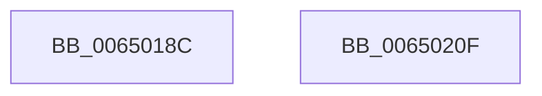

# EtwTraceSchedulingGroupRundown

- RVA: `0x0065018C`–`0x00650210` (길이 `132` bytes)
- VA: `0x000000014065018C`
- 실행 섹션: `.text`
- PDB 이름 있음: `예`; PDB Function 태그: `아니요`
- unwind 정보 RVA: `0x00080A9C`
- 디코드: `30`개 명령, `132/132` bytes 표시
- 미해석 바이트: `0` (있으면 어셈블리에 `.byte`로 보존)

> 이 문서는 커널 이미지의 기계어와 PDB 기호를 분석해 생성했습니다. 4번과 5번은 함수 원형과 자료형을 바이너리 사용 방식에서 추정한 C 해석이며 원본 소스 복구 결과는 아닙니다.

## 1. Dependencies

- 직접 호출 지점: **3**; 고유 호출 대상: **3**
- 직접 호출자로 확인된 함수: **1**
- RIP 상대 이미지 참조: **1**

### Outgoing calls
- `0x006501BC` → [EtwpConstructSchedulingGroupEvent](EtwpConstructSchedulingGroupEvent_function_006508D8.md) (function, `0x006508D8`)
- `0x006501F8` → [EtwpLogKernelEvent](../25/EtwpLogKernelEvent_function_0025CC00.md) (function, `0x0025CC00`)
- `0x00650205` → [_security_check_cookie](../6A/_security_check_cookie_function_006AC640.md) (function, `0x006AC640`)

### Direct callers
- [KiLogSingleSchedulingGroupRundown](../5C/KiLogSingleSchedulingGroupRundown_function_005C8B44.md) at `0x005C8B64`

### Static image references
- `0x00650190` → RVA `0x00E0A740` (`.data`; read)

## 2. Other-region calls and transfers

- 다른 실행 섹션으로 향하는 call: **0**
- 별도 외부 분기/꼬리 이동을 확인하지 못했습니다.

## 3. Assembly (complete function range)

```asm
0065018C  48 83 EC 68                     sub rsp, 0x68
00650190  48 8B 05 A9 A5 7B 00            mov rax, qword ptr [rip + 0x7ba5a9]
00650197  48 33 C4                        xor rax, rsp
0065019A  48 89 44 24 58                  mov qword ptr [rsp + 0x58], rax
0065019F  44 8B DA                        mov r11d, edx
006501A2  4C 8B D1                        mov r10, rcx
006501A5  33 C0                           xor eax, eax
006501A7  48 8D 4C 24 30                  lea rcx, [rsp + 0x30]
006501AC  0F 57 C0                        xorps xmm0, xmm0
006501AF  48 89 44 24 40                  mov qword ptr [rsp + 0x40], rax
006501B4  49 8B D0                        mov rdx, r8
006501B7  0F 11 44 24 30                  movups xmmword ptr [rsp + 0x30], xmm0
006501BC  E8 17 07 00 00                  call 0x1406508d8
006501C1  83 64 24 54 00                  and dword ptr [rsp + 0x54], 0
006501C6  48 8D 44 24 30                  lea rax, [rsp + 0x30]
006501CB  C7 44 24 28 02 01 60 00         mov dword ptr [rsp + 0x28], 0x600102
006501D3  48 8D 4C 24 48                  lea rcx, [rsp + 0x48]
006501D8  41 B9 01 00 00 00               mov r9d, 1
006501DE  48 89 44 24 48                  mov qword ptr [rsp + 0x48], rax
006501E3  45 8B C3                        mov r8d, r11d
006501E6  C7 44 24 50 18 00 00 00         mov dword ptr [rsp + 0x50], 0x18
006501EE  49 8B D2                        mov rdx, r10
006501F1  66 C7 44 24 20 65 05            mov word ptr [rsp + 0x20], 0x565
006501F8  E8 03 CA C0 FF                  call 0x14025cc00
006501FD  48 8B 4C 24 58                  mov rcx, qword ptr [rsp + 0x58]
00650202  48 33 CC                        xor rcx, rsp
00650205  E8 36 C4 05 00                  call 0x1406ac640
0065020A  48 83 C4 68                     add rsp, 0x68
0065020E  C3                              ret
0065020F  CC                              int3
```

## 4. C-style interpretation (structured pseudocode)

```c
__int64 __fastcall EtwTraceSchedulingGroupRundown(__int64 a1, int a2, __int64 a3)
{
    __int64 result;
    __int64 v_rsp;
    unsigned __int64 v_stack_m10;
    unsigned int v_stack_m14;
    unsigned int v_stack_m18;
    unsigned __int64 v_stack_m20;
    unsigned __int64 v_stack_m28;
    unsigned __int64 v_stack_m38;
    unsigned int v_stack_m40;
    unsigned __int16 v_stack_m48;

    v_rsp = (v_rsp) - (104);
    result = (*(unsigned __int64 *)(v_rip + 8103337)) ^ (v_rsp);
    v_stack_m10 = result;
    result = 0;
    v_stack_m28 = 0;
    v_stack_m38 = v_xmm0;
    result = EtwpConstructSchedulingGroupEvent(v_stack_m38, a3, a3, a4);
    v_stack_m40 = 0x600102ULL;
    v_stack_m20 = v_stack_m38;
    v_stack_m18 = 24;
    v_stack_m48 = 0x565ULL;
    result = EtwpLogKernelEvent(v_stack_m20, a1, (unsigned int)((unsigned int)((unsigned int)(a2))), 1);
    a1 = (v_stack_m10) ^ (v_rsp);
    result = _security_check_cookie(a1, a1, (unsigned int)((unsigned int)((unsigned int)(a2))), 1);
    v_rsp = (v_rsp) + (104);
    return result;
}
```

## 5. (Beta) C Style

```c
int64_t EtwTraceSchedulingGroupRundown(int64_t Arg1, int32_t Arg2, int64_t Arg3)
{
    int64_t result;
    int64_t local_rsp;
    uint64_t v_stack_m10;
    uint32_t v_stack_m14;
    uint32_t v_stack_m18;
    uint64_t v_stack_m20;
    uint64_t v_stack_m28;
    uint64_t v_stack_m38;
    uint32_t v_stack_m40;
    uint16_t v_stack_m48;

    local_rsp = (local_rsp) - (104);
    result = (*(uint64_t *)(v_rip + 0x7BA5A9)) ^ (local_rsp);
    v_stack_m10 = result;
    result = 0;
    v_stack_m28 = 0;
    v_stack_m38 = v_xmm0;
    result = EtwpConstructSchedulingGroupEvent(v_stack_m38, Arg3, Arg3, a4);
    v_stack_m40 = 0x600102ULL;
    v_stack_m20 = v_stack_m38;
    v_stack_m18 = 24;
    v_stack_m48 = 0x565ULL;
    result = EtwpLogKernelEvent(v_stack_m20, Arg1, (uint32_t)((uint32_t)((uint32_t)(Arg2))), 1);
    Arg1 = (v_stack_m10) ^ (local_rsp);
    result = _security_check_cookie(Arg1, Arg1, (uint32_t)((uint32_t)((uint32_t)(Arg2))), 1);
    local_rsp = (local_rsp) + (104);
    return result;
}
```

## 6. Execution-region graph

[열기: 2D/3D 그래프와 함수 탐색 컨트롤 패널](../../../control-panel.html?section=text&rva=0x0065018C&view=graph)

- 2D 그래프는 위에서 아래로 흐르고, 3D 그래프는 빈 공간을 드래그해 회전합니다. Shift+드래그는 이동, 휠은 확대·축소, 함수 노드 선택은 대상 보고서 이동입니다.

### Static fallback


