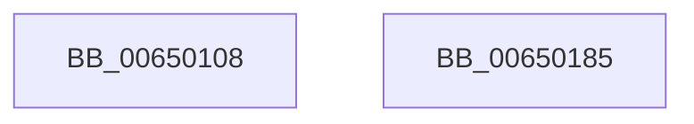

# EtwTraceSchedulingGroup

- RVA: `0x00650108`–`0x00650186` (길이 `126` bytes)
- VA: `0x0000000140650108`
- 실행 섹션: `.text`
- PDB 이름 있음: `예`; PDB Function 태그: `아니요`
- unwind 정보 RVA: `0x00080A9C`
- 디코드: `28`개 명령, `126/126` bytes 표시
- 미해석 바이트: `0` (있으면 어셈블리에 `.byte`로 보존)

> 이 문서는 커널 이미지의 기계어와 PDB 기호를 분석해 생성했습니다. 4번과 5번은 함수 원형과 자료형을 바이너리 사용 방식에서 추정한 C 해석이며 원본 소스 복구 결과는 아닙니다.

## 1. Dependencies

- 직접 호출 지점: **3**; 고유 호출 대상: **3**
- 직접 호출자로 확인된 함수: **5**
- RIP 상대 이미지 참조: **1**

### Outgoing calls
- `0x00650136` → [EtwpConstructSchedulingGroupEvent](EtwpConstructSchedulingGroupEvent_function_006508D8.md) (function, `0x006508D8`)
- `0x0065016E` → [EtwTraceKernelEvent](../23/EtwTraceKernelEvent_function_00235350.md) (function, `0x00235350`)
- `0x0065017B` → [_security_check_cookie](../6A/_security_check_cookie_function_006AC640.md) (function, `0x006AC640`)

### Direct callers
- [KeSetSchedulingGroupWeights](../46/KeSetSchedulingGroupWeights_function_0046D024.md) at `0x0046D231`
- [KeInsertSchedulingGroup](../46/KeInsertSchedulingGroup_function_0046D324.md) at `0x0046D6FA`
- [KeSetSchedulingGroupRankBias](../46/KeSetSchedulingGroupRankBias_function_0046DB74.md) at `0x0046DD81`
- [KeSetSchedulingGroupCpuRates](../46/KeSetSchedulingGroupCpuRates_function_0046DE5C.md) at `0x0046E0CD`
- [KeRemoveSchedulingGroup](../4A/KeRemoveSchedulingGroup_function_004AD328.md) at `0x004AD57A`

### Static image references
- `0x0065010C` → RVA `0x00E0A740` (`.data`; read)

## 2. Other-region calls and transfers

- 다른 실행 섹션으로 향하는 call: **0**
- 별도 외부 분기/꼬리 이동을 확인하지 못했습니다.

## 3. Assembly (complete function range)

```asm
00650108  48 83 EC 68                     sub rsp, 0x68
0065010C  48 8B 05 2D A6 7B 00            mov rax, qword ptr [rip + 0x7ba62d]
00650113  48 33 C4                        xor rax, rsp
00650116  48 89 44 24 58                  mov qword ptr [rsp + 0x58], rax
0065011B  44 0F B7 D2                     movzx r10d, dx
0065011F  33 C0                           xor eax, eax
00650121  48 8B D1                        mov rdx, rcx
00650124  48 89 44 24 50                  mov qword ptr [rsp + 0x50], rax
00650129  0F 57 C0                        xorps xmm0, xmm0
0065012C  48 8D 4C 24 40                  lea rcx, [rsp + 0x40]
00650131  0F 11 44 24 40                  movups xmmword ptr [rsp + 0x40], xmm0
00650136  E8 9D 07 00 00                  call 0x1406508d8
0065013B  83 64 24 3C 00                  and dword ptr [rsp + 0x3c], 0
00650140  4C 8D 5C 24 40                  lea r11, [rsp + 0x40]
00650145  45 0F B7 CA                     movzx r9d, r10w
00650149  4C 89 5C 24 30                  mov qword ptr [rsp + 0x30], r11
0065014E  BA 01 00 00 00                  mov edx, 1
00650153  C7 44 24 38 18 00 00 00         mov dword ptr [rsp + 0x38], 0x18
0065015B  41 B8 00 40 00 A0               mov r8d, 0xa0004000
00650161  C7 44 24 20 02 19 60 00         mov dword ptr [rsp + 0x20], 0x601902
00650169  48 8D 4C 24 30                  lea rcx, [rsp + 0x30]
0065016E  E8 DD 51 BE FF                  call 0x140235350
00650173  48 8B 4C 24 58                  mov rcx, qword ptr [rsp + 0x58]
00650178  48 33 CC                        xor rcx, rsp
0065017B  E8 C0 C4 05 00                  call 0x1406ac640
00650180  48 83 C4 68                     add rsp, 0x68
00650184  C3                              ret
00650185  CC                              int3
```

## 4. C-style interpretation (structured pseudocode)

```c
__int64 __fastcall EtwTraceSchedulingGroup(__int64 a1, unsigned __int16 a2)
{
    __int64 result;
    __int64 v_rsp;
    unsigned __int64 v_stack_m10;
    unsigned __int64 v_stack_m18;
    unsigned __int64 v_stack_m28;
    unsigned int v_stack_m2C;
    unsigned int v_stack_m30;
    unsigned __int64 v_stack_m38;
    unsigned int v_stack_m48;

    v_rsp = (v_rsp) - (104);
    result = (*(unsigned __int64 *)(v_rip + 8103469)) ^ (v_rsp);
    v_stack_m10 = result;
    result = 0;
    v_stack_m18 = 0;
    v_stack_m28 = v_xmm0;
    result = EtwpConstructSchedulingGroupEvent(v_stack_m28, a1, a3, a4);
    v_stack_m38 = v_stack_m28;
    v_stack_m30 = 24;
    v_stack_m48 = 0x601902ULL;
    result = EtwTraceKernelEvent(v_stack_m38, 1, (unsigned int)(0xA0004000ULL), a2);
    a1 = (v_stack_m10) ^ (v_rsp);
    result = _security_check_cookie(a1, 1, (unsigned int)(0xA0004000ULL), a2);
    v_rsp = (v_rsp) + (104);
    return result;
}
```

## 5. (Beta) C Style

```c
int64_t EtwTraceSchedulingGroup(int64_t Arg1, uint16_t Arg2)
{
    int64_t result;
    int64_t local_rsp;
    uint64_t v_stack_m10;
    uint64_t v_stack_m18;
    uint64_t v_stack_m28;
    uint32_t v_stack_m2C;
    uint32_t v_stack_m30;
    uint64_t v_stack_m38;
    uint32_t v_stack_m48;

    local_rsp = (local_rsp) - (104);
    result = (*(uint64_t *)(v_rip + 0x7BA62D)) ^ (local_rsp);
    v_stack_m10 = result;
    result = 0;
    v_stack_m18 = 0;
    v_stack_m28 = v_xmm0;
    result = EtwpConstructSchedulingGroupEvent(v_stack_m28, Arg1, a3, a4);
    v_stack_m38 = v_stack_m28;
    v_stack_m30 = 24;
    v_stack_m48 = 0x601902ULL;
    result = EtwTraceKernelEvent(v_stack_m38, 1, (uint32_t)(0xA0004000ULL), Arg2);
    Arg1 = (v_stack_m10) ^ (local_rsp);
    result = _security_check_cookie(Arg1, 1, (uint32_t)(0xA0004000ULL), Arg2);
    local_rsp = (local_rsp) + (104);
    return result;
}
```

## 6. Execution-region graph

[열기: 2D/3D 그래프와 함수 탐색 컨트롤 패널](../../../control-panel.html?section=text&rva=0x00650108&view=graph)

- 2D 그래프는 위에서 아래로 흐르고, 3D 그래프는 빈 공간을 드래그해 회전합니다. Shift+드래그는 이동, 휠은 확대·축소, 함수 노드 선택은 대상 보고서 이동입니다.

### Static fallback


