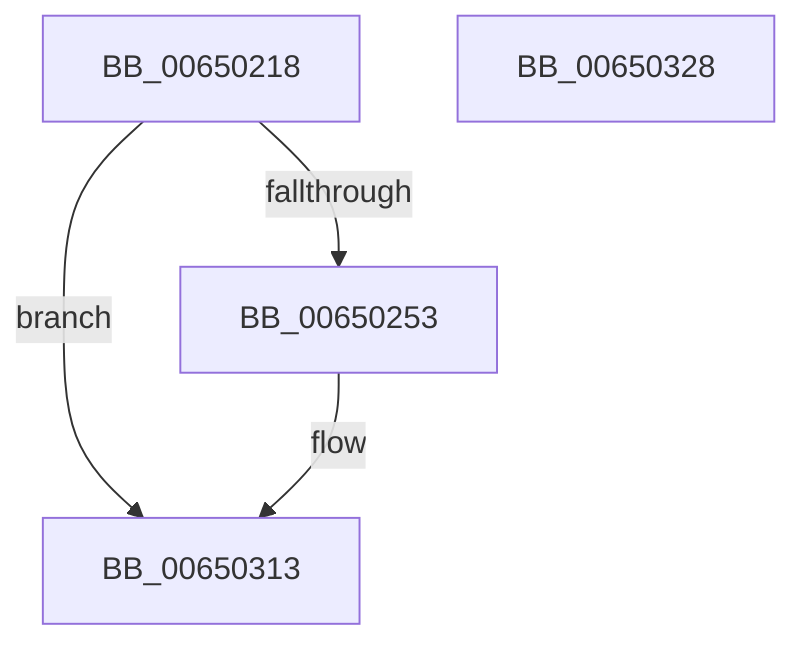

# EtwTraceSingleDpcSoftTimeout

- RVA: `0x00650218`–`0x00650329` (길이 `273` bytes)
- VA: `0x0000000140650218`
- 실행 섹션: `.text`
- PDB 이름 있음: `예`; PDB Function 태그: `아니요`
- unwind 정보 RVA: `0x000B4E9C`
- 디코드: `60`개 명령, `273/273` bytes 표시
- 미해석 바이트: `0` (있으면 어셈블리에 `.byte`로 보존)

> 이 문서는 커널 이미지의 기계어와 PDB 기호를 분석해 생성했습니다. 4번과 5번은 함수 원형과 자료형을 바이너리 사용 방식에서 추정한 C 해석이며 원본 소스 복구 결과는 아닙니다.

## 1. Dependencies

- 직접 호출 지점: **2**; 고유 호출 대상: **2**
- 직접 호출자로 확인된 함수: **1**
- RIP 상대 이미지 참조: **3**

### Outgoing calls
- `0x0065030E` → [EtwWriteEx](../25/EtwWriteEx_function_0025F0D0.md) (function, `0x0025F0D0`)
- `0x0065031A` → [_security_check_cookie](../6A/_security_check_cookie_function_006AC640.md) (function, `0x006AC640`)

### Direct callers
- [KiLogSingleDpcSoftTimeoutEvent](../5B/KiLogSingleDpcSoftTimeoutEvent_function_005B5D50.md) at `0x005B5DF1`

### Static image references
- `0x0065022F` → RVA `0x00E0A740` (`.data`; read)
- `0x00650243` → RVA `0x00EFF830` (`.data`; read)
- `0x006502C4` → RVA `0x00021260` (`.rdata`; read)

## 2. Other-region calls and transfers

- 다른 실행 섹션으로 향하는 call: **0**
- 별도 외부 분기/꼬리 이동을 확인하지 못했습니다.

## 3. Assembly (complete function range)

```asm
00650218  44 89 4C 24 20                  mov dword ptr [rsp + 0x20], r9d
0065021D  48 89 54 24 10                  mov qword ptr [rsp + 0x10], rdx
00650222  55                              push rbp
00650223  48 8D 6C 24 B9                  lea rbp, [rsp - 0x47]
00650228  48 81 EC D0 00 00 00            sub rsp, 0xd0
0065022F  48 8B 05 0A A5 7B 00            mov rax, qword ptr [rip + 0x7ba50a]
00650236  48 33 C4                        xor rax, rsp
00650239  48 89 45 37                     mov qword ptr [rbp + 0x37], rax
0065023D  48 8B D1                        mov rdx, rcx
00650240  45 33 D2                        xor r10d, r10d
00650243  48 8B 0D E6 F5 8A 00            mov rcx, qword ptr [rip + 0x8af5e6]
0065024A  48 85 C9                        test rcx, rcx
0065024D  0F 84 C0 00 00 00               je 0x140650313
00650253  41 8B 40 24                     mov eax, dword ptr [r8 + 0x24]
00650257  45 33 C9                        xor r9d, r9d
0065025A  89 45 BF                        mov dword ptr [rbp - 0x41], eax
0065025D  8B 82 10 05 00 00               mov eax, dword ptr [rdx + 0x510]
00650263  48 8B 55 7F                     mov rdx, qword ptr [rbp + 0x7f]
00650267  89 45 BB                        mov dword ptr [rbp - 0x45], eax
0065026A  48 C7 45 CF 08 00 00 00         mov qword ptr [rbp - 0x31], 8
00650272  48 C7 45 DF 04 00 00 00         mov qword ptr [rbp - 0x21], 4
0065027A  44 0F B7 02                     movzx r8d, word ptr [rdx]
0065027E  41 0F B7 C0                     movzx eax, r8w
00650282  44 89 45 2F                     mov dword ptr [rbp + 0x2f], r8d
00650286  66 D1 E8                        shr ax, 1
00650289  45 33 C0                        xor r8d, r8d
0065028C  66 89 45 B7                     mov word ptr [rbp - 0x49], ax
00650290  48 8D 45 5F                     lea rax, [rbp + 0x5f]
00650294  48 89 45 C7                     mov qword ptr [rbp - 0x39], rax
00650298  48 8D 45 BB                     lea rax, [rbp - 0x45]
0065029C  48 89 45 D7                     mov qword ptr [rbp - 0x29], rax
006502A0  48 8D 45 BF                     lea rax, [rbp - 0x41]
006502A4  48 89 45 E7                     mov qword ptr [rbp - 0x19], rax
006502A8  48 8D 45 6F                     lea rax, [rbp + 0x6f]
006502AC  48 89 45 F7                     mov qword ptr [rbp - 9], rax
006502B0  48 8D 45 77                     lea rax, [rbp + 0x77]
006502B4  48 89 45 07                     mov qword ptr [rbp + 7], rax
006502B8  48 8D 45 B7                     lea rax, [rbp - 0x49]
006502BC  48 89 45 17                     mov qword ptr [rbp + 0x17], rax
006502C0  48 8B 42 08                     mov rax, qword ptr [rdx + 8]
006502C4  48 8D 15 95 0F 9D FF            lea rdx, [rip - 0x62f06b]
006502CB  48 89 45 27                     mov qword ptr [rbp + 0x27], rax
006502CF  48 8D 45 C7                     lea rax, [rbp - 0x39]
006502D3  48 89 44 24 38                  mov qword ptr [rsp + 0x38], rax
006502D8  C7 44 24 30 07 00 00 00         mov dword ptr [rsp + 0x30], 7
006502E0  4C 89 54 24 28                  mov qword ptr [rsp + 0x28], r10
006502E5  4C 89 54 24 20                  mov qword ptr [rsp + 0x20], r10
006502EA  48 C7 45 EF 04 00 00 00         mov qword ptr [rbp - 0x11], 4
006502F2  48 C7 45 FF 04 00 00 00         mov qword ptr [rbp - 1], 4
006502FA  48 C7 45 0F 04 00 00 00         mov qword ptr [rbp + 0xf], 4
00650302  48 C7 45 1F 02 00 00 00         mov qword ptr [rbp + 0x1f], 2
0065030A  44 89 55 33                     mov dword ptr [rbp + 0x33], r10d
0065030E  E8 BD ED C0 FF                  call 0x14025f0d0
00650313  48 8B 4D 37                     mov rcx, qword ptr [rbp + 0x37]
00650317  48 33 CC                        xor rcx, rsp
0065031A  E8 21 C3 05 00                  call 0x1406ac640
0065031F  48 81 C4 D0 00 00 00            add rsp, 0xd0
00650326  5D                              pop rbp
00650327  C3                              ret
00650328  CC                              int3
```

## 4. C-style interpretation (structured pseudocode)

```c
__int64 __fastcall EtwTraceSingleDpcSoftTimeout(__int64 a1, __int64 a2, __int64 a3, int a4, __int64 a5, __int64 a6)
{
    __int64 result;
    __int64 v_r10;
    __int64 v_rsp;
    unsigned __int64 v_stack_m18;
    unsigned int v_stack_m1C;
    unsigned int v_stack_m20;
    unsigned __int64 v_stack_m28;
    unsigned __int64 v_stack_m30;
    unsigned __int64 v_stack_m38;
    unsigned __int64 v_stack_m40;
    unsigned __int64 v_stack_m48;
    unsigned __int64 v_stack_m4F;
    unsigned __int64 v_stack_m50;
    unsigned __int64 v_stack_m58;
    unsigned __int64 v_stack_m60;
    unsigned __int64 v_stack_m68;
    unsigned __int64 v_stack_m70;
    unsigned __int64 v_stack_m78;
    unsigned __int64 v_stack_m80;
    unsigned __int64 v_stack_m88;
    unsigned int v_stack_m90;
    unsigned int v_stack_m94;
    unsigned __int16 v_stack_m98;
    unsigned __int64 v_stack_mA0;
    unsigned int v_stack_mA8;
    unsigned __int64 v_stack_mB0;
    unsigned __int64 v_stack_mB8;
    unsigned __int64 v_stack_p10;
    unsigned int v_stack_p20;

    v_stack_p20 = a4;
    v_stack_p10 = a2;
    v_rsp = (v_rsp) - (208);
    result = (*(unsigned __int64 *)(v_rip + 8103178)) ^ (v_rsp);
    v_stack_m18 = result;
    v_r10 = 0;
    if (*(unsigned __int64 *)(v_rip + 9106918) != 0) {
        result = *(unsigned int *)(a3 + 36);
        a4 = 0;
        v_stack_m90 = (unsigned int)(result);
        result = *(unsigned int *)(a1 + 1296);
        a2 = a6;
        v_stack_m94 = (unsigned int)(result);
        v_stack_m80 = 8;
        v_stack_m70 = 4;
        a3 = *(unsigned __int16 *)(a2);
        result = (unsigned __int16)(a3);
        v_stack_m20 = (unsigned int)(a3);
        result = (unsigned __int16)((result) >> (1));
        a3 = 0;
        v_stack_m98 = (unsigned __int16)(result);
        result = v_stack_p10;
        v_stack_m88 = result;
        result = v_stack_m94;
        v_stack_m78 = result;
        result = v_stack_m90;
        v_stack_m68 = result;
        result = v_stack_p20;
        v_stack_m58 = result;
        result = a5;
        v_stack_m48 = result;
        result = v_stack_m98;
        v_stack_m38 = result;
        result = *(unsigned __int64 *)(a2 + 8);
        a2 = v_rip - 6484075;
        v_stack_m28 = result;
        result = v_stack_m88;
        v_stack_mA0 = result;
        v_stack_mA8 = 7;
        v_stack_mB0 = 0;
        v_stack_mB8 = 0;
        v_stack_m60 = 4;
        v_stack_m50 = 4;
        v_stack_m40 = 4;
        v_stack_m30 = 2;
        v_stack_m1C = 0;
        result = EtwWriteEx(*(unsigned __int64 *)(v_rip + 9106918), a2, a3, a4);
    }
    a1 = (v_stack_m18) ^ (v_rsp);
    result = _security_check_cookie(a1, a2, a3, a4);
    v_rsp = (v_rsp) + (208);
    return result;
}
```

## 5. (Beta) C Style

```c
int64_t EtwTraceSingleDpcSoftTimeout(void *Arg1, int64_t Arg2, void *Arg3, int32_t Arg4, int64_t Arg5, void *Arg6)
{
    uint8_t *arg1 = (uint8_t *)Arg1;
    uint8_t *arg3 = (uint8_t *)Arg3;
    uint8_t *arg6 = (uint8_t *)Arg6;

    int64_t result;
    int64_t local_r10;
    int64_t local_rsp;
    uint64_t v_stack_m18;
    uint32_t v_stack_m1C;
    uint32_t v_stack_m20;
    uint64_t v_stack_m28;
    uint64_t v_stack_m30;
    uint64_t v_stack_m38;
    uint64_t v_stack_m40;
    uint64_t v_stack_m48;
    uint64_t v_stack_m4F;
    uint64_t v_stack_m50;
    uint64_t v_stack_m58;
    uint64_t v_stack_m60;
    uint64_t v_stack_m68;
    uint64_t v_stack_m70;
    uint64_t v_stack_m78;
    uint64_t v_stack_m80;
    uint64_t v_stack_m88;
    uint32_t v_stack_m90;
    uint32_t v_stack_m94;
    uint16_t v_stack_m98;
    uint64_t v_stack_mA0;
    uint32_t v_stack_mA8;
    uint64_t v_stack_mB0;
    uint64_t v_stack_mB8;
    uint64_t v_stack_p10;
    uint32_t v_stack_p20;

    v_stack_p20 = Arg4;
    v_stack_p10 = Arg2;
    local_rsp = (local_rsp) - (208);
    result = (*(uint64_t *)(v_rip + 0x7BA50A)) ^ (local_rsp);
    v_stack_m18 = result;
    local_r10 = 0;
    if (*(uint64_t *)(v_rip + 0x8AF5E6) != 0) {
        result = *(uint32_t *)(arg3 + 0x24);
        Arg4 = 0;
        v_stack_m90 = (uint32_t)(result);
        result = *(uint32_t *)(arg1 + 0x510);
        Arg2 = Arg6;
        v_stack_m94 = (uint32_t)(result);
        v_stack_m80 = 8;
        v_stack_m70 = 4;
        Arg3 = *(uint16_t *)(Arg2);
        result = (uint16_t)(Arg3);
        v_stack_m20 = (uint32_t)(Arg3);
        result = (uint16_t)((result) >> (1));
        Arg3 = 0;
        v_stack_m98 = (uint16_t)(result);
        result = v_stack_p10;
        v_stack_m88 = result;
        result = v_stack_m94;
        v_stack_m78 = result;
        result = v_stack_m90;
        v_stack_m68 = result;
        result = v_stack_p20;
        v_stack_m58 = result;
        result = Arg5;
        v_stack_m48 = result;
        result = v_stack_m98;
        v_stack_m38 = result;
        result = *(uint64_t *)(Arg2 + 0x8);
        Arg2 = v_rip - 6484075;
        v_stack_m28 = result;
        result = v_stack_m88;
        v_stack_mA0 = result;
        v_stack_mA8 = 7;
        v_stack_mB0 = 0;
        v_stack_mB8 = 0;
        v_stack_m60 = 4;
        v_stack_m50 = 4;
        v_stack_m40 = 4;
        v_stack_m30 = 2;
        v_stack_m1C = 0;
        result = EtwWriteEx(*(uint64_t *)(v_rip + 0x8AF5E6), Arg2, Arg3, Arg4);
    }
    Arg1 = (v_stack_m18) ^ (local_rsp);
    result = _security_check_cookie(Arg1, Arg2, Arg3, Arg4);
    local_rsp = (local_rsp) + (208);
    return result;
}
```

### 관측된 메모리 오프셋

구조체 형식이 확인되지 않은 접근은 인자 기준의 오프셋으로만 기록했습니다.

| 기준 인자 | 오프셋 표현 | 폭 (bit) | 접근 |
|---|---:|---:|---|
| `Arg1` | `+ 0x510` | `32` | `R` |
| `Arg3` | `+ 0x24` | `32` | `R` |
| `Arg6` | `+ 0x0` | `16` | `R` |
| `Arg6` | `+ 0x8` | `64` | `R` |

## 6. Execution-region graph

[열기: 2D/3D 그래프와 함수 탐색 컨트롤 패널](../../../control-panel.html?section=text&rva=0x00650218&view=graph)

- 2D 그래프는 위에서 아래로 흐르고, 3D 그래프는 빈 공간을 드래그해 회전합니다. Shift+드래그는 이동, 휠은 확대·축소, 함수 노드 선택은 대상 보고서 이동입니다.

### Static fallback


