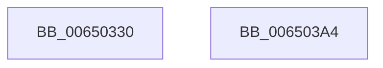

# EtwTraceThreadFeedbackRead

- RVA: `0x00650330`–`0x006503A5` (길이 `117` bytes)
- VA: `0x0000000140650330`
- 실행 섹션: `.text`
- PDB 이름 있음: `예`; PDB Function 태그: `아니요`
- unwind 정보 RVA: `0x00065FB8`
- 디코드: `26`개 명령, `117/117` bytes 표시
- 미해석 바이트: `0` (있으면 어셈블리에 `.byte`로 보존)

> 이 문서는 커널 이미지의 기계어와 PDB 기호를 분석해 생성했습니다. 4번과 5번은 함수 원형과 자료형을 바이너리 사용 방식에서 추정한 C 해석이며 원본 소스 복구 결과는 아닙니다.

## 1. Dependencies

- 직접 호출 지점: **2**; 고유 호출 대상: **2**
- 직접 호출자로 확인된 함수: **1**
- RIP 상대 이미지 참조: **1**

### Outgoing calls
- `0x0065038D` → [EtwTraceKernelEvent](../23/EtwTraceKernelEvent_function_00235350.md) (function, `0x00235350`)
- `0x0065039A` → [_security_check_cookie](../6A/_security_check_cookie_function_006AC640.md) (function, `0x006AC640`)

### Direct callers
- [sub_0037D9CF](../37/Unknown_function_0037D9CF.md) at `0x0037DA04`

### Static image references
- `0x00650337` → RVA `0x00E0A740` (`.data`; read)

## 2. Other-region calls and transfers

- 다른 실행 섹션으로 향하는 call: **0**
- 별도 외부 분기/꼬리 이동을 확인하지 못했습니다.

## 3. Assembly (complete function range)

```asm
00650330  4C 8B DC                        mov r11, rsp
00650333  48 83 EC 68                     sub rsp, 0x68
00650337  48 8B 05 02 A4 7B 00            mov rax, qword ptr [rip + 0x7ba402]
0065033E  48 33 C4                        xor rax, rsp
00650341  48 89 44 24 50                  mov qword ptr [rsp + 0x50], rax
00650346  8B 81 10 05 00 00               mov eax, dword ptr [rcx + 0x510]
0065034C  41 B9 78 0F 00 00               mov r9d, 0xf78
00650352  89 44 24 30                     mov dword ptr [rsp + 0x30], eax
00650356  49 8D 4B D8                     lea rcx, [r11 - 0x28]
0065035A  8B 42 24                        mov eax, dword ptr [rdx + 0x24]
0065035D  BA 01 00 00 00                  mov edx, 1
00650362  89 44 24 34                     mov dword ptr [rsp + 0x34], eax
00650366  49 8D 43 C8                     lea rax, [r11 - 0x38]
0065036A  49 89 43 D8                     mov qword ptr [r11 - 0x28], rax
0065036E  83 64 24 4C 00                  and dword ptr [rsp + 0x4c], 0
00650373  4D 89 43 D0                     mov qword ptr [r11 - 0x30], r8
00650377  41 B8 80 00 00 A0               mov r8d, 0xa0000080
0065037D  C7 44 24 48 10 00 00 00         mov dword ptr [rsp + 0x48], 0x10
00650385  C7 44 24 20 02 02 00 00         mov dword ptr [rsp + 0x20], 0x202
0065038D  E8 BE 4F BE FF                  call 0x140235350
00650392  48 8B 4C 24 50                  mov rcx, qword ptr [rsp + 0x50]
00650397  48 33 CC                        xor rcx, rsp
0065039A  E8 A1 C2 05 00                  call 0x1406ac640
0065039F  48 83 C4 68                     add rsp, 0x68
006503A3  C3                              ret
006503A4  CC                              int3
```

## 4. C-style interpretation (structured pseudocode)

```c
__int64 __fastcall EtwTraceThreadFeedbackRead(__int64 a1, __int64 a2, __int64 a3)
{
    __int64 result;
    __int64 v_rsp;
    unsigned __int64 v_stack_m18;
    unsigned int v_stack_m1C;
    unsigned int v_stack_m20;
    unsigned int v_stack_m34;
    unsigned int v_stack_m38;
    unsigned int v_stack_m48;

    v_rsp = (v_rsp) - (104);
    result = (*(unsigned __int64 *)(v_rip + 8102914)) ^ (v_rsp);
    v_stack_m18 = result;
    v_stack_m38 = (unsigned int)((unsigned int)(*(unsigned int *)(a1 + 1296)));
    v_stack_m34 = (unsigned int)((unsigned int)(*(unsigned int *)(a2 + 36)));
    *(unsigned __int64 *)(v_rsp - 40) = v_rsp - 56;
    *(unsigned __int64 *)(v_rsp - 48) = a3;
    v_stack_m20 = 16;
    v_stack_m48 = 514;
    result = EtwTraceKernelEvent(v_rsp - 40, 1, (unsigned int)(0xA0000080ULL), (unsigned int)(0xF78ULL));
    a1 = (v_stack_m18) ^ (v_rsp);
    result = _security_check_cookie(a1, 1, (unsigned int)(0xA0000080ULL), (unsigned int)(0xF78ULL));
    v_rsp = (v_rsp) + (104);
    return result;
}
```

## 5. (Beta) C Style

```c
int64_t EtwTraceThreadFeedbackRead(void *Arg1, void *Arg2, int64_t Arg3)
{
    uint8_t *arg1 = (uint8_t *)Arg1;
    uint8_t *arg2 = (uint8_t *)Arg2;

    int64_t result;
    int64_t local_rsp;
    uint64_t v_stack_m18;
    uint32_t v_stack_m1C;
    uint32_t v_stack_m20;
    uint32_t v_stack_m34;
    uint32_t v_stack_m38;
    uint32_t v_stack_m48;

    local_rsp = (local_rsp) - (104);
    result = (*(uint64_t *)(v_rip + 0x7BA402)) ^ (local_rsp);
    v_stack_m18 = result;
    v_stack_m38 = (uint32_t)((uint32_t)(*(uint32_t *)(arg1 + 0x510)));
    v_stack_m34 = (uint32_t)((uint32_t)(*(uint32_t *)(arg2 + 0x24)));
    *(uint64_t *)(local_rsp - 0x28) = local_rsp - 56;
    *(uint64_t *)(local_rsp - 0x30) = Arg3;
    v_stack_m20 = 16;
    v_stack_m48 = 514;
    result = EtwTraceKernelEvent(local_rsp - 40, 1, (uint32_t)(0xA0000080ULL), (uint32_t)(0xF78ULL));
    Arg1 = (v_stack_m18) ^ (local_rsp);
    result = _security_check_cookie(Arg1, 1, (uint32_t)(0xA0000080ULL), (uint32_t)(0xF78ULL));
    local_rsp = (local_rsp) + (104);
    return result;
}
```

### 관측된 메모리 오프셋

구조체 형식이 확인되지 않은 접근은 인자 기준의 오프셋으로만 기록했습니다.

| 기준 인자 | 오프셋 표현 | 폭 (bit) | 접근 |
|---|---:|---:|---|
| `Arg1` | `+ 0x510` | `32` | `R` |
| `Arg2` | `+ 0x24` | `32` | `R` |

## 6. Execution-region graph

[열기: 2D/3D 그래프와 함수 탐색 컨트롤 패널](../../../control-panel.html?section=text&rva=0x00650330&view=graph)

- 2D 그래프는 위에서 아래로 흐르고, 3D 그래프는 빈 공간을 드래그해 회전합니다. Shift+드래그는 이동, 휠은 확대·축소, 함수 노드 선택은 대상 보고서 이동입니다.

### Static fallback


