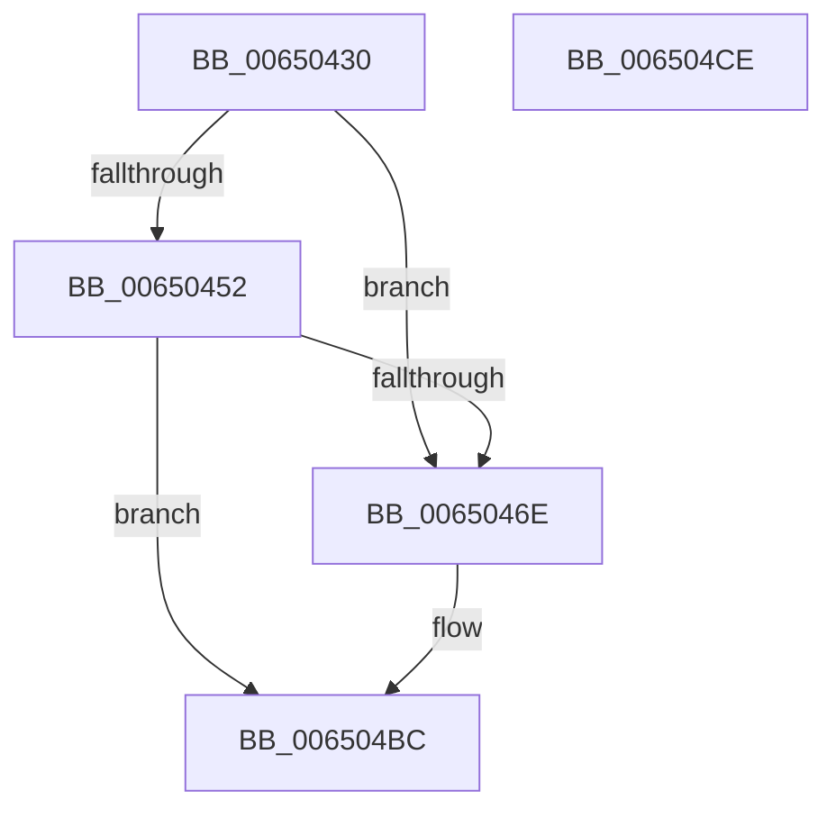

# EtwTraceThreadSchedulingGroupRundown

- RVA: `0x00650430`–`0x006504CF` (길이 `159` bytes)
- VA: `0x0000000140650430`
- 실행 섹션: `.text`
- PDB 이름 있음: `예`; PDB Function 태그: `아니요`
- unwind 정보 RVA: `0x0006F9F8`
- 디코드: `33`개 명령, `159/159` bytes 표시
- 미해석 바이트: `0` (있으면 어셈블리에 `.byte`로 보존)

> 이 문서는 커널 이미지의 기계어와 PDB 기호를 분석해 생성했습니다. 4번과 5번은 함수 원형과 자료형을 바이너리 사용 방식에서 추정한 C 해석이며 원본 소스 복구 결과는 아닙니다.

## 1. Dependencies

- 직접 호출 지점: **3**; 고유 호출 대상: **3**
- 직접 호출자로 확인된 함수: **1**
- RIP 상대 이미지 참조: **2**

### Outgoing calls
- `0x00650460` → [PsGetServerSiloGlobals](../22/PsGetServerSiloGlobals_function_002250A0.md) (function, `0x002250A0`)
- `0x006504B7` → [EtwpLogKernelEvent](../25/EtwpLogKernelEvent_function_0025CC00.md) (function, `0x0025CC00`)
- `0x006504C4` → [_security_check_cookie](../6A/_security_check_cookie_function_006AC640.md) (function, `0x006AC640`)

### Direct callers
- [KeTraceSchedulingGroupRundown](../5C/KeTraceSchedulingGroupRundown_function_005C8D20.md) at `0x005C8DC4`

### Static image references
- `0x00650434` → RVA `0x00E0A740` (`.data`; read)
- `0x00650443` → RVA `0x00FC6AA8` (`ALMOSTRO`; read)

## 2. Other-region calls and transfers

- 다른 실행 섹션으로 향하는 call: **0**
- 별도 외부 분기/꼬리 이동을 확인하지 못했습니다.

## 3. Assembly (complete function range)

```asm
00650430  48 83 EC 68                     sub rsp, 0x68
00650434  48 8B 05 05 A3 7B 00            mov rax, qword ptr [rip + 0x7ba305]
0065043B  48 33 C4                        xor rax, rsp
0065043E  48 89 44 24 50                  mov qword ptr [rsp + 0x50], rax
00650443  48 3B 0D 5E 66 97 00            cmp rcx, qword ptr [rip + 0x97665e]
0065044A  44 8B D2                        mov r10d, edx
0065044D  48 8B D1                        mov rdx, rcx
00650450  74 1C                           je 0x14065046e
00650452  49 8B 88 20 02 00 00            mov rcx, qword ptr [r8 + 0x220]
00650459  48 8B 89 F0 05 00 00            mov rcx, qword ptr [rcx + 0x5f0]
00650460  E8 3B 4C BD FF                  call 0x1402250a0
00650465  48 39 90 40 03 00 00            cmp qword ptr [rax + 0x340], rdx
0065046C  75 4E                           jne 0x1406504bc
0065046E  41 8B 80 10 05 00 00            mov eax, dword ptr [r8 + 0x510]
00650475  48 8D 4C 24 40                  lea rcx, [rsp + 0x40]
0065047A  83 64 24 34 00                  and dword ptr [rsp + 0x34], 0
0065047F  45 8B C2                        mov r8d, r10d
00650482  83 64 24 4C 00                  and dword ptr [rsp + 0x4c], 0
00650487  89 44 24 30                     mov dword ptr [rsp + 0x30], eax
0065048B  48 8D 44 24 30                  lea rax, [rsp + 0x30]
00650490  4C 89 4C 24 38                  mov qword ptr [rsp + 0x38], r9
00650495  41 B9 01 00 00 00               mov r9d, 1
0065049B  C7 44 24 28 02 01 60 00         mov dword ptr [rsp + 0x28], 0x600102
006504A3  48 89 44 24 40                  mov qword ptr [rsp + 0x40], rax
006504A8  C7 44 24 48 10 00 00 00         mov dword ptr [rsp + 0x48], 0x10
006504B0  66 C7 44 24 20 61 05            mov word ptr [rsp + 0x20], 0x561
006504B7  E8 44 C7 C0 FF                  call 0x14025cc00
006504BC  48 8B 4C 24 50                  mov rcx, qword ptr [rsp + 0x50]
006504C1  48 33 CC                        xor rcx, rsp
006504C4  E8 77 C1 05 00                  call 0x1406ac640
006504C9  48 83 C4 68                     add rsp, 0x68
006504CD  C3                              ret
006504CE  CC                              int3
```

## 4. C-style interpretation (structured pseudocode)

```c
__int64 __fastcall EtwTraceThreadSchedulingGroupRundown(__int64 a1, int a2, __int64 a3, __int64 a4)
{
    __int64 result;
    __int64 v_rsp;
    unsigned __int64 v_stack_m18;
    unsigned int v_stack_m1C;
    unsigned int v_stack_m20;
    unsigned __int64 v_stack_m28;
    unsigned __int64 v_stack_m30;
    unsigned int v_stack_m34;
    unsigned int v_stack_m38;
    unsigned int v_stack_m40;
    unsigned __int16 v_stack_m48;

    v_rsp = (v_rsp) - (104);
    result = (*(unsigned __int64 *)(v_rip + 8102661)) ^ (v_rsp);
    v_stack_m18 = result;
    if (a1 == (*(unsigned __int64 *)(v_rip + 9922142))) goto loc_0065046E;
    result = PsGetServerSiloGlobals(*(unsigned __int64 *)(*(unsigned __int64 *)(a3 + 544) + 1520), a1, a3, a4);
    if ((*(unsigned __int64 *)(result + 832)) == a1) {
        result = *(unsigned int *)(a3 + 1296);
        a1 = v_stack_m28;
        a3 = (unsigned int)((unsigned int)(a2));
        v_stack_m38 = (unsigned int)(result);
        result = v_stack_m38;
        v_stack_m30 = a4;
        a4 = 1;
        v_stack_m40 = 0x600102ULL;
        v_stack_m28 = result;
        v_stack_m20 = 16;
        v_stack_m48 = 0x561ULL;
        result = EtwpLogKernelEvent(a1, a1, a3, a4);
    }
    a1 = (v_stack_m18) ^ (v_rsp);
    result = _security_check_cookie(a1, a1, a3, a4);
    v_rsp = (v_rsp) + (104);
    return result;
}
```

## 5. (Beta) C Style

```c
int64_t EtwTraceThreadSchedulingGroupRundown(int64_t Arg1, int32_t Arg2, void *Arg3, int64_t Arg4)
{
    uint8_t *arg3 = (uint8_t *)Arg3;

    int64_t result;
    int64_t local_rsp;
    uint64_t v_stack_m18;
    uint32_t v_stack_m1C;
    uint32_t v_stack_m20;
    uint64_t v_stack_m28;
    uint64_t v_stack_m30;
    uint32_t v_stack_m34;
    uint32_t v_stack_m38;
    uint32_t v_stack_m40;
    uint16_t v_stack_m48;

    local_rsp = (local_rsp) - (104);
    result = (*(uint64_t *)(v_rip + 0x7BA305)) ^ (local_rsp);
    v_stack_m18 = result;
    if (Arg1 == (*(uint64_t *)(v_rip + 0x97665E))) goto loc_0065046E;
    result = PsGetServerSiloGlobals(*(uint64_t *)(*(uint64_t *)(arg3 + 0x220) + 0x5F0), Arg1, Arg3, Arg4);
    if ((*(uint64_t *)(result + 0x340)) == Arg1) {
        result = *(uint32_t *)(arg3 + 0x510);
        Arg1 = v_stack_m28;
        Arg3 = (uint32_t)((uint32_t)(Arg2));
        v_stack_m38 = (uint32_t)(result);
        result = v_stack_m38;
        v_stack_m30 = Arg4;
        Arg4 = 1;
        v_stack_m40 = 0x600102ULL;
        v_stack_m28 = result;
        v_stack_m20 = 16;
        v_stack_m48 = 0x561ULL;
        result = EtwpLogKernelEvent(Arg1, Arg1, Arg3, Arg4);
    }
    Arg1 = (v_stack_m18) ^ (local_rsp);
    result = _security_check_cookie(Arg1, Arg1, Arg3, Arg4);
    local_rsp = (local_rsp) + (104);
    return result;
}
```

### 관측된 메모리 오프셋

구조체 형식이 확인되지 않은 접근은 인자 기준의 오프셋으로만 기록했습니다.

| 기준 인자 | 오프셋 표현 | 폭 (bit) | 접근 |
|---|---:|---:|---|
| `Arg3` | `+ 0x220` | `64` | `R` |

## 6. Execution-region graph

[열기: 2D/3D 그래프와 함수 탐색 컨트롤 패널](../../../control-panel.html?section=text&rva=0x00650430&view=graph)

- 2D 그래프는 위에서 아래로 흐르고, 3D 그래프는 빈 공간을 드래그해 회전합니다. Shift+드래그는 이동, 휠은 확대·축소, 함수 노드 선택은 대상 보고서 이동입니다.

### Static fallback


