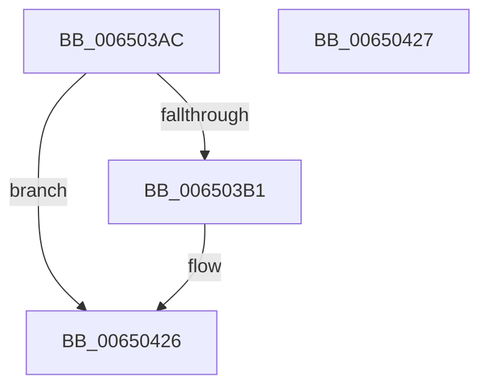

# EtwTraceThreadSchedulingGroup

- RVA: `0x006503AC`–`0x00650428` (길이 `124` bytes)
- VA: `0x00000001406503AC`
- 실행 섹션: `.text`
- PDB 이름 있음: `예`; PDB Function 태그: `아니요`
- unwind 정보 RVA: `0x000D38B4`
- 디코드: `28`개 명령, `124/124` bytes 표시
- 미해석 바이트: `0` (있으면 어셈블리에 `.byte`로 보존)

> 이 문서는 커널 이미지의 기계어와 PDB 기호를 분석해 생성했습니다. 4번과 5번은 함수 원형과 자료형을 바이너리 사용 방식에서 추정한 C 해석이며 원본 소스 복구 결과는 아닙니다.

## 1. Dependencies

- 직접 호출 지점: **2**; 고유 호출 대상: **2**
- 직접 호출자로 확인된 함수: **2**
- RIP 상대 이미지 참조: **1**

### Outgoing calls
- `0x00650410` → [EtwTraceKernelEvent](../23/EtwTraceKernelEvent_function_00235350.md) (function, `0x00235350`)
- `0x0065041D` → [_security_check_cookie](../6A/_security_check_cookie_function_006AC640.md) (function, `0x006AC640`)

### Direct callers
- [KeStartThread](../3C/KeStartThread_function_003C21B8.md) at `0x003C264D`
- [KiSetThreadSchedulingGroup](../46/KiSetThreadSchedulingGroup_function_0046E458.md) at `0x0046E5C9`

### Static image references
- `0x006503B8` → RVA `0x00E0A740` (`.data`; read)

## 2. Other-region calls and transfers

- 다른 실행 섹션으로 향하는 call: **0**
- 별도 외부 분기/꼬리 이동을 확인하지 못했습니다.

## 3. Assembly (complete function range)

```asm
006503AC  4C 3B C2                        cmp r8, rdx
006503AF  74 75                           je 0x140650426
006503B1  4C 8B DC                        mov r11, rsp
006503B4  48 83 EC 68                     sub rsp, 0x68
006503B8  48 8B 05 81 A3 7B 00            mov rax, qword ptr [rip + 0x7ba381]
006503BF  48 33 C4                        xor rax, rsp
006503C2  48 89 44 24 58                  mov qword ptr [rsp + 0x58], rax
006503C7  8B 81 10 05 00 00               mov eax, dword ptr [rcx + 0x510]
006503CD  41 B9 60 05 00 00               mov r9d, 0x560
006503D3  83 64 24 44 00                  and dword ptr [rsp + 0x44], 0
006503D8  49 8D 4B C8                     lea rcx, [r11 - 0x38]
006503DC  89 44 24 40                     mov dword ptr [rsp + 0x40], eax
006503E0  49 8D 43 D8                     lea rax, [r11 - 0x28]
006503E4  49 89 43 C8                     mov qword ptr [r11 - 0x38], rax
006503E8  83 64 24 3C 00                  and dword ptr [rsp + 0x3c], 0
006503ED  49 89 53 E0                     mov qword ptr [r11 - 0x20], rdx
006503F1  BA 01 00 00 00                  mov edx, 1
006503F6  4D 89 43 E8                     mov qword ptr [r11 - 0x18], r8
006503FA  41 B8 00 40 00 A0               mov r8d, 0xa0004000
00650400  C7 44 24 38 18 00 00 00         mov dword ptr [rsp + 0x38], 0x18
00650408  C7 44 24 20 02 19 60 00         mov dword ptr [rsp + 0x20], 0x601902
00650410  E8 3B 4F BE FF                  call 0x140235350
00650415  48 8B 4C 24 58                  mov rcx, qword ptr [rsp + 0x58]
0065041A  48 33 CC                        xor rcx, rsp
0065041D  E8 1E C2 05 00                  call 0x1406ac640
00650422  48 83 C4 68                     add rsp, 0x68
00650426  C3                              ret
00650427  CC                              int3
```

## 4. C-style interpretation (structured pseudocode)

```c
__int64 __fastcall EtwTraceThreadSchedulingGroup(__int64 a1, __int64 a2, __int64 a3)
{
    __int64 result;
    __int64 v_r11;
    __int64 v_rsp;
    unsigned __int64 v_stack_m10;
    unsigned int v_stack_m24;
    unsigned int v_stack_m28;
    unsigned int v_stack_m2C;
    unsigned int v_stack_m30;
    unsigned int v_stack_m48;

    if (a3 != a2) {
        v_r11 = v_rsp;
        v_rsp = (v_rsp) - (104);
        result = *(unsigned __int64 *)(v_rip + 8102785);
        result = (result) ^ (v_rsp);
        v_stack_m10 = result;
        result = *(unsigned int *)(a1 + 1296);
        a4 = 0x560ULL;
        a1 = v_r11 - 56;
        v_stack_m28 = (unsigned int)(result);
        result = v_r11 - 40;
        *(unsigned __int64 *)(v_r11 - 56) = result;
        *(unsigned __int64 *)(v_r11 - 32) = a2;
        a2 = 1;
        *(unsigned __int64 *)(v_r11 - 24) = a3;
        a3 = 0xA0004000ULL;
        v_stack_m30 = 24;
        v_stack_m48 = 0x601902ULL;
        result = EtwTraceKernelEvent(a1, a2, a3, a4);
        a1 = v_stack_m10;
        a1 = (a1) ^ (v_rsp);
        result = _security_check_cookie(a1, a2, a3, a4);
        v_rsp = (v_rsp) + (104);
    }
    return result;
}
```

## 5. (Beta) C Style

```c
int64_t EtwTraceThreadSchedulingGroup(void *Arg1, int64_t Arg2, int64_t Arg3)
{
    uint8_t *arg1 = (uint8_t *)Arg1;

    int64_t result;
    int64_t local_r11;
    int64_t local_rsp;
    uint64_t v_stack_m10;
    uint32_t v_stack_m24;
    uint32_t v_stack_m28;
    uint32_t v_stack_m2C;
    uint32_t v_stack_m30;
    uint32_t v_stack_m48;

    if (Arg3 != Arg2) {
        local_r11 = local_rsp;
        local_rsp = (local_rsp) - (104);
        result = *(uint64_t *)(v_rip + 0x7BA381);
        result = (result) ^ (local_rsp);
        v_stack_m10 = result;
        result = *(uint32_t *)(arg1 + 0x510);
        a4 = 0x560ULL;
        Arg1 = local_r11 - 56;
        v_stack_m28 = (uint32_t)(result);
        result = local_r11 - 40;
        *(uint64_t *)(local_r11 - 0x38) = result;
        *(uint64_t *)(local_r11 - 0x20) = Arg2;
        Arg2 = 1;
        *(uint64_t *)(local_r11 - 0x18) = Arg3;
        Arg3 = 0xA0004000ULL;
        v_stack_m30 = 24;
        v_stack_m48 = 0x601902ULL;
        result = EtwTraceKernelEvent(Arg1, Arg2, Arg3, a4);
        Arg1 = v_stack_m10;
        Arg1 = (Arg1) ^ (local_rsp);
        result = _security_check_cookie(Arg1, Arg2, Arg3, a4);
        local_rsp = (local_rsp) + (104);
    }
    return result;
}
```

### 관측된 메모리 오프셋

구조체 형식이 확인되지 않은 접근은 인자 기준의 오프셋으로만 기록했습니다.

| 기준 인자 | 오프셋 표현 | 폭 (bit) | 접근 |
|---|---:|---:|---|
| `Arg1` | `+ 0x510` | `32` | `R` |

## 6. Execution-region graph

[열기: 2D/3D 그래프와 함수 탐색 컨트롤 패널](../../../control-panel.html?section=text&rva=0x006503AC&view=graph)

- 2D 그래프는 위에서 아래로 흐르고, 3D 그래프는 빈 공간을 드래그해 회전합니다. Shift+드래그는 이동, 휠은 확대·축소, 함수 노드 선택은 대상 보고서 이동입니다.

### Static fallback


