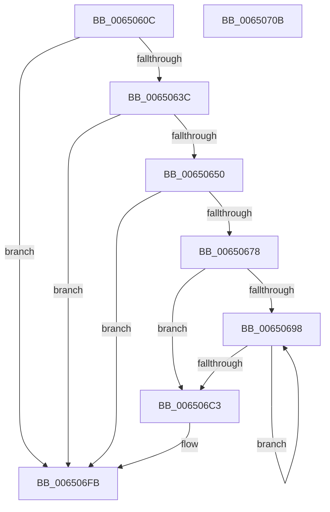

# EtwTraceWorkQueueHealthMetricsBucketUpperBounds

- RVA: `0x0065060C`–`0x0065070C` (길이 `256` bytes)
- VA: `0x000000014065060C`
- 실행 섹션: `.text`
- PDB 이름 있음: `예`; PDB Function 태그: `아니요`
- unwind 정보 RVA: `0x0008A4C8`
- 디코드: `61`개 명령, `256/256` bytes 표시
- 미해석 바이트: `0` (있으면 어셈블리에 `.byte`로 보존)

> 이 문서는 커널 이미지의 기계어와 PDB 기호를 분석해 생성했습니다. 4번과 5번은 함수 원형과 자료형을 바이너리 사용 방식에서 추정한 C 해석이며 원본 소스 복구 결과는 아닙니다.

## 1. Dependencies

- 직접 호출 지점: **4**; 고유 호출 대상: **4**
- 직접 호출자로 확인된 함수: **1**
- RIP 상대 이미지 참조: **4**

### Outgoing calls
- `0x00650643` → [EtwEventEnabled](../39/EtwEventEnabled_function_00392450.md) (function, `0x00392450`)
- `0x00650667` → [ExAllocatePool2](../../poolcode/B8/ExAllocatePool2_function_00B820F0.md) (function, `0x00B820F0`)
- `0x006506EC` → [EtwWriteEx](../25/EtwWriteEx_function_0025F0D0.md) (function, `0x0025F0D0`)
- `0x006506F6` → [ExFreePoolWithTag](../../poolcode/B8/ExFreePoolWithTag_function_00B82870.md) (function, `0x00B82870`)

### Direct callers
- [ExStartStopWorkQueueProvider](../../page/7C/ExStartStopWorkQueueProvider_function_007CF59C.md) at `0x007CF70A`

### Static image references
- `0x0065061B` → RVA `0x00EFF860` (`.data`; read)
- `0x00650622` → RVA `0x00E0EBDC` (`.data`; read)
- `0x00650628` → RVA `0x00EFA910` (`.data`; read)
- `0x0065063C` → RVA `0x00021550` (`.rdata`; read)

## 2. Other-region calls and transfers

- 다른 실행 섹션으로 향하는 call: **2**
  - `0x00650667` → [ExAllocatePool2](../../poolcode/B8/ExAllocatePool2_function_00B820F0.md) (`.text` → `POOLCODE`)
  - `0x006506F6` → [ExFreePoolWithTag](../../poolcode/B8/ExFreePoolWithTag_function_00B82870.md) (`.text` → `POOLCODE`)
- 별도 외부 분기/꼬리 이동을 확인하지 못했습니다.

## 3. Assembly (complete function range)

```asm
0065060C  48 89 5C 24 08                  mov qword ptr [rsp + 8], rbx
00650611  48 89 74 24 10                  mov qword ptr [rsp + 0x10], rsi
00650616  57                              push rdi
00650617  48 83 EC 50                     sub rsp, 0x50
0065061B  48 8B 0D 3E F2 8A 00            mov rcx, qword ptr [rip + 0x8af23e]
00650622  8B 05 B4 E5 7B 00               mov eax, dword ptr [rip + 0x7be5b4]
00650628  48 8B 35 E1 A2 8A 00            mov rsi, qword ptr [rip + 0x8aa2e1]
0065062F  89 44 24 40                     mov dword ptr [rsp + 0x40], eax
00650633  48 85 C9                        test rcx, rcx
00650636  0F 84 BF 00 00 00               je 0x1406506fb
0065063C  48 8D 15 0D 0F 9D FF            lea rdx, [rip - 0x62f0f3]
00650643  E8 08 1E D4 FF                  call 0x140392450
00650648  84 C0                           test al, al
0065064A  0F 84 AB 00 00 00               je 0x1406506fb
00650650  8B 7C 24 40                     mov edi, dword ptr [rsp + 0x40]
00650654  B9 40 00 00 00                  mov ecx, 0x40
00650659  FF C7                           inc edi
0065065B  41 B8 45 74 77 74               mov r8d, 0x74777445
00650661  8B D7                           mov edx, edi
00650663  48 C1 E2 04                     shl rdx, 4
00650667  E8 84 1A 53 00                  call 0x140b820f0
0065066C  48 8B D8                        mov rbx, rax
0065066F  48 85 C0                        test rax, rax
00650672  0F 84 83 00 00 00               je 0x1406506fb
00650678  45 33 D2                        xor r10d, r10d
0065067B  C7 43 08 04 00 00 00            mov dword ptr [rbx + 8], 4
00650682  44 21 53 0C                     and dword ptr [rbx + 0xc], r10d
00650686  48 8D 44 24 40                  lea rax, [rsp + 0x40]
0065068B  45 33 C9                        xor r9d, r9d
0065068E  48 89 03                        mov qword ptr [rbx], rax
00650691  44 39 4C 24 40                  cmp dword ptr [rsp + 0x40], r9d
00650696  76 2B                           jbe 0x1406506c3
00650698  41 FF C2                        inc r10d
0065069B  4A 8D 0C CE                     lea rcx, [rsi + r9*8]
0065069F  45 8B C2                        mov r8d, r10d
006506A2  41 FF C1                        inc r9d
006506A5  49 C1 E0 04                     shl r8, 4
006506A9  4C 03 C3                        add r8, rbx
006506AC  41 83 60 0C 00                  and dword ptr [r8 + 0xc], 0
006506B1  49 89 08                        mov qword ptr [r8], rcx
006506B4  41 C7 40 08 08 00 00 00         mov dword ptr [r8 + 8], 8
006506BC  44 3B 4C 24 40                  cmp r9d, dword ptr [rsp + 0x40]
006506C1  72 D5                           jb 0x140650698
006506C3  48 8B 0D 96 F1 8A 00            mov rcx, qword ptr [rip + 0x8af196]
006506CA  48 8D 15 7F 0E 9D FF            lea rdx, [rip - 0x62f181]
006506D1  48 89 5C 24 38                  mov qword ptr [rsp + 0x38], rbx
006506D6  45 33 C9                        xor r9d, r9d
006506D9  89 7C 24 30                     mov dword ptr [rsp + 0x30], edi
006506DD  45 33 C0                        xor r8d, r8d
006506E0  48 83 64 24 28 00               and qword ptr [rsp + 0x28], 0
006506E6  48 83 64 24 20 00               and qword ptr [rsp + 0x20], 0
006506EC  E8 DF E9 C0 FF                  call 0x14025f0d0
006506F1  33 D2                           xor edx, edx
006506F3  48 8B CB                        mov rcx, rbx
006506F6  E8 75 21 53 00                  call 0x140b82870
006506FB  48 8B 5C 24 60                  mov rbx, qword ptr [rsp + 0x60]
00650700  48 8B 74 24 68                  mov rsi, qword ptr [rsp + 0x68]
00650705  48 83 C4 50                     add rsp, 0x50
00650709  5F                              pop rdi
0065070A  C3                              ret
0065070B  CC                              int3
```

## 4. C-style interpretation (structured pseudocode)

```c
__int64 __fastcall EtwTraceWorkQueueHealthMetricsBucketUpperBounds(__int64 a1, __int64 a2, __int64 a3, int a4)
{
    __int64 result;
    __int64 v_r10;
    __int64 v_rdi;
    __int64 v_rsp;
    unsigned int v_stack_m18;
    unsigned __int64 v_stack_m20;
    unsigned int v_stack_m28;
    unsigned __int64 v_stack_m30;
    unsigned __int64 v_stack_m38;
    unsigned __int64 v_stack_p10;
    unsigned __int64 v_stack_p8;

    v_stack_p8 = v_rbx;
    v_stack_p10 = v_rsi;
    v_rsp = (v_rsp) - (80);
    v_stack_m18 = (unsigned int)((unsigned int)(*(unsigned int *)(v_rip + 8119732)));
    if (*(unsigned __int64 *)(v_rip + 9105982) == 0) goto loc_006506FB;
    result = EtwEventEnabled(*(unsigned __int64 *)(v_rip + 9105982), v_rip - 6484211, a3, a4);
    if ((unsigned __int8)(result) == 0) goto loc_006506FB;
    v_rdi = (unsigned int)(((unsigned int)(v_stack_m18)) + 1);
    a2 = ((unsigned int)((unsigned int)(v_rdi))) << (4);
    result = ExAllocatePool2(64, a2, (unsigned int)(0x74777445ULL), a4);
    if (result == 0) goto loc_006506FB;
    v_r10 = 0;
    *(unsigned int *)(result + 8) = 4;
    a4 = 0;
    *(unsigned __int64 *)(result) = v_stack_m18;
    if (v_stack_m18 <= 0) goto loc_006506C3;
loc_00650698:
    v_r10 = (unsigned int)((v_r10) + 1);
    a4 = (unsigned int)((a4) + 1);
    a3 = ((unsigned int)((unsigned int)(v_r10))) << (4);
    a3 = (a3) + (result);
    *(unsigned __int64 *)(a3) = *(unsigned __int64 *)(v_rip + 9085665) + a4 * 8;
    *(unsigned int *)(a3 + 8) = 8;
    if (a4 < v_stack_m18) goto loc_00650698;
loc_006506C3:
    v_stack_m20 = result;
    a4 = 0;
    v_stack_m28 = (unsigned int)(v_rdi);
    a3 = 0;
    result = EtwWriteEx(*(unsigned __int64 *)(v_rip + 9105814), v_rip - 6484353, a3, a4);
    a2 = 0;
    result = ExFreePoolWithTag(result, a2, a3, a4);
loc_006506FB:
    v_rsp = (v_rsp) + (80);
    return result;
}
```

## 5. (Beta) C Style

```c
int64_t EtwTraceWorkQueueHealthMetricsBucketUpperBounds(int64_t Arg1, int64_t Arg2, int64_t Arg3, int32_t Arg4)
{
    int64_t result;
    int64_t local_r10;
    int64_t local_rdi;
    int64_t local_rsp;
    uint32_t v_stack_m18;
    uint64_t v_stack_m20;
    uint32_t v_stack_m28;
    uint64_t v_stack_m30;
    uint64_t v_stack_m38;
    uint64_t v_stack_p10;
    uint64_t v_stack_p8;

    v_stack_p8 = local_rbx;
    v_stack_p10 = local_rsi;
    local_rsp = (local_rsp) - (80);
    v_stack_m18 = (uint32_t)((uint32_t)(*(uint32_t *)(v_rip + 0x7BE5B4)));
    if (*(uint64_t *)(v_rip + 0x8AF23E) == 0) goto loc_006506FB;
    result = EtwEventEnabled(*(uint64_t *)(v_rip + 0x8AF23E), v_rip - 6484211, Arg3, Arg4);
    if ((uint8_t)(result) == 0) goto loc_006506FB;
    local_rdi = (uint32_t)(((uint32_t)(v_stack_m18)) + 1);
    Arg2 = ((uint32_t)((uint32_t)(local_rdi))) << (4);
    result = ExAllocatePool2(64, Arg2, (uint32_t)(0x74777445ULL), Arg4);
    if (result == 0) goto loc_006506FB;
    local_r10 = 0;
    *(uint32_t *)(result + 0x8) = 4;
    Arg4 = 0;
    *(uint64_t *)(result) = v_stack_m18;
    if (v_stack_m18 <= 0) goto loc_006506C3;
loc_00650698:
    local_r10 = (uint32_t)((local_r10) + 1);
    Arg4 = (uint32_t)((Arg4) + 1);
    Arg3 = ((uint32_t)((uint32_t)(local_r10))) << (4);
    Arg3 = (Arg3) + (result);
    *(uint64_t *)(Arg3) = *(uint64_t *)(v_rip + 0x8AA2E1) + Arg4 * 8;
    *(uint32_t *)(Arg3 + 0x8) = 8;
    if (Arg4 < v_stack_m18) goto loc_00650698;
loc_006506C3:
    v_stack_m20 = result;
    Arg4 = 0;
    v_stack_m28 = (uint32_t)(local_rdi);
    Arg3 = 0;
    result = EtwWriteEx(*(uint64_t *)(v_rip + 0x8AF196), v_rip - 6484353, Arg3, Arg4);
    Arg2 = 0;
    result = ExFreePoolWithTag(result, Arg2, Arg3, Arg4);
loc_006506FB:
    local_rsp = (local_rsp) + (80);
    return result;
}
```

## 6. Execution-region graph

[열기: 2D/3D 그래프와 함수 탐색 컨트롤 패널](../../../control-panel.html?section=text&rva=0x0065060C&view=graph)

- 2D 그래프는 위에서 아래로 흐르고, 3D 그래프는 빈 공간을 드래그해 회전합니다. Shift+드래그는 이동, 휠은 확대·축소, 함수 노드 선택은 대상 보고서 이동입니다.

### Static fallback


