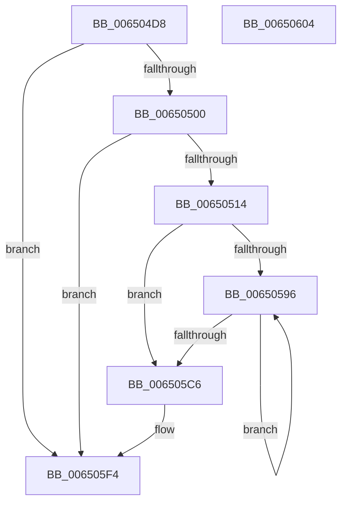

# EtwTraceWorkQueueHealthMetrics

- RVA: `0x006504D8`–`0x00650605` (길이 `301` bytes)
- VA: `0x00000001406504D8`
- 실행 섹션: `.text`
- PDB 이름 있음: `예`; PDB Function 태그: `아니요`
- unwind 정보 RVA: `0x00086C28`
- 디코드: `76`개 명령, `301/301` bytes 표시
- 미해석 바이트: `0` (있으면 어셈블리에 `.byte`로 보존)

> 이 문서는 커널 이미지의 기계어와 PDB 기호를 분석해 생성했습니다. 4번과 5번은 함수 원형과 자료형을 바이너리 사용 방식에서 추정한 C 해석이며 원본 소스 복구 결과는 아닙니다.

## 1. Dependencies

- 직접 호출 지점: **3**; 고유 호출 대상: **3**
- 직접 호출자로 확인된 함수: **1**
- RIP 상대 이미지 참조: **2**

### Outgoing calls
- `0x00650507` → [EtwEventEnabled](../39/EtwEventEnabled_function_00392450.md) (function, `0x00392450`)
- `0x00650520` → [memset](../6C/memset_function_006C6C40.md) (function, `0x006C6C40`)
- `0x006505EF` → [EtwWriteEx](../25/EtwWriteEx_function_0025F0D0.md) (function, `0x0025F0D0`)

### Direct callers
- [ExpWorkQueueHealthMetricsMonitorCallback](ExpWorkQueueHealthMetricsMonitorCallback_function_0065A7F0.md) at `0x0065A943`

### Static image references
- `0x006504ED` → RVA `0x00EFF860` (`.data`; read)
- `0x00650500` → RVA `0x000226B8` (`.rdata`; read)

## 2. Other-region calls and transfers

- 다른 실행 섹션으로 향하는 call: **0**
- 별도 외부 분기/꼬리 이동을 확인하지 못했습니다.

## 3. Assembly (complete function range)

```asm
006504D8  48 89 5C 24 08                  mov qword ptr [rsp + 8], rbx
006504DD  48 89 74 24 10                  mov qword ptr [rsp + 0x10], rsi
006504E2  57                              push rdi
006504E3  48 83 EC 40                     sub rsp, 0x40
006504E7  48 8B F9                        mov rdi, rcx
006504EA  41 8B F0                        mov esi, r8d
006504ED  48 8B 0D 6C F3 8A 00            mov rcx, qword ptr [rip + 0x8af36c]
006504F4  48 8B DA                        mov rbx, rdx
006504F7  48 85 C9                        test rcx, rcx
006504FA  0F 84 F4 00 00 00               je 0x1406505f4
00650500  48 8D 15 B1 21 9D FF            lea rdx, [rip - 0x62de4f]
00650507  E8 44 1F D4 FF                  call 0x140392450
0065050C  84 C0                           test al, al
0065050E  0F 84 E0 00 00 00               je 0x1406505f4
00650514  44 8B C6                        mov r8d, esi
00650517  33 D2                           xor edx, edx
00650519  49 C1 E0 04                     shl r8, 4
0065051D  48 8B CB                        mov rcx, rbx
00650520  E8 1B 67 07 00                  call 0x1406c6c40
00650525  83 63 0C 00                     and dword ptr [rbx + 0xc], 0
00650529  48 8D 47 02                     lea rax, [rdi + 2]
0065052D  48 89 3B                        mov qword ptr [rbx], rdi
00650530  4C 8D 5F 0C                     lea r11, [rdi + 0xc]
00650534  B9 02 00 00 00                  mov ecx, 2
00650539  45 33 C9                        xor r9d, r9d
0065053C  89 4B 08                        mov dword ptr [rbx + 8], ecx
0065053F  83 63 1C 00                     and dword ptr [rbx + 0x1c], 0
00650543  48 89 43 10                     mov qword ptr [rbx + 0x10], rax
00650547  48 8D 47 03                     lea rax, [rdi + 3]
0065054B  8D 51 FF                        lea edx, [rcx - 1]
0065054E  89 53 18                        mov dword ptr [rbx + 0x18], edx
00650551  44 8D 51 03                     lea r10d, [rcx + 3]
00650555  83 63 2C 00                     and dword ptr [rbx + 0x2c], 0
00650559  48 89 43 20                     mov qword ptr [rbx + 0x20], rax
0065055D  48 8D 47 04                     lea rax, [rdi + 4]
00650561  89 53 28                        mov dword ptr [rbx + 0x28], edx
00650564  83 63 3C 00                     and dword ptr [rbx + 0x3c], 0
00650568  48 89 43 30                     mov qword ptr [rbx + 0x30], rax
0065056C  48 8D 47 08                     lea rax, [rdi + 8]
00650570  89 4B 38                        mov dword ptr [rbx + 0x38], ecx
00650573  83 63 4C 00                     and dword ptr [rbx + 0x4c], 0
00650577  48 89 43 40                     mov qword ptr [rbx + 0x40], rax
0065057B  C7 43 48 04 00 00 00            mov dword ptr [rbx + 0x48], 4
00650582  83 63 5C 00                     and dword ptr [rbx + 0x5c], 0
00650586  4C 89 5B 50                     mov qword ptr [rbx + 0x50], r11
0065058A  C7 43 58 04 00 00 00            mov dword ptr [rbx + 0x58], 4
00650591  45 39 0B                        cmp dword ptr [r11], r9d
00650594  76 30                           jbe 0x1406505c6
00650596  44 03 D2                        add r10d, edx
00650599  41 8B C9                        mov ecx, r9d
0065059C  48 83 C1 04                     add rcx, 4
006505A0  45 8B C2                        mov r8d, r10d
006505A3  49 C1 E0 04                     shl r8, 4
006505A7  44 03 CA                        add r9d, edx
006505AA  4C 03 C3                        add r8, rbx
006505AD  48 8D 0C 8F                     lea rcx, [rdi + rcx*4]
006505B1  41 83 60 0C 00                  and dword ptr [r8 + 0xc], 0
006505B6  49 89 08                        mov qword ptr [r8], rcx
006505B9  41 C7 40 08 04 00 00 00         mov dword ptr [r8 + 8], 4
006505C1  45 3B 0B                        cmp r9d, dword ptr [r11]
006505C4  72 D0                           jb 0x140650596
006505C6  48 8B 0D 93 F2 8A 00            mov rcx, qword ptr [rip + 0x8af293]
006505CD  48 8D 15 E4 20 9D FF            lea rdx, [rip - 0x62df1c]
006505D4  48 89 5C 24 38                  mov qword ptr [rsp + 0x38], rbx
006505D9  45 33 C9                        xor r9d, r9d
006505DC  89 74 24 30                     mov dword ptr [rsp + 0x30], esi
006505E0  45 33 C0                        xor r8d, r8d
006505E3  48 83 64 24 28 00               and qword ptr [rsp + 0x28], 0
006505E9  48 83 64 24 20 00               and qword ptr [rsp + 0x20], 0
006505EF  E8 DC EA C0 FF                  call 0x14025f0d0
006505F4  48 8B 5C 24 50                  mov rbx, qword ptr [rsp + 0x50]
006505F9  48 8B 74 24 58                  mov rsi, qword ptr [rsp + 0x58]
006505FE  48 83 C4 40                     add rsp, 0x40
00650602  5F                              pop rdi
00650603  C3                              ret
00650604  CC                              int3
```

## 4. C-style interpretation (structured pseudocode)

```c
__int64 __fastcall EtwTraceWorkQueueHealthMetrics(__int64 a1, __int64 a2, int a3, int a4)
{
    __int64 result;
    __int64 v_r10;
    __int64 v_rsp;
    unsigned __int64 v_stack_m10;
    unsigned int v_stack_m18;
    unsigned __int64 v_stack_m20;
    unsigned __int64 v_stack_m28;
    unsigned __int64 v_stack_p10;
    unsigned __int64 v_stack_p8;

    v_stack_p8 = v_rbx;
    v_stack_p10 = v_rsi;
    v_rsp = (v_rsp) - (64);
    if (*(unsigned __int64 *)(v_rip + 9106284) == 0) goto loc_006505F4;
    result = EtwEventEnabled(*(unsigned __int64 *)(v_rip + 9106284), v_rip - 6479439, a3, a4);
    if ((unsigned __int8)(result) == 0) goto loc_006505F4;
    a2 = 0;
    a3 = ((unsigned int)((unsigned int)((unsigned int)(a3)))) << (4);
    result = memset(0, a2, a3, a4);
    *(unsigned __int64 *)(a2) = a1;
    a4 = 0;
    *(unsigned int *)(a2 + 8) = 2;
    *(unsigned __int64 *)(a2 + 16) = a1 + 2;
    *(unsigned int *)(a2 + 24) = (unsigned int)(2 - 1);
    *(unsigned __int64 *)(a2 + 32) = a1 + 3;
    *(unsigned int *)(a2 + 40) = (unsigned int)(2 - 1);
    *(unsigned __int64 *)(a2 + 48) = a1 + 4;
    *(unsigned int *)(a2 + 56) = 2;
    *(unsigned __int64 *)(a2 + 64) = a1 + 8;
    *(unsigned int *)(a2 + 72) = 4;
    *(unsigned __int64 *)(a2 + 80) = a1 + 12;
    *(unsigned int *)(a2 + 88) = 4;
    if ((*(unsigned int *)(a1 + 12)) <= 0) goto loc_006505C6;
loc_00650596:
    v_r10 = (unsigned int)((2 + 3) + ((unsigned int)(2 - 1)));
    a1 = (0) + (4);
    a3 = ((unsigned int)((unsigned int)(v_r10))) << (4);
    a4 = (unsigned int)((a4) + ((unsigned int)(2 - 1)));
    a3 = (a3) + (0);
    *(unsigned __int64 *)(a3) = a1 + a1 * 4;
    *(unsigned int *)(a3 + 8) = 4;
    if (a4 < (*(unsigned int *)(a1 + 12))) goto loc_00650596;
loc_006505C6:
    v_stack_m10 = 0;
    a4 = 0;
    v_stack_m18 = (unsigned int)((unsigned int)(a3));
    a3 = 0;
    result = EtwWriteEx(*(unsigned __int64 *)(v_rip + 9106067), v_rip - 6479644, a3, a4);
loc_006505F4:
    v_rsp = (v_rsp) + (64);
    return result;
}
```

## 5. (Beta) C Style

```c
int64_t EtwTraceWorkQueueHealthMetrics(void *Arg1, void *Arg2, int32_t Arg3, int32_t Arg4)
{
    uint8_t *arg1 = (uint8_t *)Arg1;
    uint8_t *arg2 = (uint8_t *)Arg2;

    int64_t result;
    int64_t local_r10;
    int64_t local_rsp;
    uint64_t v_stack_m10;
    uint32_t v_stack_m18;
    uint64_t v_stack_m20;
    uint64_t v_stack_m28;
    uint64_t v_stack_p10;
    uint64_t v_stack_p8;

    v_stack_p8 = local_rbx;
    v_stack_p10 = local_rsi;
    local_rsp = (local_rsp) - (64);
    if (*(uint64_t *)(v_rip + 0x8AF36C) == 0) goto loc_006505F4;
    result = EtwEventEnabled(*(uint64_t *)(v_rip + 0x8AF36C), v_rip - 6479439, Arg3, Arg4);
    if ((uint8_t)(result) == 0) goto loc_006505F4;
    Arg2 = 0;
    Arg3 = ((uint32_t)((uint32_t)((uint32_t)(Arg3)))) << (4);
    result = memset(0, Arg2, Arg3, Arg4);
    *(void **)(arg2) = Arg1;
    Arg4 = 0;
    *(uint32_t *)(arg2 + 0x8) = 2;
    *(void **)(arg2 + 0x10) = Arg1 + 2;
    *(uint32_t *)(arg2 + 0x18) = (uint32_t)(2 - 1);
    *(void **)(arg2 + 0x20) = Arg1 + 3;
    *(uint32_t *)(arg2 + 0x28) = (uint32_t)(2 - 1);
    *(void **)(arg2 + 0x30) = Arg1 + 4;
    *(uint32_t *)(arg2 + 0x38) = 2;
    *(void **)(arg2 + 0x40) = Arg1 + 8;
    *(uint32_t *)(arg2 + 0x48) = 4;
    *(void **)(arg2 + 0x50) = Arg1 + 12;
    *(uint32_t *)(arg2 + 0x58) = 4;
    if ((*(uint32_t *)(arg1 + 0xC)) <= 0) goto loc_006505C6;
loc_00650596:
    local_r10 = (uint32_t)((2 + 3) + ((uint32_t)(2 - 1)));
    Arg1 = (0) + (4);
    Arg3 = ((uint32_t)((uint32_t)(local_r10))) << (4);
    Arg4 = (uint32_t)((Arg4) + ((uint32_t)(2 - 1)));
    Arg3 = (Arg3) + (0);
    *(void **)(Arg3) = Arg1 + Arg1 * 4;
    *(uint32_t *)(Arg3 + 0x8) = 4;
    if (Arg4 < (*(uint32_t *)(arg1 + 0xC))) goto loc_00650596;
loc_006505C6:
    v_stack_m10 = 0;
    Arg4 = 0;
    v_stack_m18 = (uint32_t)((uint32_t)(Arg3));
    Arg3 = 0;
    result = EtwWriteEx(*(uint64_t *)(v_rip + 0x8AF293), v_rip - 6479644, Arg3, Arg4);
loc_006505F4:
    local_rsp = (local_rsp) + (64);
    return result;
}
```

### 관측된 메모리 오프셋

구조체 형식이 확인되지 않은 접근은 인자 기준의 오프셋으로만 기록했습니다.

| 기준 인자 | 오프셋 표현 | 폭 (bit) | 접근 |
|---|---:|---:|---|
| `Arg1` | `+ 0x0` | `32` | `R` |
| `Arg1` | `+ 0x0 + rcx*4` | `64` | `R` |
| `Arg1` | `+ 0x2` | `64` | `R` |
| `Arg1` | `+ 0x3` | `64` | `R` |
| `Arg1` | `+ 0x4` | `64` | `R` |
| `Arg1` | `+ 0x8` | `64` | `R` |
| `Arg1` | `+ 0xC` | `64` | `R` |
| `Arg2` | `+ 0x0` | `64` | `W` |
| `Arg2` | `+ 0x8` | `32` | `W` |
| `Arg2` | `+ 0xC` | `32` | `R/W` |
| `Arg2` | `+ 0x10` | `64` | `W` |
| `Arg2` | `+ 0x18` | `32` | `W` |
| `Arg2` | `+ 0x1C` | `32` | `R/W` |
| `Arg2` | `+ 0x20` | `64` | `W` |
| `Arg2` | `+ 0x28` | `32` | `W` |
| `Arg2` | `+ 0x2C` | `32` | `R/W` |
| `Arg2` | `+ 0x30` | `64` | `W` |
| `Arg2` | `+ 0x38` | `32` | `W` |
| `Arg2` | `+ 0x3C` | `32` | `R/W` |
| `Arg2` | `+ 0x40` | `64` | `W` |
| `Arg2` | `+ 0x48` | `32` | `W` |
| `Arg2` | `+ 0x4C` | `32` | `R/W` |
| `Arg2` | `+ 0x50` | `64` | `W` |
| `Arg2` | `+ 0x58` | `32` | `W` |
| `Arg2` | `+ 0x5C` | `32` | `R/W` |

## 6. Execution-region graph

[열기: 2D/3D 그래프와 함수 탐색 컨트롤 패널](../../../control-panel.html?section=text&rva=0x006504D8&view=graph)

- 2D 그래프는 위에서 아래로 흐르고, 3D 그래프는 빈 공간을 드래그해 회전합니다. Shift+드래그는 이동, 휠은 확대·축소, 함수 노드 선택은 대상 보고서 이동입니다.

### Static fallback


