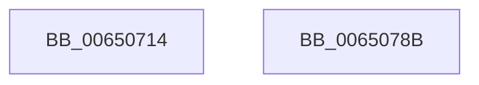

# EtwTraceWorkloadClassUpdate

- RVA: `0x00650714`–`0x0065078C` (길이 `120` bytes)
- VA: `0x0000000140650714`
- 실행 섹션: `.text`
- PDB 이름 있음: `예`; PDB Function 태그: `아니요`
- unwind 정보 RVA: `0x00079788`
- 디코드: `26`개 명령, `120/120` bytes 표시
- 미해석 바이트: `0` (있으면 어셈블리에 `.byte`로 보존)

> 이 문서는 커널 이미지의 기계어와 PDB 기호를 분석해 생성했습니다. 4번과 5번은 함수 원형과 자료형을 바이너리 사용 방식에서 추정한 C 해석이며 원본 소스 복구 결과는 아닙니다.

## 1. Dependencies

- 직접 호출 지점: **2**; 고유 호출 대상: **2**
- 직접 호출자로 확인된 함수: **2**
- RIP 상대 이미지 참조: **1**

### Outgoing calls
- `0x00650774` → [EtwTraceKernelEvent](../23/EtwTraceKernelEvent_function_00235350.md) (function, `0x00235350`)
- `0x00650781` → [_security_check_cookie](../6A/_security_check_cookie_function_006AC640.md) (function, `0x006AC640`)

### Direct callers
- [KeTraceHgsPlusRundown](../5C/KeTraceHgsPlusRundown_function_005C3728.md) at `0x005C3762`
- [sub_006E453A](../6E/Unknown_function_006E453A.md) at `0x006E453D`

### Static image references
- `0x0065071B` → RVA `0x00E0A740` (`.data`; read)

## 2. Other-region calls and transfers

- 다른 실행 섹션으로 향하는 call: **0**
- 별도 외부 분기/꼬리 이동을 확인하지 못했습니다.

## 3. Assembly (complete function range)

```asm
00650714  4C 8B DC                        mov r11, rsp
00650717  48 83 EC 58                     sub rsp, 0x58
0065071B  48 8B 05 1E A0 7B 00            mov rax, qword ptr [rip + 0x7ba01e]
00650722  48 33 C4                        xor rax, rsp
00650725  48 89 44 24 48                  mov qword ptr [rsp + 0x48], rax
0065072A  8B 81 10 05 00 00               mov eax, dword ptr [rcx + 0x510]
00650730  41 B9 79 0F 00 00               mov r9d, 0xf79
00650736  89 44 24 30                     mov dword ptr [rsp + 0x30], eax
0065073A  49 8D 4B E0                     lea rcx, [r11 - 0x20]
0065073E  88 54 24 36                     mov byte ptr [rsp + 0x36], dl
00650742  49 8D 43 D8                     lea rax, [r11 - 0x28]
00650746  49 89 43 E0                     mov qword ptr [r11 - 0x20], rax
0065074A  BA 01 00 00 00                  mov edx, 1
0065074F  83 64 24 44 00                  and dword ptr [rsp + 0x44], 0
00650754  66 45 89 43 DC                  mov word ptr [r11 - 0x24], r8w
00650759  41 B8 00 01 00 A0               mov r8d, 0xa0000100
0065075F  C6 44 24 37 00                  mov byte ptr [rsp + 0x37], 0
00650764  C7 44 24 40 08 00 00 00         mov dword ptr [rsp + 0x40], 8
0065076C  C7 44 24 20 02 02 00 00         mov dword ptr [rsp + 0x20], 0x202
00650774  E8 D7 4B BE FF                  call 0x140235350
00650779  48 8B 4C 24 48                  mov rcx, qword ptr [rsp + 0x48]
0065077E  48 33 CC                        xor rcx, rsp
00650781  E8 BA BE 05 00                  call 0x1406ac640
00650786  48 83 C4 58                     add rsp, 0x58
0065078A  C3                              ret
0065078B  CC                              int3
```

## 4. C-style interpretation (structured pseudocode)

```c
__int64 __fastcall EtwTraceWorkloadClassUpdate(__int64 a1, unsigned __int8 a2, unsigned __int16 a3)
{
    __int64 result;
    __int64 v_rsp;
    unsigned __int64 v_stack_m10;
    unsigned int v_stack_m14;
    unsigned int v_stack_m18;
    unsigned __int8 v_stack_m21;
    unsigned __int8 v_stack_m22;
    unsigned int v_stack_m28;
    unsigned int v_stack_m38;

    v_rsp = (v_rsp) - (88);
    result = (*(unsigned __int64 *)(v_rip + 8101918)) ^ (v_rsp);
    v_stack_m10 = result;
    v_stack_m28 = (unsigned int)((unsigned int)(*(unsigned int *)(a1 + 1296)));
    v_stack_m22 = a2;
    *(unsigned __int64 *)(v_rsp - 32) = v_rsp - 40;
    *(unsigned __int16 *)(v_rsp - 36) = a3;
    v_stack_m21 = 0;
    v_stack_m18 = 8;
    v_stack_m38 = 514;
    result = EtwTraceKernelEvent(v_rsp - 32, 1, (unsigned int)(0xA0000100ULL), (unsigned int)(0xF79ULL));
    a1 = (v_stack_m10) ^ (v_rsp);
    result = _security_check_cookie(a1, 1, (unsigned int)(0xA0000100ULL), (unsigned int)(0xF79ULL));
    v_rsp = (v_rsp) + (88);
    return result;
}
```

## 5. (Beta) C Style

```c
int64_t EtwTraceWorkloadClassUpdate(void *Arg1, uint8_t Arg2, uint16_t Arg3)
{
    uint8_t *arg1 = (uint8_t *)Arg1;

    int64_t result;
    int64_t local_rsp;
    uint64_t v_stack_m10;
    uint32_t v_stack_m14;
    uint32_t v_stack_m18;
    uint8_t v_stack_m21;
    uint8_t v_stack_m22;
    uint32_t v_stack_m28;
    uint32_t v_stack_m38;

    local_rsp = (local_rsp) - (88);
    result = (*(uint64_t *)(v_rip + 0x7BA01E)) ^ (local_rsp);
    v_stack_m10 = result;
    v_stack_m28 = (uint32_t)((uint32_t)(*(uint32_t *)(arg1 + 0x510)));
    v_stack_m22 = Arg2;
    *(uint64_t *)(local_rsp - 0x20) = local_rsp - 40;
    *(uint16_t *)(local_rsp - 0x24) = Arg3;
    v_stack_m21 = 0;
    v_stack_m18 = 8;
    v_stack_m38 = 514;
    result = EtwTraceKernelEvent(local_rsp - 32, 1, (uint32_t)(0xA0000100ULL), (uint32_t)(0xF79ULL));
    Arg1 = (v_stack_m10) ^ (local_rsp);
    result = _security_check_cookie(Arg1, 1, (uint32_t)(0xA0000100ULL), (uint32_t)(0xF79ULL));
    local_rsp = (local_rsp) + (88);
    return result;
}
```

### 관측된 메모리 오프셋

구조체 형식이 확인되지 않은 접근은 인자 기준의 오프셋으로만 기록했습니다.

| 기준 인자 | 오프셋 표현 | 폭 (bit) | 접근 |
|---|---:|---:|---|
| `Arg1` | `+ 0x510` | `32` | `R` |

## 6. Execution-region graph

[열기: 2D/3D 그래프와 함수 탐색 컨트롤 패널](../../../control-panel.html?section=text&rva=0x00650714&view=graph)

- 2D 그래프는 위에서 아래로 흐르고, 3D 그래프는 빈 공간을 드래그해 회전합니다. Shift+드래그는 이동, 휠은 확대·축소, 함수 노드 선택은 대상 보고서 이동입니다.

### Static fallback


