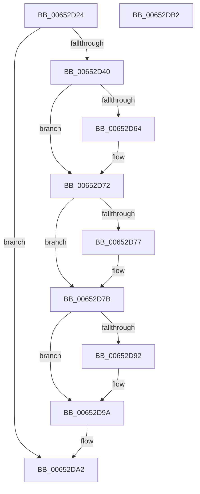

# EtwpBufferingModeCompressionFlush

- RVA: `0x00652D24`–`0x00652DB3` (길이 `143` bytes)
- VA: `0x0000000140652D24`
- 실행 섹션: `.text`
- PDB 이름 있음: `예`; PDB Function 태그: `아니요`
- unwind 정보 RVA: `0x00060BC4`
- 디코드: `41`개 명령, `143/143` bytes 표시
- 미해석 바이트: `0` (있으면 어셈블리에 `.byte`로 보존)

> 이 문서는 커널 이미지의 기계어와 PDB 기호를 분석해 생성했습니다. 4번과 5번은 함수 원형과 자료형을 바이너리 사용 방식에서 추정한 C 해석이며 원본 소스 복구 결과는 아닙니다.

## 1. Dependencies

- 직접 호출 지점: **6**; 고유 호출 대상: **6**
- 직접 호출자로 확인된 함수: **1**
- RIP 상대 이미지 참조: **0**

### Outgoing calls
- `0x00652D40` → [EtwpCompressPendingBuffers](EtwpCompressPendingBuffers_function_00653140.md) (function, `0x00653140`)
- `0x00652D54` → [KeAbPreAcquire](../21/KeAbPreAcquire_function_00210230.md) (function, `0x00210230`)
- `0x00652D6D` → [ExfAcquirePushLockExclusiveEx](../20/ExfAcquirePushLockExclusiveEx_function_0020FC90.md) (function, `0x0020FC90`)
- `0x00652D7E` → [EtwpRelinquishCompressionTarget](EtwpRelinquishCompressionTarget_function_00653818.md) (function, `0x00653818`)
- `0x00652D95` → [ExfTryToWakePushLock](../26/ExfTryToWakePushLock_function_00265DD0.md) (function, `0x00265DD0`)
- `0x00652D9D` → [KeAbPostRelease](../2E/KeAbPostRelease_function_002E1600.md) (function, `0x002E1600`)

### Direct callers
- [EtwpBufferingModeFlush](../../page/9B/EtwpBufferingModeFlush_function_009BD8F4.md) at `0x009BDADD`

### Static image references
- 디코드된 RIP-relative 메모리 참조가 없습니다.

## 2. Other-region calls and transfers

- 다른 실행 섹션으로 향하는 call: **0**
- 별도 외부 분기/꼬리 이동을 확인하지 못했습니다.

## 3. Assembly (complete function range)

```asm
00652D24  48 89 5C 24 08                  mov qword ptr [rsp + 8], rbx
00652D29  48 89 74 24 10                  mov qword ptr [rsp + 0x10], rsi
00652D2E  57                              push rdi
00652D2F  48 83 EC 20                     sub rsp, 0x20
00652D33  8B 81 98 05 00 00               mov eax, dword ptr [rcx + 0x598]
00652D39  48 8B F1                        mov rsi, rcx
00652D3C  85 C0                           test eax, eax
00652D3E  74 62                           je 0x140652da2
00652D40  E8 FB 03 00 00                  call 0x140653140
00652D45  48 8D 9E 80 05 00 00            lea rbx, [rsi + 0x580]
00652D4C  45 33 C0                        xor r8d, r8d
00652D4F  48 8B CB                        mov rcx, rbx
00652D52  33 D2                           xor edx, edx
00652D54  E8 D7 D4 BB FF                  call 0x140210230
00652D59  F0 48 0F BA 2B 00               lock bts qword ptr [rbx], 0
00652D5F  48 8B F8                        mov rdi, rax
00652D62  73 0E                           jae 0x140652d72
00652D64  4C 8B C3                        mov r8, rbx
00652D67  48 8B D0                        mov rdx, rax
00652D6A  48 8B CB                        mov rcx, rbx
00652D6D  E8 1E CF BB FF                  call 0x14020fc90
00652D72  48 85 FF                        test rdi, rdi
00652D75  74 04                           je 0x140652d7b
00652D77  C6 47 0A 01                     mov byte ptr [rdi + 0xa], 1
00652D7B  48 8B CE                        mov rcx, rsi
00652D7E  E8 95 0A 00 00                  call 0x140653818
00652D83  48 83 C8 FF                     or rax, 0xffffffffffffffff
00652D87  F0 48 0F C1 03                  lock xadd qword ptr [rbx], rax
00652D8C  24 06                           and al, 6
00652D8E  3C 02                           cmp al, 2
00652D90  75 08                           jne 0x140652d9a
00652D92  48 8B CB                        mov rcx, rbx
00652D95  E8 36 30 C1 FF                  call 0x140265dd0
00652D9A  48 8B CB                        mov rcx, rbx
00652D9D  E8 5E E8 C8 FF                  call 0x1402e1600
00652DA2  48 8B 5C 24 30                  mov rbx, qword ptr [rsp + 0x30]
00652DA7  48 8B 74 24 38                  mov rsi, qword ptr [rsp + 0x38]
00652DAC  48 83 C4 20                     add rsp, 0x20
00652DB0  5F                              pop rdi
00652DB1  C3                              ret
00652DB2  CC                              int3
```

## 4. C-style interpretation (structured pseudocode)

```c
__int64 __fastcall EtwpBufferingModeCompressionFlush(__int64 a1, int a2, int a3)
{
    __int64 result;
    __int64 v_rsp;
    unsigned __int64 v_stack_p10;
    unsigned __int64 v_stack_p8;

    v_stack_p8 = v_rbx;
    v_stack_p10 = v_rsi;
    v_rsp = (v_rsp) - (32);
    if ((unsigned int)((unsigned int)(*(unsigned int *)(a1 + 1432))) == 0) goto loc_00652DA2;
    result = EtwpCompressPendingBuffers(a1, a2, a3, a4);
    a3 = 0;
    a2 = 0;
    result = KeAbPreAcquire(a1 + 1408, a2, a3, a4);
    if (!(condition_is_above_or_equal)) {
        a3 = a1 + 1408;
        a2 = result;
        a1 = a1 + 1408;
        result = ExfAcquirePushLockExclusiveEx(a1, a2, a3, a4);
    }
    if (result != 0) {
        *(unsigned __int8 *)(result + 10) = 1;
    }
    result = EtwpRelinquishCompressionTarget(a1, a2, a3, a4);
    result = (result) | (-1);
    result = (unsigned __int8)((result) & (6));
    if (((unsigned __int8)(result)) == 2) {
        a1 = a1 + 1408;
        result = ExfTryToWakePushLock(a1, a2, a3, a4);
    }
    result = KeAbPostRelease(a1 + 1408, a2, a3, a4);
loc_00652DA2:
    v_rsp = (v_rsp) + (32);
    return result;
}
```

## 5. (Beta) C Style

```c
int64_t EtwpBufferingModeCompressionFlush(void *Arg1, int32_t Arg2, int32_t Arg3)
{
    uint8_t *arg1 = (uint8_t *)Arg1;

    int64_t result;
    int64_t local_rsp;
    uint64_t v_stack_p10;
    uint64_t v_stack_p8;

    v_stack_p8 = local_rbx;
    v_stack_p10 = local_rsi;
    local_rsp = (local_rsp) - (32);
    if ((uint32_t)((uint32_t)(*(uint32_t *)(arg1 + 0x598))) == 0) goto loc_00652DA2;
    result = EtwpCompressPendingBuffers(Arg1, Arg2, Arg3, a4);
    Arg3 = 0;
    Arg2 = 0;
    result = KeAbPreAcquire(Arg1 + 1408, Arg2, Arg3, a4);
    if (!(condition_is_above_or_equal)) {
        Arg3 = Arg1 + 1408;
        Arg2 = result;
        Arg1 = Arg1 + 1408;
        result = ExfAcquirePushLockExclusiveEx(Arg1, Arg2, Arg3, a4);
    }
    if (result != 0) {
        *(uint8_t *)(result + 0xA) = 1;
    }
    result = EtwpRelinquishCompressionTarget(Arg1, Arg2, Arg3, a4);
    result = (result) | (-1);
    result = (uint8_t)((result) & (6));
    if (((uint8_t)(result)) == 2) {
        Arg1 = Arg1 + 1408;
        result = ExfTryToWakePushLock(Arg1, Arg2, Arg3, a4);
    }
    result = KeAbPostRelease(Arg1 + 1408, Arg2, Arg3, a4);
loc_00652DA2:
    local_rsp = (local_rsp) + (32);
    return result;
}
```

### 관측된 메모리 오프셋

구조체 형식이 확인되지 않은 접근은 인자 기준의 오프셋으로만 기록했습니다.

| 기준 인자 | 오프셋 표현 | 폭 (bit) | 접근 |
|---|---:|---:|---|
| `Arg1` | `+ 0x0` | `64` | `R/W` |
| `Arg1` | `+ 0x580` | `64` | `R` |
| `Arg1` | `+ 0x598` | `32` | `R` |

## 6. Execution-region graph

[열기: 2D/3D 그래프와 함수 탐색 컨트롤 패널](../../../control-panel.html?section=text&rva=0x00652D24&view=graph)

- 2D 그래프는 위에서 아래로 흐르고, 3D 그래프는 빈 공간을 드래그해 회전합니다. Shift+드래그는 이동, 휠은 확대·축소, 함수 노드 선택은 대상 보고서 이동입니다.

### Static fallback


