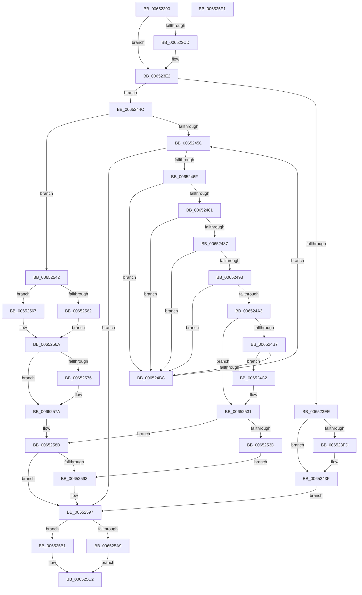

# EtwpBugCheckMultiPartCallback

- RVA: `0x00652390`–`0x006525E2` (길이 `594` bytes)
- VA: `0x0000000140652390`
- 실행 섹션: `.text`
- PDB 이름 있음: `예`; PDB Function 태그: `아니요`
- unwind 정보 RVA: `0x0005FEF8`
- 디코드: `155`개 명령, `594/594` bytes 표시
- 미해석 바이트: `0` (있으면 어셈블리에 `.byte`로 보존)

> 이 문서는 커널 이미지의 기계어와 PDB 기호를 분석해 생성했습니다. 4번과 5번은 함수 원형과 자료형을 바이너리 사용 방식에서 추정한 C 해석이며 원본 소스 복구 결과는 아닙니다.

## 1. Dependencies

- 직접 호출 지점: **2**; 고유 호출 대상: **2**
- 직접 호출자로 확인된 함수: **0**
- RIP 상대 이미지 참조: **8**

### Outgoing calls
- `0x0065249A` → [KeTestSpinLock](../41/KeTestSpinLock_function_00419C10.md) (function, `0x00419C10`)
- `0x0065251F` → [memcpy](../6C/memcpy_function_006C6840.md) (function, `0x006C6840`)

### Direct callers
- 이 함수 시작 RVA로 연결되는 직접 call은 확인되지 않았습니다. 간접 호출은 완전히 역산할 수 없습니다.

### Static image references
- `0x006523AD` → RVA `0x0002B110` (`.rdata`; read)
- `0x006523D0` → RVA `0x00EFF150` (`.data`; read)
- `0x00652400` → RVA `0x00EFF9E0` (`.data`; read)
- `0x0065240B` → RVA `0x00EFF288` (`.data`; read)
- `0x00652414` → RVA `0x00EFF258` (`.data`; read)
- `0x0065241F` → RVA `0x00FC6AA0` (`ALMOSTRO`; read)
- `0x00652427` → RVA `0x00E0A74C` (`.data`; read)
- `0x0065245C` → RVA `0x00FC6AA8` (`ALMOSTRO`; read)

## 2. Other-region calls and transfers

- 다른 실행 섹션으로 향하는 call: **0**
- 별도 외부 분기/꼬리 이동을 확인하지 못했습니다.

## 3. Assembly (complete function range)

```asm
00652390  48 8B C4                        mov rax, rsp
00652393  48 89 58 08                     mov qword ptr [rax + 8], rbx
00652397  48 89 68 10                     mov qword ptr [rax + 0x10], rbp
0065239B  48 89 70 18                     mov qword ptr [rax + 0x18], rsi
0065239F  48 89 78 20                     mov qword ptr [rax + 0x20], rdi
006523A3  41 54                           push r12
006523A5  41 56                           push r14
006523A7  41 57                           push r15
006523A9  48 83 EC 20                     sub rsp, 0x20
006523AD  0F 10 05 5C 8D 9D FF            movups xmm0, xmmword ptr [rip - 0x6272a4]
006523B4  49 8B 58 30                     mov rbx, qword ptr [r8 + 0x30]
006523B8  45 33 FF                        xor r15d, r15d
006523BB  45 89 78 28                     mov dword ptr [r8 + 0x28], r15d
006523BF  49 8B F8                        mov rdi, r8
006523C2  F3 41 0F 7F 40 10               movdqu xmmword ptr [r8 + 0x10], xmm0
006523C8  48 85 DB                        test rbx, rbx
006523CB  75 15                           jne 0x1406523e2
006523CD  0F 57 C0                        xorps xmm0, xmm0
006523D0  48 8D 1D 79 CD 8A 00            lea rbx, [rip + 0x8acd79]
006523D7  0F 11 05 72 CD 8A 00            movups xmmword ptr [rip + 0x8acd72], xmm0
006523DE  49 89 58 30                     mov qword ptr [r8 + 0x30], rbx
006523E2  41 BC 01 00 00 00               mov r12d, 1
006523E8  44 38 7B 02                     cmp byte ptr [rbx + 2], r15b
006523EC  75 5E                           jne 0x14065244c
006523EE  41 8D 54 24 1F                  lea edx, [r12 + 0x1f]
006523F3  41 89 50 28                     mov dword ptr [r8 + 0x28], edx
006523F7  45 39 78 08                     cmp dword ptr [r8 + 8], r15d
006523FB  74 42                           je 0x14065243f
006523FD  49 8B 08                        mov rcx, qword ptr [r8]
00652400  48 8B 05 D9 D5 8A 00            mov rax, qword ptr [rip + 0x8ad5d9]
00652407  48 89 41 10                     mov qword ptr [rcx + 0x10], rax
0065240B  8B 05 77 CE 8A 00               mov eax, dword ptr [rip + 0x8ace77]
00652411  89 41 08                        mov dword ptr [rcx + 8], eax
00652414  48 8B 05 3D CE 8A 00            mov rax, qword ptr [rip + 0x8ace3d]
0065241B  48 89 41 18                     mov qword ptr [rcx + 0x18], rax
0065241F  8B 05 7B 46 97 00               mov eax, dword ptr [rip + 0x97467b]
00652425  89 01                           mov dword ptr [rcx], eax
00652427  8B 05 1F 83 7B 00               mov eax, dword ptr [rip + 0x7b831f]
0065242D  89 41 04                        mov dword ptr [rcx + 4], eax
00652430  49 8B 00                        mov rax, qword ptr [r8]
00652433  49 89 40 20                     mov qword ptr [r8 + 0x20], rax
00652437  41 89 50 28                     mov dword ptr [r8 + 0x28], edx
0065243B  41 89 50 08                     mov dword ptr [r8 + 8], edx
0065243F  44 88 63 02                     mov byte ptr [rbx + 2], r12b
00652443  48 8D 73 08                     lea rsi, [rbx + 8]
00652447  E9 4B 01 00 00                  jmp 0x140652597
0065244C  48 8D 73 08                     lea rsi, [rbx + 8]
00652450  4C 8B 06                        mov r8, qword ptr [rsi]
00652453  4D 85 C0                        test r8, r8
00652456  0F 85 E6 00 00 00               jne 0x140652542
0065245C  48 8B 15 45 46 97 00            mov rdx, qword ptr [rip + 0x974645]
00652463  0F B7 03                        movzx eax, word ptr [rbx]
00652466  3B 42 10                        cmp eax, dword ptr [rdx + 0x10]
00652469  0F 83 28 01 00 00               jae 0x140652597
0065246F  8B C8                           mov ecx, eax
00652471  48 8B 82 C8 02 00 00            mov rax, qword ptr [rdx + 0x2c8]
00652478  4C 8B 34 C8                     mov r14, qword ptr [rax + rcx*8]
0065247C  45 84 F4                        test r12b, r14b
0065247F  75 3B                           jne 0x1406524bc
00652481  45 39 7E 0C                     cmp dword ptr [r14 + 0xc], r15d
00652485  7D 35                           jge 0x1406524bc
00652487  41 8B 86 2C 01 00 00            mov eax, dword ptr [r14 + 0x12c]
0065248E  41 84 C4                        test r12b, al
00652491  75 29                           jne 0x1406524bc
00652493  49 8D 8E B8 02 00 00            lea rcx, [r14 + 0x2b8]
0065249A  E8 71 77 DC FF                  call 0x140419c10
0065249F  84 C0                           test al, al
006524A1  74 19                           je 0x1406524bc
006524A3  41 0F B7 AE 88 00 00 00         movzx ebp, word ptr [r14 + 0x88]
006524AB  83 C5 30                        add ebp, 0x30
006524AE  89 6F 28                        mov dword ptr [rdi + 0x28], ebp
006524B1  44 39 7F 08                     cmp dword ptr [rdi + 8], r15d
006524B5  74 7A                           je 0x140652531
006524B7  3B 6F 0C                        cmp ebp, dword ptr [rdi + 0xc]
006524BA  76 06                           jbe 0x1406524c2
006524BC  66 44 01 23                     add word ptr [rbx], r12w
006524C0  EB 9A                           jmp 0x14065245c
006524C2  48 8B 0F                        mov rcx, qword ptr [rdi]
006524C5  C7 01 E1 AF EB 01               mov dword ptr [rcx], 0x1ebafe1
006524CB  41 8B 06                        mov eax, dword ptr [r14]
006524CE  89 41 04                        mov dword ptr [rcx + 4], eax
006524D1  41 8B 46 04                     mov eax, dword ptr [r14 + 4]
006524D5  89 41 10                        mov dword ptr [rcx + 0x10], eax
006524D8  41 8B 86 C8 00 00 00            mov eax, dword ptr [r14 + 0xc8]
006524DF  89 41 0C                        mov dword ptr [rcx + 0xc], eax
006524E2  49 8B 86 18 03 00 00            mov rax, qword ptr [r14 + 0x318]
006524E9  48 89 41 18                     mov qword ptr [rcx + 0x18], rax
006524ED  41 8B 46 0C                     mov eax, dword ptr [r14 + 0xc]
006524F1  89 41 08                        mov dword ptr [rcx + 8], eax
006524F4  41 0F B7 86 88 00 00 00         movzx eax, word ptr [r14 + 0x88]
006524FC  89 41 14                        mov dword ptr [rcx + 0x14], eax
006524FF  41 0F 10 86 30 01 00 00         movups xmm0, xmmword ptr [r14 + 0x130]
00652507  F3 0F 7F 41 20                  movdqu xmmword ptr [rcx + 0x20], xmm0
0065250C  45 0F B7 86 88 00 00 00         movzx r8d, word ptr [r14 + 0x88]
00652514  48 83 C1 30                     add rcx, 0x30
00652518  49 8B 96 90 00 00 00            mov rdx, qword ptr [r14 + 0x90]
0065251F  E8 1C 43 07 00                  call 0x1406c6840
00652524  48 8B 07                        mov rax, qword ptr [rdi]
00652527  48 89 47 20                     mov qword ptr [rdi + 0x20], rax
0065252B  89 6F 28                        mov dword ptr [rdi + 0x28], ebp
0065252E  89 6F 08                        mov dword ptr [rdi + 8], ebp
00652531  49 8D 46 50                     lea rax, [r14 + 0x50]
00652535  48 8B 08                        mov rcx, qword ptr [rax]
00652538  48 3B C8                        cmp rcx, rax
0065253B  75 4E                           jne 0x14065258b
0065253D  4C 89 3E                        mov qword ptr [rsi], r15
00652540  EB 51                           jmp 0x140652593
00652542  48 8B 05 5F 45 97 00            mov rax, qword ptr [rip + 0x97455f]
00652549  0F B7 13                        movzx edx, word ptr [rbx]
0065254C  48 8B 88 C8 02 00 00            mov rcx, qword ptr [rax + 0x2c8]
00652553  4C 8B 0C D1                     mov r9, qword ptr [rcx + rdx*8]
00652557  49 8B 48 10                     mov rcx, qword ptr [r8 + 0x10]
0065255B  8B 41 08                        mov eax, dword ptr [rcx + 8]
0065255E  3B 01                           cmp eax, dword ptr [rcx]
00652560  76 05                           jbe 0x140652567
00652562  8B 41 04                        mov eax, dword ptr [rcx + 4]
00652565  EB 03                           jmp 0x14065256a
00652567  8B 41 08                        mov eax, dword ptr [rcx + 8]
0065256A  89 41 30                        mov dword ptr [rcx + 0x30], eax
0065256D  89 47 28                        mov dword ptr [rdi + 0x28], eax
00652570  44 39 7F 08                     cmp dword ptr [rdi + 8], r15d
00652574  74 04                           je 0x14065257a
00652576  48 89 4F 20                     mov qword ptr [rdi + 0x20], rcx
0065257A  48 8B 06                        mov rax, qword ptr [rsi]
0065257D  48 8B 08                        mov rcx, qword ptr [rax]
00652580  49 8D 41 50                     lea rax, [r9 + 0x50]
00652584  48 3B C8                        cmp rcx, rax
00652587  49 0F 44 CF                     cmove rcx, r15
0065258B  48 89 0E                        mov qword ptr [rsi], rcx
0065258E  48 85 C9                        test rcx, rcx
00652591  75 04                           jne 0x140652597
00652593  66 44 01 23                     add word ptr [rbx], r12w
00652597  48 8B 05 0A 45 97 00            mov rax, qword ptr [rip + 0x97450a]
0065259E  0F B7 0B                        movzx ecx, word ptr [rbx]
006525A1  8B 57 38                        mov edx, dword ptr [rdi + 0x38]
006525A4  3B 48 10                        cmp ecx, dword ptr [rax + 0x10]
006525A7  73 08                           jae 0x1406525b1
006525A9  41 0B D4                        or edx, r12d
006525AC  89 57 38                        mov dword ptr [rdi + 0x38], edx
006525AF  EB 11                           jmp 0x1406525c2
006525B1  83 E2 FE                        and edx, 0xfffffffe
006525B4  89 57 38                        mov dword ptr [rdi + 0x38], edx
006525B7  4C 89 3E                        mov qword ptr [rsi], r15
006525BA  44 88 7B 02                     mov byte ptr [rbx + 2], r15b
006525BE  66 44 89 3B                     mov word ptr [rbx], r15w
006525C2  48 8B 5C 24 40                  mov rbx, qword ptr [rsp + 0x40]
006525C7  48 8B 6C 24 48                  mov rbp, qword ptr [rsp + 0x48]
006525CC  48 8B 74 24 50                  mov rsi, qword ptr [rsp + 0x50]
006525D1  48 8B 7C 24 58                  mov rdi, qword ptr [rsp + 0x58]
006525D6  48 83 C4 20                     add rsp, 0x20
006525DA  41 5F                           pop r15
006525DC  41 5E                           pop r14
006525DE  41 5C                           pop r12
006525E0  C3                              ret
006525E1  CC                              int3
```

## 4. C-style interpretation (structured pseudocode)

```c
__int64 __fastcall EtwpBugCheckMultiPartCallback(__int64 a1, __int64 a2, __int64 a3)
{
    __int64 result;
    __int64 v_r15;
    __int64 v_rbp;
    __int64 v_rbx;
    __int64 v_rsp;
    unsigned __int64 v_stack_p10;
    unsigned __int64 v_stack_p18;
    unsigned __int64 v_stack_p20;
    unsigned __int64 v_stack_p8;

    *(unsigned __int64 *)(v_rsp + 8) = v_rbx;
    *(unsigned __int64 *)(v_rsp + 16) = v_rbp;
    *(unsigned __int64 *)(v_rsp + 24) = v_rsi;
    *(unsigned __int64 *)(v_rsp + 32) = v_rdi;
    v_rsp = (v_rsp) - (32);
    v_r15 = 0;
    *(unsigned int *)(a3 + 40) = 0;
    *(unsigned __int64 *)(a3 + 16) = v_xmm0;
    v_rbx = *(unsigned __int64 *)(a3 + 48);
    if (*(unsigned __int64 *)(a3 + 48) == 0) {
        v_rbx = v_rip + 9096569;
        *(unsigned __int64 *)(v_rip + 9096562) = v_xmm0;
        *(unsigned __int64 *)(a3 + 48) = v_rbx;
    }
    if ((*(unsigned __int8 *)(v_rbx + 2)) != 0) goto loc_0065244C;
    *(unsigned int *)(a3 + 40) = (unsigned int)(1 + 31);
    result = v_rsp;
    if ((*(unsigned int *)(a3 + 8)) != 0) {
        a1 = *(unsigned __int64 *)(a3);
        result = *(unsigned __int64 *)(v_rip + 9098713);
        *(unsigned __int64 *)(a1 + 16) = result;
        result = *(unsigned int *)(v_rip + 9096823);
        *(unsigned int *)(a1 + 8) = (unsigned int)(result);
        result = *(unsigned __int64 *)(v_rip + 9096765);
        *(unsigned __int64 *)(a1 + 24) = result;
        result = *(unsigned int *)(v_rip + 9913979);
        *(unsigned int *)(a1) = (unsigned int)(result);
        result = *(unsigned int *)(v_rip + 8094495);
        *(unsigned int *)(a1 + 4) = (unsigned int)(result);
        result = *(unsigned __int64 *)(a3);
        *(unsigned __int64 *)(a3 + 32) = result;
        *(unsigned int *)(a3 + 40) = (unsigned int)(1 + 31);
        *(unsigned int *)(a3 + 8) = (unsigned int)(1 + 31);
    }
    *(unsigned __int8 *)(v_rbx + 2) = 1;
    goto loc_00652597;
loc_0065244C:
    if (*(unsigned __int64 *)(v_rbx + 8) != 0) goto loc_00652542;
loc_0065245C:
    if (((unsigned int)(*(unsigned __int16 *)(v_rbx))) >= (*(unsigned int *)(*(unsigned __int64 *)(v_rip + 9913925) + 16))) goto loc_00652597;
    if (((1) & ((unsigned __int8)(*(unsigned __int64 *)(*(unsigned __int64 *)(*(unsigned __int64 *)(v_rip + 9913925) + 712) + (unsigned int)((unsigned int)(*(unsigned __int16 *)(v_rbx))) * 8)))) != 0) goto loc_006524BC;
    if ((*(unsigned int *)(*(unsigned __int64 *)(*(unsigned __int64 *)(*(unsigned __int64 *)(v_rip + 9913925) + 712) + (unsigned int)((unsigned int)(*(unsigned __int16 *)(v_rbx))) * 8) + 12)) >= 0) goto loc_006524BC;
    if (((1) & ((unsigned __int8)((unsigned int)(*(unsigned int *)(*(unsigned __int64 *)(*(unsigned __int64 *)(*(unsigned __int64 *)(v_rip + 9913925) + 712) + (unsigned int)((unsigned int)(*(unsigned __int16 *)(v_rbx))) * 8) + 300))))) != 0) goto loc_006524BC;
    result = KeTestSpinLock(*(unsigned __int64 *)(*(unsigned __int64 *)(*(unsigned __int64 *)(v_rip + 9913925) + 712) + (unsigned int)((unsigned int)(*(unsigned __int16 *)(v_rbx))) * 8) + 696, *(unsigned __int64 *)(v_rip + 9913925), *(unsigned __int64 *)(v_rbx + 8), a4);
    if ((unsigned __int8)(result) == 0) goto loc_006524BC;
    v_rbp = (unsigned int)((*(unsigned __int16 *)(*(unsigned __int64 *)(*(unsigned __int64 *)(*(unsigned __int64 *)(v_rip + 9913925) + 712) + (unsigned int)((unsigned int)(*(unsigned __int16 *)(v_rbx))) * 8) + 136)) + (48));
    *(unsigned int *)(a3 + 40) = (unsigned int)(v_rbp);
    if ((*(unsigned int *)(a3 + 8)) == 0) goto loc_00652531;
    if (((unsigned int)(v_rbp)) <= (*(unsigned int *)(a3 + 12))) goto loc_006524C2;
loc_006524BC:
    goto loc_0065245C;
loc_006524C2:
    *(unsigned int *)(*(unsigned __int64 *)(a3)) = 0x1EBAFE1ULL;
    *(unsigned int *)(*(unsigned __int64 *)(a3) + 4) = (unsigned int)((unsigned int)(*(unsigned int *)(*(unsigned __int64 *)(*(unsigned __int64 *)(*(unsigned __int64 *)(v_rip + 9913925) + 712) + (unsigned int)((unsigned int)(*(unsigned __int16 *)(v_rbx))) * 8))));
    *(unsigned int *)(*(unsigned __int64 *)(a3) + 16) = (unsigned int)((unsigned int)(*(unsigned int *)(*(unsigned __int64 *)(*(unsigned __int64 *)(*(unsigned __int64 *)(v_rip + 9913925) + 712) + (unsigned int)((unsigned int)(*(unsigned __int16 *)(v_rbx))) * 8) + 4)));
    *(unsigned int *)(*(unsigned __int64 *)(a3) + 12) = (unsigned int)((unsigned int)(*(unsigned int *)(*(unsigned __int64 *)(*(unsigned __int64 *)(*(unsigned __int64 *)(v_rip + 9913925) + 712) + (unsigned int)((unsigned int)(*(unsigned __int16 *)(v_rbx))) * 8) + 200)));
    *(unsigned __int64 *)(*(unsigned __int64 *)(a3) + 24) = *(unsigned __int64 *)(*(unsigned __int64 *)(*(unsigned __int64 *)(*(unsigned __int64 *)(v_rip + 9913925) + 712) + (unsigned int)((unsigned int)(*(unsigned __int16 *)(v_rbx))) * 8) + 792);
    *(unsigned int *)(*(unsigned __int64 *)(a3) + 8) = (unsigned int)((unsigned int)(*(unsigned int *)(*(unsigned __int64 *)(*(unsigned __int64 *)(*(unsigned __int64 *)(v_rip + 9913925) + 712) + (unsigned int)((unsigned int)(*(unsigned __int16 *)(v_rbx))) * 8) + 12)));
    *(unsigned int *)(*(unsigned __int64 *)(a3) + 20) = (unsigned int)(*(unsigned __int16 *)(*(unsigned __int64 *)(*(unsigned __int64 *)(*(unsigned __int64 *)(v_rip + 9913925) + 712) + (unsigned int)((unsigned int)(*(unsigned __int16 *)(v_rbx))) * 8) + 136));
    *(unsigned __int64 *)(*(unsigned __int64 *)(a3) + 32) = v_xmm0;
    a1 = (*(unsigned __int64 *)(a3)) + (48);
    result = memcpy(a1, *(unsigned __int64 *)(*(unsigned __int64 *)(*(unsigned __int64 *)(*(unsigned __int64 *)(v_rip + 9913925) + 712) + (unsigned int)((unsigned int)(*(unsigned __int16 *)(v_rbx))) * 8) + 144), *(unsigned __int16 *)(*(unsigned __int64 *)(*(unsigned __int64 *)(*(unsigned __int64 *)(v_rip + 9913925) + 712) + (unsigned int)((unsigned int)(*(unsigned __int16 *)(v_rbx))) * 8) + 136), a4);
    *(unsigned __int64 *)(a3 + 32) = *(unsigned __int64 *)(a3);
    *(unsigned int *)(a3 + 40) = (unsigned int)(v_rbp);
    *(unsigned int *)(a3 + 8) = (unsigned int)(v_rbp);
loc_00652531:
    if ((*(unsigned __int64 *)(*(unsigned __int64 *)(*(unsigned __int64 *)(*(unsigned __int64 *)(v_rip + 9913925) + 712) + (unsigned int)((unsigned int)(*(unsigned __int16 *)(v_rbx))) * 8) + 80)) != (*(unsigned __int64 *)(*(unsigned __int64 *)(*(unsigned __int64 *)(v_rip + 9913925) + 712) + (unsigned int)((unsigned int)(*(unsigned __int16 *)(v_rbx))) * 8) + 80)) goto loc_0065258B;
    *(unsigned __int64 *)(v_rbx + 8) = 0;
    goto loc_00652593;
loc_00652542:
    if (((unsigned int)((unsigned int)(*(unsigned int *)(*(unsigned __int64 *)(*(unsigned __int16 *)(*(unsigned __int64 *)(*(unsigned __int64 *)(*(unsigned __int64 *)(v_rip + 9913925) + 712) + (unsigned int)((unsigned int)(*(unsigned __int16 *)(v_rbx))) * 8) + 136) + 16) + 8)))) <= (*(unsigned int *)(*(unsigned __int64 *)(*(unsigned __int16 *)(*(unsigned __int64 *)(*(unsigned __int64 *)(*(unsigned __int64 *)(v_rip + 9913925) + 712) + (unsigned int)((unsigned int)(*(unsigned __int16 *)(v_rbx))) * 8) + 136) + 16)))) goto loc_00652567;
    goto loc_0065256A;
loc_00652567:
loc_0065256A:
    *(unsigned int *)(*(unsigned __int64 *)(*(unsigned __int16 *)(*(unsigned __int64 *)(*(unsigned __int64 *)(*(unsigned __int64 *)(v_rip + 9913925) + 712) + (unsigned int)((unsigned int)(*(unsigned __int16 *)(v_rbx))) * 8) + 136) + 16) + 48) = (unsigned int)((unsigned int)(*(unsigned int *)(*(unsigned __int64 *)(*(unsigned __int16 *)(*(unsigned __int64 *)(*(unsigned __int64 *)(*(unsigned __int64 *)(v_rip + 9913925) + 712) + (unsigned int)((unsigned int)(*(unsigned __int16 *)(v_rbx))) * 8) + 136) + 16) + 8)));
    *(unsigned int *)(a3 + 40) = (unsigned int)((unsigned int)(*(unsigned int *)(*(unsigned __int64 *)(*(unsigned __int16 *)(*(unsigned __int64 *)(*(unsigned __int64 *)(*(unsigned __int64 *)(v_rip + 9913925) + 712) + (unsigned int)((unsigned int)(*(unsigned __int16 *)(v_rbx))) * 8) + 136) + 16) + 8)));
    if ((*(unsigned int *)(a3 + 8)) != 0) {
        *(unsigned __int64 *)(a3 + 32) = *(unsigned __int64 *)(*(unsigned __int16 *)(*(unsigned __int64 *)(*(unsigned __int64 *)(*(unsigned __int64 *)(v_rip + 9913925) + 712) + (unsigned int)((unsigned int)(*(unsigned __int16 *)(v_rbx))) * 8) + 136) + 16);
    }
    a1 = *(unsigned __int64 *)(*(unsigned __int64 *)(v_rbx + 8));
    if ((*(unsigned __int64 *)(*(unsigned __int64 *)(v_rbx + 8))) == (*(unsigned __int64 *)(*(unsigned __int64 *)(*(unsigned __int64 *)(v_rip + 9913695) + 712) + *(unsigned __int16 *)(v_rbx) * 8) + 80)) { a1 = 0; }
loc_0065258B:
    *(unsigned __int64 *)(v_rbx + 8) = a1;
    if (a1 == 0) {
    }
    if (((unsigned int)(*(unsigned __int16 *)(v_rbx))) >= (*(unsigned int *)(*(unsigned __int64 *)(v_rip + 9913610) + 16))) goto loc_006525B1;
    a2 = (unsigned int)(((unsigned int)(*(unsigned int *)(a3 + 56))) | (1));
    *(unsigned int *)(a3 + 56) = (unsigned int)(a2);
    goto loc_006525C2;
loc_006525B1:
    a2 = (unsigned int)((a2) & (0xFFFFFFFEULL));
    *(unsigned int *)(a3 + 56) = (unsigned int)(a2);
    *(unsigned __int64 *)(v_rbx + 8) = 0;
    *(unsigned __int8 *)(v_rbx + 2) = 0;
    *(unsigned __int16 *)(v_rbx) = 0;
loc_006525C2:
    v_rsp = (v_rsp) + (32);
    return *(unsigned __int64 *)(v_rip + 9913610);
}
```

## 5. (Beta) C Style

```c
int64_t EtwpBugCheckMultiPartCallback(int64_t Arg1, int64_t Arg2, void *Arg3)
{
    uint8_t *arg3 = (uint8_t *)Arg3;

    int64_t result;
    int64_t local_r15;
    int64_t local_rbp;
    int64_t local_rbx;
    int64_t local_rsp;
    uint64_t v_stack_p10;
    uint64_t v_stack_p18;
    uint64_t v_stack_p20;
    uint64_t v_stack_p8;

    *(uint64_t *)(local_rsp + 0x8) = local_rbx;
    *(uint64_t *)(local_rsp + 0x10) = local_rbp;
    *(uint64_t *)(local_rsp + 0x18) = local_rsi;
    *(uint64_t *)(local_rsp + 0x20) = local_rdi;
    local_rsp = (local_rsp) - (32);
    local_r15 = 0;
    *(uint32_t *)(arg3 + 0x28) = 0;
    *(uint64_t *)(arg3 + 0x10) = v_xmm0;
    local_rbx = *(uint64_t *)(arg3 + 0x30);
    if (*(uint64_t *)(arg3 + 0x30) == 0) {
        local_rbx = v_rip + 9096569;
        *(uint64_t *)(v_rip + 0x8ACD72) = v_xmm0;
        *(uint64_t *)(arg3 + 0x30) = local_rbx;
    }
    if ((*(uint8_t *)(local_rbx + 0x2)) != 0) goto loc_0065244C;
    *(uint32_t *)(arg3 + 0x28) = (uint32_t)(1 + 31);
    result = local_rsp;
    if ((*(uint32_t *)(arg3 + 0x8)) != 0) {
        Arg1 = *(uint64_t *)(arg3);
        result = *(uint64_t *)(v_rip + 0x8AD5D9);
        *(uint64_t *)(Arg1 + 0x10) = result;
        result = *(uint32_t *)(v_rip + 0x8ACE77);
        *(uint32_t *)(Arg1 + 0x8) = (uint32_t)(result);
        result = *(uint64_t *)(v_rip + 0x8ACE3D);
        *(uint64_t *)(Arg1 + 0x18) = result;
        result = *(uint32_t *)(v_rip + 0x97467B);
        *(uint32_t *)(Arg1) = (uint32_t)(result);
        result = *(uint32_t *)(v_rip + 0x7B831F);
        *(uint32_t *)(Arg1 + 0x4) = (uint32_t)(result);
        result = *(uint64_t *)(arg3);
        *(uint64_t *)(arg3 + 0x20) = result;
        *(uint32_t *)(arg3 + 0x28) = (uint32_t)(1 + 31);
        *(uint32_t *)(arg3 + 0x8) = (uint32_t)(1 + 31);
    }
    *(uint8_t *)(local_rbx + 0x2) = 1;
    goto loc_00652597;
loc_0065244C:
    if (*(uint64_t *)(local_rbx + 0x8) != 0) goto loc_00652542;
loc_0065245C:
    if (((uint32_t)(*(uint16_t *)(local_rbx))) >= (*(uint32_t *)(*(uint64_t *)(v_rip + 0x974645) + 0x10))) goto loc_00652597;
    if (((1) & ((uint8_t)(*(uint64_t *)(*(uint64_t *)(*(uint64_t *)(v_rip + 0x974645) + 0x2C8) + (uint32_t)((uint32_t)(*(uint16_t *)(local_rbx))) * 8)))) != 0) goto loc_006524BC;
    if ((*(uint32_t *)(*(uint64_t *)(*(uint64_t *)(*(uint64_t *)(v_rip + 0x974645) + 0x2C8) + (uint32_t)((uint32_t)(*(uint16_t *)(local_rbx))) * 8) + 0xC)) >= 0) goto loc_006524BC;
    if (((1) & ((uint8_t)((uint32_t)(*(uint32_t *)(*(uint64_t *)(*(uint64_t *)(*(uint64_t *)(v_rip + 0x974645) + 0x2C8) + (uint32_t)((uint32_t)(*(uint16_t *)(local_rbx))) * 8) + 0x12C))))) != 0) goto loc_006524BC;
    result = KeTestSpinLock(*(uint64_t *)(*(uint64_t *)(*(uint64_t *)(v_rip + 0x974645) + 0x2C8) + (uint32_t)((uint32_t)(*(uint16_t *)(local_rbx))) * 8) + 696, *(uint64_t *)(v_rip + 0x974645), *(uint64_t *)(local_rbx + 0x8), a4);
    if ((uint8_t)(result) == 0) goto loc_006524BC;
    local_rbp = (uint32_t)((*(uint16_t *)(*(uint64_t *)(*(uint64_t *)(*(uint64_t *)(v_rip + 0x974645) + 0x2C8) + (uint32_t)((uint32_t)(*(uint16_t *)(local_rbx))) * 8) + 0x88)) + (48));
    *(uint32_t *)(arg3 + 0x28) = (uint32_t)(local_rbp);
    if ((*(uint32_t *)(arg3 + 0x8)) == 0) goto loc_00652531;
    if (((uint32_t)(local_rbp)) <= (*(uint32_t *)(arg3 + 0xC))) goto loc_006524C2;
loc_006524BC:
    goto loc_0065245C;
loc_006524C2:
    *(uint32_t *)(*(uint64_t *)(arg3)) = 0x1EBAFE1ULL;
    *(uint32_t *)(*(uint64_t *)(arg3) + 0x4) = (uint32_t)((uint32_t)(*(uint32_t *)(*(uint64_t *)(*(uint64_t *)(*(uint64_t *)(v_rip + 0x974645) + 0x2C8) + (uint32_t)((uint32_t)(*(uint16_t *)(local_rbx))) * 8))));
    *(uint32_t *)(*(uint64_t *)(arg3) + 0x10) = (uint32_t)((uint32_t)(*(uint32_t *)(*(uint64_t *)(*(uint64_t *)(*(uint64_t *)(v_rip + 0x974645) + 0x2C8) + (uint32_t)((uint32_t)(*(uint16_t *)(local_rbx))) * 8) + 0x4)));
    *(uint32_t *)(*(uint64_t *)(arg3) + 0xC) = (uint32_t)((uint32_t)(*(uint32_t *)(*(uint64_t *)(*(uint64_t *)(*(uint64_t *)(v_rip + 0x974645) + 0x2C8) + (uint32_t)((uint32_t)(*(uint16_t *)(local_rbx))) * 8) + 0xC8)));
    *(uint64_t *)(*(uint64_t *)(arg3) + 0x18) = *(uint64_t *)(*(uint64_t *)(*(uint64_t *)(*(uint64_t *)(v_rip + 0x974645) + 0x2C8) + (uint32_t)((uint32_t)(*(uint16_t *)(local_rbx))) * 8) + 0x318);
    *(uint32_t *)(*(uint64_t *)(arg3) + 0x8) = (uint32_t)((uint32_t)(*(uint32_t *)(*(uint64_t *)(*(uint64_t *)(*(uint64_t *)(v_rip + 0x974645) + 0x2C8) + (uint32_t)((uint32_t)(*(uint16_t *)(local_rbx))) * 8) + 0xC)));
    *(uint32_t *)(*(uint64_t *)(arg3) + 0x14) = (uint32_t)(*(uint16_t *)(*(uint64_t *)(*(uint64_t *)(*(uint64_t *)(v_rip + 0x974645) + 0x2C8) + (uint32_t)((uint32_t)(*(uint16_t *)(local_rbx))) * 8) + 0x88));
    *(uint64_t *)(*(uint64_t *)(arg3) + 0x20) = v_xmm0;
    Arg1 = (*(uint64_t *)(arg3)) + (48);
    result = memcpy(Arg1, *(uint64_t *)(*(uint64_t *)(*(uint64_t *)(*(uint64_t *)(v_rip + 0x974645) + 0x2C8) + (uint32_t)((uint32_t)(*(uint16_t *)(local_rbx))) * 8) + 0x90), *(uint16_t *)(*(uint64_t *)(*(uint64_t *)(*(uint64_t *)(v_rip + 0x974645) + 0x2C8) + (uint32_t)((uint32_t)(*(uint16_t *)(local_rbx))) * 8) + 0x88), a4);
    *(uint64_t *)(arg3 + 0x20) = *(uint64_t *)(arg3);
    *(uint32_t *)(arg3 + 0x28) = (uint32_t)(local_rbp);
    *(uint32_t *)(arg3 + 0x8) = (uint32_t)(local_rbp);
loc_00652531:
    if ((*(uint64_t *)(*(uint64_t *)(*(uint64_t *)(*(uint64_t *)(v_rip + 0x974645) + 0x2C8) + (uint32_t)((uint32_t)(*(uint16_t *)(local_rbx))) * 8) + 0x50)) != (*(uint64_t *)(*(uint64_t *)(*(uint64_t *)(v_rip + 0x974645) + 0x2C8) + (uint32_t)((uint32_t)(*(uint16_t *)(local_rbx))) * 8) + 80)) goto loc_0065258B;
    *(uint64_t *)(local_rbx + 0x8) = 0;
    goto loc_00652593;
loc_00652542:
    if (((uint32_t)((uint32_t)(*(uint32_t *)(*(uint64_t *)(*(uint16_t *)(*(uint64_t *)(*(uint64_t *)(*(uint64_t *)(v_rip + 0x974645) + 0x2C8) + (uint32_t)((uint32_t)(*(uint16_t *)(local_rbx))) * 8) + 0x88) + 0x10) + 0x8)))) <= (*(uint32_t *)(*(uint64_t *)(*(uint16_t *)(*(uint64_t *)(*(uint64_t *)(*(uint64_t *)(v_rip + 0x974645) + 0x2C8) + (uint32_t)((uint32_t)(*(uint16_t *)(local_rbx))) * 8) + 0x88) + 0x10)))) goto loc_00652567;
    goto loc_0065256A;
loc_00652567:
loc_0065256A:
    *(uint32_t *)(*(uint64_t *)(*(uint16_t *)(*(uint64_t *)(*(uint64_t *)(*(uint64_t *)(v_rip + 0x974645) + 0x2C8) + (uint32_t)((uint32_t)(*(uint16_t *)(local_rbx))) * 8) + 0x88) + 0x10) + 0x30) = (uint32_t)((uint32_t)(*(uint32_t *)(*(uint64_t *)(*(uint16_t *)(*(uint64_t *)(*(uint64_t *)(*(uint64_t *)(v_rip + 0x974645) + 0x2C8) + (uint32_t)((uint32_t)(*(uint16_t *)(local_rbx))) * 8) + 0x88) + 0x10) + 0x8)));
    *(uint32_t *)(arg3 + 0x28) = (uint32_t)((uint32_t)(*(uint32_t *)(*(uint64_t *)(*(uint16_t *)(*(uint64_t *)(*(uint64_t *)(*(uint64_t *)(v_rip + 0x974645) + 0x2C8) + (uint32_t)((uint32_t)(*(uint16_t *)(local_rbx))) * 8) + 0x88) + 0x10) + 0x8)));
    if ((*(uint32_t *)(arg3 + 0x8)) != 0) {
        *(uint64_t *)(arg3 + 0x20) = *(uint64_t *)(*(uint16_t *)(*(uint64_t *)(*(uint64_t *)(*(uint64_t *)(v_rip + 0x974645) + 0x2C8) + (uint32_t)((uint32_t)(*(uint16_t *)(local_rbx))) * 8) + 0x88) + 0x10);
    }
    Arg1 = *(uint64_t *)(*(uint64_t *)(local_rbx + 0x8));
    if ((*(uint64_t *)(*(uint64_t *)(local_rbx + 0x8))) == (*(uint64_t *)(*(uint64_t *)(*(uint64_t *)(v_rip + 0x97455F) + 0x2C8) + *(uint16_t *)(local_rbx) * 8) + 80)) { Arg1 = 0; }
loc_0065258B:
    *(uint64_t *)(local_rbx + 0x8) = Arg1;
    if (Arg1 == 0) {
    }
    if (((uint32_t)(*(uint16_t *)(local_rbx))) >= (*(uint32_t *)(*(uint64_t *)(v_rip + 0x97450A) + 0x10))) goto loc_006525B1;
    Arg2 = (uint32_t)(((uint32_t)(*(uint32_t *)(arg3 + 0x38))) | (1));
    *(uint32_t *)(arg3 + 0x38) = (uint32_t)(Arg2);
    goto loc_006525C2;
loc_006525B1:
    Arg2 = (uint32_t)((Arg2) & (0xFFFFFFFEULL));
    *(uint32_t *)(arg3 + 0x38) = (uint32_t)(Arg2);
    *(uint64_t *)(local_rbx + 0x8) = 0;
    *(uint8_t *)(local_rbx + 0x2) = 0;
    *(uint16_t *)(local_rbx) = 0;
loc_006525C2:
    local_rsp = (local_rsp) + (32);
    return *(uint64_t *)(v_rip + 0x97450A);
}
```

### 관측된 메모리 오프셋

구조체 형식이 확인되지 않은 접근은 인자 기준의 오프셋으로만 기록했습니다.

| 기준 인자 | 오프셋 표현 | 폭 (bit) | 접근 |
|---|---:|---:|---|
| `Arg3` | `+ 0x0` | `64` | `R` |
| `Arg3` | `+ 0x8` | `32` | `R` |
| `Arg3` | `+ 0x8` | `32` | `W` |
| `Arg3` | `+ 0xC` | `32` | `R` |
| `Arg3` | `+ 0x10` | `128` | `W` |
| `Arg3` | `+ 0x20` | `64` | `W` |
| `Arg3` | `+ 0x28` | `32` | `W` |
| `Arg3` | `+ 0x30` | `64` | `R` |
| `Arg3` | `+ 0x30` | `64` | `W` |
| `Arg3` | `+ 0x38` | `32` | `R` |
| `Arg3` | `+ 0x38` | `32` | `W` |

## 6. Execution-region graph

[열기: 2D/3D 그래프와 함수 탐색 컨트롤 패널](../../../control-panel.html?section=text&rva=0x00652390&view=graph)

- 2D 그래프는 위에서 아래로 흐르고, 3D 그래프는 빈 공간을 드래그해 회전합니다. Shift+드래그는 이동, 휠은 확대·축소, 함수 노드 선택은 대상 보고서 이동입니다.

### Static fallback


