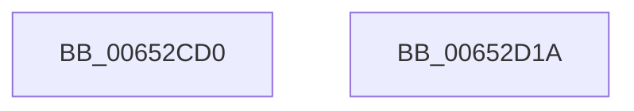

# EtwpCancelApcThunk

- RVA: `0x00652CD0`–`0x00652D1B` (길이 `75` bytes)
- VA: `0x0000000140652CD0`
- 실행 섹션: `.text`
- PDB 이름 있음: `예`; PDB Function 태그: `아니요`
- unwind 정보 RVA: `0x0006E5F8`
- 디코드: `21`개 명령, `75/75` bytes 표시
- 미해석 바이트: `0` (있으면 어셈블리에 `.byte`로 보존)

> 이 문서는 커널 이미지의 기계어와 PDB 기호를 분석해 생성했습니다. 4번과 5번은 함수 원형과 자료형을 바이너리 사용 방식에서 추정한 C 해석이며 원본 소스 복구 결과는 아닙니다.

## 1. Dependencies

- 직접 호출 지점: **2**; 고유 호출 대상: **2**
- 직접 호출자로 확인된 함수: **0**
- RIP 상대 이미지 참조: **0**

### Outgoing calls
- `0x00652CFF` → [guard_dispatch_icall](../6B/guard_dispatch_icall_function_006BAAD0.md) (function, `0x006BAAD0`)
- `0x00652D0A` → [EtwpFinalizePendingApc](../44/EtwpFinalizePendingApc_function_004486A4.md) (function, `0x004486A4`)

### Direct callers
- 이 함수 시작 RVA로 연결되는 직접 call은 확인되지 않았습니다. 간접 호출은 완전히 역산할 수 없습니다.

### Static image references
- 디코드된 RIP-relative 메모리 참조가 없습니다.

## 2. Other-region calls and transfers

- 다른 실행 섹션으로 향하는 call: **0**
- 별도 외부 분기/꼬리 이동을 확인하지 못했습니다.

## 3. Assembly (complete function range)

```asm
00652CD0  48 89 5C 24 08                  mov qword ptr [rsp + 8], rbx
00652CD5  57                              push rdi
00652CD6  48 83 EC 30                     sub rsp, 0x30
00652CDA  48 8B 51 48                     mov rdx, qword ptr [rcx + 0x48]
00652CDE  48 8B F9                        mov rdi, rcx
00652CE1  48 8B 59 38                     mov rbx, qword ptr [rcx + 0x38]
00652CE5  48 8B 81 90 00 00 00            mov rax, qword ptr [rcx + 0x90]
00652CEC  4C 8B C3                        mov r8, rbx
00652CEF  4C 8B 49 40                     mov r9, qword ptr [rcx + 0x40]
00652CF3  48 89 54 24 20                  mov qword ptr [rsp + 0x20], rdx
00652CF8  48 8B 51 08                     mov rdx, qword ptr [rcx + 8]
00652CFC  48 8B CB                        mov rcx, rbx
00652CFF  E8 CC 7D 06 00                  call 0x1406baad0
00652D04  48 8B D7                        mov rdx, rdi
00652D07  48 8B CB                        mov rcx, rbx
00652D0A  E8 95 59 DF FF                  call 0x1404486a4
00652D0F  48 8B 5C 24 40                  mov rbx, qword ptr [rsp + 0x40]
00652D14  48 83 C4 30                     add rsp, 0x30
00652D18  5F                              pop rdi
00652D19  C3                              ret
00652D1A  CC                              int3
```

## 4. C-style interpretation (structured pseudocode)

```c
__int64 __fastcall EtwpCancelApcThunk(__int64 a1)
{
    __int64 result;
    __int64 v_rsp;
    unsigned __int64 v_stack_m18;
    unsigned __int64 v_stack_p8;

    v_stack_p8 = v_rbx;
    v_rsp = (v_rsp) - (48);
    v_stack_m18 = *(unsigned __int64 *)(a1 + 72);
    result = guard_dispatch_icall(*(unsigned __int64 *)(a1 + 56), *(unsigned __int64 *)(a1 + 8), *(unsigned __int64 *)(a1 + 56), *(unsigned __int64 *)(a1 + 64));
    result = EtwpFinalizePendingApc(*(unsigned __int64 *)(a1 + 56), a1, *(unsigned __int64 *)(a1 + 56), *(unsigned __int64 *)(a1 + 64));
    v_rsp = (v_rsp) + (48);
    return result;
}
```

## 5. (Beta) C Style

```c
int64_t EtwpCancelApcThunk(void *Arg1)
{
    uint8_t *arg1 = (uint8_t *)Arg1;

    int64_t result;
    int64_t local_rsp;
    uint64_t v_stack_m18;
    uint64_t v_stack_p8;

    v_stack_p8 = local_rbx;
    local_rsp = (local_rsp) - (48);
    v_stack_m18 = *(uint64_t *)(arg1 + 0x48);
    result = guard_dispatch_icall(*(uint64_t *)(arg1 + 0x38), *(uint64_t *)(arg1 + 0x8), *(uint64_t *)(arg1 + 0x38), *(uint64_t *)(arg1 + 0x40));
    result = EtwpFinalizePendingApc(*(uint64_t *)(arg1 + 0x38), Arg1, *(uint64_t *)(arg1 + 0x38), *(uint64_t *)(arg1 + 0x40));
    local_rsp = (local_rsp) + (48);
    return result;
}
```

### 관측된 메모리 오프셋

구조체 형식이 확인되지 않은 접근은 인자 기준의 오프셋으로만 기록했습니다.

| 기준 인자 | 오프셋 표현 | 폭 (bit) | 접근 |
|---|---:|---:|---|
| `Arg1` | `+ 0x8` | `64` | `R` |
| `Arg1` | `+ 0x38` | `64` | `R` |
| `Arg1` | `+ 0x40` | `64` | `R` |
| `Arg1` | `+ 0x48` | `64` | `R` |
| `Arg1` | `+ 0x90` | `64` | `R` |

## 6. Execution-region graph

[열기: 2D/3D 그래프와 함수 탐색 컨트롤 패널](../../../control-panel.html?section=text&rva=0x00652CD0&view=graph)

- 2D 그래프는 위에서 아래로 흐르고, 3D 그래프는 빈 공간을 드래그해 회전합니다. Shift+드래그는 이동, 휠은 확대·축소, 함수 노드 선택은 대상 보고서 이동입니다.

### Static fallback


