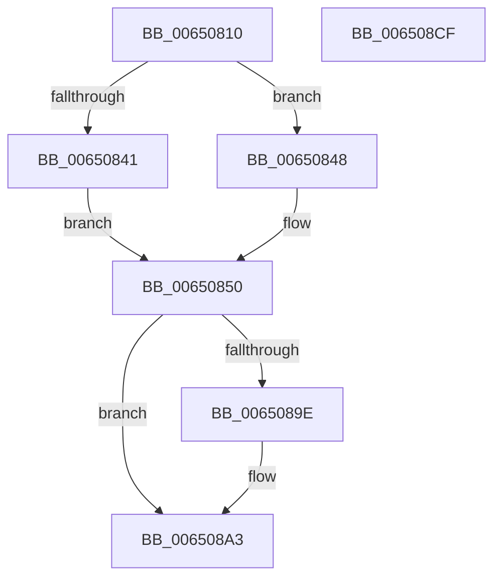

# EtwpCancelTraceImageUnloadApc

- RVA: `0x00650810`–`0x006508D0` (길이 `192` bytes)
- VA: `0x0000000140650810`
- 실행 섹션: `.text`
- PDB 이름 있음: `예`; PDB Function 태그: `아니요`
- unwind 정보 RVA: `0x000AD5F0`
- 디코드: `50`개 명령, `192/192` bytes 표시
- 미해석 바이트: `0` (있으면 어셈블리에 `.byte`로 보존)

> 이 문서는 커널 이미지의 기계어와 PDB 기호를 분석해 생성했습니다. 4번과 5번은 함수 원형과 자료형을 바이너리 사용 방식에서 추정한 C 해석이며 원본 소스 복구 결과는 아닙니다.

## 1. Dependencies

- 직접 호출 지점: **6**; 고유 호출 대상: **5**
- 직접 호출자로 확인된 함수: **0**
- RIP 상대 이미지 참조: **0**

### Outgoing calls
- `0x00650838` → [FsRtlGetFileNameInformation](../../page/A1/FsRtlGetFileNameInformation_function_00A11E50.md) (function, `0x00A11E50`)
- `0x0065088F` → [EtwpTraceImageUnload](../44/EtwpTraceImageUnload_function_0044C048.md) (function, `0x0044C048`)
- `0x0065089E` → [FsRtlReleaseFileNameInformation](../../page/97/FsRtlReleaseFileNameInformation_function_0097DB90.md) (function, `0x0097DB90`)
- `0x006508AC` → [ObfDereferenceObjectWithTag](../2F/ObfDereferenceObjectWithTag_function_002F78E0.md) (function, `0x002F78E0`)
- `0x006508BA` → [ObfDereferenceObjectWithTag](../2F/ObfDereferenceObjectWithTag_function_002F78E0.md) (function, `0x002F78E0`)
- `0x006508C4` → [ExFreePoolWithTag](../../poolcode/B8/ExFreePoolWithTag_function_00B82870.md) (function, `0x00B82870`)

### Direct callers
- 이 함수 시작 RVA로 연결되는 직접 call은 확인되지 않았습니다. 간접 호출은 완전히 역산할 수 없습니다.

### Static image references
- 디코드된 RIP-relative 메모리 참조가 없습니다.

## 2. Other-region calls and transfers

- 다른 실행 섹션으로 향하는 call: **3**
  - `0x00650838` → [FsRtlGetFileNameInformation](../../page/A1/FsRtlGetFileNameInformation_function_00A11E50.md) (`.text` → `PAGE`)
  - `0x0065089E` → [FsRtlReleaseFileNameInformation](../../page/97/FsRtlReleaseFileNameInformation_function_0097DB90.md) (`.text` → `PAGE`)
  - `0x006508C4` → [ExFreePoolWithTag](../../poolcode/B8/ExFreePoolWithTag_function_00B82870.md) (`.text` → `POOLCODE`)
- 별도 외부 분기/꼬리 이동을 확인하지 못했습니다.

## 3. Assembly (complete function range)

```asm
00650810  48 8B C4                        mov rax, rsp
00650813  53                              push rbx
00650814  48 83 EC 60                     sub rsp, 0x60
00650818  48 83 60 08 00                  and qword ptr [rax + 8], 0
0065081D  4C 8D 48 08                     lea r9, [rax + 8]
00650821  48 8B D9                        mov rbx, rcx
00650824  4C 8D 40 E8                     lea r8, [rax - 0x18]
00650828  48 8B 49 58                     mov rcx, qword ptr [rcx + 0x58]
0065082C  0F 57 C0                        xorps xmm0, xmm0
0065082F  BA 00 02 00 00                  mov edx, 0x200
00650834  0F 11 40 E8                     movups xmmword ptr [rax - 0x18], xmm0
00650838  E8 13 16 3C 00                  call 0x140a11e50
0065083D  85 C0                           test eax, eax
0065083F  78 07                           js 0x140650848
00650841  48 8D 4C 24 50                  lea rcx, [rsp + 0x50]
00650846  EB 08                           jmp 0x140650850
00650848  48 8B 4B 58                     mov rcx, qword ptr [rbx + 0x58]
0065084C  48 83 C1 58                     add rcx, 0x58
00650850  83 64 24 48 00                  and dword ptr [rsp + 0x48], 0
00650855  48 8B 83 88 00 00 00            mov rax, qword ptr [rbx + 0x88]
0065085C  4C 8B 4B 70                     mov r9, qword ptr [rbx + 0x70]
00650860  4C 8B 43 68                     mov r8, qword ptr [rbx + 0x68]
00650864  48 8B 53 60                     mov rdx, qword ptr [rbx + 0x60]
00650868  48 89 44 24 40                  mov qword ptr [rsp + 0x40], rax
0065086D  8B 83 84 00 00 00               mov eax, dword ptr [rbx + 0x84]
00650873  89 44 24 38                     mov dword ptr [rsp + 0x38], eax
00650877  8B 83 80 00 00 00               mov eax, dword ptr [rbx + 0x80]
0065087D  89 44 24 30                     mov dword ptr [rsp + 0x30], eax
00650881  8B 43 7C                        mov eax, dword ptr [rbx + 0x7c]
00650884  89 44 24 28                     mov dword ptr [rsp + 0x28], eax
00650888  8B 43 78                        mov eax, dword ptr [rbx + 0x78]
0065088B  89 44 24 20                     mov dword ptr [rsp + 0x20], eax
0065088F  E8 B4 B7 DF FF                  call 0x14044c048
00650894  48 8B 4C 24 70                  mov rcx, qword ptr [rsp + 0x70]
00650899  48 85 C9                        test rcx, rcx
0065089C  74 05                           je 0x1406508a3
0065089E  E8 ED D2 32 00                  call 0x14097db90
006508A3  48 8B 4B 58                     mov rcx, qword ptr [rbx + 0x58]
006508A7  BA 44 66 6C 74                  mov edx, 0x746c6644
006508AC  E8 2F 70 CA FF                  call 0x1402f78e0
006508B1  48 8B 4B 60                     mov rcx, qword ptr [rbx + 0x60]
006508B5  BA 44 66 6C 74                  mov edx, 0x746c6644
006508BA  E8 21 70 CA FF                  call 0x1402f78e0
006508BF  33 D2                           xor edx, edx
006508C1  48 8B CB                        mov rcx, rbx
006508C4  E8 A7 1F 53 00                  call 0x140b82870
006508C9  48 83 C4 60                     add rsp, 0x60
006508CD  5B                              pop rbx
006508CE  C3                              ret
006508CF  CC                              int3
```

## 4. C-style interpretation (structured pseudocode)

```c
__int64 __fastcall EtwpCancelTraceImageUnloadApc(__int64 a1)
{
    __int64 result;
    __int64 v_rsp;
    unsigned __int64 v_stack_m18;
    unsigned int v_stack_m20;
    unsigned __int64 v_stack_m28;
    unsigned int v_stack_m30;
    unsigned int v_stack_m38;
    unsigned int v_stack_m40;
    unsigned int v_stack_m48;
    unsigned __int64 v_stack_p8;

    v_rsp = (v_rsp) - (96);
    *(unsigned __int64 *)(v_rsp - 24) = v_xmm0;
    result = FsRtlGetFileNameInformation(*(unsigned __int64 *)(a1 + 88), 512, v_rsp - 24, v_rsp + 8);
    if (sign_flag) goto loc_00650848;
    goto loc_00650850;
loc_00650848:
    a1 = (*(unsigned __int64 *)(a1 + 88)) + (88);
loc_00650850:
    v_stack_m28 = *(unsigned __int64 *)(a1 + 136);
    v_stack_m30 = (unsigned int)((unsigned int)(*(unsigned int *)(a1 + 132)));
    v_stack_m38 = (unsigned int)((unsigned int)(*(unsigned int *)(a1 + 128)));
    v_stack_m40 = (unsigned int)((unsigned int)(*(unsigned int *)(a1 + 124)));
    v_stack_m48 = (unsigned int)((unsigned int)(*(unsigned int *)(a1 + 120)));
    result = EtwpTraceImageUnload(a1, *(unsigned __int64 *)(a1 + 96), *(unsigned __int64 *)(a1 + 104), *(unsigned __int64 *)(a1 + 112));
    if (v_stack_p8 != 0) {
        result = FsRtlReleaseFileNameInformation(v_stack_p8, *(unsigned __int64 *)(a1 + 96), *(unsigned __int64 *)(a1 + 104), *(unsigned __int64 *)(a1 + 112));
    }
    result = ObfDereferenceObjectWithTag(*(unsigned __int64 *)(a1 + 88), (unsigned int)(0x746C6644ULL), *(unsigned __int64 *)(a1 + 104), *(unsigned __int64 *)(a1 + 112));
    result = ObfDereferenceObjectWithTag(*(unsigned __int64 *)(a1 + 96), (unsigned int)(0x746C6644ULL), *(unsigned __int64 *)(a1 + 104), *(unsigned __int64 *)(a1 + 112));
    a2 = 0;
    result = ExFreePoolWithTag(a1, a2, *(unsigned __int64 *)(a1 + 104), *(unsigned __int64 *)(a1 + 112));
    v_rsp = (v_rsp) + (96);
    return result;
}
```

## 5. (Beta) C Style

```c
int64_t EtwpCancelTraceImageUnloadApc(void *Arg1)
{
    uint8_t *arg1 = (uint8_t *)Arg1;

    int64_t result;
    int64_t local_rsp;
    uint64_t v_stack_m18;
    uint32_t v_stack_m20;
    uint64_t v_stack_m28;
    uint32_t v_stack_m30;
    uint32_t v_stack_m38;
    uint32_t v_stack_m40;
    uint32_t v_stack_m48;
    uint64_t v_stack_p8;

    local_rsp = (local_rsp) - (96);
    *(uint64_t *)(local_rsp - 0x18) = v_xmm0;
    result = FsRtlGetFileNameInformation(*(uint64_t *)(arg1 + 0x58), 512, local_rsp - 24, local_rsp + 8);
    if (sign_flag) goto loc_00650848;
    goto loc_00650850;
loc_00650848:
    Arg1 = (*(uint64_t *)(arg1 + 0x58)) + (88);
loc_00650850:
    v_stack_m28 = *(uint64_t *)(arg1 + 0x88);
    v_stack_m30 = (uint32_t)((uint32_t)(*(uint32_t *)(arg1 + 0x84)));
    v_stack_m38 = (uint32_t)((uint32_t)(*(uint32_t *)(arg1 + 0x80)));
    v_stack_m40 = (uint32_t)((uint32_t)(*(uint32_t *)(arg1 + 0x7C)));
    v_stack_m48 = (uint32_t)((uint32_t)(*(uint32_t *)(arg1 + 0x78)));
    result = EtwpTraceImageUnload(Arg1, *(uint64_t *)(arg1 + 0x60), *(uint64_t *)(arg1 + 0x68), *(uint64_t *)(arg1 + 0x70));
    if (v_stack_p8 != 0) {
        result = FsRtlReleaseFileNameInformation(v_stack_p8, *(uint64_t *)(arg1 + 0x60), *(uint64_t *)(arg1 + 0x68), *(uint64_t *)(arg1 + 0x70));
    }
    result = ObfDereferenceObjectWithTag(*(uint64_t *)(arg1 + 0x58), (uint32_t)(0x746C6644ULL), *(uint64_t *)(arg1 + 0x68), *(uint64_t *)(arg1 + 0x70));
    result = ObfDereferenceObjectWithTag(*(uint64_t *)(arg1 + 0x60), (uint32_t)(0x746C6644ULL), *(uint64_t *)(arg1 + 0x68), *(uint64_t *)(arg1 + 0x70));
    a2 = 0;
    result = ExFreePoolWithTag(Arg1, a2, *(uint64_t *)(arg1 + 0x68), *(uint64_t *)(arg1 + 0x70));
    local_rsp = (local_rsp) + (96);
    return result;
}
```

### 관측된 메모리 오프셋

구조체 형식이 확인되지 않은 접근은 인자 기준의 오프셋으로만 기록했습니다.

| 기준 인자 | 오프셋 표현 | 폭 (bit) | 접근 |
|---|---:|---:|---|
| `Arg1` | `+ 0x58` | `64` | `R` |
| `Arg1` | `+ 0x60` | `64` | `R` |
| `Arg1` | `+ 0x68` | `64` | `R` |
| `Arg1` | `+ 0x70` | `64` | `R` |
| `Arg1` | `+ 0x78` | `32` | `R` |
| `Arg1` | `+ 0x7C` | `32` | `R` |
| `Arg1` | `+ 0x80` | `32` | `R` |
| `Arg1` | `+ 0x84` | `32` | `R` |
| `Arg1` | `+ 0x88` | `64` | `R` |

## 6. Execution-region graph

[열기: 2D/3D 그래프와 함수 탐색 컨트롤 패널](../../../control-panel.html?section=text&rva=0x00650810&view=graph)

- 2D 그래프는 위에서 아래로 흐르고, 3D 그래프는 빈 공간을 드래그해 회전합니다. Shift+드래그는 이동, 휠은 확대·축소, 함수 노드 선택은 대상 보고서 이동입니다.

### Static fallback


