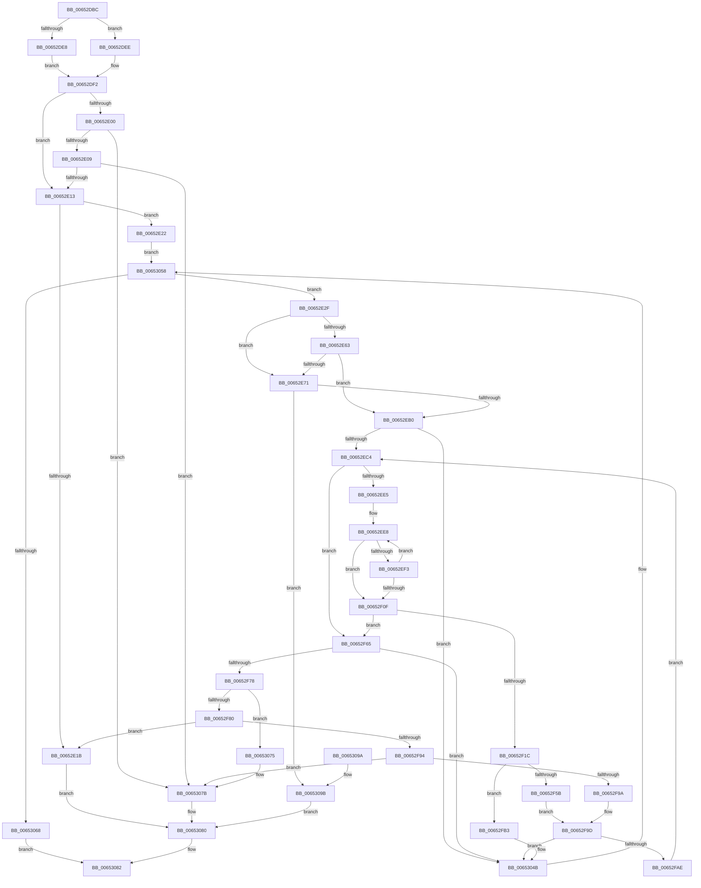

# EtwpCompressBuffer

- RVA: `0x00652DBC`–`0x00653137` (길이 `891` bytes)
- VA: `0x0000000140652DBC`
- 실행 섹션: `.text`
- PDB 이름 있음: `예`; PDB Function 태그: `아니요`
- unwind 정보 RVA: `0x000D3E98`
- 디코드: `226`개 명령, `891/891` bytes 표시
- 미해석 바이트: `0` (있으면 어셈블리에 `.byte`로 보존)

> 이 문서는 커널 이미지의 기계어와 PDB 기호를 분석해 생성했습니다. 4번과 5번은 함수 원형과 자료형을 바이너리 사용 방식에서 추정한 C 해석이며 원본 소스 복구 결과는 아닙니다.

## 1. Dependencies

- 직접 호출 지점: **8**; 고유 호출 대상: **6**
- 직접 호출자로 확인된 함수: **1**
- RIP 상대 이미지 참조: **0**

### Outgoing calls
- `0x00652DF7` → [Feature_218004792__private_IsEnabledDeviceUsageNoInline](../64/Feature_218004792__private_IsEnabledDeviceUsageNoInline_function_0064F3EC.md) (function, `0x0064F3EC`)
- `0x00652E25` → [EtwpRotateCompressionTargetIfNeeded](EtwpRotateCompressionTargetIfNeeded_function_006538DC.md) (function, `0x006538DC`)
- `0x00652EA1` → [RtlCompressBuffer](../26/RtlCompressBuffer_function_0026A220.md) (function, `0x0026A220`)
- `0x00652ED6` → [EtwpGetNextEventOffsetType](../4B/EtwpGetNextEventOffsetType_function_004B6F8C.md) (function, `0x004B6F8C`)
- `0x00652F04` → [EtwpGetNextEventOffsetType](../4B/EtwpGetNextEventOffsetType_function_004B6F8C.md) (function, `0x004B6F8C`)
- `0x00652F52` → [RtlCompressBuffer](../26/RtlCompressBuffer_function_0026A220.md) (function, `0x0026A220`)
- `0x00652F83` → [EtwpUpdateEventsLostCount](../3F/EtwpUpdateEventsLostCount_function_003F18E0.md) (function, `0x003F18E0`)
- `0x00653053` → [EtwpRotateCompressionTarget](EtwpRotateCompressionTarget_function_00653868.md) (function, `0x00653868`)

### Direct callers
- [EtwpCompressPendingBuffers](EtwpCompressPendingBuffers_function_00653140.md) at `0x006531E7`

### Static image references
- 디코드된 RIP-relative 메모리 참조가 없습니다.

## 2. Other-region calls and transfers

- 다른 실행 섹션으로 향하는 call: **0**
- 별도 외부 분기/꼬리 이동을 확인하지 못했습니다.

## 3. Assembly (complete function range)

```asm
00652DBC  48 89 5C 24 08                  mov qword ptr [rsp + 8], rbx
00652DC1  55                              push rbp
00652DC2  56                              push rsi
00652DC3  57                              push rdi
00652DC4  41 54                           push r12
00652DC6  41 55                           push r13
00652DC8  41 56                           push r14
00652DCA  41 57                           push r15
00652DCC  48 8B EC                        mov rbp, rsp
00652DCF  48 83 EC 50                     sub rsp, 0x50
00652DD3  83 65 48 00                     and dword ptr [rbp + 0x48], 0
00652DD7  4C 8B FA                        mov r15, rdx
00652DDA  83 65 50 00                     and dword ptr [rbp + 0x50], 0
00652DDE  48 8B D9                        mov rbx, rcx
00652DE1  8B 42 08                        mov eax, dword ptr [rdx + 8]
00652DE4  3B 02                           cmp eax, dword ptr [rdx]
00652DE6  76 06                           jbe 0x140652dee
00652DE8  44 8B 72 04                     mov r14d, dword ptr [rdx + 4]
00652DEC  EB 04                           jmp 0x140652df2
00652DEE  44 8B 72 08                     mov r14d, dword ptr [rdx + 8]
00652DF2  BE 48 00 00 00                  mov esi, 0x48
00652DF7  E8 F0 C5 FF FF                  call 0x14064f3ec
00652DFC  85 C0                           test eax, eax
00652DFE  74 13                           je 0x140652e13
00652E00  44 3B F6                        cmp r14d, esi
00652E03  0F 82 72 02 00 00               jb 0x14065307b
00652E09  44 3B 73 04                     cmp r14d, dword ptr [rbx + 4]
00652E0D  0F 87 68 02 00 00               ja 0x14065307b
00652E13  41 8D 7E B8                     lea edi, [r14 - 0x48]
00652E17  85 FF                           test edi, edi
00652E19  75 07                           jne 0x140652e22
00652E1B  33 D2                           xor edx, edx
00652E1D  E9 5E 02 00 00                  jmp 0x140653080
00652E22  48 8B CB                        mov rcx, rbx
00652E25  E8 B2 0A 00 00                  call 0x1406538dc
00652E2A  E9 29 02 00 00                  jmp 0x140653058
00652E2F  8B 40 08                        mov eax, dword ptr [rax + 8]
00652E32  4C 8B A3 88 05 00 00            mov r12, qword ptr [rbx + 0x588]
00652E39  44 8B E8                        mov r13d, eax
00652E3C  4C 8D 40 48                     lea r8, [rax + 0x48]
00652E40  41 8B 44 24 08                  mov eax, dword ptr [r12 + 8]
00652E45  44 8B 4B 04                     mov r9d, dword ptr [rbx + 4]
00652E49  44 2B C8                        sub r9d, eax
00652E4C  48 8B 83 88 05 00 00            mov rax, qword ptr [rbx + 0x588]
00652E53  41 83 E9 48                     sub r9d, 0x48
00652E57  44 89 4D F0                     mov dword ptr [rbp - 0x10], r9d
00652E5B  8B 48 08                        mov ecx, dword ptr [rax + 8]
00652E5E  83 F9 48                        cmp ecx, 0x48
00652E61  74 0E                           je 0x140652e71
00652E63  41 8B C1                        mov eax, r9d
00652E66  0F AF 83 9C 05 00 00            imul eax, dword ptr [rbx + 0x59c]
00652E6D  3B F8                           cmp edi, eax
00652E6F  73 3F                           jae 0x140652eb0
00652E71  48 8B 83 90 05 00 00            mov rax, qword ptr [rbx + 0x590]
00652E78  B9 03 00 00 00                  mov ecx, 3
00652E7D  48 89 44 24 38                  mov qword ptr [rsp + 0x38], rax
00652E82  48 8D 45 48                     lea rax, [rbp + 0x48]
00652E86  48 89 44 24 30                  mov qword ptr [rsp + 0x30], rax
00652E8B  83 64 24 28 00                  and dword ptr [rsp + 0x28], 0
00652E90  44 89 4C 24 20                  mov dword ptr [rsp + 0x20], r9d
00652E95  4F 8D 0C 20                     lea r9, [r8 + r12]
00652E99  8B D6                           mov edx, esi
00652E9B  44 8B C7                        mov r8d, edi
00652E9E  49 03 D7                        add rdx, r15
00652EA1  E8 7A 73 C1 FF                  call 0x14026a220
00652EA6  8B D0                           mov edx, eax
00652EA8  85 C0                           test eax, eax
00652EAA  0F 89 EB 01 00 00               jns 0x14065309b
00652EB0  B8 01 00 00 00                  mov eax, 1
00652EB5  89 45 58                        mov dword ptr [rbp + 0x58], eax
00652EB8  39 83 A0 05 00 00               cmp dword ptr [rbx + 0x5a0], eax
00652EBE  0F 82 87 01 00 00               jb 0x14065304b
00652EC4  8B C8                           mov ecx, eax
00652EC6  4C 8D 45 50                     lea r8, [rbp + 0x50]
00652ECA  D3 EF                           shr edi, cl
00652ECC  8B D6                           mov edx, esi
00652ECE  49 8B CF                        mov rcx, r15
00652ED1  03 FE                           add edi, esi
00652ED3  45 33 D2                        xor r10d, r10d
00652ED6  E8 B1 40 E6 FF                  call 0x1404b6f8c
00652EDB  8B D0                           mov edx, eax
00652EDD  85 C0                           test eax, eax
00652EDF  0F 84 80 00 00 00               je 0x140652f65
00652EE5  44 8B CE                        mov r9d, esi
00652EE8  8B 45 50                        mov eax, dword ptr [rbp + 0x50]
00652EEB  41 8D 0C 01                     lea ecx, [r9 + rax]
00652EEF  3B CF                           cmp ecx, edi
00652EF1  77 1C                           ja 0x140652f0f
00652EF3  44 03 D0                        add r10d, eax
00652EF6  4C 8D 45 50                     lea r8, [rbp + 0x50]
00652EFA  49 8B CF                        mov rcx, r15
00652EFD  45 8D 0C 32                     lea r9d, [r10 + rsi]
00652F01  41 8B D1                        mov edx, r9d
00652F04  E8 83 40 E6 FF                  call 0x1404b6f8c
00652F09  8B D0                           mov edx, eax
00652F0B  85 C0                           test eax, eax
00652F0D  75 D9                           jne 0x140652ee8
00652F0F  44 8B 4D F0                     mov r9d, dword ptr [rbp - 0x10]
00652F13  44 89 55 F4                     mov dword ptr [rbp - 0xc], r10d
00652F17  45 85 D2                        test r10d, r10d
00652F1A  74 49                           je 0x140652f65
00652F1C  48 8B 83 90 05 00 00            mov rax, qword ptr [rbx + 0x590]
00652F23  BF 03 00 00 00                  mov edi, 3
00652F28  48 89 44 24 38                  mov qword ptr [rsp + 0x38], rax
00652F2D  8B CF                           mov ecx, edi
00652F2F  48 8D 45 48                     lea rax, [rbp + 0x48]
00652F33  8B D6                           mov edx, esi
00652F35  48 89 44 24 30                  mov qword ptr [rsp + 0x30], rax
00652F3A  49 03 D7                        add rdx, r15
00652F3D  83 64 24 28 00                  and dword ptr [rsp + 0x28], 0
00652F42  45 8B C2                        mov r8d, r10d
00652F45  44 89 4C 24 20                  mov dword ptr [rsp + 0x20], r9d
00652F4A  4D 8D 4C 24 48                  lea r9, [r12 + 0x48]
00652F4F  4D 03 CD                        add r9, r13
00652F52  E8 C9 72 C1 FF                  call 0x14026a220
00652F57  85 C0                           test eax, eax
00652F59  79 58                           jns 0x140652fb3
00652F5B  8B 45 58                        mov eax, dword ptr [rbp + 0x58]
00652F5E  FF C0                           inc eax
00652F60  89 45 58                        mov dword ptr [rbp + 0x58], eax
00652F63  EB 38                           jmp 0x140652f9d
00652F65  48 8B 83 88 05 00 00            mov rax, qword ptr [rbx + 0x588]
00652F6C  8B 48 08                        mov ecx, dword ptr [rax + 8]
00652F6F  83 F9 48                        cmp ecx, 0x48
00652F72  0F 85 D3 00 00 00               jne 0x14065304b
00652F78  85 D2                           test edx, edx
00652F7A  0F 84 F5 00 00 00               je 0x140653075
00652F80  48 8B CB                        mov rcx, rbx
00652F83  E8 58 E9 D9 FF                  call 0x1403f18e0
00652F88  03 75 50                        add esi, dword ptr [rbp + 0x50]
00652F8B  41 3B F6                        cmp esi, r14d
00652F8E  0F 84 87 FE FF FF               je 0x140652e1b
00652F94  0F 87 E1 00 00 00               ja 0x14065307b
00652F9A  8B 45 58                        mov eax, dword ptr [rbp + 0x58]
00652F9D  41 8B FE                        mov edi, r14d
00652FA0  2B FE                           sub edi, esi
00652FA2  3B 83 A0 05 00 00               cmp eax, dword ptr [rbx + 0x5a0]
00652FA8  0F 87 9D 00 00 00               ja 0x14065304b
00652FAE  E9 11 FF FF FF                  jmp 0x140652ec4
00652FB3  41 0F 10 07                     movups xmm0, xmmword ptr [r15]
00652FB7  8B 55 F4                        mov edx, dword ptr [rbp - 0xc]
00652FBA  43 0F 11 04 2C                  movups xmmword ptr [r12 + r13], xmm0
00652FBF  41 0F 10 4F 10                  movups xmm1, xmmword ptr [r15 + 0x10]
00652FC4  43 0F 11 4C 2C 10               movups xmmword ptr [r12 + r13 + 0x10], xmm1
00652FCA  41 0F 10 47 20                  movups xmm0, xmmword ptr [r15 + 0x20]
00652FCF  43 0F 11 44 2C 20               movups xmmword ptr [r12 + r13 + 0x20], xmm0
00652FD5  41 0F 10 4F 30                  movups xmm1, xmmword ptr [r15 + 0x30]
00652FDA  43 0F 11 4C 2C 30               movups xmmword ptr [r12 + r13 + 0x30], xmm1
00652FE0  F2 41 0F 10 47 40               movsd xmm0, qword ptr [r15 + 0x40]
00652FE6  F2 43 0F 11 44 2C 40            movsd qword ptr [r12 + r13 + 0x40], xmm0
00652FED  8B 45 48                        mov eax, dword ptr [rbp + 0x48]
00652FF0  4B 83 64 2C 18 00               and qword ptr [r12 + r13 + 0x18], 0
00652FF6  83 C0 48                        add eax, 0x48
00652FF9  43 89 04 2C                     mov dword ptr [r12 + r13], eax
00652FFD  8D 42 48                        lea eax, [rdx + 0x48]
00653000  43 89 44 2C 08                  mov dword ptr [r12 + r13 + 8], eax
00653005  8D 42 48                        lea eax, [rdx + 0x48]
00653008  43 89 44 2C 04                  mov dword ptr [r12 + r13 + 4], eax
0065300D  43 C7 44 2C 0C 00 00 00 00      mov dword ptr [r12 + r13 + 0xc], 0
00653016  43 89 7C 2C 2C                  mov dword ptr [r12 + r13 + 0x2c], edi
0065301B  48 8B 83 88 05 00 00            mov rax, qword ptr [rbx + 0x588]
00653022  8B 48 08                        mov ecx, dword ptr [rax + 8]
00653025  48 8B 83 88 05 00 00            mov rax, qword ptr [rbx + 0x588]
0065302C  83 C1 48                        add ecx, 0x48
0065302F  89 48 08                        mov dword ptr [rax + 8], ecx
00653032  48 8B 83 88 05 00 00            mov rax, qword ptr [rbx + 0x588]
00653039  8B 48 08                        mov ecx, dword ptr [rax + 8]
0065303C  03 4D 48                        add ecx, dword ptr [rbp + 0x48]
0065303F  48 8B 83 88 05 00 00            mov rax, qword ptr [rbx + 0x588]
00653046  03 F2                           add esi, edx
00653048  89 48 08                        mov dword ptr [rax + 8], ecx
0065304B  41 8B FE                        mov edi, r14d
0065304E  48 8B CB                        mov rcx, rbx
00653051  2B FE                           sub edi, esi
00653053  E8 10 08 00 00                  call 0x140653868
00653058  48 8B 83 88 05 00 00            mov rax, qword ptr [rbx + 0x588]
0065305F  48 85 C0                        test rax, rax
00653062  0F 85 C7 FD FF FF               jne 0x140652e2f
00653068  FF 83 FC 00 00 00               inc dword ptr [rbx + 0xfc]
0065306E  B8 17 00 00 C0                  mov eax, 0xc0000017
00653073  EB 0D                           jmp 0x140653082
00653075  FF 83 FC 00 00 00               inc dword ptr [rbx + 0xfc]
0065307B  BA 02 01 00 C0                  mov edx, 0xc0000102
00653080  8B C2                           mov eax, edx
00653082  48 8B 9C 24 90 00 00 00         mov rbx, qword ptr [rsp + 0x90]
0065308A  48 83 C4 50                     add rsp, 0x50
0065308E  41 5F                           pop r15
00653090  41 5E                           pop r14
00653092  41 5D                           pop r13
00653094  41 5C                           pop r12
00653096  5F                              pop rdi
00653097  5E                              pop rsi
00653098  5D                              pop rbp
00653099  C3                              ret
0065309A  CC                              int3
0065309B  41 0F 10 07                     movups xmm0, xmmword ptr [r15]
0065309F  43 0F 11 04 2C                  movups xmmword ptr [r12 + r13], xmm0
006530A4  41 0F 10 4F 10                  movups xmm1, xmmword ptr [r15 + 0x10]
006530A9  43 0F 11 4C 2C 10               movups xmmword ptr [r12 + r13 + 0x10], xmm1
006530AF  41 0F 10 47 20                  movups xmm0, xmmword ptr [r15 + 0x20]
006530B4  43 0F 11 44 2C 20               movups xmmword ptr [r12 + r13 + 0x20], xmm0
006530BA  41 0F 10 4F 30                  movups xmm1, xmmword ptr [r15 + 0x30]
006530BF  43 0F 11 4C 2C 30               movups xmmword ptr [r12 + r13 + 0x30], xmm1
006530C5  F2 41 0F 10 47 40               movsd xmm0, qword ptr [r15 + 0x40]
006530CB  F2 43 0F 11 44 2C 40            movsd qword ptr [r12 + r13 + 0x40], xmm0
006530D2  8B 45 48                        mov eax, dword ptr [rbp + 0x48]
006530D5  4B 83 64 2C 18 00               and qword ptr [r12 + r13 + 0x18], 0
006530DB  83 C0 48                        add eax, 0x48
006530DE  43 89 04 2C                     mov dword ptr [r12 + r13], eax
006530E2  8D 47 48                        lea eax, [rdi + 0x48]
006530E5  43 89 44 2C 08                  mov dword ptr [r12 + r13 + 8], eax
006530EA  8D 47 48                        lea eax, [rdi + 0x48]
006530ED  43 89 44 2C 04                  mov dword ptr [r12 + r13 + 4], eax
006530F2  43 C7 44 2C 0C 00 00 00 00      mov dword ptr [r12 + r13 + 0xc], 0
006530FB  43 C7 44 2C 2C 03 00 00 00      mov dword ptr [r12 + r13 + 0x2c], 3
00653104  48 8B 83 88 05 00 00            mov rax, qword ptr [rbx + 0x588]
0065310B  8B 48 08                        mov ecx, dword ptr [rax + 8]
0065310E  48 8B 83 88 05 00 00            mov rax, qword ptr [rbx + 0x588]
00653115  83 C1 48                        add ecx, 0x48
00653118  89 48 08                        mov dword ptr [rax + 8], ecx
0065311B  48 8B 83 88 05 00 00            mov rax, qword ptr [rbx + 0x588]
00653122  8B 48 08                        mov ecx, dword ptr [rax + 8]
00653125  48 8B 83 88 05 00 00            mov rax, qword ptr [rbx + 0x588]
0065312C  03 4D 48                        add ecx, dword ptr [rbp + 0x48]
0065312F  89 48 08                        mov dword ptr [rax + 8], ecx
00653132  E9 49 FF FF FF                  jmp 0x140653080
```

## 4. C-style interpretation (structured pseudocode)

```c
__int64 __fastcall EtwpCompressBuffer(__int64 a1, __int64 a2)
{
    __int64 result;
    __int64 v_r10;
    __int64 v_rdi;
    __int64 v_rsi;
    __int64 v_rsp;
    unsigned int v_stack_m44;
    unsigned int v_stack_m48;
    unsigned __int64 v_stack_m50;
    unsigned __int64 v_stack_m58;
    unsigned int v_stack_m60;
    unsigned int v_stack_m68;
    unsigned int v_stack_p10;
    unsigned int v_stack_p18;
    unsigned int v_stack_p20;
    unsigned __int64 v_stack_p8;

    v_stack_p8 = v_rbx;
    v_rsp = (v_rsp) - (80);
    if (((unsigned int)((unsigned int)(*(unsigned int *)(a2 + 8)))) <= (*(unsigned int *)(a2))) goto loc_00652DEE;
    goto loc_00652DF2;
loc_00652DEE:
loc_00652DF2:
    result = Feature_218004792__private_IsEnabledDeviceUsageNoInline(a1, a2, a3, a4);
    if ((unsigned int)(result) == 0) goto loc_00652E13;
    if (((unsigned int)((unsigned int)(*(unsigned int *)(a2 + 8)))) < 72) goto loc_0065307B;
    if (((unsigned int)((unsigned int)(*(unsigned int *)(a2 + 8)))) > (*(unsigned int *)(a1 + 4))) goto loc_0065307B;
loc_00652E13:
    if ((unsigned int)((unsigned int)(*(unsigned int *)(a2 + 8)) - 72) != 0) goto loc_00652E22;
loc_00652E1B:
    a2 = 0;
    goto loc_00653080;
loc_00652E22:
    result = EtwpRotateCompressionTargetIfNeeded(a1, a2, a3, a4);
    goto loc_00653058;
loc_00652E2F:
    a4 = (unsigned int)(((unsigned int)(*(unsigned int *)(a1 + 4))) - ((unsigned int)((unsigned int)(*(unsigned int *)(*(unsigned __int64 *)(a1 + 1416) + 8)))));
    a4 = (unsigned int)((a4) - (72));
    v_stack_m48 = (unsigned int)(a4);
    if (((unsigned int)((unsigned int)(*(unsigned int *)(*(unsigned __int64 *)(a1 + 1416) + 8)))) == 72) goto loc_00652E71;
    result = (unsigned int)(((unsigned int)((unsigned int)(a4))) * (*(unsigned int *)(a1 + 1436)));
    if (((unsigned int)((unsigned int)(*(unsigned int *)(a2 + 8)) - 72)) >= ((unsigned int)(result))) goto loc_00652EB0;
loc_00652E71:
    v_stack_m50 = *(unsigned __int64 *)(a1 + 1424);
    v_stack_m58 = v_stack_p10;
    v_stack_m68 = (unsigned int)(a4);
    a2 = (72) + (0);
    result = RtlCompressBuffer(3, a2, (unsigned int)((unsigned int)((unsigned int)(*(unsigned int *)(a2 + 8)) - 72)), (unsigned int)(*(unsigned int *)(result + 8)) + 72 + *(unsigned __int64 *)(a1 + 1416) * 1);
    if (!sign_flag) goto loc_0065309B;
loc_00652EB0:
    v_stack_p20 = 1;
    if ((*(unsigned int *)(a1 + 1440)) < 1) goto loc_0065304B;
loc_00652EC4:
    v_rdi = (unsigned int)(((unsigned int)(*(unsigned int *)(a2 + 8)) - 72) >> (1));
    v_rdi = (unsigned int)((v_rdi) + (72));
    v_r10 = 0;
    result = EtwpGetNextEventOffsetType(a2, 72, v_stack_p18, (unsigned int)(*(unsigned int *)(result + 8)) + 72 + *(unsigned __int64 *)(a1 + 1416) * 1);
    if ((unsigned int)(result) == 0) goto loc_00652F65;
loc_00652EE8:
    if (((unsigned int)(72 + (unsigned int)(v_stack_p18) * 1)) > ((unsigned int)(v_rdi))) goto loc_00652F0F;
    v_r10 = (unsigned int)((v_r10) + ((unsigned int)((unsigned int)(v_stack_p18))));
    result = EtwpGetNextEventOffsetType(a2, (unsigned int)((unsigned int)(v_r10 + 72 * 1)), v_stack_p18, v_r10 + 72 * 1);
    if ((unsigned int)(result) != 0) goto loc_00652EE8;
loc_00652F0F:
    v_stack_m44 = (unsigned int)(v_r10);
    if ((unsigned int)(v_r10) == 0) goto loc_00652F65;
    v_stack_m50 = *(unsigned __int64 *)(a1 + 1424);
    v_stack_m58 = v_stack_p10;
    a2 = (72) + (a2);
    v_stack_m68 = (unsigned int)((unsigned int)(v_stack_m48));
    a4 = (*(unsigned __int64 *)(a1 + 1416) + 72) + ((unsigned int)((unsigned int)((unsigned int)(*(unsigned int *)(result + 8)))));
    result = RtlCompressBuffer(3, a2, (unsigned int)((unsigned int)(v_r10)), a4);
    if (!sign_flag) goto loc_00652FB3;
    result = (unsigned int)(((unsigned int)(v_stack_p20)) + 1);
    v_stack_p20 = (unsigned int)(result);
    goto loc_00652F9D;
loc_00652F65:
    if (((unsigned int)((unsigned int)(*(unsigned int *)(*(unsigned __int64 *)(a1 + 1416) + 8)))) != 72) goto loc_0065304B;
    if ((unsigned int)(a2) == 0) goto loc_00653075;
    result = EtwpUpdateEventsLostCount(a1, a2, (unsigned int)((unsigned int)(v_r10)), a4);
    v_rsi = (unsigned int)((72) + (v_stack_p18));
    if (((unsigned int)(v_rsi)) == ((unsigned int)((unsigned int)(*(unsigned int *)(a2 + 8))))) goto loc_00652E1B;
    if (((unsigned int)(v_rsi)) > ((unsigned int)((unsigned int)(*(unsigned int *)(a2 + 8))))) goto loc_0065307B;
loc_00652F9D:
    v_rdi = (unsigned int)(((unsigned int)((unsigned int)((unsigned int)(*(unsigned int *)(a2 + 8))))) - ((unsigned int)(v_rsi)));
    if (((unsigned int)((unsigned int)(v_stack_p20))) > (*(unsigned int *)(a1 + 1440))) goto loc_0065304B;
    goto loc_00652EC4;
loc_00652FB3:
    *(unsigned __int64 *)(*(unsigned __int64 *)(a1 + 1416) + (unsigned int)((unsigned int)((unsigned int)(*(unsigned int *)(result + 8)))) * 1) = v_xmm0;
    *(unsigned __int64 *)(*(unsigned __int64 *)(a1 + 1416) + (unsigned int)((unsigned int)((unsigned int)(*(unsigned int *)(result + 8)))) * 1 + 16) = v_xmm1;
    *(unsigned __int64 *)(*(unsigned __int64 *)(a1 + 1416) + (unsigned int)((unsigned int)((unsigned int)(*(unsigned int *)(result + 8)))) * 1 + 32) = v_xmm0;
    *(unsigned __int64 *)(*(unsigned __int64 *)(a1 + 1416) + (unsigned int)((unsigned int)((unsigned int)(*(unsigned int *)(result + 8)))) * 1 + 48) = v_xmm1;
    *(unsigned __int64 *)(*(unsigned __int64 *)(a1 + 1416) + (unsigned int)((unsigned int)((unsigned int)(*(unsigned int *)(result + 8)))) * 1 + 64) = v_xmm0;
    result = (unsigned int)(((unsigned int)(v_stack_p10)) + (72));
    *(unsigned int *)(*(unsigned __int64 *)(a1 + 1416) + (unsigned int)((unsigned int)((unsigned int)(*(unsigned int *)(result + 8)))) * 1) = (unsigned int)(result);
    *(unsigned int *)(*(unsigned __int64 *)(a1 + 1416) + (unsigned int)((unsigned int)((unsigned int)(*(unsigned int *)(result + 8)))) * 1 + 8) = (unsigned int)((unsigned int)(v_stack_m44) + 72);
    *(unsigned int *)(*(unsigned __int64 *)(a1 + 1416) + (unsigned int)((unsigned int)((unsigned int)(*(unsigned int *)(result + 8)))) * 1 + 4) = (unsigned int)((unsigned int)(v_stack_m44) + 72);
    *(unsigned int *)(*(unsigned __int64 *)(a1 + 1416) + (unsigned int)((unsigned int)((unsigned int)(*(unsigned int *)(result + 8)))) * 1 + 12) = 0;
    *(unsigned int *)(*(unsigned __int64 *)(a1 + 1416) + (unsigned int)((unsigned int)((unsigned int)(*(unsigned int *)(result + 8)))) * 1 + 44) = (unsigned int)(v_rdi);
    a1 = (unsigned int)(((unsigned int)(*(unsigned int *)(*(unsigned __int64 *)(a1 + 1416) + 8))) + (72));
    *(unsigned int *)(*(unsigned __int64 *)(a1 + 1416) + 8) = (unsigned int)(a1);
    a1 = (unsigned int)(((unsigned int)(*(unsigned int *)(*(unsigned __int64 *)(a1 + 1416) + 8))) + (v_stack_p10));
    v_rsi = (unsigned int)((v_rsi) + ((unsigned int)((unsigned int)(v_stack_m44))));
    *(unsigned int *)(*(unsigned __int64 *)(a1 + 1416) + 8) = (unsigned int)(a1);
loc_0065304B:
    v_rdi = (unsigned int)(((unsigned int)((unsigned int)((unsigned int)(*(unsigned int *)(a2 + 8))))) - ((unsigned int)(v_rsi)));
    result = EtwpRotateCompressionTarget(a1, (unsigned int)(v_stack_m44), (unsigned int)((unsigned int)(v_r10)), a4);
loc_00653058:
    if (*(unsigned __int64 *)(a1 + 1416) != 0) goto loc_00652E2F;
    goto loc_00653082;
loc_00653075:
loc_0065307B:
loc_00653080:
loc_00653082:
    v_rsp = (v_rsp) + (80);
    return (unsigned int)((unsigned int)((unsigned int)(0xC0000102ULL)));
loc_0065309B:
    *(unsigned __int64 *)(*(unsigned __int64 *)(a1 + 1416) + (unsigned int)((unsigned int)((unsigned int)(*(unsigned int *)(result + 8)))) * 1) = v_xmm0;
    *(unsigned __int64 *)(*(unsigned __int64 *)(a1 + 1416) + (unsigned int)((unsigned int)((unsigned int)(*(unsigned int *)(result + 8)))) * 1 + 16) = v_xmm1;
    *(unsigned __int64 *)(*(unsigned __int64 *)(a1 + 1416) + (unsigned int)((unsigned int)((unsigned int)(*(unsigned int *)(result + 8)))) * 1 + 32) = v_xmm0;
    *(unsigned __int64 *)(*(unsigned __int64 *)(a1 + 1416) + (unsigned int)((unsigned int)((unsigned int)(*(unsigned int *)(result + 8)))) * 1 + 48) = v_xmm1;
    *(unsigned __int64 *)(*(unsigned __int64 *)(a1 + 1416) + (unsigned int)((unsigned int)((unsigned int)(*(unsigned int *)(result + 8)))) * 1 + 64) = v_xmm0;
    result = (unsigned int)(((unsigned int)(v_stack_p10)) + (72));
    *(unsigned int *)(*(unsigned __int64 *)(a1 + 1416) + (unsigned int)((unsigned int)((unsigned int)(*(unsigned int *)(result + 8)))) * 1) = (unsigned int)(result);
    *(unsigned int *)(*(unsigned __int64 *)(a1 + 1416) + (unsigned int)((unsigned int)((unsigned int)(*(unsigned int *)(result + 8)))) * 1 + 8) = (unsigned int)(v_rdi + 72);
    *(unsigned int *)(*(unsigned __int64 *)(a1 + 1416) + (unsigned int)((unsigned int)((unsigned int)(*(unsigned int *)(result + 8)))) * 1 + 4) = (unsigned int)(v_rdi + 72);
    *(unsigned int *)(*(unsigned __int64 *)(a1 + 1416) + (unsigned int)((unsigned int)((unsigned int)(*(unsigned int *)(result + 8)))) * 1 + 12) = 0;
    *(unsigned int *)(*(unsigned __int64 *)(a1 + 1416) + (unsigned int)((unsigned int)((unsigned int)(*(unsigned int *)(result + 8)))) * 1 + 44) = 3;
    a1 = (unsigned int)(((unsigned int)(*(unsigned int *)(*(unsigned __int64 *)(v_stack_p8 + 1416) + 8))) + (72));
    *(unsigned int *)(*(unsigned __int64 *)(v_stack_p8 + 1416) + 8) = (unsigned int)(a1);
    a1 = (unsigned int)(((unsigned int)(*(unsigned int *)(*(unsigned __int64 *)(v_stack_p8 + 1416) + 8))) + (v_stack_p10));
    *(unsigned int *)(*(unsigned __int64 *)(v_stack_p8 + 1416) + 8) = (unsigned int)(a1);
    goto loc_00653080;
}
```

## 5. (Beta) C Style

```c
int64_t EtwpCompressBuffer(void *Arg1, void *Arg2)
{
    uint8_t *arg1 = (uint8_t *)Arg1;
    uint8_t *arg2 = (uint8_t *)Arg2;

    int64_t result;
    int64_t local_r10;
    int64_t local_rdi;
    int64_t local_rsi;
    int64_t local_rsp;
    uint32_t v_stack_m44;
    uint32_t v_stack_m48;
    uint64_t v_stack_m50;
    uint64_t v_stack_m58;
    uint32_t v_stack_m60;
    uint32_t v_stack_m68;
    uint32_t v_stack_p10;
    uint32_t v_stack_p18;
    uint32_t v_stack_p20;
    uint64_t v_stack_p8;

    v_stack_p8 = local_rbx;
    local_rsp = (local_rsp) - (80);
    if (((uint32_t)((uint32_t)(*(uint32_t *)(arg2 + 0x8)))) <= (*(uint32_t *)(arg2))) goto loc_00652DEE;
    goto loc_00652DF2;
loc_00652DEE:
loc_00652DF2:
    result = Feature_218004792__private_IsEnabledDeviceUsageNoInline(Arg1, Arg2, a3, a4);
    if ((uint32_t)(result) == 0) goto loc_00652E13;
    if (((uint32_t)((uint32_t)(*(uint32_t *)(arg2 + 0x8)))) < 72) goto loc_0065307B;
    if (((uint32_t)((uint32_t)(*(uint32_t *)(arg2 + 0x8)))) > (*(uint32_t *)(arg1 + 0x4))) goto loc_0065307B;
loc_00652E13:
    if ((uint32_t)((uint32_t)(*(uint32_t *)(arg2 + 0x8)) - 72) != 0) goto loc_00652E22;
loc_00652E1B:
    Arg2 = 0;
    goto loc_00653080;
loc_00652E22:
    result = EtwpRotateCompressionTargetIfNeeded(Arg1, Arg2, a3, a4);
    goto loc_00653058;
loc_00652E2F:
    a4 = (uint32_t)(((uint32_t)(*(uint32_t *)(arg1 + 0x4))) - ((uint32_t)((uint32_t)(*(uint32_t *)(*(uint64_t *)(arg1 + 0x588) + 0x8)))));
    a4 = (uint32_t)((a4) - (72));
    v_stack_m48 = (uint32_t)(a4);
    if (((uint32_t)((uint32_t)(*(uint32_t *)(*(uint64_t *)(arg1 + 0x588) + 0x8)))) == 72) goto loc_00652E71;
    result = (uint32_t)(((uint32_t)((uint32_t)(a4))) * (*(uint32_t *)(arg1 + 0x59C)));
    if (((uint32_t)((uint32_t)(*(uint32_t *)(arg2 + 0x8)) - 72)) >= ((uint32_t)(result))) goto loc_00652EB0;
loc_00652E71:
    v_stack_m50 = *(uint64_t *)(arg1 + 0x590);
    v_stack_m58 = v_stack_p10;
    v_stack_m68 = (uint32_t)(a4);
    Arg2 = (72) + (0);
    result = RtlCompressBuffer(3, Arg2, (uint32_t)((uint32_t)((uint32_t)(*(uint32_t *)(arg2 + 0x8)) - 72)), (uint32_t)(*(uint32_t *)(result + 0x8)) + 72 + *(uint64_t *)(arg1 + 0x588) * 1);
    if (!sign_flag) goto loc_0065309B;
loc_00652EB0:
    v_stack_p20 = 1;
    if ((*(uint32_t *)(arg1 + 0x5A0)) < 1) goto loc_0065304B;
loc_00652EC4:
    local_rdi = (uint32_t)(((uint32_t)(*(uint32_t *)(arg2 + 0x8)) - 72) >> (1));
    local_rdi = (uint32_t)((local_rdi) + (72));
    local_r10 = 0;
    result = EtwpGetNextEventOffsetType(Arg2, 72, v_stack_p18, (uint32_t)(*(uint32_t *)(result + 0x8)) + 72 + *(uint64_t *)(arg1 + 0x588) * 1);
    if ((uint32_t)(result) == 0) goto loc_00652F65;
loc_00652EE8:
    if (((uint32_t)(72 + (uint32_t)(v_stack_p18) * 1)) > ((uint32_t)(local_rdi))) goto loc_00652F0F;
    local_r10 = (uint32_t)((local_r10) + ((uint32_t)((uint32_t)(v_stack_p18))));
    result = EtwpGetNextEventOffsetType(Arg2, (uint32_t)((uint32_t)(local_r10 + 72 * 1)), v_stack_p18, local_r10 + 72 * 1);
    if ((uint32_t)(result) != 0) goto loc_00652EE8;
loc_00652F0F:
    v_stack_m44 = (uint32_t)(local_r10);
    if ((uint32_t)(local_r10) == 0) goto loc_00652F65;
    v_stack_m50 = *(uint64_t *)(arg1 + 0x590);
    v_stack_m58 = v_stack_p10;
    Arg2 = (72) + (Arg2);
    v_stack_m68 = (uint32_t)((uint32_t)(v_stack_m48));
    a4 = (*(uint64_t *)(arg1 + 0x588) + 72) + ((uint32_t)((uint32_t)((uint32_t)(*(uint32_t *)(result + 0x8)))));
    result = RtlCompressBuffer(3, Arg2, (uint32_t)((uint32_t)(local_r10)), a4);
    if (!sign_flag) goto loc_00652FB3;
    result = (uint32_t)(((uint32_t)(v_stack_p20)) + 1);
    v_stack_p20 = (uint32_t)(result);
    goto loc_00652F9D;
loc_00652F65:
    if (((uint32_t)((uint32_t)(*(uint32_t *)(*(uint64_t *)(arg1 + 0x588) + 0x8)))) != 72) goto loc_0065304B;
    if ((uint32_t)(Arg2) == 0) goto loc_00653075;
    result = EtwpUpdateEventsLostCount(Arg1, Arg2, (uint32_t)((uint32_t)(local_r10)), a4);
    local_rsi = (uint32_t)((72) + (v_stack_p18));
    if (((uint32_t)(local_rsi)) == ((uint32_t)((uint32_t)(*(uint32_t *)(arg2 + 0x8))))) goto loc_00652E1B;
    if (((uint32_t)(local_rsi)) > ((uint32_t)((uint32_t)(*(uint32_t *)(arg2 + 0x8))))) goto loc_0065307B;
loc_00652F9D:
    local_rdi = (uint32_t)(((uint32_t)((uint32_t)((uint32_t)(*(uint32_t *)(arg2 + 0x8))))) - ((uint32_t)(local_rsi)));
    if (((uint32_t)((uint32_t)(v_stack_p20))) > (*(uint32_t *)(arg1 + 0x5A0))) goto loc_0065304B;
    goto loc_00652EC4;
loc_00652FB3:
    *(uint64_t *)(*(uint64_t *)(arg1 + 0x588) + (uint32_t)((uint32_t)((uint32_t)(*(uint32_t *)(result + 0x8)))) * 1) = v_xmm0;
    *(uint64_t *)(*(uint64_t *)(arg1 + 0x588) + (uint32_t)((uint32_t)((uint32_t)(*(uint32_t *)(result + 0x8)))) * 1 + 0x10) = v_xmm1;
    *(uint64_t *)(*(uint64_t *)(arg1 + 0x588) + (uint32_t)((uint32_t)((uint32_t)(*(uint32_t *)(result + 0x8)))) * 1 + 0x20) = v_xmm0;
    *(uint64_t *)(*(uint64_t *)(arg1 + 0x588) + (uint32_t)((uint32_t)((uint32_t)(*(uint32_t *)(result + 0x8)))) * 1 + 0x30) = v_xmm1;
    *(uint64_t *)(*(uint64_t *)(arg1 + 0x588) + (uint32_t)((uint32_t)((uint32_t)(*(uint32_t *)(result + 0x8)))) * 1 + 0x40) = v_xmm0;
    result = (uint32_t)(((uint32_t)(v_stack_p10)) + (72));
    *(uint32_t *)(*(uint64_t *)(arg1 + 0x588) + (uint32_t)((uint32_t)((uint32_t)(*(uint32_t *)(result + 0x8)))) * 1) = (uint32_t)(result);
    *(uint32_t *)(*(uint64_t *)(arg1 + 0x588) + (uint32_t)((uint32_t)((uint32_t)(*(uint32_t *)(result + 0x8)))) * 1 + 0x8) = (uint32_t)((uint32_t)(v_stack_m44) + 72);
    *(uint32_t *)(*(uint64_t *)(arg1 + 0x588) + (uint32_t)((uint32_t)((uint32_t)(*(uint32_t *)(result + 0x8)))) * 1 + 0x4) = (uint32_t)((uint32_t)(v_stack_m44) + 72);
    *(uint32_t *)(*(uint64_t *)(arg1 + 0x588) + (uint32_t)((uint32_t)((uint32_t)(*(uint32_t *)(result + 0x8)))) * 1 + 0xC) = 0;
    *(uint32_t *)(*(uint64_t *)(arg1 + 0x588) + (uint32_t)((uint32_t)((uint32_t)(*(uint32_t *)(result + 0x8)))) * 1 + 0x2C) = (uint32_t)(local_rdi);
    Arg1 = (uint32_t)(((uint32_t)(*(uint32_t *)(*(uint64_t *)(arg1 + 0x588) + 0x8))) + (72));
    *(uint32_t *)(*(uint64_t *)(arg1 + 0x588) + 0x8) = (uint32_t)(Arg1);
    Arg1 = (uint32_t)(((uint32_t)(*(uint32_t *)(*(uint64_t *)(arg1 + 0x588) + 0x8))) + (v_stack_p10));
    local_rsi = (uint32_t)((local_rsi) + ((uint32_t)((uint32_t)(v_stack_m44))));
    *(uint32_t *)(*(uint64_t *)(arg1 + 0x588) + 0x8) = (uint32_t)(Arg1);
loc_0065304B:
    local_rdi = (uint32_t)(((uint32_t)((uint32_t)((uint32_t)(*(uint32_t *)(arg2 + 0x8))))) - ((uint32_t)(local_rsi)));
    result = EtwpRotateCompressionTarget(Arg1, (uint32_t)(v_stack_m44), (uint32_t)((uint32_t)(local_r10)), a4);
loc_00653058:
    if (*(uint64_t *)(arg1 + 0x588) != 0) goto loc_00652E2F;
    goto loc_00653082;
loc_00653075:
loc_0065307B:
loc_00653080:
loc_00653082:
    local_rsp = (local_rsp) + (80);
    return (uint32_t)((uint32_t)((uint32_t)(0xC0000102ULL)));
loc_0065309B:
    *(uint64_t *)(*(uint64_t *)(arg1 + 0x588) + (uint32_t)((uint32_t)((uint32_t)(*(uint32_t *)(result + 0x8)))) * 1) = v_xmm0;
    *(uint64_t *)(*(uint64_t *)(arg1 + 0x588) + (uint32_t)((uint32_t)((uint32_t)(*(uint32_t *)(result + 0x8)))) * 1 + 0x10) = v_xmm1;
    *(uint64_t *)(*(uint64_t *)(arg1 + 0x588) + (uint32_t)((uint32_t)((uint32_t)(*(uint32_t *)(result + 0x8)))) * 1 + 0x20) = v_xmm0;
    *(uint64_t *)(*(uint64_t *)(arg1 + 0x588) + (uint32_t)((uint32_t)((uint32_t)(*(uint32_t *)(result + 0x8)))) * 1 + 0x30) = v_xmm1;
    *(uint64_t *)(*(uint64_t *)(arg1 + 0x588) + (uint32_t)((uint32_t)((uint32_t)(*(uint32_t *)(result + 0x8)))) * 1 + 0x40) = v_xmm0;
    result = (uint32_t)(((uint32_t)(v_stack_p10)) + (72));
    *(uint32_t *)(*(uint64_t *)(arg1 + 0x588) + (uint32_t)((uint32_t)((uint32_t)(*(uint32_t *)(result + 0x8)))) * 1) = (uint32_t)(result);
    *(uint32_t *)(*(uint64_t *)(arg1 + 0x588) + (uint32_t)((uint32_t)((uint32_t)(*(uint32_t *)(result + 0x8)))) * 1 + 0x8) = (uint32_t)(local_rdi + 72);
    *(uint32_t *)(*(uint64_t *)(arg1 + 0x588) + (uint32_t)((uint32_t)((uint32_t)(*(uint32_t *)(result + 0x8)))) * 1 + 0x4) = (uint32_t)(local_rdi + 72);
    *(uint32_t *)(*(uint64_t *)(arg1 + 0x588) + (uint32_t)((uint32_t)((uint32_t)(*(uint32_t *)(result + 0x8)))) * 1 + 0xC) = 0;
    *(uint32_t *)(*(uint64_t *)(arg1 + 0x588) + (uint32_t)((uint32_t)((uint32_t)(*(uint32_t *)(result + 0x8)))) * 1 + 0x2C) = 3;
    Arg1 = (uint32_t)(((uint32_t)(*(uint32_t *)(*(uint64_t *)(v_stack_p8 + 0x588) + 0x8))) + (72));
    *(uint32_t *)(*(uint64_t *)(v_stack_p8 + 0x588) + 0x8) = (uint32_t)(Arg1);
    Arg1 = (uint32_t)(((uint32_t)(*(uint32_t *)(*(uint64_t *)(v_stack_p8 + 0x588) + 0x8))) + (v_stack_p10));
    *(uint32_t *)(*(uint64_t *)(v_stack_p8 + 0x588) + 0x8) = (uint32_t)(Arg1);
    goto loc_00653080;
}
```

### 관측된 메모리 오프셋

구조체 형식이 확인되지 않은 접근은 인자 기준의 오프셋으로만 기록했습니다.

| 기준 인자 | 오프셋 표현 | 폭 (bit) | 접근 |
|---|---:|---:|---|
| `Arg1` | `+ 0x4` | `32` | `R` |
| `Arg1` | `+ 0xFC` | `32` | `R/W` |
| `Arg1` | `+ 0x588` | `64` | `R` |
| `Arg1` | `+ 0x590` | `64` | `R` |
| `Arg1` | `+ 0x59C` | `32` | `R` |
| `Arg1` | `+ 0x5A0` | `32` | `R` |
| `Arg2` | `+ 0x0` | `32` | `R` |
| `Arg2` | `+ 0x0` | `128` | `R` |
| `Arg2` | `+ 0x4` | `32` | `R` |
| `Arg2` | `+ 0x8` | `32` | `R` |
| `Arg2` | `+ 0x10` | `128` | `R` |
| `Arg2` | `+ 0x20` | `128` | `R` |
| `Arg2` | `+ 0x30` | `128` | `R` |
| `Arg2` | `+ 0x40` | `64` | `R` |

## 6. Execution-region graph

[열기: 2D/3D 그래프와 함수 탐색 컨트롤 패널](../../../control-panel.html?section=text&rva=0x00652DBC&view=graph)

- 2D 그래프는 위에서 아래로 흐르고, 3D 그래프는 빈 공간을 드래그해 회전합니다. Shift+드래그는 이동, 휠은 확대·축소, 함수 노드 선택은 대상 보고서 이동입니다.

### Static fallback


