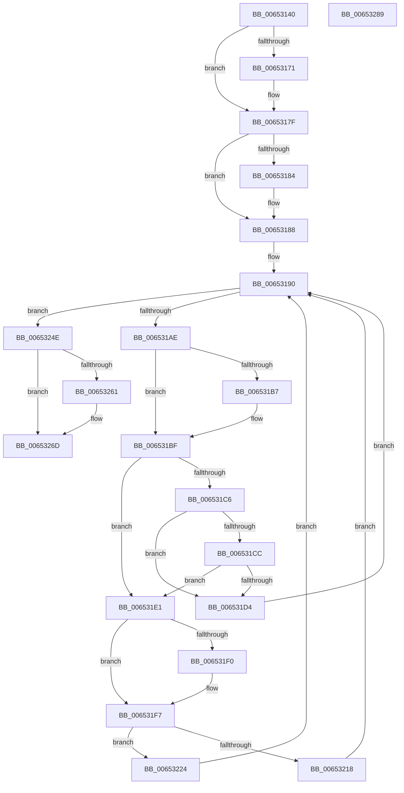

# EtwpCompressPendingBuffers

- RVA: `0x00653140`–`0x0065328A` (길이 `330` bytes)
- VA: `0x0000000140653140`
- 실행 섹션: `.text`
- PDB 이름 있음: `예`; PDB Function 태그: `아니요`
- unwind 정보 RVA: `0x00060BC4`
- 디코드: `88`개 명령, `330/330` bytes 표시
- 미해석 바이트: `0` (있으면 어셈블리에 `.byte`로 보존)

> 이 문서는 커널 이미지의 기계어와 PDB 기호를 분석해 생성했습니다. 4번과 5번은 함수 원형과 자료형을 바이너리 사용 방식에서 추정한 C 해석이며 원본 소스 복구 결과는 아닙니다.

## 1. Dependencies

- 직접 호출 지점: **13**; 고유 호출 대상: **11**
- 직접 호출자로 확인된 함수: **2**
- RIP 상대 이미지 참조: **0**

### Outgoing calls
- `0x00653161` → [KeAbPreAcquire](../21/KeAbPreAcquire_function_00210230.md) (function, `0x00210230`)
- `0x0065317A` → [ExfAcquirePushLockExclusiveEx](../20/ExfAcquirePushLockExclusiveEx_function_0020FC90.md) (function, `0x0020FC90`)
- `0x0065318B` → [EtwpRotateCompressionTargetIfNeeded](EtwpRotateCompressionTargetIfNeeded_function_006538DC.md) (function, `0x006538DC`)
- `0x00653192` → [KeQueryPerformanceCounter](../37/KeQueryPerformanceCounter_function_0037E7E0.md) (function, `0x0037E7E0`)
- `0x0065319D` → [EtwpDequeueBufferPendingCompression](EtwpDequeueBufferPendingCompression_function_006533E8.md) (function, `0x006533E8`)
- `0x006531AE` → [Feature_218004792__private_IsEnabledDeviceUsageNoInline](../64/Feature_218004792__private_IsEnabledDeviceUsageNoInline_function_0064F3EC.md) (function, `0x0064F3EC`)
- `0x006531BA` → [EtwpWaitForBufferReferenceCount](../../page/9B/EtwpWaitForBufferReferenceCount_function_009BDEC0.md) (function, `0x009BDEC0`)
- `0x006531DA` → [EtwpCompleteBuffer](../../page/AB/EtwpCompleteBuffer_function_00AB0C78.md) (function, `0x00AB0C78`)
- `0x006531E7` → [EtwpCompressBuffer](EtwpCompressBuffer_function_00652DBC.md) (function, `0x00652DBC`)
- `0x006531FD` → [EtwpCompleteBuffer](../../page/AB/EtwpCompleteBuffer_function_00AB0C78.md) (function, `0x00AB0C78`)
- `0x00653204` → [KeQueryPerformanceCounter](../37/KeQueryPerformanceCounter_function_0037E7E0.md) (function, `0x0037E7E0`)
- `0x00653268` → [ExfTryToWakePushLock](../26/ExfTryToWakePushLock_function_00265DD0.md) (function, `0x00265DD0`)
- `0x00653274` → [KeAbPostRelease](../2E/KeAbPostRelease_function_002E1600.md) (function, `0x002E1600`)

### Direct callers
- [EtwpBufferingModeCompressionFlush](EtwpBufferingModeCompressionFlush_function_00652D24.md) at `0x00652D40`
- [EtwpCompressionProc](EtwpCompressionProc_function_00653300.md) at `0x00653335`

### Static image references
- 디코드된 RIP-relative 메모리 참조가 없습니다.

## 2. Other-region calls and transfers

- 다른 실행 섹션으로 향하는 call: **3**
  - `0x006531BA` → [EtwpWaitForBufferReferenceCount](../../page/9B/EtwpWaitForBufferReferenceCount_function_009BDEC0.md) (`.text` → `PAGE`)
  - `0x006531DA` → [EtwpCompleteBuffer](../../page/AB/EtwpCompleteBuffer_function_00AB0C78.md) (`.text` → `PAGE`)
  - `0x006531FD` → [EtwpCompleteBuffer](../../page/AB/EtwpCompleteBuffer_function_00AB0C78.md) (`.text` → `PAGE`)
- 별도 외부 분기/꼬리 이동을 확인하지 못했습니다.

## 3. Assembly (complete function range)

```asm
00653140  48 89 5C 24 08                  mov qword ptr [rsp + 8], rbx
00653145  48 89 74 24 10                  mov qword ptr [rsp + 0x10], rsi
0065314A  57                              push rdi
0065314B  48 83 EC 20                     sub rsp, 0x20
0065314F  48 8D 99 80 05 00 00            lea rbx, [rcx + 0x580]
00653156  48 8B F9                        mov rdi, rcx
00653159  48 8B CB                        mov rcx, rbx
0065315C  45 33 C0                        xor r8d, r8d
0065315F  33 D2                           xor edx, edx
00653161  E8 CA D0 BB FF                  call 0x140210230
00653166  F0 48 0F BA 2B 00               lock bts qword ptr [rbx], 0
0065316C  48 8B F0                        mov rsi, rax
0065316F  73 0E                           jae 0x14065317f
00653171  4C 8B C3                        mov r8, rbx
00653174  48 8B D0                        mov rdx, rax
00653177  48 8B CB                        mov rcx, rbx
0065317A  E8 11 CB BB FF                  call 0x14020fc90
0065317F  48 85 F6                        test rsi, rsi
00653182  74 04                           je 0x140653188
00653184  C6 46 0A 01                     mov byte ptr [rsi + 0xa], 1
00653188  48 8B CF                        mov rcx, rdi
0065318B  E8 4C 07 00 00                  call 0x1406538dc
00653190  33 C9                           xor ecx, ecx
00653192  E8 49 B6 D2 FF                  call 0x14037e7e0
00653197  48 8B CF                        mov rcx, rdi
0065319A  48 8B D8                        mov rbx, rax
0065319D  E8 46 02 00 00                  call 0x1406533e8
006531A2  48 8B F0                        mov rsi, rax
006531A5  48 85 C0                        test rax, rax
006531A8  0F 84 A0 00 00 00               je 0x14065324e
006531AE  E8 39 C2 FF FF                  call 0x14064f3ec
006531B3  85 C0                           test eax, eax
006531B5  74 08                           je 0x1406531bf
006531B7  48 8B CE                        mov rcx, rsi
006531BA  E8 01 AD 36 00                  call 0x1409bdec0
006531BF  8B 4E 0C                        mov ecx, dword ptr [rsi + 0xc]
006531C2  85 C9                           test ecx, ecx
006531C4  7F 1B                           jg 0x1406531e1
006531C6  83 7E 04 48                     cmp dword ptr [rsi + 4], 0x48
006531CA  76 08                           jbe 0x1406531d4
006531CC  8B 46 08                        mov eax, dword ptr [rsi + 8]
006531CF  83 F8 48                        cmp eax, 0x48
006531D2  77 0D                           ja 0x1406531e1
006531D4  48 8B D6                        mov rdx, rsi
006531D7  48 8B CF                        mov rcx, rdi
006531DA  E8 99 DA 45 00                  call 0x140ab0c78
006531DF  EB AF                           jmp 0x140653190
006531E1  48 8B D6                        mov rdx, rsi
006531E4  48 8B CF                        mov rcx, rdi
006531E7  E8 D0 FB FF FF                  call 0x140652dbc
006531EC  85 C0                           test eax, eax
006531EE  79 07                           jns 0x1406531f7
006531F0  F0 FF 87 FC 00 00 00            lock inc dword ptr [rdi + 0xfc]
006531F7  48 8B D6                        mov rdx, rsi
006531FA  48 8B CF                        mov rcx, rdi
006531FD  E8 76 DA 45 00                  call 0x140ab0c78
00653202  33 C9                           xor ecx, ecx
00653204  E8 D7 B5 D2 FF                  call 0x14037e7e0
00653209  48 8B 8F 10 06 00 00            mov rcx, qword ptr [rdi + 0x610]
00653210  48 2B C3                        sub rax, rbx
00653213  48 85 C9                        test rcx, rcx
00653216  75 0C                           jne 0x140653224
00653218  48 89 87 10 06 00 00            mov qword ptr [rdi + 0x610], rax
0065321F  E9 6C FF FF FF                  jmp 0x140653190
00653224  48 8D 0C 88                     lea rcx, [rax + rcx*4]
00653228  48 B8 67 66 66 66 66 66 66 66   movabs rax, 0x6666666666666667
00653232  48 F7 E9                        imul rcx
00653235  48 D1 FA                        sar rdx, 1
00653238  48 8B C2                        mov rax, rdx
0065323B  48 C1 E8 3F                     shr rax, 0x3f
0065323F  48 03 D0                        add rdx, rax
00653242  48 89 97 10 06 00 00            mov qword ptr [rdi + 0x610], rdx
00653249  E9 42 FF FF FF                  jmp 0x140653190
0065324E  48 83 C8 FF                     or rax, 0xffffffffffffffff
00653252  F0 48 0F C1 87 80 05 00 00      lock xadd qword ptr [rdi + 0x580], rax
0065325B  24 06                           and al, 6
0065325D  3C 02                           cmp al, 2
0065325F  75 0C                           jne 0x14065326d
00653261  48 8D 8F 80 05 00 00            lea rcx, [rdi + 0x580]
00653268  E8 63 2B C1 FF                  call 0x140265dd0
0065326D  48 8D 8F 80 05 00 00            lea rcx, [rdi + 0x580]
00653274  E8 87 E3 C8 FF                  call 0x1402e1600
00653279  48 8B 5C 24 30                  mov rbx, qword ptr [rsp + 0x30]
0065327E  48 8B 74 24 38                  mov rsi, qword ptr [rsp + 0x38]
00653283  48 83 C4 20                     add rsp, 0x20
00653287  5F                              pop rdi
00653288  C3                              ret
00653289  CC                              int3
```

## 4. C-style interpretation (structured pseudocode)

```c
__int64 __fastcall EtwpCompressPendingBuffers(__int64 a1, int a2, int a3)
{
    __int64 result;
    __int64 v_rsp;
    unsigned __int64 v_stack_p10;
    unsigned __int64 v_stack_p8;

    v_stack_p8 = v_rbx;
    v_stack_p10 = v_rsi;
    v_rsp = (v_rsp) - (32);
    a3 = 0;
    a2 = 0;
    result = KeAbPreAcquire(a1 + 1408, a2, a3, a4);
    if (!(condition_is_above_or_equal)) {
        a3 = a1 + 1408;
        a2 = result;
        a1 = a1 + 1408;
        result = ExfAcquirePushLockExclusiveEx(a1, a2, a3, a4);
    }
    if (result != 0) {
        *(unsigned __int8 *)(result + 10) = 1;
    }
    result = EtwpRotateCompressionTargetIfNeeded(a1, a2, a3, a4);
loc_00653190:
    a1 = 0;
    result = KeQueryPerformanceCounter(a1, a2, a3, a4);
    result = EtwpDequeueBufferPendingCompression(0, a2, a3, a4);
    if (result == 0) goto loc_0065324E;
    result = Feature_218004792__private_IsEnabledDeviceUsageNoInline(0, a2, a3, a4);
    if ((unsigned int)(result) != 0) {
        a1 = result;
        result = EtwpWaitForBufferReferenceCount(a1, a2, a3, a4);
    }
    if (condition_is_greater) goto loc_006531E1;
    if ((*(unsigned int *)(result + 4)) <= 72) goto loc_006531D4;
    if (((unsigned int)((unsigned int)(*(unsigned int *)(result + 8)))) > 72) goto loc_006531E1;
loc_006531D4:
    result = EtwpCompleteBuffer(a1, result, a3, a4);
    goto loc_00653190;
loc_006531E1:
    result = EtwpCompressBuffer(a1, result, a3, a4);
    if (sign_flag) {
    }
    result = EtwpCompleteBuffer(a1, result, a3, a4);
    a1 = 0;
    result = KeQueryPerformanceCounter(a1, result, a3, a4);
    result = (result) - (result);
    if (*(unsigned __int64 *)(a1 + 1552) != 0) goto loc_00653224;
    *(unsigned __int64 *)(a1 + 1552) = result;
    goto loc_00653190;
loc_00653224:
    a2 = (result) >> (1);
    result = (a2) >> (63);
    a2 = (a2) + (result);
    *(unsigned __int64 *)(a1 + 1552) = a2;
    goto loc_00653190;
loc_0065324E:
    result = (result) | (-1);
    result = (unsigned __int8)((result) & (6));
    if (((unsigned __int8)(result)) == 2) {
        a1 = a1 + 1408;
        result = ExfTryToWakePushLock(a1, a2, a3, a4);
    }
    result = KeAbPostRelease(a1 + 1408, a2, a3, a4);
    v_rsp = (v_rsp) + (32);
    return result;
}
```

## 5. (Beta) C Style

```c
int64_t EtwpCompressPendingBuffers(void *Arg1, int32_t Arg2, int32_t Arg3)
{
    uint8_t *arg1 = (uint8_t *)Arg1;

    int64_t result;
    int64_t local_rsp;
    uint64_t v_stack_p10;
    uint64_t v_stack_p8;

    v_stack_p8 = local_rbx;
    v_stack_p10 = local_rsi;
    local_rsp = (local_rsp) - (32);
    Arg3 = 0;
    Arg2 = 0;
    result = KeAbPreAcquire(Arg1 + 1408, Arg2, Arg3, a4);
    if (!(condition_is_above_or_equal)) {
        Arg3 = Arg1 + 1408;
        Arg2 = result;
        Arg1 = Arg1 + 1408;
        result = ExfAcquirePushLockExclusiveEx(Arg1, Arg2, Arg3, a4);
    }
    if (result != 0) {
        *(uint8_t *)(result + 0xA) = 1;
    }
    result = EtwpRotateCompressionTargetIfNeeded(Arg1, Arg2, Arg3, a4);
loc_00653190:
    Arg1 = 0;
    result = KeQueryPerformanceCounter(Arg1, Arg2, Arg3, a4);
    result = EtwpDequeueBufferPendingCompression(0, Arg2, Arg3, a4);
    if (result == 0) goto loc_0065324E;
    result = Feature_218004792__private_IsEnabledDeviceUsageNoInline(0, Arg2, Arg3, a4);
    if ((uint32_t)(result) != 0) {
        Arg1 = result;
        result = EtwpWaitForBufferReferenceCount(Arg1, Arg2, Arg3, a4);
    }
    if (condition_is_greater) goto loc_006531E1;
    if ((*(uint32_t *)(result + 0x4)) <= 72) goto loc_006531D4;
    if (((uint32_t)((uint32_t)(*(uint32_t *)(result + 0x8)))) > 72) goto loc_006531E1;
loc_006531D4:
    result = EtwpCompleteBuffer(Arg1, result, Arg3, a4);
    goto loc_00653190;
loc_006531E1:
    result = EtwpCompressBuffer(Arg1, result, Arg3, a4);
    if (sign_flag) {
    }
    result = EtwpCompleteBuffer(Arg1, result, Arg3, a4);
    Arg1 = 0;
    result = KeQueryPerformanceCounter(Arg1, result, Arg3, a4);
    result = (result) - (result);
    if (*(uint64_t *)(arg1 + 0x610) != 0) goto loc_00653224;
    *(uint64_t *)(arg1 + 0x610) = result;
    goto loc_00653190;
loc_00653224:
    Arg2 = (result) >> (1);
    result = (Arg2) >> (63);
    Arg2 = (Arg2) + (result);
    *(uint64_t *)(arg1 + 0x610) = Arg2;
    goto loc_00653190;
loc_0065324E:
    result = (result) | (-1);
    result = (uint8_t)((result) & (6));
    if (((uint8_t)(result)) == 2) {
        Arg1 = Arg1 + 1408;
        result = ExfTryToWakePushLock(Arg1, Arg2, Arg3, a4);
    }
    result = KeAbPostRelease(Arg1 + 1408, Arg2, Arg3, a4);
    local_rsp = (local_rsp) + (32);
    return result;
}
```

### 관측된 메모리 오프셋

구조체 형식이 확인되지 않은 접근은 인자 기준의 오프셋으로만 기록했습니다.

| 기준 인자 | 오프셋 표현 | 폭 (bit) | 접근 |
|---|---:|---:|---|
| `Arg1` | `+ 0x0` | `64` | `R/W` |
| `Arg1` | `+ 0xFC` | `32` | `R/W` |
| `Arg1` | `+ 0x580` | `64` | `R` |
| `Arg1` | `+ 0x580` | `64` | `R/W` |
| `Arg1` | `+ 0x610` | `64` | `R` |
| `Arg1` | `+ 0x610` | `64` | `W` |

## 6. Execution-region graph

[열기: 2D/3D 그래프와 함수 탐색 컨트롤 패널](../../../control-panel.html?section=text&rva=0x00653140&view=graph)

- 2D 그래프는 위에서 아래로 흐르고, 3D 그래프는 빈 공간을 드래그해 회전합니다. Shift+드래그는 이동, 휠은 확대·축소, 함수 노드 선택은 대상 보고서 이동입니다.

### Static fallback


