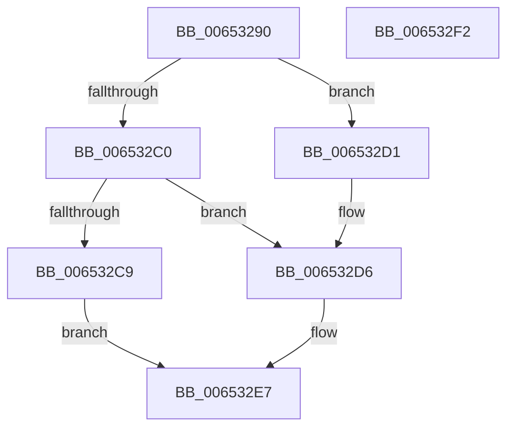

# EtwpCompressionDpc

- RVA: `0x00653290`–`0x006532F3` (길이 `99` bytes)
- VA: `0x0000000140653290`
- 실행 섹션: `.text`
- PDB 이름 있음: `예`; PDB Function 태그: `아니요`
- unwind 정보 RVA: `0x0005CAAC`
- 디코드: `27`개 명령, `99/99` bytes 표시
- 미해석 바이트: `0` (있으면 어셈블리에 `.byte`로 보존)

> 이 문서는 커널 이미지의 기계어와 PDB 기호를 분석해 생성했습니다. 4번과 5번은 함수 원형과 자료형을 바이너리 사용 방식에서 추정한 C 해석이며 원본 소스 복구 결과는 아닙니다.

## 1. Dependencies

- 직접 호출 지점: **4**; 고유 호출 대상: **3**
- 직접 호출자로 확인된 함수: **2**
- RIP 상대 이미지 참조: **0**

### Outgoing calls
- `0x006532A4` → [Feature_218004792__private_IsEnabledDeviceUsageNoInline](../64/Feature_218004792__private_IsEnabledDeviceUsageNoInline_function_0064F3EC.md) (function, `0x0064F3EC`)
- `0x006532C0` → [ExAcquireRundownProtectionCacheAwareEx](../41/ExAcquireRundownProtectionCacheAwareEx_function_00411F50.md) (function, `0x00411F50`)
- `0x006532D1` → [ExAcquireRundownProtectionCacheAwareEx](../41/ExAcquireRundownProtectionCacheAwareEx_function_00411F50.md) (function, `0x00411F50`)
- `0x006532E2` → [ExQueueWorkItem](../2F/ExQueueWorkItem_function_002F9520.md) (function, `0x002F9520`)

### Direct callers
- [sub_006DFB24](../6D/Unknown_function_006DFB24.md) at `0x006DFBE6`
- [sub_006DFE7E](../6D/Unknown_function_006DFE7E.md) at `0x006DFEB3`

### Static image references
- 디코드된 RIP-relative 메모리 참조가 없습니다.

## 2. Other-region calls and transfers

- 다른 실행 섹션으로 향하는 call: **0**
- 별도 외부 분기/꼬리 이동을 확인하지 못했습니다.

## 3. Assembly (complete function range)

```asm
00653290  48 89 5C 24 08                  mov qword ptr [rsp + 8], rbx
00653295  57                              push rdi
00653296  48 83 EC 20                     sub rsp, 0x20
0065329A  48 8B 9A 50 05 00 00            mov rbx, qword ptr [rdx + 0x550]
006532A1  48 8B FA                        mov rdi, rdx
006532A4  E8 43 C1 FF FF                  call 0x14064f3ec
006532A9  48 8B 8B C0 02 00 00            mov rcx, qword ptr [rbx + 0x2c0]
006532B0  33 DB                           xor ebx, ebx
006532B2  44 8B 07                        mov r8d, dword ptr [rdi]
006532B5  8D 53 01                        lea edx, [rbx + 1]
006532B8  4A 8B 0C C1                     mov rcx, qword ptr [rcx + r8*8]
006532BC  85 C0                           test eax, eax
006532BE  74 11                           je 0x1406532d1
006532C0  E8 8B EC DB FF                  call 0x140411f50
006532C5  84 C0                           test al, al
006532C7  75 0D                           jne 0x1406532d6
006532C9  87 9F 78 05 00 00               xchg dword ptr [rdi + 0x578], ebx
006532CF  EB 16                           jmp 0x1406532e7
006532D1  E8 7A EC DB FF                  call 0x140411f50
006532D6  48 8D 8F 58 05 00 00            lea rcx, [rdi + 0x558]
006532DD  BA 01 00 00 00                  mov edx, 1
006532E2  E8 39 62 CA FF                  call 0x1402f9520
006532E7  48 8B 5C 24 30                  mov rbx, qword ptr [rsp + 0x30]
006532EC  48 83 C4 20                     add rsp, 0x20
006532F0  5F                              pop rdi
006532F1  C3                              ret
006532F2  CC                              int3
```

## 4. C-style interpretation (structured pseudocode)

```c
__int64 __fastcall EtwpCompressionDpc(__int64 a1, __int64 a2)
{
    __int64 result;
    __int64 v_rbx;
    __int64 v_rsp;
    unsigned __int64 v_stack_p8;

    v_stack_p8 = v_rbx;
    v_rsp = (v_rsp) - (32);
    result = Feature_218004792__private_IsEnabledDeviceUsageNoInline(a1, a2, a3, a4);
    v_rbx = 0;
    if ((unsigned int)(result) == 0) goto loc_006532D1;
    result = ExAcquireRundownProtectionCacheAwareEx(*(unsigned __int64 *)(*(unsigned __int64 *)(*(unsigned __int64 *)(a2 + 1360) + 704) + (unsigned int)(*(unsigned int *)(a2)) * 8), v_rbx + 1, (unsigned int)(*(unsigned int *)(a2)), a4);
    if ((unsigned __int8)(result) != 0) goto loc_006532D6;
    goto loc_006532E7;
loc_006532D1:
    result = ExAcquireRundownProtectionCacheAwareEx(*(unsigned __int64 *)(*(unsigned __int64 *)(*(unsigned __int64 *)(a2 + 1360) + 704) + (unsigned int)(*(unsigned int *)(a2)) * 8), v_rbx + 1, (unsigned int)(*(unsigned int *)(a2)), a4);
loc_006532D6:
    result = ExQueueWorkItem(a2 + 1368, 1, (unsigned int)(*(unsigned int *)(a2)), a4);
loc_006532E7:
    v_rsp = (v_rsp) + (32);
    return result;
}
```

## 5. (Beta) C Style

```c
int64_t EtwpCompressionDpc(int64_t Arg1, void *Arg2)
{
    uint8_t *arg2 = (uint8_t *)Arg2;

    int64_t result;
    int64_t local_rbx;
    int64_t local_rsp;
    uint64_t v_stack_p8;

    v_stack_p8 = local_rbx;
    local_rsp = (local_rsp) - (32);
    result = Feature_218004792__private_IsEnabledDeviceUsageNoInline(Arg1, Arg2, a3, a4);
    local_rbx = 0;
    if ((uint32_t)(result) == 0) goto loc_006532D1;
    result = ExAcquireRundownProtectionCacheAwareEx(*(uint64_t *)(*(uint64_t *)(*(uint64_t *)(arg2 + 0x550) + 0x2C0) + (uint32_t)(*(uint32_t *)(arg2)) * 8), local_rbx + 1, (uint32_t)(*(uint32_t *)(arg2)), a4);
    if ((uint8_t)(result) != 0) goto loc_006532D6;
    goto loc_006532E7;
loc_006532D1:
    result = ExAcquireRundownProtectionCacheAwareEx(*(uint64_t *)(*(uint64_t *)(*(uint64_t *)(arg2 + 0x550) + 0x2C0) + (uint32_t)(*(uint32_t *)(arg2)) * 8), local_rbx + 1, (uint32_t)(*(uint32_t *)(arg2)), a4);
loc_006532D6:
    result = ExQueueWorkItem(Arg2 + 1368, 1, (uint32_t)(*(uint32_t *)(arg2)), a4);
loc_006532E7:
    local_rsp = (local_rsp) + (32);
    return result;
}
```

### 관측된 메모리 오프셋

구조체 형식이 확인되지 않은 접근은 인자 기준의 오프셋으로만 기록했습니다.

| 기준 인자 | 오프셋 표현 | 폭 (bit) | 접근 |
|---|---:|---:|---|
| `Arg2` | `+ 0x0` | `32` | `R` |
| `Arg2` | `+ 0x550` | `64` | `R` |
| `Arg2` | `+ 0x558` | `64` | `R` |
| `Arg2` | `+ 0x578` | `32` | `R/W` |

## 6. Execution-region graph

[열기: 2D/3D 그래프와 함수 탐색 컨트롤 패널](../../../control-panel.html?section=text&rva=0x00653290&view=graph)

- 2D 그래프는 위에서 아래로 흐르고, 3D 그래프는 빈 공간을 드래그해 회전합니다. Shift+드래그는 이동, 휠은 확대·축소, 함수 노드 선택은 대상 보고서 이동입니다.

### Static fallback


