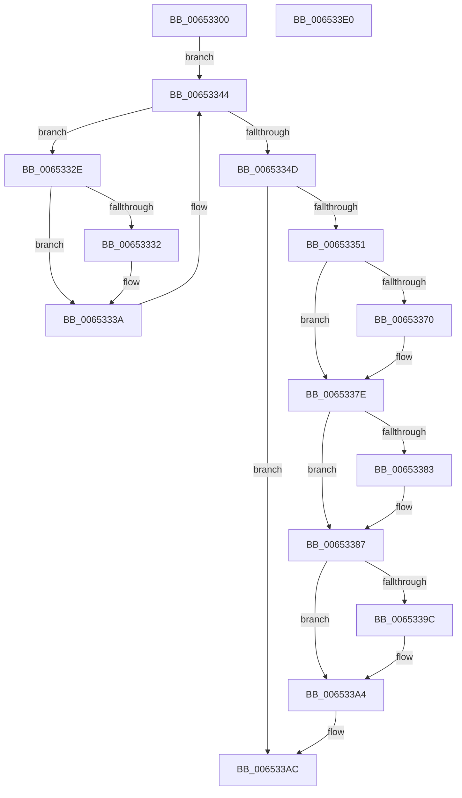

# EtwpCompressionProc

- RVA: `0x00653300`–`0x006533E1` (길이 `225` bytes)
- VA: `0x0000000140653300`
- 실행 섹션: `.text`
- PDB 이름 있음: `예`; PDB Function 태그: `아니요`
- unwind 정보 RVA: `0x0005C954`
- 디코드: `61`개 명령, `225/225` bytes 표시
- 미해석 바이트: `0` (있으면 어셈블리에 `.byte`로 보존)

> 이 문서는 커널 이미지의 기계어와 PDB 기호를 분석해 생성했습니다. 4번과 5번은 함수 원형과 자료형을 바이너리 사용 방식에서 추정한 C 해석이며 원본 소스 복구 결과는 아닙니다.

## 1. Dependencies

- 직접 호출 지점: **7**; 고유 호출 대상: **7**
- 직접 호출자로 확인된 함수: **0**
- RIP 상대 이미지 참조: **0**

### Outgoing calls
- `0x00653335` → [EtwpCompressPendingBuffers](EtwpCompressPendingBuffers_function_00653140.md) (function, `0x00653140`)
- `0x00653360` → [KeAbPreAcquire](../21/KeAbPreAcquire_function_00210230.md) (function, `0x00210230`)
- `0x00653379` → [ExfAcquirePushLockExclusiveEx](../20/ExfAcquirePushLockExclusiveEx_function_0020FC90.md) (function, `0x0020FC90`)
- `0x0065338A` → [EtwpRelinquishCompressionTarget](EtwpRelinquishCompressionTarget_function_00653818.md) (function, `0x00653818`)
- `0x0065339F` → [ExfTryToWakePushLock](../26/ExfTryToWakePushLock_function_00265DD0.md) (function, `0x00265DD0`)
- `0x006533A7` → [KeAbPostRelease](../2E/KeAbPostRelease_function_002E1600.md) (function, `0x002E1600`)
- `0x006533C6` → [ExReleaseRundownProtectionCacheAwareEx](../25/ExReleaseRundownProtectionCacheAwareEx_function_0025F050.md) (function, `0x0025F050`)

### Direct callers
- 이 함수 시작 RVA로 연결되는 직접 call은 확인되지 않았습니다. 간접 호출은 완전히 역산할 수 없습니다.

### Static image references
- 디코드된 RIP-relative 메모리 참조가 없습니다.

## 2. Other-region calls and transfers

- 다른 실행 섹션으로 향하는 call: **0**
- 별도 외부 분기/꼬리 이동을 확인하지 못했습니다.

## 3. Assembly (complete function range)

```asm
00653300  48 89 5C 24 08                  mov qword ptr [rsp + 8], rbx
00653305  48 89 6C 24 10                  mov qword ptr [rsp + 0x10], rbp
0065330A  48 89 74 24 18                  mov qword ptr [rsp + 0x18], rsi
0065330F  57                              push rdi
00653310  48 83 EC 20                     sub rsp, 0x20
00653314  48 83 CB FF                     or rbx, 0xffffffffffffffff
00653318  48 8D B1 98 05 00 00            lea rsi, [rcx + 0x598]
0065331F  8B C3                           mov eax, ebx
00653321  48 8B F9                        mov rdi, rcx
00653324  F0 0F C1 81 78 05 00 00         lock xadd dword ptr [rcx + 0x578], eax
0065332C  EB 16                           jmp 0x140653344
0065332E  85 C0                           test eax, eax
00653330  74 08                           je 0x14065333a
00653332  48 8B CF                        mov rcx, rdi
00653335  E8 06 FE FF FF                  call 0x140653140
0065333A  8B C3                           mov eax, ebx
0065333C  F0 0F C1 87 78 05 00 00         lock xadd dword ptr [rdi + 0x578], eax
00653344  03 C3                           add eax, ebx
00653346  83 F8 01                        cmp eax, 1
00653349  8B 06                           mov eax, dword ptr [rsi]
0065334B  74 E1                           je 0x14065332e
0065334D  85 C0                           test eax, eax
0065334F  75 5B                           jne 0x1406533ac
00653351  48 8D B7 80 05 00 00            lea rsi, [rdi + 0x580]
00653358  45 33 C0                        xor r8d, r8d
0065335B  48 8B CE                        mov rcx, rsi
0065335E  33 D2                           xor edx, edx
00653360  E8 CB CE BB FF                  call 0x140210230
00653365  F0 48 0F BA 2E 00               lock bts qword ptr [rsi], 0
0065336B  48 8B E8                        mov rbp, rax
0065336E  73 0E                           jae 0x14065337e
00653370  4C 8B C6                        mov r8, rsi
00653373  48 8B D0                        mov rdx, rax
00653376  48 8B CE                        mov rcx, rsi
00653379  E8 12 C9 BB FF                  call 0x14020fc90
0065337E  48 85 ED                        test rbp, rbp
00653381  74 04                           je 0x140653387
00653383  C6 45 0A 01                     mov byte ptr [rbp + 0xa], 1
00653387  48 8B CF                        mov rcx, rdi
0065338A  E8 89 04 00 00                  call 0x140653818
0065338F  F0 48 0F C1 1E                  lock xadd qword ptr [rsi], rbx
00653394  80 E3 06                        and bl, 6
00653397  80 FB 02                        cmp bl, 2
0065339A  75 08                           jne 0x1406533a4
0065339C  48 8B CE                        mov rcx, rsi
0065339F  E8 2C 2A C1 FF                  call 0x140265dd0
006533A4  48 8B CE                        mov rcx, rsi
006533A7  E8 54 E2 C8 FF                  call 0x1402e1600
006533AC  48 8B 87 50 05 00 00            mov rax, qword ptr [rdi + 0x550]
006533B3  BA 01 00 00 00                  mov edx, 1
006533B8  44 8B 07                        mov r8d, dword ptr [rdi]
006533BB  48 8B 88 C0 02 00 00            mov rcx, qword ptr [rax + 0x2c0]
006533C2  4A 8B 0C C1                     mov rcx, qword ptr [rcx + r8*8]
006533C6  E8 85 BC C0 FF                  call 0x14025f050
006533CB  48 8B 5C 24 30                  mov rbx, qword ptr [rsp + 0x30]
006533D0  48 8B 6C 24 38                  mov rbp, qword ptr [rsp + 0x38]
006533D5  48 8B 74 24 40                  mov rsi, qword ptr [rsp + 0x40]
006533DA  48 83 C4 20                     add rsp, 0x20
006533DE  5F                              pop rdi
006533DF  C3                              ret
006533E0  CC                              int3
```

## 4. C-style interpretation (structured pseudocode)

```c
__int64 __fastcall EtwpCompressionProc(__int64 a1, int a2, int a3)
{
    __int64 result;
    __int64 v_rbx;
    __int64 v_rsp;
    unsigned __int64 v_stack_p10;
    unsigned __int64 v_stack_p18;
    unsigned __int64 v_stack_p8;

    v_stack_p8 = v_rbx;
    v_stack_p10 = v_rbp;
    v_stack_p18 = v_rsi;
    v_rsp = (v_rsp) - (32);
    v_rbx = (v_rbx) | (-1);
    goto loc_00653344;
loc_0065332E:
    result = (unsigned int)((unsigned int)(v_rbx));
    if ((unsigned int)((unsigned int)((unsigned int)(v_rbx))) != 0) {
        a1 = a1;
        result = EtwpCompressPendingBuffers(a1, a2, a3, a4);
    }
loc_00653344:
    result = (unsigned int)(((unsigned int)((unsigned int)(v_rbx))) + ((unsigned int)(v_rbx)));
    if (((unsigned int)(result)) == 1) goto loc_0065332E;
    if ((unsigned int)((unsigned int)(*(unsigned int *)(a1 + 1432))) != 0) goto loc_006533AC;
    a3 = 0;
    a2 = 0;
    result = KeAbPreAcquire(a1 + 1408, a2, a3, a4);
    if (!(condition_is_above_or_equal)) {
        a3 = a1 + 1408;
        a2 = result;
        a1 = a1 + 1408;
        result = ExfAcquirePushLockExclusiveEx(a1, a2, a3, a4);
    }
    if (result != 0) {
        *(unsigned __int8 *)(result + 10) = 1;
    }
    result = EtwpRelinquishCompressionTarget(a1, a2, a3, a4);
    v_rbx = (unsigned __int8)((v_rbx) & (6));
    if (((unsigned __int8)(v_rbx)) == 2) {
        a1 = a1 + 1408;
        result = ExfTryToWakePushLock(a1, a2, a3, a4);
    }
    result = KeAbPostRelease(a1 + 1408, a2, a3, a4);
loc_006533AC:
    result = ExReleaseRundownProtectionCacheAwareEx(*(unsigned __int64 *)(*(unsigned __int64 *)(*(unsigned __int64 *)(a1 + 1360) + 704) + (unsigned int)(*(unsigned int *)(a1)) * 8), 1, (unsigned int)(*(unsigned int *)(a1)), a4);
    v_rsp = (v_rsp) + (32);
    return result;
}
```

## 5. (Beta) C Style

```c
int64_t EtwpCompressionProc(void *Arg1, int32_t Arg2, int32_t Arg3)
{
    uint8_t *arg1 = (uint8_t *)Arg1;

    int64_t result;
    int64_t local_rbx;
    int64_t local_rsp;
    uint64_t v_stack_p10;
    uint64_t v_stack_p18;
    uint64_t v_stack_p8;

    v_stack_p8 = local_rbx;
    v_stack_p10 = local_rbp;
    v_stack_p18 = local_rsi;
    local_rsp = (local_rsp) - (32);
    local_rbx = (local_rbx) | (-1);
    goto loc_00653344;
loc_0065332E:
    result = (uint32_t)((uint32_t)(local_rbx));
    if ((uint32_t)((uint32_t)((uint32_t)(local_rbx))) != 0) {
        Arg1 = Arg1;
        result = EtwpCompressPendingBuffers(Arg1, Arg2, Arg3, a4);
    }
loc_00653344:
    result = (uint32_t)(((uint32_t)((uint32_t)(local_rbx))) + ((uint32_t)(local_rbx)));
    if (((uint32_t)(result)) == 1) goto loc_0065332E;
    if ((uint32_t)((uint32_t)(*(uint32_t *)(arg1 + 0x598))) != 0) goto loc_006533AC;
    Arg3 = 0;
    Arg2 = 0;
    result = KeAbPreAcquire(Arg1 + 1408, Arg2, Arg3, a4);
    if (!(condition_is_above_or_equal)) {
        Arg3 = Arg1 + 1408;
        Arg2 = result;
        Arg1 = Arg1 + 1408;
        result = ExfAcquirePushLockExclusiveEx(Arg1, Arg2, Arg3, a4);
    }
    if (result != 0) {
        *(uint8_t *)(result + 0xA) = 1;
    }
    result = EtwpRelinquishCompressionTarget(Arg1, Arg2, Arg3, a4);
    local_rbx = (uint8_t)((local_rbx) & (6));
    if (((uint8_t)(local_rbx)) == 2) {
        Arg1 = Arg1 + 1408;
        result = ExfTryToWakePushLock(Arg1, Arg2, Arg3, a4);
    }
    result = KeAbPostRelease(Arg1 + 1408, Arg2, Arg3, a4);
loc_006533AC:
    result = ExReleaseRundownProtectionCacheAwareEx(*(uint64_t *)(*(uint64_t *)(*(uint64_t *)(arg1 + 0x550) + 0x2C0) + (uint32_t)(*(uint32_t *)(arg1)) * 8), 1, (uint32_t)(*(uint32_t *)(arg1)), a4);
    local_rsp = (local_rsp) + (32);
    return result;
}
```

### 관측된 메모리 오프셋

구조체 형식이 확인되지 않은 접근은 인자 기준의 오프셋으로만 기록했습니다.

| 기준 인자 | 오프셋 표현 | 폭 (bit) | 접근 |
|---|---:|---:|---|
| `Arg1` | `+ 0x0` | `32` | `R` |
| `Arg1` | `+ 0x0` | `64` | `R/W` |
| `Arg1` | `+ 0x550` | `64` | `R` |
| `Arg1` | `+ 0x578` | `32` | `R/W` |
| `Arg1` | `+ 0x580` | `64` | `R` |
| `Arg1` | `+ 0x598` | `64` | `R` |

## 6. Execution-region graph

[열기: 2D/3D 그래프와 함수 탐색 컨트롤 패널](../../../control-panel.html?section=text&rva=0x00653300&view=graph)

- 2D 그래프는 위에서 아래로 흐르고, 3D 그래프는 빈 공간을 드래그해 회전합니다. Shift+드래그는 이동, 휠은 확대·축소, 함수 노드 선택은 대상 보고서 이동입니다.

### Static fallback


