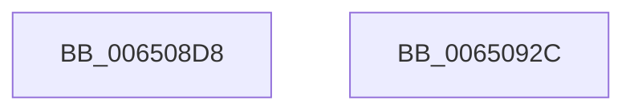

# EtwpConstructSchedulingGroupEvent

- RVA: `0x006508D8`–`0x0065092D` (길이 `85` bytes)
- VA: `0x00000001406508D8`
- 실행 섹션: `.text`
- PDB 이름 있음: `예`; PDB Function 태그: `아니요`
- unwind 정보 RVA: `0x000DB714`
- 디코드: `29`개 명령, `85/85` bytes 표시
- 미해석 바이트: `0` (있으면 어셈블리에 `.byte`로 보존)

> 이 문서는 커널 이미지의 기계어와 PDB 기호를 분석해 생성했습니다. 4번과 5번은 함수 원형과 자료형을 바이너리 사용 방식에서 추정한 C 해석이며 원본 소스 복구 결과는 아닙니다.

## 1. Dependencies

- 직접 호출 지점: **0**; 고유 호출 대상: **0**
- 직접 호출자로 확인된 함수: **2**
- RIP 상대 이미지 참조: **0**

### Outgoing calls
- 직접 디코드된 call 명령이 없습니다.

### Direct callers
- [EtwTraceSchedulingGroup](EtwTraceSchedulingGroup_function_00650108.md) at `0x00650136`
- [EtwTraceSchedulingGroupRundown](EtwTraceSchedulingGroupRundown_function_0065018C.md) at `0x006501BC`

### Static image references
- 디코드된 RIP-relative 메모리 참조가 없습니다.

## 2. Other-region calls and transfers

- 다른 실행 섹션으로 향하는 call: **0**
- 별도 외부 분기/꼬리 이동을 확인하지 못했습니다.

## 3. Assembly (complete function range)

```asm
006508D8  48 83 61 08 00                  and qword ptr [rcx + 8], 0
006508DD  4C 8B C9                        mov r9, rcx
006508E0  48 83 61 10 00                  and qword ptr [rcx + 0x10], 0
006508E5  48 89 11                        mov qword ptr [rcx], rdx
006508E8  48 8B 42 60                     mov rax, qword ptr [rdx + 0x60]
006508EC  48 89 41 08                     mov qword ptr [rcx + 8], rax
006508F0  48 8B 02                        mov rax, qword ptr [rdx]
006508F3  8B 51 14                        mov edx, dword ptr [rcx + 0x14]
006508F6  89 41 10                        mov dword ptr [rcx + 0x10], eax
006508F9  8B CA                           mov ecx, edx
006508FB  48 C1 E8 20                     shr rax, 0x20
006508FF  33 C8                           xor ecx, eax
00650901  44 8B C0                        mov r8d, eax
00650904  83 E1 01                        and ecx, 1
00650907  33 CA                           xor ecx, edx
00650909  8B D0                           mov edx, eax
0065090B  33 D1                           xor edx, ecx
0065090D  83 E2 02                        and edx, 2
00650910  33 D1                           xor edx, ecx
00650912  44 33 C2                        xor r8d, edx
00650915  41 83 E0 04                     and r8d, 4
00650919  44 33 C2                        xor r8d, edx
0065091C  41 8B C8                        mov ecx, r8d
0065091F  33 C8                           xor ecx, eax
00650921  83 E1 08                        and ecx, 8
00650924  41 33 C8                        xor ecx, r8d
00650927  41 89 49 14                     mov dword ptr [r9 + 0x14], ecx
0065092B  C3                              ret
0065092C  CC                              int3
```

## 4. C-style interpretation (structured pseudocode)

```c
__int64 __fastcall EtwpConstructSchedulingGroupEvent(__int64 a1, __int64 a2)
{
    __int64 result;

    *(unsigned __int64 *)(a1) = a2;
    *(unsigned __int64 *)(a1 + 8) = *(unsigned __int64 *)(a2 + 96);
    *(unsigned int *)(a1 + 16) = (unsigned int)(*(unsigned __int64 *)(a2));
    result = (*(unsigned __int64 *)(a2)) >> (32);
    a1 = (unsigned int)(((unsigned int)((unsigned int)((unsigned int)(*(unsigned int *)(a1 + 20))))) ^ ((unsigned int)(result)));
    a1 = (unsigned int)((a1) & (1));
    a1 = (unsigned int)((a1) ^ ((unsigned int)((unsigned int)(*(unsigned int *)(a1 + 20)))));
    a2 = (unsigned int)(((unsigned int)((unsigned int)(result))) ^ ((unsigned int)(a1)));
    a2 = (unsigned int)((a2) & (2));
    a2 = (unsigned int)((a2) ^ ((unsigned int)(a1)));
    a3 = (unsigned int)(((unsigned int)((unsigned int)(result))) ^ ((unsigned int)(a2)));
    a3 = (unsigned int)((a3) & (4));
    a3 = (unsigned int)((a3) ^ ((unsigned int)(a2)));
    a1 = (unsigned int)(((unsigned int)((unsigned int)(a3))) ^ ((unsigned int)(result)));
    a1 = (unsigned int)((a1) & (8));
    a1 = (unsigned int)((a1) ^ ((unsigned int)(a3)));
    *(unsigned int *)(a1 + 20) = (unsigned int)(a1);
    return result;
}
```

## 5. (Beta) C Style

```c
int64_t EtwpConstructSchedulingGroupEvent(void *Arg1, void *Arg2)
{
    uint8_t *arg1 = (uint8_t *)Arg1;
    uint8_t *arg2 = (uint8_t *)Arg2;

    int64_t result;

    *(void **)(arg1) = Arg2;
    *(uint64_t *)(arg1 + 0x8) = *(uint64_t *)(arg2 + 0x60);
    *(uint32_t *)(arg1 + 0x10) = (uint32_t)(*(uint64_t *)(arg2));
    result = (*(uint64_t *)(arg2)) >> (32);
    Arg1 = (uint32_t)(((uint32_t)((uint32_t)((uint32_t)(*(uint32_t *)(arg1 + 0x14))))) ^ ((uint32_t)(result)));
    Arg1 = (uint32_t)((Arg1) & (1));
    Arg1 = (uint32_t)((Arg1) ^ ((uint32_t)((uint32_t)(*(uint32_t *)(arg1 + 0x14)))));
    Arg2 = (uint32_t)(((uint32_t)((uint32_t)(result))) ^ ((uint32_t)(Arg1)));
    Arg2 = (uint32_t)((Arg2) & (2));
    Arg2 = (uint32_t)((Arg2) ^ ((uint32_t)(Arg1)));
    a3 = (uint32_t)(((uint32_t)((uint32_t)(result))) ^ ((uint32_t)(Arg2)));
    a3 = (uint32_t)((a3) & (4));
    a3 = (uint32_t)((a3) ^ ((uint32_t)(Arg2)));
    Arg1 = (uint32_t)(((uint32_t)((uint32_t)(a3))) ^ ((uint32_t)(result)));
    Arg1 = (uint32_t)((Arg1) & (8));
    Arg1 = (uint32_t)((Arg1) ^ ((uint32_t)(a3)));
    *(uint32_t *)(arg1 + 0x14) = (uint32_t)(Arg1);
    return result;
}
```

### 관측된 메모리 오프셋

구조체 형식이 확인되지 않은 접근은 인자 기준의 오프셋으로만 기록했습니다.

| 기준 인자 | 오프셋 표현 | 폭 (bit) | 접근 |
|---|---:|---:|---|
| `Arg1` | `+ 0x0` | `64` | `W` |
| `Arg1` | `+ 0x8` | `64` | `R/W` |
| `Arg1` | `+ 0x8` | `64` | `W` |
| `Arg1` | `+ 0x10` | `32` | `W` |
| `Arg1` | `+ 0x10` | `64` | `R/W` |
| `Arg1` | `+ 0x14` | `32` | `R` |
| `Arg1` | `+ 0x14` | `32` | `W` |
| `Arg2` | `+ 0x0` | `64` | `R` |
| `Arg2` | `+ 0x60` | `64` | `R` |

## 6. Execution-region graph

[열기: 2D/3D 그래프와 함수 탐색 컨트롤 패널](../../../control-panel.html?section=text&rva=0x006508D8&view=graph)

- 2D 그래프는 위에서 아래로 흐르고, 3D 그래프는 빈 공간을 드래그해 회전합니다. Shift+드래그는 이동, 휠은 확대·축소, 함수 노드 선택은 대상 보고서 이동입니다.

### Static fallback


