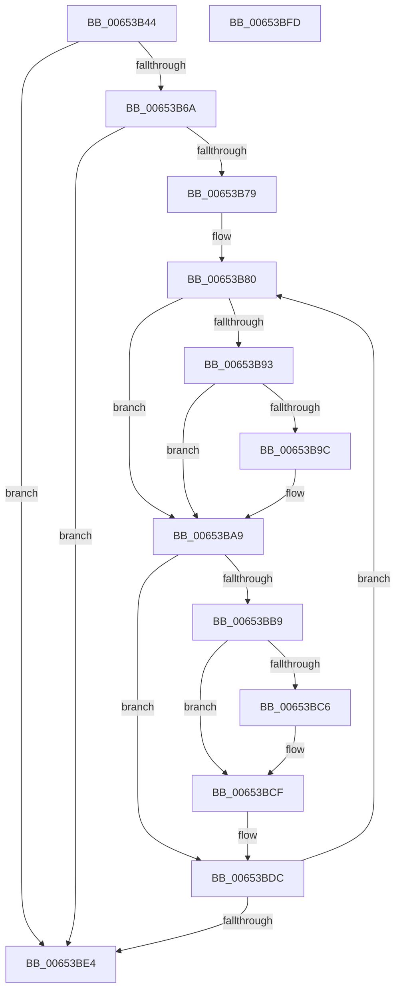

# EtwpCovSampCaptureCancelApcs

- RVA: `0x00653B44`–`0x00653BFE` (길이 `186` bytes)
- VA: `0x0000000140653B44`
- 실행 섹션: `.text`
- PDB 이름 있음: `예`; PDB Function 태그: `아니요`
- unwind 정보 RVA: `0x00060300`
- 디코드: `53`개 명령, `186/186` bytes 표시
- 미해석 바이트: `0` (있으면 어셈블리에 `.byte`로 보존)

> 이 문서는 커널 이미지의 기계어와 PDB 기호를 분석해 생성했습니다. 4번과 5번은 함수 원형과 자료형을 바이너리 사용 방식에서 추정한 C 해석이며 원본 소스 복구 결과는 아닙니다.

## 1. Dependencies

- 직접 호출 지점: **6**; 고유 호출 대상: **6**
- 직접 호출자로 확인된 함수: **1**
- RIP 상대 이미지 참조: **0**

### Outgoing calls
- `0x00653B85` → [KeAcquireSpinLockRaiseToDpc](../20/KeAcquireSpinLockRaiseToDpc_function_00208470.md) (function, `0x00208470`)
- `0x00653BA4` → [ObfReferenceObjectWithTag](../21/ObfReferenceObjectWithTag_function_00210710.md) (function, `0x00210710`)
- `0x00653BAF` → [KeReleaseSpinLock](../39/KeReleaseSpinLock_function_00392BA0.md) (function, `0x00392BA0`)
- `0x00653BBD` → [KeRemoveQueueApc](../3C/KeRemoveQueueApc_function_003C4820.md) (function, `0x003C4820`)
- `0x00653BCA` → [EtwpCovSampCaptureApcRelease](../44/EtwpCovSampCaptureApcRelease_function_00444214.md) (function, `0x00444214`)
- `0x00653BD7` → [ObfDereferenceObjectWithTag](../2F/ObfDereferenceObjectWithTag_function_002F78E0.md) (function, `0x002F78E0`)

### Direct callers
- [EtwpCovSampCaptureContextStop](../43/EtwpCovSampCaptureContextStop_function_0043BE5C.md) at `0x0043BF31`

### Static image references
- 디코드된 RIP-relative 메모리 참조가 없습니다.

## 2. Other-region calls and transfers

- 다른 실행 섹션으로 향하는 call: **0**
- 별도 외부 분기/꼬리 이동을 확인하지 못했습니다.

## 3. Assembly (complete function range)

```asm
00653B44  48 89 5C 24 08                  mov qword ptr [rsp + 8], rbx
00653B49  48 89 6C 24 10                  mov qword ptr [rsp + 0x10], rbp
00653B4E  48 89 74 24 18                  mov qword ptr [rsp + 0x18], rsi
00653B53  57                              push rdi
00653B54  41 56                           push r14
00653B56  41 57                           push r15
00653B58  48 83 EC 20                     sub rsp, 0x20
00653B5C  8B 81 C8 02 00 00               mov eax, dword ptr [rcx + 0x2c8]
00653B62  39 81 CC 02 00 00               cmp dword ptr [rcx + 0x2cc], eax
00653B68  74 7A                           je 0x140653be4
00653B6A  48 8D B9 A0 02 00 00            lea rdi, [rcx + 0x2a0]
00653B71  48 8B 1F                        mov rbx, qword ptr [rdi]
00653B74  48 3B DF                        cmp rbx, rdi
00653B77  74 6B                           je 0x140653be4
00653B79  4C 8D B1 78 02 00 00            lea r14, [rcx + 0x278]
00653B80  49 8B CE                        mov rcx, r14
00653B83  33 F6                           xor esi, esi
00653B85  E8 E6 48 BB FF                  call 0x140208470
00653B8A  44 8A F8                        mov r15b, al
00653B8D  40 38 73 72                     cmp byte ptr [rbx + 0x72], sil
00653B91  74 16                           je 0x140653ba9
00653B93  48 8B 73 28                     mov rsi, qword ptr [rbx + 0x28]
00653B97  48 85 F6                        test rsi, rsi
00653B9A  74 0D                           je 0x140653ba9
00653B9C  BA 44 66 6C 74                  mov edx, 0x746c6644
00653BA1  48 8B CE                        mov rcx, rsi
00653BA4  E8 67 CB BB FF                  call 0x140210710
00653BA9  41 8A D7                        mov dl, r15b
00653BAC  49 8B CE                        mov rcx, r14
00653BAF  E8 EC EF D3 FF                  call 0x140392ba0
00653BB4  48 85 F6                        test rsi, rsi
00653BB7  74 23                           je 0x140653bdc
00653BB9  48 8D 4B 20                     lea rcx, [rbx + 0x20]
00653BBD  E8 5E 0C D7 FF                  call 0x1403c4820
00653BC2  84 C0                           test al, al
00653BC4  74 09                           je 0x140653bcf
00653BC6  48 8D 4B E8                     lea rcx, [rbx - 0x18]
00653BCA  E8 45 06 DF FF                  call 0x140444214
00653BCF  BA 44 66 6C 74                  mov edx, 0x746c6644
00653BD4  48 8B CE                        mov rcx, rsi
00653BD7  E8 04 3D CA FF                  call 0x1402f78e0
00653BDC  48 8B 1B                        mov rbx, qword ptr [rbx]
00653BDF  48 3B DF                        cmp rbx, rdi
00653BE2  75 9C                           jne 0x140653b80
00653BE4  48 8B 5C 24 40                  mov rbx, qword ptr [rsp + 0x40]
00653BE9  48 8B 6C 24 48                  mov rbp, qword ptr [rsp + 0x48]
00653BEE  48 8B 74 24 50                  mov rsi, qword ptr [rsp + 0x50]
00653BF3  48 83 C4 20                     add rsp, 0x20
00653BF7  41 5F                           pop r15
00653BF9  41 5E                           pop r14
00653BFB  5F                              pop rdi
00653BFC  C3                              ret
00653BFD  CC                              int3
```

## 4. C-style interpretation (structured pseudocode)

```c
__int64 __fastcall EtwpCovSampCaptureCancelApcs(__int64 a1)
{
    __int64 result;
    __int64 v_rsi;
    __int64 v_rsp;
    unsigned __int64 v_stack_p10;
    unsigned __int64 v_stack_p18;
    unsigned __int64 v_stack_p8;

    v_stack_p8 = v_rbx;
    v_stack_p10 = v_rbp;
    v_stack_p18 = v_rsi;
    v_rsp = (v_rsp) - (32);
    if ((*(unsigned int *)(a1 + 716)) == ((unsigned int)((unsigned int)(*(unsigned int *)(a1 + 712))))) goto loc_00653BE4;
    if ((*(unsigned __int64 *)(a1 + 672)) == (a1 + 672)) goto loc_00653BE4;
loc_00653B80:
    v_rsi = 0;
    result = KeAcquireSpinLockRaiseToDpc(a1 + 632, a2, a3, a4);
    if ((*(unsigned __int8 *)(*(unsigned __int64 *)(a1 + 672) + 114)) == 0) goto loc_00653BA9;
    if (*(unsigned __int64 *)(*(unsigned __int64 *)(a1 + 672) + 40) != 0) {
        a2 = 0x746C6644ULL;
        a1 = *(unsigned __int64 *)(*(unsigned __int64 *)(a1 + 672) + 40);
        result = ObfReferenceObjectWithTag(a1, a2, a3, a4);
    }
    result = KeReleaseSpinLock(a1 + 632, (unsigned __int8)((unsigned __int8)(result)), a3, a4);
    if (*(unsigned __int64 *)(*(unsigned __int64 *)(a1 + 672) + 40) == 0) goto loc_00653BDC;
    result = KeRemoveQueueApc(*(unsigned __int64 *)(a1 + 672) + 32, (unsigned __int8)((unsigned __int8)(result)), a3, a4);
    if ((unsigned __int8)(result) != 0) {
        a1 = *(unsigned __int64 *)(a1 + 672) - 24;
        result = EtwpCovSampCaptureApcRelease(a1, (unsigned __int8)((unsigned __int8)(result)), a3, a4);
    }
    result = ObfDereferenceObjectWithTag(*(unsigned __int64 *)(*(unsigned __int64 *)(a1 + 672) + 40), (unsigned int)(0x746C6644ULL), a3, a4);
loc_00653BDC:
    if ((*(unsigned __int64 *)(*(unsigned __int64 *)(a1 + 672))) != (a1 + 672)) goto loc_00653B80;
loc_00653BE4:
    v_rsp = (v_rsp) + (32);
    return result;
}
```

## 5. (Beta) C Style

```c
int64_t EtwpCovSampCaptureCancelApcs(void *Arg1)
{
    uint8_t *arg1 = (uint8_t *)Arg1;

    int64_t result;
    int64_t local_rsi;
    int64_t local_rsp;
    uint64_t v_stack_p10;
    uint64_t v_stack_p18;
    uint64_t v_stack_p8;

    v_stack_p8 = local_rbx;
    v_stack_p10 = local_rbp;
    v_stack_p18 = local_rsi;
    local_rsp = (local_rsp) - (32);
    if ((*(uint32_t *)(arg1 + 0x2CC)) == ((uint32_t)((uint32_t)(*(uint32_t *)(arg1 + 0x2C8))))) goto loc_00653BE4;
    if ((*(uint64_t *)(arg1 + 0x2A0)) == (Arg1 + 672)) goto loc_00653BE4;
loc_00653B80:
    local_rsi = 0;
    result = KeAcquireSpinLockRaiseToDpc(Arg1 + 632, a2, a3, a4);
    if ((*(uint8_t *)(*(uint64_t *)(arg1 + 0x2A0) + 0x72)) == 0) goto loc_00653BA9;
    if (*(uint64_t *)(*(uint64_t *)(arg1 + 0x2A0) + 0x28) != 0) {
        a2 = 0x746C6644ULL;
        Arg1 = *(uint64_t *)(*(uint64_t *)(arg1 + 0x2A0) + 0x28);
        result = ObfReferenceObjectWithTag(Arg1, a2, a3, a4);
    }
    result = KeReleaseSpinLock(Arg1 + 632, (uint8_t)((uint8_t)(result)), a3, a4);
    if (*(uint64_t *)(*(uint64_t *)(arg1 + 0x2A0) + 0x28) == 0) goto loc_00653BDC;
    result = KeRemoveQueueApc(*(uint64_t *)(arg1 + 0x2A0) + 32, (uint8_t)((uint8_t)(result)), a3, a4);
    if ((uint8_t)(result) != 0) {
        Arg1 = *(uint64_t *)(arg1 + 0x2A0) - 24;
        result = EtwpCovSampCaptureApcRelease(Arg1, (uint8_t)((uint8_t)(result)), a3, a4);
    }
    result = ObfDereferenceObjectWithTag(*(uint64_t *)(*(uint64_t *)(arg1 + 0x2A0) + 0x28), (uint32_t)(0x746C6644ULL), a3, a4);
loc_00653BDC:
    if ((*(uint64_t *)(*(uint64_t *)(arg1 + 0x2A0))) != (Arg1 + 672)) goto loc_00653B80;
loc_00653BE4:
    local_rsp = (local_rsp) + (32);
    return result;
}
```

### 관측된 메모리 오프셋

구조체 형식이 확인되지 않은 접근은 인자 기준의 오프셋으로만 기록했습니다.

| 기준 인자 | 오프셋 표현 | 폭 (bit) | 접근 |
|---|---:|---:|---|
| `Arg1` | `+ 0x0` | `64` | `R` |
| `Arg1` | `+ 0x278` | `64` | `R` |
| `Arg1` | `+ 0x2A0` | `64` | `R` |
| `Arg1` | `+ 0x2C8` | `32` | `R` |
| `Arg1` | `+ 0x2CC` | `32` | `R` |

## 6. Execution-region graph

[열기: 2D/3D 그래프와 함수 탐색 컨트롤 패널](../../../control-panel.html?section=text&rva=0x00653B44&view=graph)

- 2D 그래프는 위에서 아래로 흐르고, 3D 그래프는 빈 공간을 드래그해 회전합니다. Shift+드래그는 이동, 휠은 확대·축소, 함수 노드 선택은 대상 보고서 이동입니다.

### Static fallback


