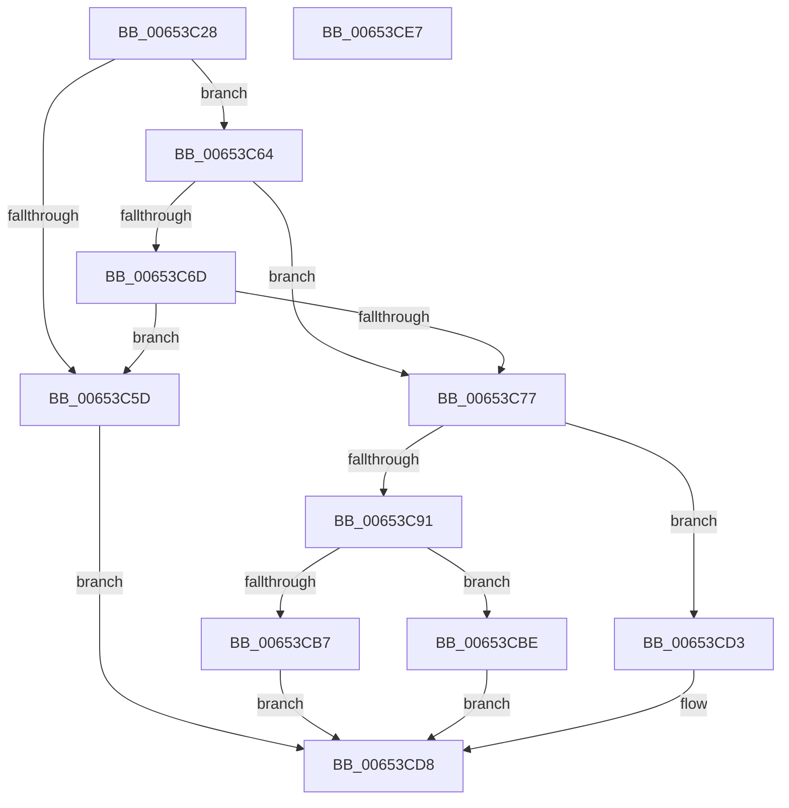

# EtwpCovSampCaptureKernelStack

- RVA: `0x00653C28`–`0x00653CE8` (길이 `192` bytes)
- VA: `0x0000000140653C28`
- 실행 섹션: `.text`
- PDB 이름 있음: `예`; PDB Function 태그: `아니요`
- unwind 정보 RVA: `0x00085694`
- 디코드: `65`개 명령, `192/192` bytes 표시
- 미해석 바이트: `0` (있으면 어셈블리에 `.byte`로 보존)

> 이 문서는 커널 이미지의 기계어와 PDB 기호를 분석해 생성했습니다. 4번과 5번은 함수 원형과 자료형을 바이너리 사용 방식에서 추정한 C 해석이며 원본 소스 복구 결과는 아닙니다.

## 1. Dependencies

- 직접 호출 지점: **3**; 고유 호출 대상: **3**
- 직접 호출자로 확인된 함수: **1**
- RIP 상대 이미지 참조: **0**

### Outgoing calls
- `0x00653C54` → [KeQueryCurrentStackInformation](../2F/KeQueryCurrentStackInformation_function_002F7C80.md) (function, `0x002F7C80`)
- `0x00653CAE` → [RtlWalkFrameChain](../2F/RtlWalkFrameChain_function_002F85E0.md) (function, `0x002F85E0`)
- `0x00653CCC` → [EtwpCovSampCaptureBufferOptimizeIP](../46/EtwpCovSampCaptureBufferOptimizeIP_function_00460210.md) (function, `0x00460210`)

### Direct callers
- [EtwpCovSampCaptureSample](EtwpCovSampCaptureSample_function_00653F24.md) at `0x00653FED`

### Static image references
- 디코드된 RIP-relative 메모리 참조가 없습니다.

## 2. Other-region calls and transfers

- 다른 실행 섹션으로 향하는 call: **0**
- 별도 외부 분기/꼬리 이동을 확인하지 못했습니다.

## 3. Assembly (complete function range)

```asm
00653C28  48 8B C4                        mov rax, rsp
00653C2B  48 89 58 08                     mov qword ptr [rax + 8], rbx
00653C2F  55                              push rbp
00653C30  56                              push rsi
00653C31  57                              push rdi
00653C32  48 83 EC 30                     sub rsp, 0x30
00653C36  33 DB                           xor ebx, ebx
00653C38  4C 8D 40 20                     lea r8, [rax + 0x20]
00653C3C  8B EA                           mov ebp, edx
00653C3E  48 89 58 20                     mov qword ptr [rax + 0x20], rbx
00653C42  48 8B F9                        mov rdi, rcx
00653C45  48 89 58 D8                     mov qword ptr [rax - 0x28], rbx
00653C49  48 8D 50 D8                     lea rdx, [rax - 0x28]
00653C4D  89 58 18                        mov dword ptr [rax + 0x18], ebx
00653C50  48 8D 48 18                     lea rcx, [rax + 0x18]
00653C54  E8 27 40 CA FF                  call 0x1402f7c80
00653C59  84 C0                           test al, al
00653C5B  75 07                           jne 0x140653c64
00653C5D  BB BB 00 00 C0                  mov ebx, 0xc00000bb
00653C62  EB 74                           jmp 0x140653cd8
00653C64  8B 44 24 60                     mov eax, dword ptr [rsp + 0x60]
00653C68  83 F8 09                        cmp eax, 9
00653C6B  77 0A                           ja 0x140653c77
00653C6D  B9 A1 03 00 00                  mov ecx, 0x3a1
00653C72  0F A3 C1                        bt ecx, eax
00653C75  72 E6                           jb 0x140653c5d
00653C77  0F B7 4F 3E                     movzx ecx, word ptr [rdi + 0x3e]
00653C7B  8B C5                           mov eax, ebp
00653C7D  0F B7 57 3C                     movzx edx, word ptr [rdi + 0x3c]
00653C81  8B F3                           mov esi, ebx
00653C83  C1 ED 1C                        shr ebp, 0x1c
00653C86  83 E0 02                        and eax, 2
00653C89  0F 44 F5                        cmove esi, ebp
00653C8C  66 3B D1                        cmp dx, cx
00653C8F  72 42                           jb 0x140653cd3
00653C91  F7 D8                           neg eax
00653C93  8B C6                           mov eax, esi
00653C95  45 1B C0                        sbb r8d, r8d
00653C98  C1 E0 08                        shl eax, 8
00653C9B  2B D1                           sub edx, ecx
00653C9D  41 83 E0 02                     and r8d, 2
00653CA1  44 0B C0                        or r8d, eax
00653CA4  03 D6                           add edx, esi
00653CA6  48 8D 47 40                     lea rax, [rdi + 0x40]
00653CAA  48 8D 0C C8                     lea rcx, [rax + rcx*8]
00653CAE  E8 2D 49 CA FF                  call 0x1402f85e0
00653CB3  3B C6                           cmp eax, esi
00653CB5  77 07                           ja 0x140653cbe
00653CB7  BB 25 02 00 C0                  mov ebx, 0xc0000225
00653CBC  EB 1A                           jmp 0x140653cd8
00653CBE  83 4F 38 01                     or dword ptr [rdi + 0x38], 1
00653CC2  66 2B C6                        sub ax, si
00653CC5  66 01 47 3E                     add word ptr [rdi + 0x3e], ax
00653CC9  48 8B CF                        mov rcx, rdi
00653CCC  E8 3F C5 E0 FF                  call 0x140460210
00653CD1  EB 05                           jmp 0x140653cd8
00653CD3  BB E5 00 00 C0                  mov ebx, 0xc00000e5
00653CD8  8B C3                           mov eax, ebx
00653CDA  48 8B 5C 24 50                  mov rbx, qword ptr [rsp + 0x50]
00653CDF  48 83 C4 30                     add rsp, 0x30
00653CE3  5F                              pop rdi
00653CE4  5E                              pop rsi
00653CE5  5D                              pop rbp
00653CE6  C3                              ret
00653CE7  CC                              int3
```

## 4. C-style interpretation (structured pseudocode)

```c
__int64 __fastcall EtwpCovSampCaptureKernelStack(__int64 a1, int a2)
{
    __int64 result;
    __int64 v_rbp;
    __int64 v_rbx;
    __int64 v_rsi;
    __int64 v_rsp;
    unsigned int v_stack_p18;
    unsigned __int64 v_stack_p8;

    *(unsigned __int64 *)(v_rsp + 8) = v_rbx;
    v_rsp = (v_rsp) - (48);
    v_rbx = 0;
    *(unsigned __int64 *)(v_rsp + 32) = 0;
    *(unsigned __int64 *)(v_rsp - 40) = 0;
    *(unsigned int *)(v_rsp + 24) = 0;
    result = KeQueryCurrentStackInformation(v_rsp + 24, v_rsp - 40, v_rsp + 32, a4);
    if ((unsigned __int8)(result) != 0) goto loc_00653C64;
loc_00653C5D:
    goto loc_00653CD8;
loc_00653C64:
    if (((unsigned int)((unsigned int)(v_stack_p18))) > 9) goto loc_00653C77;
    if (((unsigned int)((unsigned int)(v_stack_p18))) < 9) goto loc_00653C5D;
loc_00653C77:
    v_rbp = (unsigned int)(((unsigned int)(a2)) >> (28));
    result = (unsigned int)(((unsigned int)((unsigned int)((unsigned int)(a2)))) & (2));
    v_rsi = (unsigned int)((unsigned int)((unsigned int)(0xC00000BBULL)));
    if (condition_is_equal) { v_rsi = (unsigned int)(v_rbp); }
    if (((unsigned __int16)(*(unsigned __int16 *)(a1 + 60))) < ((unsigned __int16)(*(unsigned __int16 *)(a1 + 62)))) goto loc_00653CD3;
    result = (unsigned int)(-(result));
    result = (unsigned int)(((unsigned int)((unsigned int)(v_rsi))) << (8));
    a2 = (unsigned int)((*(unsigned __int16 *)(a1 + 60)) - ((unsigned int)(*(unsigned __int16 *)(a1 + 62))));
    a3 = (unsigned int)((v_rsp + 32) & (2));
    a3 = (unsigned int)((a3) | ((unsigned int)(result)));
    a2 = (unsigned int)((a2) + ((unsigned int)(v_rsi)));
    result = RtlWalkFrameChain(a1 + 64 + *(unsigned __int16 *)(a1 + 62) * 8, a2, a3, a4);
    if (((unsigned int)(result)) > ((unsigned int)(v_rsi))) goto loc_00653CBE;
    goto loc_00653CD8;
loc_00653CBE:
    result = (unsigned __int16)((result) - ((unsigned __int16)(v_rsi)));
    result = EtwpCovSampCaptureBufferOptimizeIP(a1, a2, a3, a4);
    goto loc_00653CD8;
loc_00653CD3:
loc_00653CD8:
    v_rsp = (v_rsp) + (48);
    return (unsigned int)((unsigned int)((unsigned int)(0xC00000E5ULL)));
}
```

## 5. (Beta) C Style

```c
int64_t EtwpCovSampCaptureKernelStack(void *Arg1, int32_t Arg2)
{
    uint8_t *arg1 = (uint8_t *)Arg1;

    int64_t result;
    int64_t local_rbp;
    int64_t local_rbx;
    int64_t local_rsi;
    int64_t local_rsp;
    uint32_t v_stack_p18;
    uint64_t v_stack_p8;

    *(uint64_t *)(local_rsp + 0x8) = local_rbx;
    local_rsp = (local_rsp) - (48);
    local_rbx = 0;
    *(uint64_t *)(local_rsp + 0x20) = 0;
    *(uint64_t *)(local_rsp - 0x28) = 0;
    *(uint32_t *)(local_rsp + 0x18) = 0;
    result = KeQueryCurrentStackInformation(local_rsp + 24, local_rsp - 40, local_rsp + 32, a4);
    if ((uint8_t)(result) != 0) goto loc_00653C64;
loc_00653C5D:
    goto loc_00653CD8;
loc_00653C64:
    if (((uint32_t)((uint32_t)(v_stack_p18))) > 9) goto loc_00653C77;
    if (((uint32_t)((uint32_t)(v_stack_p18))) < 9) goto loc_00653C5D;
loc_00653C77:
    local_rbp = (uint32_t)(((uint32_t)(Arg2)) >> (28));
    result = (uint32_t)(((uint32_t)((uint32_t)((uint32_t)(Arg2)))) & (2));
    local_rsi = (uint32_t)((uint32_t)((uint32_t)(0xC00000BBULL)));
    if (condition_is_equal) { local_rsi = (uint32_t)(local_rbp); }
    if (((uint16_t)(*(uint16_t *)(arg1 + 0x3C))) < ((uint16_t)(*(uint16_t *)(arg1 + 0x3E)))) goto loc_00653CD3;
    result = (uint32_t)(-(result));
    result = (uint32_t)(((uint32_t)((uint32_t)(local_rsi))) << (8));
    Arg2 = (uint32_t)((*(uint16_t *)(arg1 + 0x3C)) - ((uint32_t)(*(uint16_t *)(arg1 + 0x3E))));
    a3 = (uint32_t)((local_rsp + 32) & (2));
    a3 = (uint32_t)((a3) | ((uint32_t)(result)));
    Arg2 = (uint32_t)((Arg2) + ((uint32_t)(local_rsi)));
    result = RtlWalkFrameChain(Arg1 + 64 + *(uint16_t *)(arg1 + 0x3E) * 8, Arg2, a3, a4);
    if (((uint32_t)(result)) > ((uint32_t)(local_rsi))) goto loc_00653CBE;
    goto loc_00653CD8;
loc_00653CBE:
    result = (uint16_t)((result) - ((uint16_t)(local_rsi)));
    result = EtwpCovSampCaptureBufferOptimizeIP(Arg1, Arg2, a3, a4);
    goto loc_00653CD8;
loc_00653CD3:
loc_00653CD8:
    local_rsp = (local_rsp) + (48);
    return (uint32_t)((uint32_t)((uint32_t)(0xC00000E5ULL)));
}
```

### 관측된 메모리 오프셋

구조체 형식이 확인되지 않은 접근은 인자 기준의 오프셋으로만 기록했습니다.

| 기준 인자 | 오프셋 표현 | 폭 (bit) | 접근 |
|---|---:|---:|---|
| `Arg1` | `+ 0x0 + rcx*8` | `64` | `R` |
| `Arg1` | `+ 0x38` | `32` | `R/W` |
| `Arg1` | `+ 0x3C` | `16` | `R` |
| `Arg1` | `+ 0x3E` | `16` | `R` |
| `Arg1` | `+ 0x3E` | `16` | `R/W` |
| `Arg1` | `+ 0x40` | `64` | `R` |

## 6. Execution-region graph

[열기: 2D/3D 그래프와 함수 탐색 컨트롤 패널](../../../control-panel.html?section=text&rva=0x00653C28&view=graph)

- 2D 그래프는 위에서 아래로 흐르고, 3D 그래프는 빈 공간을 드래그해 회전합니다. Shift+드래그는 이동, 휠은 확대·축소, 함수 노드 선택은 대상 보고서 이동입니다.

### Static fallback


