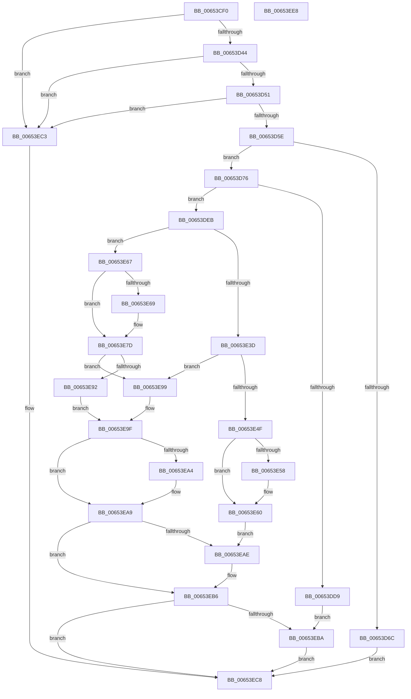

# EtwpCovSampCaptureQueueApc

- RVA: `0x00653CF0`–`0x00653EE9` (길이 `505` bytes)
- VA: `0x0000000140653CF0`
- 실행 섹션: `.text`
- PDB 이름 있음: `예`; PDB Function 태그: `아니요`
- unwind 정보 RVA: `0x000BC81C`
- 디코드: `128`개 명령, `505/505` bytes 표시
- 미해석 바이트: `0` (있으면 어셈블리에 `.byte`로 보존)

> 이 문서는 커널 이미지의 기계어와 PDB 기호를 분석해 생성했습니다. 4번과 5번은 함수 원형과 자료형을 바이너리 사용 방식에서 추정한 C 해석이며 원본 소스 복구 결과는 아닙니다.

## 1. Dependencies

- 직접 호출 지점: **7**; 고유 호출 대상: **7**
- 직접 호출자로 확인된 함수: **1**
- RIP 상대 이미지 참조: **3**

### Outgoing calls
- `0x00653DCC` → [EtwpCovSampLookasidePop](../43/EtwpCovSampLookasidePop_function_0043C528.md) (function, `0x0043C528`)
- `0x00653E1A` → [KeInitializeApc](../42/KeInitializeApc_function_00428510.md) (function, `0x00428510`)
- `0x00653E46` → [KeTryToInsertQueueApc](../4D/KeTryToInsertQueueApc_function_004D72B8.md) (function, `0x004D72B8`)
- `0x00653E5B` → [KeIsThreadRunning](../39/KeIsThreadRunning_function_00396720.md) (function, `0x00396720`)
- `0x00653E89` → [KeInsertQueueApc](../20/KeInsertQueueApc_function_00203F10.md) (function, `0x00203F10`)
- `0x00653EA4` → [KeLeaveCriticalRegion](../25/KeLeaveCriticalRegion_function_0025D8B0.md) (function, `0x0025D8B0`)
- `0x00653EB1` → [EtwpCovSampCaptureApcRelease](../44/EtwpCovSampCaptureApcRelease_function_00444214.md) (function, `0x00444214`)

### Direct callers
- [EtwpCovSampCaptureSample](EtwpCovSampCaptureSample_function_00653F24.md) at `0x0065406A`

### Static image references
- `0x00653D18` → RVA `0x00EFF1E8` (`.data`; read)
- `0x00653DF4` → RVA `0x004440D0` (`EtwpCovSampCaptureApc`; read)
- `0x00653E00` → RVA `0x007C1490` (`EtwpCovSampCaptureApcRundown`; read)

## 2. Other-region calls and transfers

- 다른 실행 섹션으로 향하는 call: **0**
- 별도 외부 분기/꼬리 이동을 확인하지 못했습니다.

## 3. Assembly (complete function range)

```asm
00653CF0  48 89 5C 24 08                  mov qword ptr [rsp + 8], rbx
00653CF5  48 89 6C 24 18                  mov qword ptr [rsp + 0x18], rbp
00653CFA  48 89 74 24 20                  mov qword ptr [rsp + 0x20], rsi
00653CFF  57                              push rdi
00653D00  41 54                           push r12
00653D02  41 55                           push r13
00653D04  41 56                           push r14
00653D06  41 57                           push r15
00653D08  48 83 EC 40                     sub rsp, 0x40
00653D0C  65 48 8B 3C 25 88 01 00 00      mov rdi, qword ptr gs:[0x188]
00653D15  45 33 FF                        xor r15d, r15d
00653D18  4C 8B 2D C9 B4 8A 00            mov r13, qword ptr [rip + 0x8ab4c9]
00653D1F  4C 8B E1                        mov r12, rcx
00653D22  48 8B 97 20 02 00 00            mov rdx, qword ptr [rdi + 0x220]
00653D29  41 8D 77 01                     lea esi, [r15 + 1]
00653D2D  8B 82 88 00 00 00               mov eax, dword ptr [rdx + 0x88]
00653D33  C1 E8 03                        shr eax, 3
00653D36  23 C6                           and eax, esi
00653D38  03 82 50 01 00 00               add eax, dword ptr [rdx + 0x150]
00653D3E  0F 85 7F 01 00 00               jne 0x140653ec3
00653D44  44 38 BF 84 02 00 00            cmp byte ptr [rdi + 0x284], r15b
00653D4B  0F 85 72 01 00 00               jne 0x140653ec3
00653D51  F7 47 74 00 40 00 00            test dword ptr [rdi + 0x74], 0x4000
00653D58  0F 84 65 01 00 00               je 0x140653ec3
00653D5E  48 8D 9F A0 05 00 00            lea rbx, [rdi + 0x5a0]
00653D65  F0 0F BA 2B 17                  lock bts dword ptr [rbx], 0x17
00653D6A  73 0A                           jae 0x140653d76
00653D6C  BF 18 07 00 C0                  mov edi, 0xc0000718
00653D71  E9 52 01 00 00                  jmp 0x140653ec8
00653D76  65 4C 8B 04 25 20 00 00 00      mov r8, qword ptr gs:[0x20]
00653D7F  8B D6                           mov edx, esi
00653D81  49 8B 45 08                     mov rax, qword ptr [r13 + 8]
00653D85  44 8B C8                        mov r9d, eax
00653D88  C1 E8 0D                        shr eax, 0xd
00653D8B  25 FF FF 03 00                  and eax, 0x3ffff
00653D90  49 C1 E9 04                     shr r9, 4
00653D94  0F BD C8                        bsr ecx, eax
00653D97  41 81 E1 FF 01 00 00            and r9d, 0x1ff
00653D9E  D3 E2                           shl edx, cl
00653DA0  33 D0                           xor edx, eax
00653DA2  89 4C 24 78                     mov dword ptr [rsp + 0x78], ecx
00653DA6  49 8B 80 B0 8B 00 00            mov rax, qword ptr [r8 + 0x8bb0]
00653DAD  83 C1 FE                        add ecx, -2
00653DB0  4E 8D 34 CD 0F 00 00 00         lea r14, [r9*8 + 0xf]
00653DB8  48 8B 04 C8                     mov rax, qword ptr [rax + rcx*8]
00653DBC  49 8B CD                        mov rcx, r13
00653DBF  4C 03 74 D0 08                  add r14, qword ptr [rax + rdx*8 + 8]
00653DC4  49 83 E6 F0                     and r14, 0xfffffffffffffff0
00653DC8  49 8D 56 10                     lea rdx, [r14 + 0x10]
00653DCC  E8 57 87 DE FF                  call 0x14043c528
00653DD1  48 8B E8                        mov rbp, rax
00653DD4  48 85 C0                        test rax, rax
00653DD7  75 12                           jne 0x140653deb
00653DD9  F0 41 01 B6 34 01 00 00         lock add dword ptr [r14 + 0x134], esi
00653DE1  BF 9A 00 00 C0                  mov edi, 0xc000009a
00653DE6  E9 CF 00 00 00                  jmp 0x140653eba
00653DEB  4C 8D 70 38                     lea r14, [rax + 0x38]
00653DEF  4C 89 6C 24 38                  mov qword ptr [rsp + 0x38], r13
00653DF4  4C 8D 0D D5 02 DF FF            lea r9, [rip - 0x20fd2b]
00653DFB  44 88 7C 24 30                  mov byte ptr [rsp + 0x30], r15b
00653E00  48 8D 05 89 D6 16 00            lea rax, [rip + 0x16d689]
00653E07  4C 89 4C 24 28                  mov qword ptr [rsp + 0x28], r9
00653E0C  49 8B CE                        mov rcx, r14
00653E0F  48 89 44 24 20                  mov qword ptr [rsp + 0x20], rax
00653E14  45 33 C0                        xor r8d, r8d
00653E17  48 8B D7                        mov rdx, rdi
00653E1A  E8 F1 46 DD FF                  call 0x140428510
00653E1F  4C 21 7D 78                     and qword ptr [rbp + 0x78], r15
00653E23  48 B8 20 03 00 00 80 F7 FF FF   movabs rax, 0xfffff78000000320
00653E2D  8B 00                           mov eax, dword ptr [rax]
00653E2F  89 85 90 00 00 00               mov dword ptr [rbp + 0x90], eax
00653E35  44 0F 20 C0                     mov rax, cr8
00653E39  3C 02                           cmp al, 2
00653E3B  76 2A                           jbe 0x140653e67
00653E3D  45 33 C0                        xor r8d, r8d
00653E40  49 8B D4                        mov rdx, r12
00653E43  49 8B CE                        mov rcx, r14
00653E46  E8 6D 34 E8 FF                  call 0x1404d72b8
00653E4B  84 C0                           test al, al
00653E4D  75 4A                           jne 0x140653e99
00653E4F  F7 47 74 00 40 00 00            test dword ptr [rdi + 0x74], 0x4000
00653E56  74 08                           je 0x140653e60
00653E58  48 8B CF                        mov rcx, rdi
00653E5B  E8 C0 28 D4 FF                  call 0x140396720
00653E60  BF 01 00 00 C0                  mov edi, 0xc0000001
00653E65  EB 47                           jmp 0x140653eae
00653E67  73 14                           jae 0x140653e7d
00653E69  65 48 8B 04 25 88 01 00 00      mov rax, qword ptr gs:[0x188]
00653E72  44 8B FE                        mov r15d, esi
00653E75  66 FF 88 E4 01 00 00            dec word ptr [rax + 0x1e4]
00653E7C  90                              nop
00653E7D  45 33 C9                        xor r9d, r9d
00653E80  45 33 C0                        xor r8d, r8d
00653E83  49 8B D4                        mov rdx, r12
00653E86  49 8B CE                        mov rcx, r14
00653E89  E8 82 00 BB FF                  call 0x140203f10
00653E8E  84 C0                           test al, al
00653E90  75 07                           jne 0x140653e99
00653E92  BF 01 00 00 C0                  mov edi, 0xc0000001
00653E97  EB 06                           jmp 0x140653e9f
00653E99  33 F6                           xor esi, esi
00653E9B  33 ED                           xor ebp, ebp
00653E9D  33 FF                           xor edi, edi
00653E9F  45 85 FF                        test r15d, r15d
00653EA2  74 05                           je 0x140653ea9
00653EA4  E8 07 9A C0 FF                  call 0x14025d8b0
00653EA9  48 85 ED                        test rbp, rbp
00653EAC  74 08                           je 0x140653eb6
00653EAE  48 8B CD                        mov rcx, rbp
00653EB1  E8 5E 03 DF FF                  call 0x140444214
00653EB6  85 F6                           test esi, esi
00653EB8  74 0E                           je 0x140653ec8
00653EBA  F0 81 23 FF FF 7F FF            lock and dword ptr [rbx], 0xff7fffff
00653EC1  EB 05                           jmp 0x140653ec8
00653EC3  BF BB 00 00 C0                  mov edi, 0xc00000bb
00653EC8  4C 8D 5C 24 40                  lea r11, [rsp + 0x40]
00653ECD  8B C7                           mov eax, edi
00653ECF  49 8B 5B 30                     mov rbx, qword ptr [r11 + 0x30]
00653ED3  49 8B 6B 40                     mov rbp, qword ptr [r11 + 0x40]
00653ED7  49 8B 73 48                     mov rsi, qword ptr [r11 + 0x48]
00653EDB  49 8B E3                        mov rsp, r11
00653EDE  41 5F                           pop r15
00653EE0  41 5E                           pop r14
00653EE2  41 5D                           pop r13
00653EE4  41 5C                           pop r12
00653EE6  5F                              pop rdi
00653EE7  C3                              ret
00653EE8  CC                              int3
```

## 4. C-style interpretation (structured pseudocode)

```c
__int64 __fastcall EtwpCovSampCaptureQueueApc(__int64 a1)
{
    __int64 result;
    __int64 v_r14;
    __int64 v_r15;
    __int64 v_rbp;
    __int64 v_rdi;
    __int64 v_rsi;
    __int64 v_rsp;
    unsigned __int64 v_stack_m28;
    unsigned __int64 v_stack_m30;
    unsigned __int8 v_stack_m38;
    unsigned __int64 v_stack_m40;
    unsigned __int64 v_stack_m48;
    unsigned int v_stack_p10;
    unsigned __int64 v_stack_p18;
    unsigned __int64 v_stack_p20;
    unsigned __int64 v_stack_p8;

    v_stack_p8 = v_rbx;
    v_stack_p18 = v_rbp;
    v_stack_p20 = v_rsi;
    v_rsp = (v_rsp) - (64);
    v_r15 = 0;
    result = (unsigned int)(((unsigned int)(*(unsigned int *)(*(unsigned __int64 *)(*(unsigned __int64 *)(gs_base + (0 + 392)) + 544) + 136))) >> (3));
    result = (unsigned int)((result) & ((unsigned int)(v_r15 + 1)));
    result = (unsigned int)((result) + (*(unsigned int *)(*(unsigned __int64 *)(*(unsigned __int64 *)(gs_base + (0 + 392)) + 544) + 336)));
    if (condition_is_not_equal) goto loc_00653EC3;
    if ((*(unsigned __int8 *)(*(unsigned __int64 *)(gs_base + (0 + 392)) + 644)) != 0) goto loc_00653EC3;
    if (((*(unsigned int *)(*(unsigned __int64 *)(gs_base + (0 + 392)) + 116)) & (0x4000ULL)) == 0) goto loc_00653EC3;
    if (condition_is_above_or_equal) goto loc_00653D76;
    goto loc_00653EC8;
loc_00653D76:
    result = (unsigned int)((*(unsigned __int64 *)(*(unsigned __int64 *)(v_rip + 9090249) + 8)) >> (13));
    result = (unsigned int)((result) & (0x3FFFFULL));
    a4 = ((unsigned int)((unsigned int)(*(unsigned __int64 *)(*(unsigned __int64 *)(v_rip + 9090249) + 8)))) >> (4);
    a4 = (unsigned int)((a4) & (511));
    a2 = (unsigned int)(((unsigned int)((unsigned int)(v_r15 + 1))) << ((unsigned __int8)(a1)));
    a2 = (unsigned int)((a2) ^ ((unsigned int)(result)));
    v_stack_p10 = (unsigned int)(a1);
    a1 = (unsigned int)((a1) + (-2));
    v_r14 = (a4 * 8 + 15) + (*(unsigned __int64 *)(*(unsigned __int64 *)(*(unsigned __int64 *)(*(unsigned __int64 *)(gs_base + (0 + 32)) + 35760) + a1 * 8) + a2 * 8 + 8));
    v_r14 = (v_r14) & (-16);
    result = EtwpCovSampLookasidePop(*(unsigned __int64 *)(v_rip + 9090249), v_r14 + 16, *(unsigned __int64 *)(gs_base + (0 + 32)), a4);
    if (result != 0) goto loc_00653DEB;
    goto loc_00653EBA;
loc_00653DEB:
    v_stack_m30 = *(unsigned __int64 *)(v_rip + 9090249);
    v_stack_m38 = 0;
    v_stack_m40 = v_rip - 2161963;
    v_stack_m48 = v_rip + 1496713;
    a3 = 0;
    result = KeInitializeApc(result + 56, (unsigned int)(0xC000009AULL), a3, v_rip - 2161963);
    *(unsigned int *)(result + 144) = (unsigned int)((unsigned int)(*(unsigned int *)(result)));
    if (((unsigned __int8)(v_cr8)) <= 2) goto loc_00653E67;
    a3 = 0;
    result = KeTryToInsertQueueApc(result + 56, a1, a3, v_rip - 2161963);
    if ((unsigned __int8)(result) != 0) goto loc_00653E99;
    if (((*(unsigned int *)((unsigned int)(0xC000009AULL) + 116)) & (0x4000ULL)) != 0) {
        a1 = (unsigned int)(0xC000009AULL);
        result = KeIsThreadRunning(a1, a1, a3, v_rip - 2161963);
    }
    goto loc_00653EAE;
loc_00653E67:
    if (!(condition_is_above_or_equal)) {
        result = *(unsigned __int64 *)(gs_base + (0 + 392));
        v_r15 = (unsigned int)(v_r15 + 1);
    }
    a4 = 0;
    a3 = 0;
    result = KeInsertQueueApc(result + 56, a1, a3, a4);
    if ((unsigned __int8)(result) != 0) goto loc_00653E99;
    goto loc_00653E9F;
loc_00653E99:
    v_rsi = 0;
    v_rbp = 0;
    v_rdi = 0;
loc_00653E9F:
    if ((unsigned int)(v_r15) != 0) {
        result = KeLeaveCriticalRegion(result + 56, a1, a3, a4);
    }
    if (0 != 0) {
        a1 = 0;
        result = EtwpCovSampCaptureApcRelease(a1, a1, a3, a4);
    }
    if (0 == 0) goto loc_00653EC8;
loc_00653EBA:
    goto loc_00653EC8;
loc_00653EC3:
loc_00653EC8:
    return (unsigned int)((unsigned int)((unsigned int)(0xC00000BBULL)));
}
```

## 5. (Beta) C Style

```c
int64_t EtwpCovSampCaptureQueueApc(int64_t Arg1)
{
    int64_t result;
    int64_t local_r14;
    int64_t local_r15;
    int64_t local_rbp;
    int64_t local_rdi;
    int64_t local_rsi;
    int64_t local_rsp;
    uint64_t v_stack_m28;
    uint64_t v_stack_m30;
    uint8_t v_stack_m38;
    uint64_t v_stack_m40;
    uint64_t v_stack_m48;
    uint32_t v_stack_p10;
    uint64_t v_stack_p18;
    uint64_t v_stack_p20;
    uint64_t v_stack_p8;

    v_stack_p8 = local_rbx;
    v_stack_p18 = local_rbp;
    v_stack_p20 = local_rsi;
    local_rsp = (local_rsp) - (64);
    local_r15 = 0;
    result = (uint32_t)(((uint32_t)(*(uint32_t *)(*(uint64_t *)(*(uint64_t *)(gs_base + (0 + 0x188)) + 0x220) + 0x88))) >> (3));
    result = (uint32_t)((result) & ((uint32_t)(local_r15 + 1)));
    result = (uint32_t)((result) + (*(uint32_t *)(*(uint64_t *)(*(uint64_t *)(gs_base + (0 + 0x188)) + 0x220) + 0x150)));
    if (condition_is_not_equal) goto loc_00653EC3;
    if ((*(uint8_t *)(*(uint64_t *)(gs_base + (0 + 0x188)) + 0x284)) != 0) goto loc_00653EC3;
    if (((*(uint32_t *)(*(uint64_t *)(gs_base + (0 + 0x188)) + 0x74)) & (0x4000ULL)) == 0) goto loc_00653EC3;
    if (condition_is_above_or_equal) goto loc_00653D76;
    goto loc_00653EC8;
loc_00653D76:
    result = (uint32_t)((*(uint64_t *)(*(uint64_t *)(v_rip + 0x8AB4C9) + 0x8)) >> (13));
    result = (uint32_t)((result) & (0x3FFFFULL));
    a4 = ((uint32_t)((uint32_t)(*(uint64_t *)(*(uint64_t *)(v_rip + 0x8AB4C9) + 0x8)))) >> (4);
    a4 = (uint32_t)((a4) & (511));
    a2 = (uint32_t)(((uint32_t)((uint32_t)(local_r15 + 1))) << ((uint8_t)(Arg1)));
    a2 = (uint32_t)((a2) ^ ((uint32_t)(result)));
    v_stack_p10 = (uint32_t)(Arg1);
    Arg1 = (uint32_t)((Arg1) + (-2));
    local_r14 = (a4 * 8 + 15) + (*(uint64_t *)(*(uint64_t *)(*(uint64_t *)(*(uint64_t *)(gs_base + (0 + 0x20)) + 0x8BB0) + Arg1 * 8) + a2 * 8 + 0x8));
    local_r14 = (local_r14) & (-16);
    result = EtwpCovSampLookasidePop(*(uint64_t *)(v_rip + 0x8AB4C9), local_r14 + 16, *(uint64_t *)(gs_base + (0 + 0x20)), a4);
    if (result != 0) goto loc_00653DEB;
    goto loc_00653EBA;
loc_00653DEB:
    v_stack_m30 = *(uint64_t *)(v_rip + 0x8AB4C9);
    v_stack_m38 = 0;
    v_stack_m40 = v_rip - 2161963;
    v_stack_m48 = v_rip + 1496713;
    a3 = 0;
    result = KeInitializeApc(result + 56, (uint32_t)(0xC000009AULL), a3, v_rip - 2161963);
    *(uint32_t *)(result + 0x90) = (uint32_t)((uint32_t)(*(uint32_t *)(result)));
    if (((uint8_t)(v_cr8)) <= 2) goto loc_00653E67;
    a3 = 0;
    result = KeTryToInsertQueueApc(result + 56, Arg1, a3, v_rip - 2161963);
    if ((uint8_t)(result) != 0) goto loc_00653E99;
    if (((*(uint32_t *)((uint32_t)(0xC000009AULL) + 0x74)) & (0x4000ULL)) != 0) {
        Arg1 = (uint32_t)(0xC000009AULL);
        result = KeIsThreadRunning(Arg1, Arg1, a3, v_rip - 2161963);
    }
    goto loc_00653EAE;
loc_00653E67:
    if (!(condition_is_above_or_equal)) {
        result = *(uint64_t *)(gs_base + (0 + 0x188));
        local_r15 = (uint32_t)(local_r15 + 1);
    }
    a4 = 0;
    a3 = 0;
    result = KeInsertQueueApc(result + 56, Arg1, a3, a4);
    if ((uint8_t)(result) != 0) goto loc_00653E99;
    goto loc_00653E9F;
loc_00653E99:
    local_rsi = 0;
    local_rbp = 0;
    local_rdi = 0;
loc_00653E9F:
    if ((uint32_t)(local_r15) != 0) {
        result = KeLeaveCriticalRegion(result + 56, Arg1, a3, a4);
    }
    if (0 != 0) {
        Arg1 = 0;
        result = EtwpCovSampCaptureApcRelease(Arg1, Arg1, a3, a4);
    }
    if (0 == 0) goto loc_00653EC8;
loc_00653EBA:
    goto loc_00653EC8;
loc_00653EC3:
loc_00653EC8:
    return (uint32_t)((uint32_t)((uint32_t)(0xC00000BBULL)));
}
```

## 6. Execution-region graph

[열기: 2D/3D 그래프와 함수 탐색 컨트롤 패널](../../../control-panel.html?section=text&rva=0x00653CF0&view=graph)

- 2D 그래프는 위에서 아래로 흐르고, 3D 그래프는 빈 공간을 드래그해 회전합니다. Shift+드래그는 이동, 휠은 확대·축소, 함수 노드 선택은 대상 보고서 이동입니다.

### Static fallback


