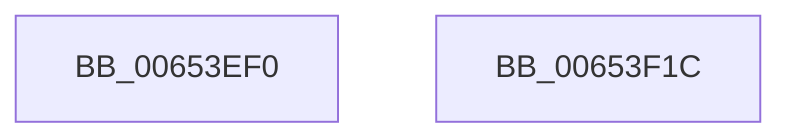

# EtwpCovSampCaptureRebalanceDpc

- RVA: `0x00653EF0`–`0x00653F1D` (길이 `45` bytes)
- VA: `0x0000000140653EF0`
- 실행 섹션: `.text`
- PDB 이름 있음: `예`; PDB Function 태그: `아니요`
- unwind 정보 RVA: `0x0005C788`
- 디코드: `11`개 명령, `45/45` bytes 표시
- 미해석 바이트: `0` (있으면 어셈블리에 `.byte`로 보존)

> 이 문서는 커널 이미지의 기계어와 PDB 기호를 분석해 생성했습니다. 4번과 5번은 함수 원형과 자료형을 바이너리 사용 방식에서 추정한 C 해석이며 원본 소스 복구 결과는 아닙니다.

## 1. Dependencies

- 직접 호출 지점: **1**; 고유 호출 대상: **1**
- 직접 호출자로 확인된 함수: **0**
- RIP 상대 이미지 참조: **0**

### Outgoing calls
- `0x00653F12` → [KeSetEvent](../33/KeSetEvent_function_0033F310.md) (function, `0x0033F310`)

### Direct callers
- 이 함수 시작 RVA로 연결되는 직접 call은 확인되지 않았습니다. 간접 호출은 완전히 역산할 수 없습니다.

### Static image references
- 디코드된 RIP-relative 메모리 참조가 없습니다.

## 2. Other-region calls and transfers

- 다른 실행 섹션으로 향하는 call: **0**
- 별도 외부 분기/꼬리 이동을 확인하지 못했습니다.

## 3. Assembly (complete function range)

```asm
00653EF0  48 83 EC 28                     sub rsp, 0x28
00653EF4  48 B8 20 03 00 00 80 F7 FF FF   movabs rax, 0xfffff78000000320
00653EFE  48 8D 8A 10 04 00 00            lea rcx, [rdx + 0x410]
00653F05  45 33 C0                        xor r8d, r8d
00653F08  8B 00                           mov eax, dword ptr [rax]
00653F0A  89 82 2C 04 00 00               mov dword ptr [rdx + 0x42c], eax
00653F10  33 D2                           xor edx, edx
00653F12  E8 F9 B3 CE FF                  call 0x14033f310
00653F17  48 83 C4 28                     add rsp, 0x28
00653F1B  C3                              ret
00653F1C  CC                              int3
```

## 4. C-style interpretation (structured pseudocode)

```c
__int64 __fastcall EtwpCovSampCaptureRebalanceDpc(__int64 a1, __int64 a2, int a3)
{
    __int64 result;
    __int64 v_rsp;

    v_rsp = (v_rsp) - (40);
    a3 = 0;
    *(unsigned int *)(a2 + 1068) = (unsigned int)((unsigned int)(*(unsigned int *)(result)));
    a2 = 0;
    result = KeSetEvent(a2 + 1040, a2, a3, a4);
    v_rsp = (v_rsp) + (40);
    return result;
}
```

## 5. (Beta) C Style

```c
int64_t EtwpCovSampCaptureRebalanceDpc(int64_t Arg1, void *Arg2, int32_t Arg3)
{
    uint8_t *arg2 = (uint8_t *)Arg2;

    int64_t result;
    int64_t local_rsp;

    local_rsp = (local_rsp) - (40);
    Arg3 = 0;
    *(uint32_t *)(arg2 + 0x42C) = (uint32_t)((uint32_t)(*(uint32_t *)(result)));
    Arg2 = 0;
    result = KeSetEvent(Arg2 + 1040, Arg2, Arg3, a4);
    local_rsp = (local_rsp) + (40);
    return result;
}
```

### 관측된 메모리 오프셋

구조체 형식이 확인되지 않은 접근은 인자 기준의 오프셋으로만 기록했습니다.

| 기준 인자 | 오프셋 표현 | 폭 (bit) | 접근 |
|---|---:|---:|---|
| `Arg2` | `+ 0x410` | `64` | `R` |
| `Arg2` | `+ 0x42C` | `32` | `W` |

## 6. Execution-region graph

[열기: 2D/3D 그래프와 함수 탐색 컨트롤 패널](../../../control-panel.html?section=text&rva=0x00653EF0&view=graph)

- 2D 그래프는 위에서 아래로 흐르고, 3D 그래프는 빈 공간을 드래그해 회전합니다. Shift+드래그는 이동, 휠은 확대·축소, 함수 노드 선택은 대상 보고서 이동입니다.

### Static fallback


