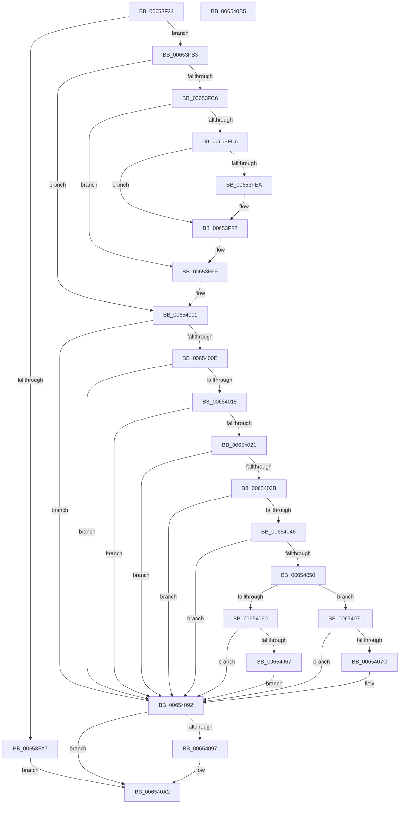

# EtwpCovSampCaptureSample

- RVA: `0x00653F24`–`0x006540B6` (길이 `402` bytes)
- VA: `0x0000000140653F24`
- 실행 섹션: `.text`
- PDB 이름 있음: `예`; PDB Function 태그: `아니요`
- unwind 정보 RVA: `0x000BD140`
- 디코드: `102`개 명령, `402/402` bytes 표시
- 미해석 바이트: `0` (있으면 어셈블리에 `.byte`로 보존)

> 이 문서는 커널 이미지의 기계어와 PDB 기호를 분석해 생성했습니다. 4번과 5번은 함수 원형과 자료형을 바이너리 사용 방식에서 추정한 C 해석이며 원본 소스 복구 결과는 아닙니다.

## 1. Dependencies

- 직접 호출 지점: **8**; 고유 호출 대상: **8**
- 직접 호출자로 확인된 함수: **4**
- RIP 상대 이미지 참조: **1**

### Outgoing calls
- `0x00653FC9` → [EtwpCovSampCaptureBufferGet](../43/EtwpCovSampCaptureBufferGet_function_0043C1A0.md) (function, `0x0043C1A0`)
- `0x00653FDC` → [EtwpCovSampCaptureBufferAddIP](../46/EtwpCovSampCaptureBufferAddIP_function_00463F80.md) (function, `0x00463F80`)
- `0x00653FED` → [EtwpCovSampCaptureKernelStack](EtwpCovSampCaptureKernelStack_function_00653C28.md) (function, `0x00653C28`)
- `0x00653FF8` → [EtwpCovSampCaptureBufferQueue](../43/EtwpCovSampCaptureBufferQueue_function_0043C234.md) (function, `0x0043C234`)
- `0x00654057` → [EtwpCovSampSafeForUserAddressCapture](../45/EtwpCovSampSafeForUserAddressCapture_function_00452C28.md) (function, `0x00452C28`)
- `0x0065406A` → [EtwpCovSampCaptureQueueApc](EtwpCovSampCaptureQueueApc_function_00653CF0.md) (function, `0x00653CF0`)
- `0x00654082` → [EtwpCovSampCaptureUserAddresses](../../page/8D/EtwpCovSampCaptureUserAddresses_function_008D73BC.md) (function, `0x008D73BC`)
- `0x0065409D` → [EtwpCovSampCaptureBufferRelease](../43/EtwpCovSampCaptureBufferRelease_function_0043C4B4.md) (function, `0x0043C4B4`)

### Direct callers
- [EtwpCoverageSamplerPageFault](../4F/EtwpCoverageSamplerPageFault_function_004FBEF0.md) at `0x004FC0A9`
- [EtwpCoverageSamplerContextSwap](../4F/EtwpCoverageSamplerContextSwap_function_004FC9F8.md) at `0x004FCB71`
- [EtwpCovSampProfileInterrupt](EtwpCovSampProfileInterrupt_function_00654210.md) at `0x00654391`
- [EtwpCoverageSamplerReadyThread](EtwpCoverageSamplerReadyThread_function_006543E8.md) at `0x0065457B`

### Static image references
- `0x00653F4D` → RVA `0x00EFF1E8` (`.data`; read)

## 2. Other-region calls and transfers

- 다른 실행 섹션으로 향하는 call: **1**
  - `0x00654082` → [EtwpCovSampCaptureUserAddresses](../../page/8D/EtwpCovSampCaptureUserAddresses_function_008D73BC.md) (`.text` → `PAGE`)
- 별도 외부 분기/꼬리 이동을 확인하지 못했습니다.

## 3. Assembly (complete function range)

```asm
00653F24  48 89 5C 24 08                  mov qword ptr [rsp + 8], rbx
00653F29  48 89 6C 24 10                  mov qword ptr [rsp + 0x10], rbp
00653F2E  56                              push rsi
00653F2F  57                              push rdi
00653F30  41 56                           push r14
00653F32  48 83 EC 20                     sub rsp, 0x20
00653F36  65 48 8B 1C 25 88 01 00 00      mov rbx, qword ptr gs:[0x188]
00653F3F  48 8B E9                        mov rbp, rcx
00653F42  65 4C 8B 04 25 20 00 00 00      mov r8, qword ptr gs:[0x20]
00653F4B  33 FF                           xor edi, edi
00653F4D  48 8B 35 94 B2 8A 00            mov rsi, qword ptr [rip + 0x8ab294]
00653F54  44 8B F2                        mov r14d, edx
00653F57  21 7C 24 50                     and dword ptr [rsp + 0x50], edi
00653F5B  8D 57 01                        lea edx, [rdi + 1]
00653F5E  48 8B 46 08                     mov rax, qword ptr [rsi + 8]
00653F62  44 8B C8                        mov r9d, eax
00653F65  C1 E8 0D                        shr eax, 0xd
00653F68  25 FF FF 03 00                  and eax, 0x3ffff
00653F6D  49 C1 E9 04                     shr r9, 4
00653F71  0F BD C8                        bsr ecx, eax
00653F74  41 81 E1 FF 01 00 00            and r9d, 0x1ff
00653F7B  D3 E2                           shl edx, cl
00653F7D  33 D0                           xor edx, eax
00653F7F  89 4C 24 58                     mov dword ptr [rsp + 0x58], ecx
00653F83  49 8B 80 B0 8B 00 00            mov rax, qword ptr [r8 + 0x8bb0]
00653F8A  83 C1 FE                        add ecx, -2
00653F8D  48 8B 04 C8                     mov rax, qword ptr [rax + rcx*8]
00653F91  4A 8D 0C CD 0F 00 00 00         lea rcx, [r9*8 + 0xf]
00653F99  48 03 4C D0 08                  add rcx, qword ptr [rax + rdx*8 + 8]
00653F9E  48 83 E1 F0                     and rcx, 0xfffffffffffffff0
00653FA2  39 79 3C                        cmp dword ptr [rcx + 0x3c], edi
00653FA5  74 0C                           je 0x140653fb3
00653FA7  F0 FF 81 30 01 00 00            lock inc dword ptr [rcx + 0x130]
00653FAE  E9 EF 00 00 00                  jmp 0x1406540a2
00653FB3  48 8D 45 FF                     lea rax, [rbp - 1]
00653FB7  48 B9 FE FF FF FF FF 7F FF FF   movabs rcx, 0xffff7ffffffffffe
00653FC1  48 3B C1                        cmp rax, rcx
00653FC4  76 3B                           jbe 0x140654001
00653FC6  48 8B CE                        mov rcx, rsi
00653FC9  E8 D2 81 DE FF                  call 0x14043c1a0
00653FCE  48 8B F8                        mov rdi, rax
00653FD1  48 85 C0                        test rax, rax
00653FD4  74 29                           je 0x140653fff
00653FD6  48 8B D5                        mov rdx, rbp
00653FD9  48 8B C8                        mov rcx, rax
00653FDC  E8 9F FF E0 FF                  call 0x140463f80
00653FE1  83 BE 0C 05 00 00 00            cmp dword ptr [rsi + 0x50c], 0
00653FE8  75 08                           jne 0x140653ff2
00653FEA  41 8B D6                        mov edx, r14d
00653FED  E8 36 FC FF FF                  call 0x140653c28
00653FF2  48 8B D7                        mov rdx, rdi
00653FF5  48 8B CE                        mov rcx, rsi
00653FF8  E8 37 82 DE FF                  call 0x14043c234
00653FFD  33 FF                           xor edi, edi
00653FFF  33 ED                           xor ebp, ebp
00654001  F7 43 74 00 04 00 00            test dword ptr [rbx + 0x74], 0x400
00654008  0F 85 84 00 00 00               jne 0x140654092
0065400E  8B 83 A0 05 00 00               mov eax, dword ptr [rbx + 0x5a0]
00654014  A8 01                           test al, 1
00654016  75 7A                           jne 0x140654092
00654018  F7 43 74 00 40 00 00            test dword ptr [rbx + 0x74], 0x4000
0065401F  74 71                           je 0x140654092
00654021  48 83 BB F0 00 00 00 00         cmp qword ptr [rbx + 0xf0], 0
00654029  74 67                           je 0x140654092
0065402B  48 8B 8B 20 02 00 00            mov rcx, qword ptr [rbx + 0x220]
00654032  8B 81 88 00 00 00               mov eax, dword ptr [rcx + 0x88]
00654038  C1 E8 03                        shr eax, 3
0065403B  83 E0 01                        and eax, 1
0065403E  03 81 50 01 00 00               add eax, dword ptr [rcx + 0x150]
00654044  75 4C                           jne 0x140654092
00654046  8A 83 84 02 00 00               mov al, byte ptr [rbx + 0x284]
0065404C  84 C0                           test al, al
0065404E  75 42                           jne 0x140654092
00654050  48 8D 54 24 50                  lea rdx, [rsp + 0x50]
00654055  33 C9                           xor ecx, ecx
00654057  E8 CC EB DF FF                  call 0x140452c28
0065405C  85 C0                           test eax, eax
0065405E  79 11                           jns 0x140654071
00654060  83 7C 24 50 00                  cmp dword ptr [rsp + 0x50], 0
00654065  75 2B                           jne 0x140654092
00654067  48 8B CD                        mov rcx, rbp
0065406A  E8 81 FC FF FF                  call 0x140653cf0
0065406F  EB 21                           jmp 0x140654092
00654071  F0 0F BA AB A0 05 00 00 17      lock bts dword ptr [rbx + 0x5a0], 0x17
0065407A  72 16                           jb 0x140654092
0065407C  48 8B D5                        mov rdx, rbp
0065407F  48 8B CE                        mov rcx, rsi
00654082  E8 35 33 28 00                  call 0x1408d73bc
00654087  F0 81 A3 A0 05 00 00 FF FF 7F FF  lock and dword ptr [rbx + 0x5a0], 0xff7fffff
00654092  48 85 FF                        test rdi, rdi
00654095  74 0B                           je 0x1406540a2
00654097  48 8B D7                        mov rdx, rdi
0065409A  48 8B CE                        mov rcx, rsi
0065409D  E8 12 84 DE FF                  call 0x14043c4b4
006540A2  48 8B 5C 24 40                  mov rbx, qword ptr [rsp + 0x40]
006540A7  48 8B 6C 24 48                  mov rbp, qword ptr [rsp + 0x48]
006540AC  48 83 C4 20                     add rsp, 0x20
006540B0  41 5E                           pop r14
006540B2  5F                              pop rdi
006540B3  5E                              pop rsi
006540B4  C3                              ret
006540B5  CC                              int3
```

## 4. C-style interpretation (structured pseudocode)

```c
__int64 __fastcall EtwpCovSampCaptureSample(__int64 a1, int a2)
{
    __int64 result;
    __int64 v_rbp;
    __int64 v_rdi;
    __int64 v_rsp;
    unsigned __int64 v_stack_p10;
    unsigned int v_stack_p18;
    unsigned int v_stack_p20;
    unsigned __int64 v_stack_p8;

    v_stack_p8 = v_rbx;
    v_stack_p10 = v_rbp;
    v_rsp = (v_rsp) - (32);
    v_rdi = 0;
    result = (unsigned int)((*(unsigned __int64 *)(*(unsigned __int64 *)(v_rip + 9089684) + 8)) >> (13));
    result = (unsigned int)((result) & (0x3FFFFULL));
    a4 = ((unsigned int)((unsigned int)(*(unsigned __int64 *)(*(unsigned __int64 *)(v_rip + 9089684) + 8)))) >> (4);
    a4 = (unsigned int)((a4) & (511));
    a2 = (unsigned int)((v_rdi + 1) << ((unsigned __int8)(a1)));
    a2 = (unsigned int)((a2) ^ ((unsigned int)(result)));
    v_stack_p20 = (unsigned int)(a1);
    a1 = (unsigned int)((a1) + (-2));
    a1 = (a4 * 8 + 15) + (*(unsigned __int64 *)(*(unsigned __int64 *)(*(unsigned __int64 *)(*(unsigned __int64 *)(gs_base + (0 + 32)) + 35760) + a1 * 8) + a2 * 8 + 8));
    a1 = (a1) & (-16);
    if ((*(unsigned int *)(a1 + 60)) == 0) goto loc_00653FB3;
    goto loc_006540A2;
loc_00653FB3:
    if ((a1 - 1) <= a1) goto loc_00654001;
    result = EtwpCovSampCaptureBufferGet(*(unsigned __int64 *)(v_rip + 9089684), a2, *(unsigned __int64 *)(gs_base + (0 + 32)), a4);
    if (result == 0) goto loc_00653FFF;
    result = EtwpCovSampCaptureBufferAddIP(result, a1, *(unsigned __int64 *)(gs_base + (0 + 32)), a4);
    if ((*(unsigned int *)(*(unsigned __int64 *)(v_rip + 9089684) + 1292)) == 0) {
        a2 = (unsigned int)((unsigned int)(a2));
        result = EtwpCovSampCaptureKernelStack(result, a2, *(unsigned __int64 *)(gs_base + (0 + 32)), a4);
    }
    result = EtwpCovSampCaptureBufferQueue(*(unsigned __int64 *)(v_rip + 9089684), result, *(unsigned __int64 *)(gs_base + (0 + 32)), a4);
    v_rdi = 0;
loc_00653FFF:
    v_rbp = 0;
loc_00654001:
    if (((*(unsigned int *)(*(unsigned __int64 *)(gs_base + (0 + 392)) + 116)) & (0x400ULL)) != 0) goto loc_00654092;
    if ((((unsigned __int8)((unsigned int)(*(unsigned int *)(*(unsigned __int64 *)(gs_base + (0 + 392)) + 1440)))) & (1)) != 0) goto loc_00654092;
    if (((*(unsigned int *)(*(unsigned __int64 *)(gs_base + (0 + 392)) + 116)) & (0x4000ULL)) == 0) goto loc_00654092;
    if ((*(unsigned __int64 *)(*(unsigned __int64 *)(gs_base + (0 + 392)) + 240)) == 0) goto loc_00654092;
    result = (unsigned int)(((unsigned int)(*(unsigned int *)(*(unsigned __int64 *)(*(unsigned __int64 *)(gs_base + (0 + 392)) + 544) + 136))) >> (3));
    result = (unsigned int)((result) & (1));
    result = (unsigned int)((result) + (*(unsigned int *)(*(unsigned __int64 *)(*(unsigned __int64 *)(gs_base + (0 + 392)) + 544) + 336)));
    if (condition_is_not_equal) goto loc_00654092;
    if ((unsigned __int8)(*(unsigned __int8 *)(*(unsigned __int64 *)(gs_base + (0 + 392)) + 644)) != 0) goto loc_00654092;
    a1 = 0;
    result = EtwpCovSampSafeForUserAddressCapture(a1, v_stack_p18, *(unsigned __int64 *)(gs_base + (0 + 32)), a4);
    if (!sign_flag) goto loc_00654071;
    if (v_stack_p18 != 0) goto loc_00654092;
    result = EtwpCovSampCaptureQueueApc(0, v_stack_p18, *(unsigned __int64 *)(gs_base + (0 + 32)), a4);
    goto loc_00654092;
loc_00654071:
    if (v_stack_p18 >= 0) {
        a2 = 0;
        a1 = *(unsigned __int64 *)(v_rip + 9089684);
        result = EtwpCovSampCaptureUserAddresses(a1, a2, *(unsigned __int64 *)(gs_base + (0 + 32)), a4);
    }
    if (0 != 0) {
        a2 = 0;
        a1 = *(unsigned __int64 *)(v_rip + 9089684);
        result = EtwpCovSampCaptureBufferRelease(a1, a2, *(unsigned __int64 *)(gs_base + (0 + 32)), a4);
    }
    v_rsp = (v_rsp) + (32);
    return result;
}
```

## 5. (Beta) C Style

```c
int64_t EtwpCovSampCaptureSample(void *Arg1, int32_t Arg2)
{
    uint8_t *arg1 = (uint8_t *)Arg1;

    int64_t result;
    int64_t local_rbp;
    int64_t local_rdi;
    int64_t local_rsp;
    uint64_t v_stack_p10;
    uint32_t v_stack_p18;
    uint32_t v_stack_p20;
    uint64_t v_stack_p8;

    v_stack_p8 = local_rbx;
    v_stack_p10 = local_rbp;
    local_rsp = (local_rsp) - (32);
    local_rdi = 0;
    result = (uint32_t)((*(uint64_t *)(*(uint64_t *)(v_rip + 0x8AB294) + 0x8)) >> (13));
    result = (uint32_t)((result) & (0x3FFFFULL));
    a4 = ((uint32_t)((uint32_t)(*(uint64_t *)(*(uint64_t *)(v_rip + 0x8AB294) + 0x8)))) >> (4);
    a4 = (uint32_t)((a4) & (511));
    Arg2 = (uint32_t)((local_rdi + 1) << ((uint8_t)(Arg1)));
    Arg2 = (uint32_t)((Arg2) ^ ((uint32_t)(result)));
    v_stack_p20 = (uint32_t)(Arg1);
    Arg1 = (uint32_t)((Arg1) + (-2));
    Arg1 = (a4 * 8 + 15) + (*(uint64_t *)(*(uint64_t *)(*(uint64_t *)(*(uint64_t *)(gs_base + (0 + 0x20)) + 0x8BB0) + arg1 * 8) + Arg2 * 8 + 0x8));
    Arg1 = (Arg1) & (-16);
    if ((*(uint32_t *)(arg1 + 0x3C)) == 0) goto loc_00653FB3;
    goto loc_006540A2;
loc_00653FB3:
    if ((Arg1 - 1) <= Arg1) goto loc_00654001;
    result = EtwpCovSampCaptureBufferGet(*(uint64_t *)(v_rip + 0x8AB294), Arg2, *(uint64_t *)(gs_base + (0 + 0x20)), a4);
    if (result == 0) goto loc_00653FFF;
    result = EtwpCovSampCaptureBufferAddIP(result, Arg1, *(uint64_t *)(gs_base + (0 + 0x20)), a4);
    if ((*(uint32_t *)(*(uint64_t *)(v_rip + 0x8AB294) + 0x50C)) == 0) {
        Arg2 = (uint32_t)((uint32_t)(Arg2));
        result = EtwpCovSampCaptureKernelStack(result, Arg2, *(uint64_t *)(gs_base + (0 + 0x20)), a4);
    }
    result = EtwpCovSampCaptureBufferQueue(*(uint64_t *)(v_rip + 0x8AB294), result, *(uint64_t *)(gs_base + (0 + 0x20)), a4);
    local_rdi = 0;
loc_00653FFF:
    local_rbp = 0;
loc_00654001:
    if (((*(uint32_t *)(*(uint64_t *)(gs_base + (0 + 0x188)) + 0x74)) & (0x400ULL)) != 0) goto loc_00654092;
    if ((((uint8_t)((uint32_t)(*(uint32_t *)(*(uint64_t *)(gs_base + (0 + 0x188)) + 0x5A0)))) & (1)) != 0) goto loc_00654092;
    if (((*(uint32_t *)(*(uint64_t *)(gs_base + (0 + 0x188)) + 0x74)) & (0x4000ULL)) == 0) goto loc_00654092;
    if ((*(uint64_t *)(*(uint64_t *)(gs_base + (0 + 0x188)) + 0xF0)) == 0) goto loc_00654092;
    result = (uint32_t)(((uint32_t)(*(uint32_t *)(*(uint64_t *)(*(uint64_t *)(gs_base + (0 + 0x188)) + 0x220) + 0x88))) >> (3));
    result = (uint32_t)((result) & (1));
    result = (uint32_t)((result) + (*(uint32_t *)(*(uint64_t *)(*(uint64_t *)(gs_base + (0 + 0x188)) + 0x220) + 0x150)));
    if (condition_is_not_equal) goto loc_00654092;
    if ((uint8_t)(*(uint8_t *)(*(uint64_t *)(gs_base + (0 + 0x188)) + 0x284)) != 0) goto loc_00654092;
    Arg1 = 0;
    result = EtwpCovSampSafeForUserAddressCapture(Arg1, v_stack_p18, *(uint64_t *)(gs_base + (0 + 0x20)), a4);
    if (!sign_flag) goto loc_00654071;
    if (v_stack_p18 != 0) goto loc_00654092;
    result = EtwpCovSampCaptureQueueApc(0, v_stack_p18, *(uint64_t *)(gs_base + (0 + 0x20)), a4);
    goto loc_00654092;
loc_00654071:
    if (v_stack_p18 >= 0) {
        Arg2 = 0;
        Arg1 = *(uint64_t *)(v_rip + 0x8AB294);
        result = EtwpCovSampCaptureUserAddresses(Arg1, Arg2, *(uint64_t *)(gs_base + (0 + 0x20)), a4);
    }
    if (0 != 0) {
        Arg2 = 0;
        Arg1 = *(uint64_t *)(v_rip + 0x8AB294);
        result = EtwpCovSampCaptureBufferRelease(Arg1, Arg2, *(uint64_t *)(gs_base + (0 + 0x20)), a4);
    }
    local_rsp = (local_rsp) + (32);
    return result;
}
```

### 관측된 메모리 오프셋

구조체 형식이 확인되지 않은 접근은 인자 기준의 오프셋으로만 기록했습니다.

| 기준 인자 | 오프셋 표현 | 폭 (bit) | 접근 |
|---|---:|---:|---|
| `Arg1` | `- 0x1` | `64` | `R` |

## 6. Execution-region graph

[열기: 2D/3D 그래프와 함수 탐색 컨트롤 패널](../../../control-panel.html?section=text&rva=0x00653F24&view=graph)

- 2D 그래프는 위에서 아래로 흐르고, 3D 그래프는 빈 공간을 드래그해 회전합니다. Shift+드래그는 이동, 휠은 확대·축소, 함수 노드 선택은 대상 보고서 이동입니다.

### Static fallback


