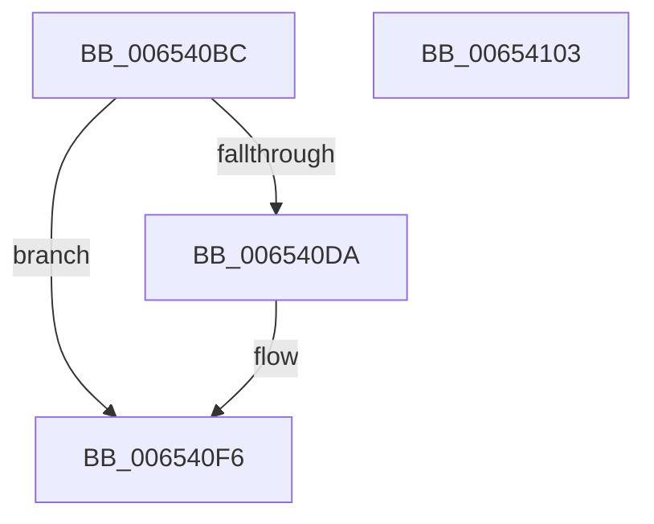

# EtwpCovSampLookasideFlushFreeListToCleanupList

- RVA: `0x006540BC`–`0x00654104` (길이 `72` bytes)
- VA: `0x00000001406540BC`
- 실행 섹션: `.text`
- PDB 이름 있음: `예`; PDB Function 태그: `아니요`
- unwind 정보 RVA: `0x00068D5C`
- 디코드: `22`개 명령, `72/72` bytes 표시
- 미해석 바이트: `0` (있으면 어셈블리에 `.byte`로 보존)

> 이 문서는 커널 이미지의 기계어와 PDB 기호를 분석해 생성했습니다. 4번과 5번은 함수 원형과 자료형을 바이너리 사용 방식에서 추정한 C 해석이며 원본 소스 복구 결과는 아닙니다.

## 1. Dependencies

- 직접 호출 지점: **2**; 고유 호출 대상: **2**
- 직접 호출자로 확인된 함수: **2**
- RIP 상대 이미지 참조: **0**

### Outgoing calls
- `0x006540D0` → [ExpInterlockedFlushSList](../6B/ExpInterlockedFlushSList_function_006BA5F0.md) (function, `0x006BA5F0`)
- `0x006540E5` → [EtwpCovSampPushListSList](../46/EtwpCovSampPushListSList_function_004667A8.md) (function, `0x004667A8`)

### Direct callers
- [EtwpCovSampCaptureCleanupLookasides](../43/EtwpCovSampCaptureCleanupLookasides_function_0043BFE0.md) at `0x0043C035`
- [EtwpCovSampCaptureFreeLookasides](../../page/AC/EtwpCovSampCaptureFreeLookasides_function_00ACEDF0.md) at `0x00ACEE17`

### Static image references
- 디코드된 RIP-relative 메모리 참조가 없습니다.

## 2. Other-region calls and transfers

- 다른 실행 섹션으로 향하는 call: **0**
- 별도 외부 분기/꼬리 이동을 확인하지 못했습니다.

## 3. Assembly (complete function range)

```asm
006540BC  48 89 5C 24 10                  mov qword ptr [rsp + 0x10], rbx
006540C1  57                              push rdi
006540C2  48 83 EC 20                     sub rsp, 0x20
006540C6  48 8B 79 20                     mov rdi, qword ptr [rcx + 0x20]
006540CA  33 DB                           xor ebx, ebx
006540CC  89 5C 24 30                     mov dword ptr [rsp + 0x30], ebx
006540D0  E8 1B 65 06 00                  call 0x1406ba5f0
006540D5  48 85 C0                        test rax, rax
006540D8  74 1C                           je 0x1406540f6
006540DA  4C 8D 44 24 30                  lea r8, [rsp + 0x30]
006540DF  48 8B D0                        mov rdx, rax
006540E2  48 8B CF                        mov rcx, rdi
006540E5  E8 BE 26 E1 FF                  call 0x1404667a8
006540EA  8B 44 24 30                     mov eax, dword ptr [rsp + 0x30]
006540EE  F0 01 47 4C                     lock add dword ptr [rdi + 0x4c], eax
006540F2  8B 5C 24 30                     mov ebx, dword ptr [rsp + 0x30]
006540F6  8B C3                           mov eax, ebx
006540F8  48 8B 5C 24 38                  mov rbx, qword ptr [rsp + 0x38]
006540FD  48 83 C4 20                     add rsp, 0x20
00654101  5F                              pop rdi
00654102  C3                              ret
00654103  CC                              int3
```

## 4. C-style interpretation (structured pseudocode)

```c
__int64 __fastcall EtwpCovSampLookasideFlushFreeListToCleanupList(__int64 a1)
{
    __int64 result;
    __int64 v_rbx;
    __int64 v_rsp;
    unsigned __int64 v_stack_p10;
    unsigned int v_stack_p8;

    v_stack_p10 = v_rbx;
    v_rsp = (v_rsp) - (32);
    v_rbx = 0;
    v_stack_p8 = 0;
    result = ExpInterlockedFlushSList(a1, a2, a3, a4);
    if (result != 0) {
        a3 = v_stack_p8;
        a2 = result;
        a1 = *(unsigned __int64 *)(a1 + 32);
        result = EtwpCovSampPushListSList(a1, a2, a3, a4);
        result = v_stack_p8;
        v_rbx = v_stack_p8;
    }
    v_rsp = (v_rsp) + (32);
    return (unsigned int)((unsigned int)(v_rbx));
}
```

## 5. (Beta) C Style

```c
int64_t EtwpCovSampLookasideFlushFreeListToCleanupList(void *Arg1)
{
    uint8_t *arg1 = (uint8_t *)Arg1;

    int64_t result;
    int64_t local_rbx;
    int64_t local_rsp;
    uint64_t v_stack_p10;
    uint32_t v_stack_p8;

    v_stack_p10 = local_rbx;
    local_rsp = (local_rsp) - (32);
    local_rbx = 0;
    v_stack_p8 = 0;
    result = ExpInterlockedFlushSList(Arg1, a2, a3, a4);
    if (result != 0) {
        a3 = v_stack_p8;
        a2 = result;
        Arg1 = *(uint64_t *)(arg1 + 0x20);
        result = EtwpCovSampPushListSList(Arg1, a2, a3, a4);
        result = v_stack_p8;
        local_rbx = v_stack_p8;
    }
    local_rsp = (local_rsp) + (32);
    return (uint32_t)((uint32_t)(local_rbx));
}
```

### 관측된 메모리 오프셋

구조체 형식이 확인되지 않은 접근은 인자 기준의 오프셋으로만 기록했습니다.

| 기준 인자 | 오프셋 표현 | 폭 (bit) | 접근 |
|---|---:|---:|---|
| `Arg1` | `+ 0x20` | `64` | `R` |

## 6. Execution-region graph

[열기: 2D/3D 그래프와 함수 탐색 컨트롤 패널](../../../control-panel.html?section=text&rva=0x006540BC&view=graph)

- 2D 그래프는 위에서 아래로 흐르고, 3D 그래프는 빈 공간을 드래그해 회전합니다. Shift+드래그는 이동, 휠은 확대·축소, 함수 노드 선택은 대상 보고서 이동입니다.

### Static fallback


