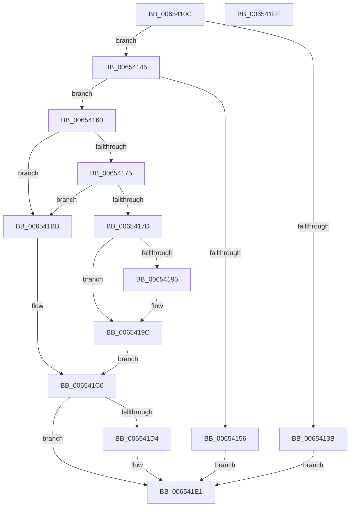

# EtwpCovSampLookasideGrow

- RVA: `0x0065410C`–`0x006541FF` (길이 `243` bytes)
- VA: `0x000000014065410C`
- 실행 섹션: `.text`
- PDB 이름 있음: `예`; PDB Function 태그: `아니요`
- unwind 정보 RVA: `0x0005E6B4`
- 디코드: `68`개 명령, `243/243` bytes 표시
- 미해석 바이트: `0` (있으면 어셈블리에 `.byte`로 보존)

> 이 문서는 커널 이미지의 기계어와 PDB 기호를 분석해 생성했습니다. 4번과 5번은 함수 원형과 자료형을 바이너리 사용 방식에서 추정한 C 해석이며 원본 소스 복구 결과는 아닙니다.

## 1. Dependencies

- 직접 호출 지점: **5**; 고유 호출 대상: **5**
- 직접 호출자로 확인된 함수: **2**
- RIP 상대 이미지 참조: **0**

### Outgoing calls
- `0x00654149` → [guard_dispatch_icall](../6B/guard_dispatch_icall_function_006BAAD0.md) (function, `0x006BAAD0`)
- `0x00654167` → [KeAcquireSpinLockRaiseToDpc](../20/KeAcquireSpinLockRaiseToDpc_function_00208470.md) (function, `0x00208470`)
- `0x006541B0` → [ExpInterlockedPushEntrySList](../6B/ExpInterlockedPushEntrySList_function_006BA5B0.md) (function, `0x006BA5B0`)
- `0x006541CA` → [KeReleaseSpinLock](../39/KeReleaseSpinLock_function_00392BA0.md) (function, `0x00392BA0`)
- `0x006541DC` → [ExFreePoolWithTag](../../poolcode/B8/ExFreePoolWithTag_function_00B82870.md) (function, `0x00B82870`)

### Direct callers
- [EtwpCovSampCaptureContextStart](../../page/7C/EtwpCovSampCaptureContextStart_function_007C14AC.md) at `0x007C1933`
- [EtwpCovSampCaptureWorkerThread](../../page/7C/EtwpCovSampCaptureWorkerThread_function_007C19B0.md) at `0x007C1B0C`

### Static image references
- 디코드된 RIP-relative 메모리 참조가 없습니다.

## 2. Other-region calls and transfers

- 다른 실행 섹션으로 향하는 call: **1**
  - `0x006541DC` → [ExFreePoolWithTag](../../poolcode/B8/ExFreePoolWithTag_function_00B82870.md) (`.text` → `POOLCODE`)
- 별도 외부 분기/꼬리 이동을 확인하지 못했습니다.

## 3. Assembly (complete function range)

```asm
0065410C  48 8B C4                        mov rax, rsp
0065410F  48 89 58 08                     mov qword ptr [rax + 8], rbx
00654113  48 89 68 10                     mov qword ptr [rax + 0x10], rbp
00654117  48 89 70 18                     mov qword ptr [rax + 0x18], rsi
0065411B  48 89 78 20                     mov qword ptr [rax + 0x20], rdi
0065411F  41 56                           push r14
00654121  48 83 EC 20                     sub rsp, 0x20
00654125  48 8B 72 20                     mov rsi, qword ptr [rdx + 0x20]
00654129  48 8B DA                        mov rbx, rdx
0065412C  48 8B E9                        mov rbp, rcx
0065412F  44 0F 20 C0                     mov rax, cr8
00654133  8B 42 34                        mov eax, dword ptr [rdx + 0x34]
00654136  3B 42 38                        cmp eax, dword ptr [rdx + 0x38]
00654139  72 0A                           jb 0x140654145
0065413B  BB FF 00 00 00                  mov ebx, 0xff
00654140  E9 9C 00 00 00                  jmp 0x1406541e1
00654145  48 8B 46 30                     mov rax, qword ptr [rsi + 0x30]
00654149  E8 82 69 06 00                  call 0x1406baad0
0065414E  48 8B F8                        mov rdi, rax
00654151  48 85 C0                        test rax, rax
00654154  75 0A                           jne 0x140654160
00654156  BB 9A 00 00 C0                  mov ebx, 0xc000009a
0065415B  E9 81 00 00 00                  jmp 0x1406541e1
00654160  48 8D 8D 78 02 00 00            lea rcx, [rbp + 0x278]
00654167  E8 04 43 BB FF                  call 0x140208470
0065416C  83 7B 28 00                     cmp dword ptr [rbx + 0x28], 0
00654170  44 8A F0                        mov r14b, al
00654173  74 46                           je 0x1406541bb
00654175  8B 43 34                        mov eax, dword ptr [rbx + 0x34]
00654178  3B 43 38                        cmp eax, dword ptr [rbx + 0x38]
0065417B  73 3E                           jae 0x1406541bb
0065417D  F0 FF 43 34                     lock inc dword ptr [rbx + 0x34]
00654181  FF 46 48                        inc dword ptr [rsi + 0x48]
00654184  48 8D 46 20                     lea rax, [rsi + 0x20]
00654188  48 8B 50 08                     mov rdx, qword ptr [rax + 8]
0065418C  48 8D 4F 18                     lea rcx, [rdi + 0x18]
00654190  48 39 02                        cmp qword ptr [rdx], rax
00654193  74 07                           je 0x14065419c
00654195  B9 03 00 00 00                  mov ecx, 3
0065419A  CD 29                           int 0x29
0065419C  48 89 51 08                     mov qword ptr [rcx + 8], rdx
006541A0  48 89 01                        mov qword ptr [rcx], rax
006541A3  48 89 0A                        mov qword ptr [rdx], rcx
006541A6  48 8B D7                        mov rdx, rdi
006541A9  48 89 48 08                     mov qword ptr [rax + 8], rcx
006541AD  48 8B CB                        mov rcx, rbx
006541B0  E8 FB 63 06 00                  call 0x1406ba5b0
006541B5  33 FF                           xor edi, edi
006541B7  33 DB                           xor ebx, ebx
006541B9  EB 05                           jmp 0x1406541c0
006541BB  BB FF 00 00 00                  mov ebx, 0xff
006541C0  41 8A D6                        mov dl, r14b
006541C3  48 8D 8D 78 02 00 00            lea rcx, [rbp + 0x278]
006541CA  E8 D1 E9 D3 FF                  call 0x140392ba0
006541CF  48 85 FF                        test rdi, rdi
006541D2  74 0D                           je 0x1406541e1
006541D4  BA 45 74 77 56                  mov edx, 0x56777445
006541D9  48 8B CF                        mov rcx, rdi
006541DC  E8 8F E6 52 00                  call 0x140b82870
006541E1  48 8B 6C 24 38                  mov rbp, qword ptr [rsp + 0x38]
006541E6  8B C3                           mov eax, ebx
006541E8  48 8B 5C 24 30                  mov rbx, qword ptr [rsp + 0x30]
006541ED  48 8B 74 24 40                  mov rsi, qword ptr [rsp + 0x40]
006541F2  48 8B 7C 24 48                  mov rdi, qword ptr [rsp + 0x48]
006541F7  48 83 C4 20                     add rsp, 0x20
006541FB  41 5E                           pop r14
006541FD  C3                              ret
006541FE  CC                              int3
```

## 4. C-style interpretation (structured pseudocode)

```c
__int64 __fastcall EtwpCovSampLookasideGrow(__int64 a1, __int64 a2)
{
    __int64 result;
    __int64 v_rbx;
    __int64 v_rdi;
    __int64 v_rsp;
    unsigned __int64 v_stack_p10;
    unsigned __int64 v_stack_p18;
    unsigned __int64 v_stack_p20;
    unsigned __int64 v_stack_p8;

    *(unsigned __int64 *)(v_rsp + 8) = v_rbx;
    *(unsigned __int64 *)(v_rsp + 16) = v_rbp;
    *(unsigned __int64 *)(v_rsp + 24) = v_rsi;
    *(unsigned __int64 *)(v_rsp + 32) = v_rdi;
    v_rsp = (v_rsp) - (32);
    if (((unsigned int)((unsigned int)(*(unsigned int *)(a2 + 52)))) < (*(unsigned int *)(a2 + 56))) goto loc_00654145;
    goto loc_006541E1;
loc_00654145:
    result = guard_dispatch_icall(a1, a2, a3, a4);
    if (result != 0) goto loc_00654160;
    goto loc_006541E1;
loc_00654160:
    result = KeAcquireSpinLockRaiseToDpc(a1 + 632, a2, a3, a4);
    if ((*(unsigned int *)((unsigned int)(0xC000009AULL) + 40)) == 0) goto loc_006541BB;
    if (((unsigned int)((unsigned int)(*(unsigned int *)((unsigned int)(0xC000009AULL) + 52)))) >= (*(unsigned int *)((unsigned int)(0xC000009AULL) + 56))) goto loc_006541BB;
    if ((*(unsigned __int64 *)(*(unsigned __int64 *)(*(unsigned __int64 *)(a2 + 32) + 32 + 8))) != (*(unsigned __int64 *)(a2 + 32) + 32)) {
        a1 = 3;
    }
    *(unsigned __int64 *)(a1 + 8) = *(unsigned __int64 *)(*(unsigned __int64 *)(a2 + 32) + 32 + 8);
    *(unsigned __int64 *)(a1) = *(unsigned __int64 *)(a2 + 32) + 32;
    *(unsigned __int64 *)(*(unsigned __int64 *)(*(unsigned __int64 *)(a2 + 32) + 32 + 8)) = a1;
    *(unsigned __int64 *)(*(unsigned __int64 *)(a2 + 32) + 32 + 8) = a1;
    result = ExpInterlockedPushEntrySList((unsigned int)(0xC000009AULL), result, a3, a4);
    v_rdi = 0;
    v_rbx = 0;
    goto loc_006541C0;
loc_006541BB:
loc_006541C0:
    result = KeReleaseSpinLock(a1 + 632, (unsigned __int8)((unsigned __int8)(result)), a3, a4);
    if (0 != 0) {
        a2 = 0x56777445ULL;
        a1 = 0;
        result = ExFreePoolWithTag(a1, a2, a3, a4);
    }
    v_rsp = (v_rsp) + (32);
    return 255;
}
```

## 5. (Beta) C Style

```c
int64_t EtwpCovSampLookasideGrow(void *Arg1, void *Arg2)
{
    uint8_t *arg1 = (uint8_t *)Arg1;
    uint8_t *arg2 = (uint8_t *)Arg2;

    int64_t result;
    int64_t local_rbx;
    int64_t local_rdi;
    int64_t local_rsp;
    uint64_t v_stack_p10;
    uint64_t v_stack_p18;
    uint64_t v_stack_p20;
    uint64_t v_stack_p8;

    *(uint64_t *)(local_rsp + 0x8) = local_rbx;
    *(uint64_t *)(local_rsp + 0x10) = local_rbp;
    *(uint64_t *)(local_rsp + 0x18) = local_rsi;
    *(uint64_t *)(local_rsp + 0x20) = local_rdi;
    local_rsp = (local_rsp) - (32);
    if (((uint32_t)((uint32_t)(*(uint32_t *)(arg2 + 0x34)))) < (*(uint32_t *)(arg2 + 0x38))) goto loc_00654145;
    goto loc_006541E1;
loc_00654145:
    result = guard_dispatch_icall(Arg1, Arg2, a3, a4);
    if (result != 0) goto loc_00654160;
    goto loc_006541E1;
loc_00654160:
    result = KeAcquireSpinLockRaiseToDpc(Arg1 + 632, Arg2, a3, a4);
    if ((*(uint32_t *)((uint32_t)(0xC000009AULL) + 0x28)) == 0) goto loc_006541BB;
    if (((uint32_t)((uint32_t)(*(uint32_t *)((uint32_t)(0xC000009AULL) + 0x34)))) >= (*(uint32_t *)((uint32_t)(0xC000009AULL) + 0x38))) goto loc_006541BB;
    if ((*(uint64_t *)(*(uint64_t *)(*(uint64_t *)(arg2 + 0x20) + 0x20 + 0x8))) != (*(uint64_t *)(arg2 + 0x20) + 32)) {
        Arg1 = 3;
    }
    *(uint64_t *)(arg1 + 0x8) = *(uint64_t *)(*(uint64_t *)(arg2 + 0x20) + 0x20 + 0x8);
    *(uint64_t *)(arg1) = *(uint64_t *)(arg2 + 0x20) + 32;
    *(void **)(*(uint64_t *)(*(uint64_t *)(arg2 + 0x20) + 0x20 + 0x8)) = Arg1;
    *(void **)(*(uint64_t *)(arg2 + 0x20) + 0x20 + 0x8) = Arg1;
    result = ExpInterlockedPushEntrySList((uint32_t)(0xC000009AULL), result, a3, a4);
    local_rdi = 0;
    local_rbx = 0;
    goto loc_006541C0;
loc_006541BB:
loc_006541C0:
    result = KeReleaseSpinLock(Arg1 + 632, (uint8_t)((uint8_t)(result)), a3, a4);
    if (0 != 0) {
        Arg2 = 0x56777445ULL;
        Arg1 = 0;
        result = ExFreePoolWithTag(Arg1, Arg2, a3, a4);
    }
    local_rsp = (local_rsp) + (32);
    return 255;
}
```

### 관측된 메모리 오프셋

구조체 형식이 확인되지 않은 접근은 인자 기준의 오프셋으로만 기록했습니다.

| 기준 인자 | 오프셋 표현 | 폭 (bit) | 접근 |
|---|---:|---:|---|
| `Arg1` | `+ 0x278` | `64` | `R` |
| `Arg2` | `+ 0x20` | `64` | `R` |
| `Arg2` | `+ 0x28` | `32` | `R` |
| `Arg2` | `+ 0x34` | `32` | `R` |
| `Arg2` | `+ 0x34` | `32` | `R/W` |
| `Arg2` | `+ 0x38` | `32` | `R` |

## 6. Execution-region graph

[열기: 2D/3D 그래프와 함수 탐색 컨트롤 패널](../../../control-panel.html?section=text&rva=0x0065410C&view=graph)

- 2D 그래프는 위에서 아래로 흐르고, 3D 그래프는 빈 공간을 드래그해 회전합니다. Shift+드래그는 이동, 휠은 확대·축소, 함수 노드 선택은 대상 보고서 이동입니다.

### Static fallback


