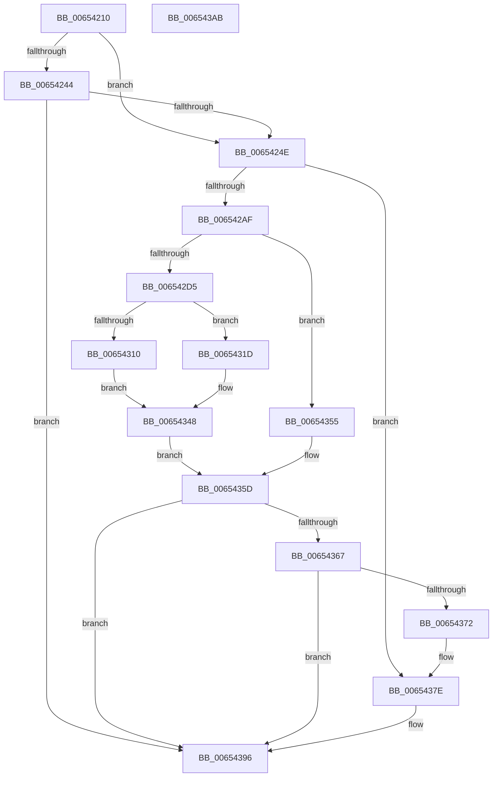

# EtwpCovSampProfileInterrupt

- RVA: `0x00654210`–`0x006543AC` (길이 `412` bytes)
- VA: `0x0000000140654210`
- 실행 섹션: `.text`
- PDB 이름 있음: `예`; PDB Function 태그: `아니요`
- unwind 정보 RVA: `0x000B6A1C`
- 디코드: `104`개 명령, `412/412` bytes 표시
- 미해석 바이트: `0` (있으면 어셈블리에 `.byte`로 보존)

> 이 문서는 커널 이미지의 기계어와 PDB 기호를 분석해 생성했습니다. 4번과 5번은 함수 원형과 자료형을 바이너리 사용 방식에서 추정한 C 해석이며 원본 소스 복구 결과는 아닙니다.

## 1. Dependencies

- 직접 호출 지점: **1**; 고유 호출 대상: **1**
- 직접 호출자로 확인된 함수: **0**
- RIP 상대 이미지 참조: **0**

### Outgoing calls
- `0x00654391` → [EtwpCovSampCaptureSample](EtwpCovSampCaptureSample_function_00653F24.md) (function, `0x00653F24`)

### Direct callers
- 이 함수 시작 RVA로 연결되는 직접 call은 확인되지 않았습니다. 간접 호출은 완전히 역산할 수 없습니다.

### Static image references
- 디코드된 RIP-relative 메모리 참조가 없습니다.

## 2. Other-region calls and transfers

- 다른 실행 섹션으로 향하는 call: **0**
- 별도 외부 분기/꼬리 이동을 확인하지 못했습니다.

## 3. Assembly (complete function range)

```asm
00654210  48 89 5C 24 08                  mov qword ptr [rsp + 8], rbx
00654215  48 89 6C 24 18                  mov qword ptr [rsp + 0x18], rbp
0065421A  48 89 74 24 20                  mov qword ptr [rsp + 0x20], rsi
0065421F  57                              push rdi
00654220  48 83 EC 20                     sub rsp, 0x20
00654224  65 4C 8B 04 25 20 00 00 00      mov r8, qword ptr gs:[0x20]
0065422D  48 8B F1                        mov rsi, rcx
00654230  65 48 8B 04 25 88 01 00 00      mov rax, qword ptr gs:[0x188]
00654239  BD 01 00 00 00                  mov ebp, 1
0065423E  49 3B 40 18                     cmp rax, qword ptr [r8 + 0x18]
00654242  75 0A                           jne 0x14065424e
00654244  41 38 68 20                     cmp byte ptr [r8 + 0x20], bpl
00654248  0F 86 48 01 00 00               jbe 0x140654396
0065424E  48 8B 42 08                     mov rax, qword ptr [rdx + 8]
00654252  8B D5                           mov edx, ebp
00654254  65 4C 8B 04 25 20 00 00 00      mov r8, qword ptr gs:[0x20]
0065425D  44 8B C8                        mov r9d, eax
00654260  C1 E8 0D                        shr eax, 0xd
00654263  25 FF FF 03 00                  and eax, 0x3ffff
00654268  49 C1 E9 04                     shr r9, 4
0065426C  0F BD C8                        bsr ecx, eax
0065426F  41 81 E1 FF 01 00 00            and r9d, 0x1ff
00654276  D3 E2                           shl edx, cl
00654278  83 C1 FE                        add ecx, -2
0065427B  33 D0                           xor edx, eax
0065427D  89 4C 24 38                     mov dword ptr [rsp + 0x38], ecx
00654281  49 8B 80 B0 8B 00 00            mov rax, qword ptr [r8 + 0x8bb0]
00654288  4A 8D 1C CD 0F 00 00 00         lea rbx, [r9*8 + 0xf]
00654290  48 8B 04 C8                     mov rax, qword ptr [rax + rcx*8]
00654294  48 03 5C D0 08                  add rbx, qword ptr [rax + rdx*8 + 8]
00654299  48 83 E3 F0                     and rbx, 0xfffffffffffffff0
0065429D  4C 8D 83 90 00 00 00            lea r8, [rbx + 0x90]
006542A4  41 8B 38                        mov edi, dword ptr [r8]
006542A7  85 FF                           test edi, edi
006542A9  0F 84 CF 00 00 00               je 0x14065437e
006542AF  45 8B 48 14                     mov r9d, dword ptr [r8 + 0x14]
006542B3  49 BB 20 03 00 00 80 F7 FF FF   movabs r11, 0xfffff78000000320
006542BD  45 8B 1B                        mov r11d, dword ptr [r11]
006542C0  41 8B C3                        mov eax, r11d
006542C3  41 8B 50 04                     mov edx, dword ptr [r8 + 4]
006542C7  2B C2                           sub eax, edx
006542C9  41 8B 48 08                     mov ecx, dword ptr [r8 + 8]
006542CD  3B C1                           cmp eax, ecx
006542CF  0F 86 80 00 00 00               jbe 0x140654355
006542D5  45 89 58 04                     mov dword ptr [r8 + 4], r11d
006542D9  44 03 CF                        add r9d, edi
006542DC  41 8B 40 0C                     mov eax, dword ptr [r8 + 0xc]
006542E0  44 3B C8                        cmp r9d, eax
006542E3  41 0F 4E C1                     cmovle eax, r9d
006542E7  41 89 40 14                     mov dword ptr [r8 + 0x14], eax
006542EB  44 8B C8                        mov r9d, eax
006542EE  41 8B 48 1C                     mov ecx, dword ptr [r8 + 0x1c]
006542F2  8D 04 3F                        lea eax, [rdi + rdi]
006542F5  45 8B 50 10                     mov r10d, dword ptr [r8 + 0x10]
006542F9  44 03 D1                        add r10d, ecx
006542FC  41 D1 EA                        shr r10d, 1
006542FF  45 89 50 1C                     mov dword ptr [r8 + 0x1c], r10d
00654303  41 C7 40 10 00 00 00 00         mov dword ptr [r8 + 0x10], 0
0065430B  44 3B D0                        cmp r10d, eax
0065430E  73 0D                           jae 0x14065431d
00654310  41 89 68 20                     mov dword ptr [r8 + 0x20], ebp
00654314  44 8B D5                        mov r10d, ebp
00654317  41 89 68 18                     mov dword ptr [r8 + 0x18], ebp
0065431B  EB 2B                           jmp 0x140654348
0065431D  33 D2                           xor edx, edx
0065431F  8D 4F 01                        lea ecx, [rdi + 1]
00654322  41 8B C2                        mov eax, r10d
00654325  F7 F1                           div ecx
00654327  41 89 40 20                     mov dword ptr [r8 + 0x20], eax
0065432B  44 8B D0                        mov r10d, eax
0065432E  41 8B 48 24                     mov ecx, dword ptr [r8 + 0x24]
00654332  41 33 CB                        xor ecx, r11d
00654335  69 D1 93 01 00 01               imul edx, ecx, 0x1000193
0065433B  8D 0C 00                        lea ecx, [rax + rax]
0065433E  23 CA                           and ecx, edx
00654340  41 89 50 24                     mov dword ptr [r8 + 0x24], edx
00654344  41 89 48 18                     mov dword ptr [r8 + 0x18], ecx
00654348  B8 18 00 00 00                  mov eax, 0x18
0065434D  49 8B C8                        mov rcx, r8
00654350  48 03 C8                        add rcx, rax
00654353  EB 08                           jmp 0x14065435d
00654355  45 8B 50 20                     mov r10d, dword ptr [r8 + 0x20]
00654359  49 8D 48 18                     lea rcx, [r8 + 0x18]
0065435D  F0 41 01 68 10                  lock add dword ptr [r8 + 0x10], ebp
00654362  45 85 C9                        test r9d, r9d
00654365  7E 2F                           jle 0x140654396
00654367  83 C8 FF                        or eax, 0xffffffff
0065436A  F0 0F C1 01                     lock xadd dword ptr [rcx], eax
0065436E  2B C5                           sub eax, ebp
00654370  7F 24                           jg 0x140654396
00654372  41 8D 41 FF                     lea eax, [r9 - 1]
00654376  41 89 40 14                     mov dword ptr [r8 + 0x14], eax
0065437A  45 89 50 18                     mov dword ptr [r8 + 0x18], r10d
0065437E  48 8B 8E 68 01 00 00            mov rcx, qword ptr [rsi + 0x168]
00654385  F0 01 AB 40 01 00 00            lock add dword ptr [rbx + 0x140], ebp
0065438C  BA 02 00 00 50                  mov edx, 0x50000002
00654391  E8 8E FB FF FF                  call 0x140653f24
00654396  48 8B 5C 24 30                  mov rbx, qword ptr [rsp + 0x30]
0065439B  48 8B 6C 24 40                  mov rbp, qword ptr [rsp + 0x40]
006543A0  48 8B 74 24 48                  mov rsi, qword ptr [rsp + 0x48]
006543A5  48 83 C4 20                     add rsp, 0x20
006543A9  5F                              pop rdi
006543AA  C3                              ret
006543AB  CC                              int3
```

## 4. C-style interpretation (structured pseudocode)

```c
__int64 __fastcall EtwpCovSampProfileInterrupt(__int64 a1, __int64 a2)
{
    __int64 result;
    __int64 v_r10;
    __int64 v_rbx;
    __int64 v_rsp;
    unsigned int v_stack_p10;
    unsigned __int64 v_stack_p18;
    unsigned __int64 v_stack_p20;
    unsigned __int64 v_stack_p8;

    v_stack_p8 = v_rbx;
    v_stack_p18 = v_rbp;
    v_stack_p20 = v_rsi;
    v_rsp = (v_rsp) - (32);
    if ((*(unsigned __int64 *)(gs_base + (0 + 392))) != (*(unsigned __int64 *)(*(unsigned __int64 *)(gs_base + (0 + 32)) + 24))) goto loc_0065424E;
    if ((*(unsigned __int8 *)(*(unsigned __int64 *)(gs_base + (0 + 32)) + 32)) <= 1) goto loc_00654396;
loc_0065424E:
    result = (unsigned int)((*(unsigned __int64 *)(a2 + 8)) >> (13));
    result = (unsigned int)((result) & (0x3FFFFULL));
    a4 = ((unsigned int)((unsigned int)(*(unsigned __int64 *)(a2 + 8)))) >> (4);
    a4 = (unsigned int)((a4) & (511));
    a2 = (unsigned int)((1) << ((unsigned __int8)(a1)));
    a1 = (unsigned int)((a1) + (-2));
    a2 = (unsigned int)((a2) ^ ((unsigned int)(result)));
    v_stack_p10 = (unsigned int)(a1);
    v_rbx = (a4 * 8 + 15) + (*(unsigned __int64 *)(*(unsigned __int64 *)(*(unsigned __int64 *)(*(unsigned __int64 *)(gs_base + (0 + 32)) + 35760) + a1 * 8) + a2 * 8 + 8));
    v_rbx = (v_rbx) & (-16);
    if ((unsigned int)((unsigned int)(*(unsigned int *)(v_rbx + 144))) == 0) goto loc_0065437E;
    result = (unsigned int)(((unsigned int)((unsigned int)((unsigned int)(*(unsigned int *)(v_r11))))) - ((unsigned int)((unsigned int)(*(unsigned int *)(v_rbx + 144 + 4)))));
    if (((unsigned int)(result)) <= ((unsigned int)((unsigned int)(*(unsigned int *)(v_rbx + 144 + 8))))) goto loc_00654355;
    *(unsigned int *)(v_rbx + 144 + 4) = (unsigned int)((unsigned int)(*(unsigned int *)(v_r11)));
    a4 = (unsigned int)(((unsigned int)(*(unsigned int *)(v_rbx + 144 + 20))) + ((unsigned int)((unsigned int)(*(unsigned int *)(v_rbx + 144)))));
    result = (unsigned int)(*(unsigned int *)(v_rbx + 144 + 12));
    if (((unsigned int)(a4)) <= ((unsigned int)((unsigned int)(*(unsigned int *)(v_rbx + 144 + 12))))) { result = (unsigned int)(a4); }
    *(unsigned int *)(v_rbx + 144 + 20) = (unsigned int)(result);
    v_r10 = (unsigned int)(((unsigned int)(*(unsigned int *)(v_rbx + 144 + 16))) + ((unsigned int)((unsigned int)(*(unsigned int *)(v_rbx + 144 + 28)))));
    v_r10 = (unsigned int)((v_r10) >> (1));
    *(unsigned int *)(v_rbx + 144 + 28) = (unsigned int)(v_r10);
    *(unsigned int *)(v_rbx + 144 + 16) = 0;
    if (((unsigned int)(v_r10)) >= ((unsigned int)((unsigned int)(*(unsigned int *)(v_rbx + 144)) + (unsigned int)(*(unsigned int *)(v_rbx + 144)) * 1))) goto loc_0065431D;
    *(unsigned int *)(v_rbx + 144 + 32) = 1;
    *(unsigned int *)(v_rbx + 144 + 24) = 1;
    goto loc_00654348;
loc_0065431D:
    a2 = 0;
    *(unsigned int *)(v_rbx + 144 + 32) = 1;
    a1 = (unsigned int)(((unsigned int)(*(unsigned int *)(v_rbx + 144 + 36))) ^ ((unsigned int)((unsigned int)(*(unsigned int *)(v_r11)))));
    a2 = (unsigned int)((a2) * ((unsigned int)(a1)));
    a1 = (unsigned int)((1 + 1 * 1) & ((unsigned int)(a2)));
    *(unsigned int *)(v_rbx + 144 + 36) = (unsigned int)(a2);
    *(unsigned int *)(v_rbx + 144 + 24) = (unsigned int)(a1);
loc_00654348:
    a1 = (v_rbx + 144) + (24);
    goto loc_0065435D;
loc_00654355:
loc_0065435D:
    if (condition_is_less_or_equal) goto loc_00654396;
    result = (unsigned int)((24) | (0xFFFFFFFFULL));
    result = (unsigned int)((result) - (1));
    if (condition_is_greater) goto loc_00654396;
    *(unsigned int *)(v_rbx + 144 + 20) = (unsigned int)((unsigned int)((unsigned int)(result)) - 1);
    *(unsigned int *)(v_rbx + 144 + 24) = (unsigned int)((unsigned int)(*(unsigned int *)(v_rbx + 144 + 32)));
loc_0065437E:
    result = EtwpCovSampCaptureSample(*(unsigned __int64 *)(a1 + 360), (unsigned int)(0x50000002ULL), v_rbx + 144, (unsigned int)((unsigned int)(result)));
loc_00654396:
    v_rsp = (v_rsp) + (32);
    return result;
}
```

## 5. (Beta) C Style

```c
int64_t EtwpCovSampProfileInterrupt(void *Arg1, void *Arg2)
{
    uint8_t *arg1 = (uint8_t *)Arg1;
    uint8_t *arg2 = (uint8_t *)Arg2;

    int64_t result;
    int64_t local_r10;
    int64_t local_rbx;
    int64_t local_rsp;
    uint32_t v_stack_p10;
    uint64_t v_stack_p18;
    uint64_t v_stack_p20;
    uint64_t v_stack_p8;

    v_stack_p8 = local_rbx;
    v_stack_p18 = local_rbp;
    v_stack_p20 = local_rsi;
    local_rsp = (local_rsp) - (32);
    if ((*(uint64_t *)(gs_base + (0 + 0x188))) != (*(uint64_t *)(*(uint64_t *)(gs_base + (0 + 0x20)) + 0x18))) goto loc_0065424E;
    if ((*(uint8_t *)(*(uint64_t *)(gs_base + (0 + 0x20)) + 0x20)) <= 1) goto loc_00654396;
loc_0065424E:
    result = (uint32_t)((*(uint64_t *)(arg2 + 0x8)) >> (13));
    result = (uint32_t)((result) & (0x3FFFFULL));
    a4 = ((uint32_t)((uint32_t)(*(uint64_t *)(arg2 + 0x8)))) >> (4);
    a4 = (uint32_t)((a4) & (511));
    Arg2 = (uint32_t)((1) << ((uint8_t)(Arg1)));
    Arg1 = (uint32_t)((Arg1) + (-2));
    Arg2 = (uint32_t)((Arg2) ^ ((uint32_t)(result)));
    v_stack_p10 = (uint32_t)(Arg1);
    local_rbx = (a4 * 8 + 15) + (*(uint64_t *)(*(uint64_t *)(*(uint64_t *)(*(uint64_t *)(gs_base + (0 + 0x20)) + 0x8BB0) + arg1 * 8) + arg2 * 8 + 0x8));
    local_rbx = (local_rbx) & (-16);
    if ((uint32_t)((uint32_t)(*(uint32_t *)(local_rbx + 0x90))) == 0) goto loc_0065437E;
    result = (uint32_t)(((uint32_t)((uint32_t)((uint32_t)(*(uint32_t *)(local_r11))))) - ((uint32_t)((uint32_t)(*(uint32_t *)(local_rbx + 0x90 + 0x4)))));
    if (((uint32_t)(result)) <= ((uint32_t)((uint32_t)(*(uint32_t *)(local_rbx + 0x90 + 0x8))))) goto loc_00654355;
    *(uint32_t *)(local_rbx + 0x90 + 0x4) = (uint32_t)((uint32_t)(*(uint32_t *)(local_r11)));
    a4 = (uint32_t)(((uint32_t)(*(uint32_t *)(local_rbx + 0x90 + 0x14))) + ((uint32_t)((uint32_t)(*(uint32_t *)(local_rbx + 0x90)))));
    result = (uint32_t)(*(uint32_t *)(local_rbx + 0x90 + 0xC));
    if (((uint32_t)(a4)) <= ((uint32_t)((uint32_t)(*(uint32_t *)(local_rbx + 0x90 + 0xC))))) { result = (uint32_t)(a4); }
    *(uint32_t *)(local_rbx + 0x90 + 0x14) = (uint32_t)(result);
    local_r10 = (uint32_t)(((uint32_t)(*(uint32_t *)(local_rbx + 0x90 + 0x10))) + ((uint32_t)((uint32_t)(*(uint32_t *)(local_rbx + 0x90 + 0x1C)))));
    local_r10 = (uint32_t)((local_r10) >> (1));
    *(uint32_t *)(local_rbx + 0x90 + 0x1C) = (uint32_t)(local_r10);
    *(uint32_t *)(local_rbx + 0x90 + 0x10) = 0;
    if (((uint32_t)(local_r10)) >= ((uint32_t)((uint32_t)(*(uint32_t *)(local_rbx + 0x90)) + (uint32_t)(*(uint32_t *)(local_rbx + 0x90)) * 1))) goto loc_0065431D;
    *(uint32_t *)(local_rbx + 0x90 + 0x20) = 1;
    *(uint32_t *)(local_rbx + 0x90 + 0x18) = 1;
    goto loc_00654348;
loc_0065431D:
    Arg2 = 0;
    *(uint32_t *)(local_rbx + 0x90 + 0x20) = 1;
    Arg1 = (uint32_t)(((uint32_t)(*(uint32_t *)(local_rbx + 0x90 + 0x24))) ^ ((uint32_t)((uint32_t)(*(uint32_t *)(local_r11)))));
    Arg2 = (uint32_t)((Arg2) * ((uint32_t)(Arg1)));
    Arg1 = (uint32_t)((1 + 1 * 1) & ((uint32_t)(Arg2)));
    *(uint32_t *)(local_rbx + 0x90 + 0x24) = (uint32_t)(Arg2);
    *(uint32_t *)(local_rbx + 0x90 + 0x18) = (uint32_t)(Arg1);
loc_00654348:
    Arg1 = (local_rbx + 144) + (24);
    goto loc_0065435D;
loc_00654355:
loc_0065435D:
    if (condition_is_less_or_equal) goto loc_00654396;
    result = (uint32_t)((24) | (0xFFFFFFFFULL));
    result = (uint32_t)((result) - (1));
    if (condition_is_greater) goto loc_00654396;
    *(uint32_t *)(local_rbx + 0x90 + 0x14) = (uint32_t)((uint32_t)((uint32_t)(result)) - 1);
    *(uint32_t *)(local_rbx + 0x90 + 0x18) = (uint32_t)((uint32_t)(*(uint32_t *)(local_rbx + 0x90 + 0x20)));
loc_0065437E:
    result = EtwpCovSampCaptureSample(*(uint64_t *)(arg1 + 0x168), (uint32_t)(0x50000002ULL), local_rbx + 144, (uint32_t)((uint32_t)(result)));
loc_00654396:
    local_rsp = (local_rsp) + (32);
    return result;
}
```

### 관측된 메모리 오프셋

구조체 형식이 확인되지 않은 접근은 인자 기준의 오프셋으로만 기록했습니다.

| 기준 인자 | 오프셋 표현 | 폭 (bit) | 접근 |
|---|---:|---:|---|
| `Arg1` | `+ 0x168` | `64` | `R` |
| `Arg2` | `+ 0x8` | `64` | `R` |

## 6. Execution-region graph

[열기: 2D/3D 그래프와 함수 탐색 컨트롤 패널](../../../control-panel.html?section=text&rva=0x00654210&view=graph)

- 2D 그래프는 위에서 아래로 흐르고, 3D 그래프는 빈 공간을 드래그해 회전합니다. Shift+드래그는 이동, 휠은 확대·축소, 함수 노드 선택은 대상 보고서 이동입니다.

### Static fallback


