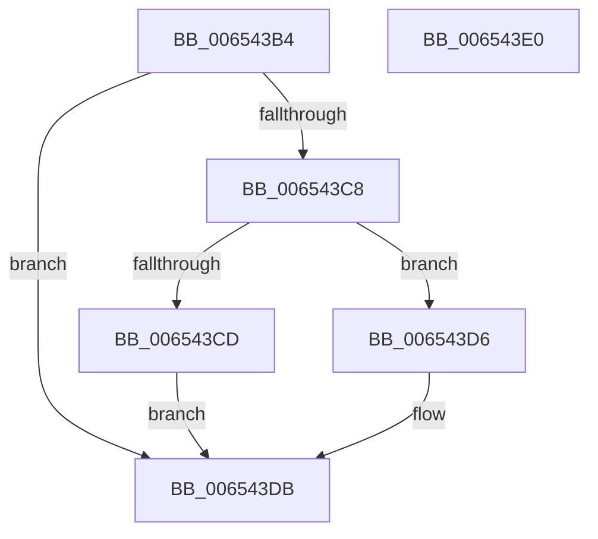

# EtwpCovSampSampleBufferDecRef

- RVA: `0x006543B4`–`0x006543E1` (길이 `45` bytes)
- VA: `0x00000001406543B4`
- 실행 섹션: `.text`
- PDB 이름 있음: `예`; PDB Function 태그: `아니요`
- unwind 정보 RVA: `0x0005C788`
- 디코드: `14`개 명령, `45/45` bytes 표시
- 미해석 바이트: `0` (있으면 어셈블리에 `.byte`로 보존)

> 이 문서는 커널 이미지의 기계어와 PDB 기호를 분석해 생성했습니다. 4번과 5번은 함수 원형과 자료형을 바이너리 사용 방식에서 추정한 C 해석이며 원본 소스 복구 결과는 아닙니다.

## 1. Dependencies

- 직접 호출 지점: **1**; 고유 호출 대상: **1**
- 직접 호출자로 확인된 함수: **4**
- RIP 상대 이미지 참조: **0**

### Outgoing calls
- `0x006543D6` → [EtwpCovSampCaptureQueueBuffer](../46/EtwpCovSampCaptureQueueBuffer_function_004620D0.md) (function, `0x004620D0`)

### Direct callers
- [EtwpCovSampCaptureFlushSampleBuffers](../43/EtwpCovSampCaptureFlushSampleBuffers_function_0043C0B4.md) at `0x0043C170`
- [EtwpCovSampCaptureBufferQueue](../43/EtwpCovSampCaptureBufferQueue_function_0043C234.md) at `0x0043C30B`
- [EtwpCovSampSampleBufferReserve](../43/EtwpCovSampSampleBufferReserve_function_0043C348.md) at `0x0043C484`
- [sub_006EF6EE](../6E/Unknown_function_006EF6EE.md) at `0x006EF700`

### Static image references
- 디코드된 RIP-relative 메모리 참조가 없습니다.

## 2. Other-region calls and transfers

- 다른 실행 섹션으로 향하는 call: **0**
- 별도 외부 분기/꼬리 이동을 확인하지 못했습니다.

## 3. Assembly (complete function range)

```asm
006543B4  48 83 EC 28                     sub rsp, 0x28
006543B8  48 83 C8 FF                     or rax, 0xffffffffffffffff
006543BC  F0 48 0F C1 42 30               lock xadd qword ptr [rdx + 0x30], rax
006543C2  48 83 E8 01                     sub rax, 1
006543C6  7F 13                           jg 0x1406543db
006543C8  48 85 C0                        test rax, rax
006543CB  74 09                           je 0x1406543d6
006543CD  B9 0E 00 00 00                  mov ecx, 0xe
006543D2  CD 29                           int 0x29
006543D4  EB 05                           jmp 0x1406543db
006543D6  E8 F5 DC E0 FF                  call 0x1404620d0
006543DB  48 83 C4 28                     add rsp, 0x28
006543DF  C3                              ret
006543E0  CC                              int3
```

## 4. C-style interpretation (structured pseudocode)

```c
__int64 __fastcall EtwpCovSampSampleBufferDecRef(__int64 a1, __int64 a2)
{
    __int64 result;
    __int64 v_rsp;

    v_rsp = (v_rsp) - (40);
    result = (result) | (-1);
    result = (result) - (1);
    if (condition_is_greater) goto loc_006543DB;
    if (result == 0) goto loc_006543D6;
    goto loc_006543DB;
loc_006543D6:
    result = EtwpCovSampCaptureQueueBuffer(14, a2, a3, a4);
loc_006543DB:
    v_rsp = (v_rsp) + (40);
    return result;
}
```

## 5. (Beta) C Style

```c
int64_t EtwpCovSampSampleBufferDecRef(int64_t Arg1, void *Arg2)
{
    uint8_t *arg2 = (uint8_t *)Arg2;

    int64_t result;
    int64_t local_rsp;

    local_rsp = (local_rsp) - (40);
    result = (result) | (-1);
    result = (result) - (1);
    if (condition_is_greater) goto loc_006543DB;
    if (result == 0) goto loc_006543D6;
    goto loc_006543DB;
loc_006543D6:
    result = EtwpCovSampCaptureQueueBuffer(14, Arg2, a3, a4);
loc_006543DB:
    local_rsp = (local_rsp) + (40);
    return result;
}
```

### 관측된 메모리 오프셋

구조체 형식이 확인되지 않은 접근은 인자 기준의 오프셋으로만 기록했습니다.

| 기준 인자 | 오프셋 표현 | 폭 (bit) | 접근 |
|---|---:|---:|---|
| `Arg2` | `+ 0x30` | `64` | `R/W` |

## 6. Execution-region graph

[열기: 2D/3D 그래프와 함수 탐색 컨트롤 패널](../../../control-panel.html?section=text&rva=0x006543B4&view=graph)

- 2D 그래프는 위에서 아래로 흐르고, 3D 그래프는 빈 공간을 드래그해 회전합니다. Shift+드래그는 이동, 휠은 확대·축소, 함수 노드 선택은 대상 보고서 이동입니다.

### Static fallback


