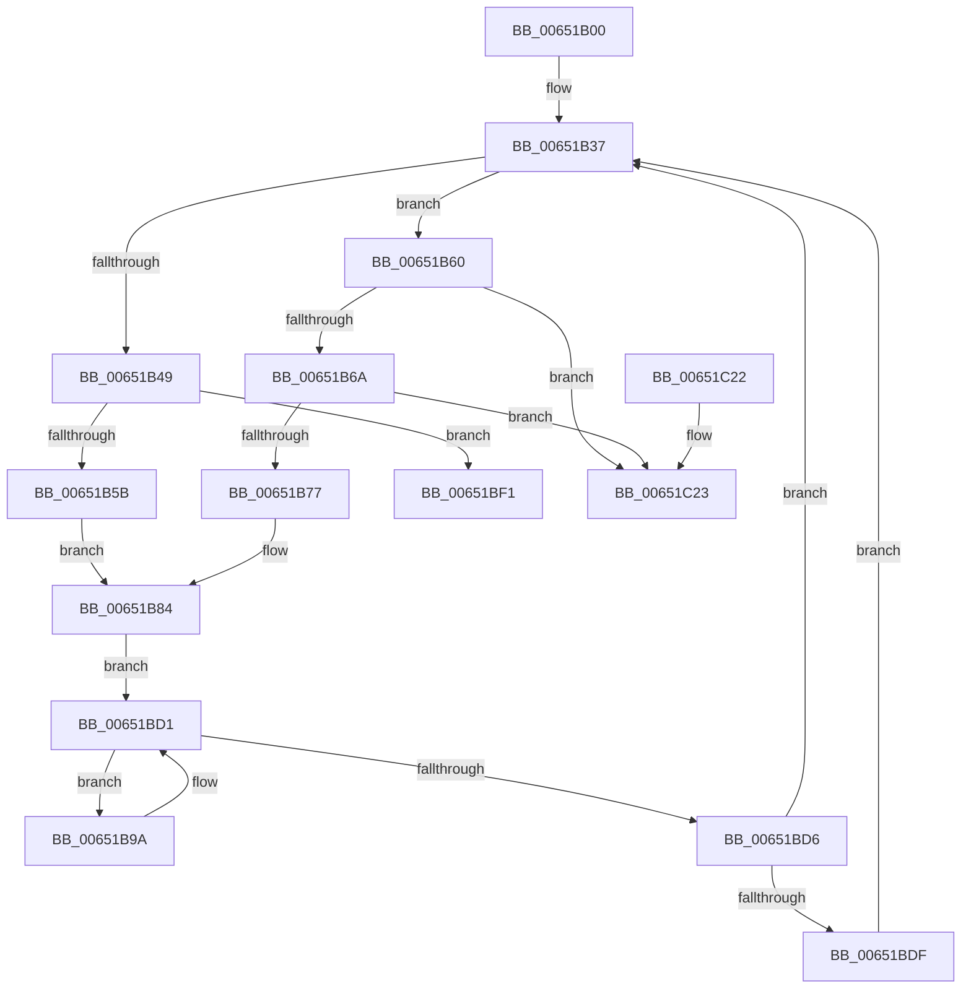

# EtwpCoverageHighIrqlCPWorkItemCallback

- RVA: `0x00651B00`–`0x00651C2A` (길이 `298` bytes)
- VA: `0x0000000140651B00`
- 실행 섹션: `.text`
- PDB 이름 있음: `예`; PDB Function 태그: `아니요`
- unwind 정보 RVA: `0x000D3AA0`
- 디코드: `83`개 명령, `298/298` bytes 표시
- 미해석 바이트: `0` (있으면 어셈블리에 `.byte`로 보존)

> 이 문서는 커널 이미지의 기계어와 PDB 기호를 분석해 생성했습니다. 4번과 5번은 함수 원형과 자료형을 바이너리 사용 방식에서 추정한 C 해석이며 원본 소스 복구 결과는 아닙니다.

## 1. Dependencies

- 직접 호출 지점: **6**; 고유 호출 대상: **5**
- 직접 호출자로 확인된 함수: **0**
- RIP 상대 이미지 참조: **0**

### Outgoing calls
- `0x00651B3A` → [KeAcquireSpinLockRaiseToDpc](../20/KeAcquireSpinLockRaiseToDpc_function_00208470.md) (function, `0x00208470`)
- `0x00651B93` → [KeReleaseSpinLock](../39/KeReleaseSpinLock_function_00392BA0.md) (function, `0x00392BA0`)
- `0x00651BB2` → [TelemetryCoverageStringHashInternal](../4D/TelemetryCoverageStringHashInternal_function_004D51A0.md) (function, `0x004D51A0`)
- `0x00651BC3` → [EtwpCoverageRecord](../../page/98/EtwpCoverageRecord_function_009821BC.md) (function, `0x009821BC`)
- `0x00651BE7` → [ExFreePoolWithTag](../../poolcode/B8/ExFreePoolWithTag_function_00B82870.md) (function, `0x00B82870`)
- `0x00651C04` → [KeReleaseSpinLock](../39/KeReleaseSpinLock_function_00392BA0.md) (function, `0x00392BA0`)

### Direct callers
- 이 함수 시작 RVA로 연결되는 직접 call은 확인되지 않았습니다. 간접 호출은 완전히 역산할 수 없습니다.

### Static image references
- 디코드된 RIP-relative 메모리 참조가 없습니다.

## 2. Other-region calls and transfers

- 다른 실행 섹션으로 향하는 call: **2**
  - `0x00651BC3` → [EtwpCoverageRecord](../../page/98/EtwpCoverageRecord_function_009821BC.md) (`.text` → `PAGE`)
  - `0x00651BE7` → [ExFreePoolWithTag](../../poolcode/B8/ExFreePoolWithTag_function_00B82870.md) (`.text` → `POOLCODE`)
- 별도 외부 분기/꼬리 이동을 확인하지 못했습니다.

## 3. Assembly (complete function range)

```asm
00651B00  48 89 5C 24 10                  mov qword ptr [rsp + 0x10], rbx
00651B05  48 89 6C 24 18                  mov qword ptr [rsp + 0x18], rbp
00651B0A  56                              push rsi
00651B0B  57                              push rdi
00651B0C  41 54                           push r12
00651B0E  41 56                           push r14
00651B10  41 57                           push r15
00651B12  48 83 EC 40                     sub rsp, 0x40
00651B16  48 8B 39                        mov rdi, qword ptr [rcx]
00651B19  33 C0                           xor eax, eax
00651B1B  21 44 24 70                     and dword ptr [rsp + 0x70], eax
00651B1F  0F 57 C0                        xorps xmm0, xmm0
00651B22  48 83 C7 18                     add rdi, 0x18
00651B26  48 89 44 24 30                  mov qword ptr [rsp + 0x30], rax
00651B2B  4C 8B E1                        mov r12, rcx
00651B2E  0F 11 44 24 20                  movups xmmword ptr [rsp + 0x20], xmm0
00651B33  48 8D 77 10                     lea rsi, [rdi + 0x10]
00651B37  48 8B CF                        mov rcx, rdi
00651B3A  E8 31 69 BB FF                  call 0x140208470
00651B3F  48 8B 1E                        mov rbx, qword ptr [rsi]
00651B42  8A D0                           mov dl, al
00651B44  48 3B DE                        cmp rbx, rsi
00651B47  75 17                           jne 0x140651b60
00651B49  48 8B 5F 08                     mov rbx, qword ptr [rdi + 8]
00651B4D  48 8B 4B 18                     mov rcx, qword ptr [rbx + 0x18]
00651B51  48 39 4B 20                     cmp qword ptr [rbx + 0x20], rcx
00651B55  0F 83 96 00 00 00               jae 0x140651bf1
00651B5B  45 33 F6                        xor r14d, r14d
00651B5E  EB 24                           jmp 0x140651b84
00651B60  48 39 73 08                     cmp qword ptr [rbx + 8], rsi
00651B64  0F 85 B9 00 00 00               jne 0x140651c23
00651B6A  48 8B 03                        mov rax, qword ptr [rbx]
00651B6D  48 39 58 08                     cmp qword ptr [rax + 8], rbx
00651B71  0F 85 AC 00 00 00               jne 0x140651c23
00651B77  48 89 06                        mov qword ptr [rsi], rax
00651B7A  41 BE 01 00 00 00               mov r14d, 1
00651B80  48 89 70 08                     mov qword ptr [rax + 8], rsi
00651B84  4C 8B 7B 18                     mov r15, qword ptr [rbx + 0x18]
00651B88  48 8B CF                        mov rcx, rdi
00651B8B  48 8B 6B 20                     mov rbp, qword ptr [rbx + 0x20]
00651B8F  4C 89 7B 20                     mov qword ptr [rbx + 0x20], r15
00651B93  E8 08 10 D4 FF                  call 0x140392ba0
00651B98  EB 37                           jmp 0x140651bd1
00651B9A  48 83 64 24 2C 00               and qword ptr [rsp + 0x2c], 0
00651BA0  48 8D 54 24 70                  lea rdx, [rsp + 0x70]
00651BA5  83 64 24 34 00                  and dword ptr [rsp + 0x34], 0
00651BAA  48 8B CD                        mov rcx, rbp
00651BAD  48 89 6C 24 20                  mov qword ptr [rsp + 0x20], rbp
00651BB2  E8 E9 35 E8 FF                  call 0x1404d51a0
00651BB7  49 8B CC                        mov rcx, r12
00651BBA  89 44 24 28                     mov dword ptr [rsp + 0x28], eax
00651BBE  48 8D 54 24 20                  lea rdx, [rsp + 0x20]
00651BC3  E8 F4 05 33 00                  call 0x1409821bc
00651BC8  8B 54 24 70                     mov edx, dword ptr [rsp + 0x70]
00651BCC  FF C2                           inc edx
00651BCE  48 03 EA                        add rbp, rdx
00651BD1  49 3B EF                        cmp rbp, r15
00651BD4  72 C4                           jb 0x140651b9a
00651BD6  45 85 F6                        test r14d, r14d
00651BD9  0F 84 58 FF FF FF               je 0x140651b37
00651BDF  BA 45 74 77 56                  mov edx, 0x56777445
00651BE4  48 8B CB                        mov rcx, rbx
00651BE7  E8 84 0C 53 00                  call 0x140b82870
00651BEC  E9 46 FF FF FF                  jmp 0x140651b37
00651BF1  48 8D 43 28                     lea rax, [rbx + 0x28]
00651BF5  48 8B CF                        mov rcx, rdi
00651BF8  48 89 43 18                     mov qword ptr [rbx + 0x18], rax
00651BFC  48 89 43 20                     mov qword ptr [rbx + 0x20], rax
00651C00  83 67 48 00                     and dword ptr [rdi + 0x48], 0
00651C04  E8 97 0F D4 FF                  call 0x140392ba0
00651C09  4C 8D 5C 24 40                  lea r11, [rsp + 0x40]
00651C0E  49 8B 5B 38                     mov rbx, qword ptr [r11 + 0x38]
00651C12  49 8B 6B 40                     mov rbp, qword ptr [r11 + 0x40]
00651C16  49 8B E3                        mov rsp, r11
00651C19  41 5F                           pop r15
00651C1B  41 5E                           pop r14
00651C1D  41 5C                           pop r12
00651C1F  5F                              pop rdi
00651C20  5E                              pop rsi
00651C21  C3                              ret
00651C22  CC                              int3
00651C23  B9 03 00 00 00                  mov ecx, 3
00651C28  CD 29                           int 0x29
```

## 4. C-style interpretation (structured pseudocode)

```c
__int64 __fastcall EtwpCoverageHighIrqlCPWorkItemCallback(__int64 a1)
{
    __int64 result;
    __int64 v_r14;
    __int64 v_rbp;
    __int64 v_rdi;
    __int64 v_rsp;
    unsigned __int64 v_stack_m28;
    unsigned int v_stack_m34;
    unsigned __int64 v_stack_m38;
    unsigned __int64 v_stack_m3C;
    unsigned int v_stack_m40;
    unsigned __int64 v_stack_m48;
    unsigned __int64 v_stack_p10;
    unsigned __int64 v_stack_p18;
    unsigned int v_stack_p8;

    v_stack_p10 = v_rbx;
    v_stack_p18 = v_rbp;
    v_rsp = (v_rsp) - (64);
    result = 0;
    v_rdi = (*(unsigned __int64 *)(a1)) + (24);
    v_stack_m38 = 0;
    v_stack_m48 = v_xmm0;
loc_00651B37:
    result = KeAcquireSpinLockRaiseToDpc(v_rdi, a2, a3, a4);
    if ((*(unsigned __int64 *)(v_rdi + 16)) != (v_rdi + 16)) goto loc_00651B60;
    if ((*(unsigned __int64 *)(*(unsigned __int64 *)(v_rdi + 8) + 32)) >= (*(unsigned __int64 *)(*(unsigned __int64 *)(v_rdi + 8) + 24))) goto loc_00651BF1;
    v_r14 = 0;
    goto loc_00651B84;
loc_00651B60:
    if ((*(unsigned __int64 *)(*(unsigned __int64 *)(v_rdi + 8) + 8)) != (v_rdi + 16)) goto loc_00651C23;
    if ((*(unsigned __int64 *)(*(unsigned __int64 *)(*(unsigned __int64 *)(v_rdi + 8)) + 8)) != (*(unsigned __int64 *)(v_rdi + 8))) goto loc_00651C23;
    *(unsigned __int64 *)(v_rdi + 16) = *(unsigned __int64 *)(*(unsigned __int64 *)(v_rdi + 8));
    *(unsigned __int64 *)(*(unsigned __int64 *)(*(unsigned __int64 *)(v_rdi + 8)) + 8) = v_rdi + 16;
loc_00651B84:
    *(unsigned __int64 *)(*(unsigned __int64 *)(v_rdi + 8) + 32) = *(unsigned __int64 *)(*(unsigned __int64 *)(v_rdi + 8) + 24);
    result = KeReleaseSpinLock(v_rdi, (unsigned __int8)(result), a3, a4);
    goto loc_00651BD1;
loc_00651B9A:
    v_stack_m48 = *(unsigned __int64 *)(*(unsigned __int64 *)(v_rdi + 8) + 32);
    result = TelemetryCoverageStringHashInternal(*(unsigned __int64 *)(*(unsigned __int64 *)(v_rdi + 8) + 32), v_stack_p8, a3, a4);
    v_stack_m40 = (unsigned int)(result);
    result = EtwpCoverageRecord(a1, v_stack_m48, a3, a4);
    a2 = (unsigned int)(((unsigned int)(v_stack_p8)) + 1);
    v_rbp = (*(unsigned __int64 *)(*(unsigned __int64 *)(v_rdi + 8) + 32)) + (a2);
loc_00651BD1:
    if (v_rbp < (*(unsigned __int64 *)(*(unsigned __int64 *)(v_rdi + 8) + 24))) goto loc_00651B9A;
    if (1 == 0) goto loc_00651B37;
    result = ExFreePoolWithTag(*(unsigned __int64 *)(v_rdi + 8), (unsigned int)(0x56777445ULL), a3, a4);
    goto loc_00651B37;
loc_00651BF1:
    *(unsigned __int64 *)(*(unsigned __int64 *)(v_rdi + 8) + 24) = *(unsigned __int64 *)(v_rdi + 8) + 40;
    *(unsigned __int64 *)(*(unsigned __int64 *)(v_rdi + 8) + 32) = *(unsigned __int64 *)(v_rdi + 8) + 40;
    result = KeReleaseSpinLock(v_rdi, (unsigned int)(0x56777445ULL), a3, a4);
    return result;
loc_00651C23:
    return result;
}
```

## 5. (Beta) C Style

```c
int64_t EtwpCoverageHighIrqlCPWorkItemCallback(void *Arg1)
{
    uint8_t *arg1 = (uint8_t *)Arg1;

    int64_t result;
    int64_t local_r14;
    int64_t local_rbp;
    int64_t local_rdi;
    int64_t local_rsp;
    uint64_t v_stack_m28;
    uint32_t v_stack_m34;
    uint64_t v_stack_m38;
    uint64_t v_stack_m3C;
    uint32_t v_stack_m40;
    uint64_t v_stack_m48;
    uint64_t v_stack_p10;
    uint64_t v_stack_p18;
    uint32_t v_stack_p8;

    v_stack_p10 = local_rbx;
    v_stack_p18 = local_rbp;
    local_rsp = (local_rsp) - (64);
    result = 0;
    local_rdi = (*(uint64_t *)(arg1)) + (24);
    v_stack_m38 = 0;
    v_stack_m48 = v_xmm0;
loc_00651B37:
    result = KeAcquireSpinLockRaiseToDpc(local_rdi, a2, a3, a4);
    if ((*(uint64_t *)(local_rdi + 0x10)) != (local_rdi + 16)) goto loc_00651B60;
    if ((*(uint64_t *)(*(uint64_t *)(local_rdi + 0x8) + 0x20)) >= (*(uint64_t *)(*(uint64_t *)(local_rdi + 0x8) + 0x18))) goto loc_00651BF1;
    local_r14 = 0;
    goto loc_00651B84;
loc_00651B60:
    if ((*(uint64_t *)(*(uint64_t *)(local_rdi + 0x8) + 0x8)) != (local_rdi + 16)) goto loc_00651C23;
    if ((*(uint64_t *)(*(uint64_t *)(*(uint64_t *)(local_rdi + 0x8)) + 0x8)) != (*(uint64_t *)(local_rdi + 0x8))) goto loc_00651C23;
    *(uint64_t *)(local_rdi + 0x10) = *(uint64_t *)(*(uint64_t *)(local_rdi + 0x8));
    *(uint64_t *)(*(uint64_t *)(*(uint64_t *)(local_rdi + 0x8)) + 0x8) = local_rdi + 16;
loc_00651B84:
    *(uint64_t *)(*(uint64_t *)(local_rdi + 0x8) + 0x20) = *(uint64_t *)(*(uint64_t *)(local_rdi + 0x8) + 0x18);
    result = KeReleaseSpinLock(local_rdi, (uint8_t)(result), a3, a4);
    goto loc_00651BD1;
loc_00651B9A:
    v_stack_m48 = *(uint64_t *)(*(uint64_t *)(local_rdi + 0x8) + 0x20);
    result = TelemetryCoverageStringHashInternal(*(uint64_t *)(*(uint64_t *)(local_rdi + 0x8) + 0x20), v_stack_p8, a3, a4);
    v_stack_m40 = (uint32_t)(result);
    result = EtwpCoverageRecord(Arg1, v_stack_m48, a3, a4);
    a2 = (uint32_t)(((uint32_t)(v_stack_p8)) + 1);
    local_rbp = (*(uint64_t *)(*(uint64_t *)(local_rdi + 0x8) + 0x20)) + (a2);
loc_00651BD1:
    if (local_rbp < (*(uint64_t *)(*(uint64_t *)(local_rdi + 0x8) + 0x18))) goto loc_00651B9A;
    if (1 == 0) goto loc_00651B37;
    result = ExFreePoolWithTag(*(uint64_t *)(local_rdi + 0x8), (uint32_t)(0x56777445ULL), a3, a4);
    goto loc_00651B37;
loc_00651BF1:
    *(uint64_t *)(*(uint64_t *)(local_rdi + 0x8) + 0x18) = *(uint64_t *)(local_rdi + 0x8) + 40;
    *(uint64_t *)(*(uint64_t *)(local_rdi + 0x8) + 0x20) = *(uint64_t *)(local_rdi + 0x8) + 40;
    result = KeReleaseSpinLock(local_rdi, (uint32_t)(0x56777445ULL), a3, a4);
    return result;
loc_00651C23:
    return result;
}
```

### 관측된 메모리 오프셋

구조체 형식이 확인되지 않은 접근은 인자 기준의 오프셋으로만 기록했습니다.

| 기준 인자 | 오프셋 표현 | 폭 (bit) | 접근 |
|---|---:|---:|---|
| `Arg1` | `+ 0x0` | `64` | `R` |

## 6. Execution-region graph

[열기: 2D/3D 그래프와 함수 탐색 컨트롤 패널](../../../control-panel.html?section=text&rva=0x00651B00&view=graph)

- 2D 그래프는 위에서 아래로 흐르고, 3D 그래프는 빈 공간을 드래그해 회전합니다. Shift+드래그는 이동, 휠은 확대·축소, 함수 노드 선택은 대상 보고서 이동입니다.

### Static fallback


