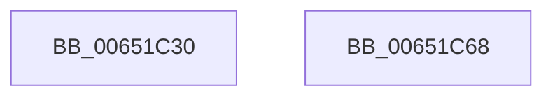

# EtwpCoverageInitializeStringBuffer

- RVA: `0x00651C30`–`0x00651C69` (길이 `57` bytes)
- VA: `0x0000000140651C30`
- 실행 섹션: `.text`
- PDB 이름 있음: `예`; PDB Function 태그: `아니요`
- unwind 정보 RVA: `0x0005CAAC`
- 디코드: `18`개 명령, `57/57` bytes 표시
- 미해석 바이트: `0` (있으면 어셈블리에 `.byte`로 보존)

> 이 문서는 커널 이미지의 기계어와 PDB 기호를 분석해 생성했습니다. 4번과 5번은 함수 원형과 자료형을 바이너리 사용 방식에서 추정한 C 해석이며 원본 소스 복구 결과는 아닙니다.

## 1. Dependencies

- 직접 호출 지점: **1**; 고유 호출 대상: **1**
- 직접 호출자로 확인된 함수: **1**
- RIP 상대 이미지 참조: **0**

### Outgoing calls
- `0x00651C44` → [memset](../6C/memset_function_006C6C40.md) (function, `0x006C6C40`)

### Direct callers
- [EtwpCoverageEnsureStringBuffer](../../page/7B/EtwpCoverageEnsureStringBuffer_function_007B9CDC.md) at `0x007B9D4B`

### Static image references
- 디코드된 RIP-relative 메모리 참조가 없습니다.

## 2. Other-region calls and transfers

- 다른 실행 섹션으로 향하는 call: **0**
- 별도 외부 분기/꼬리 이동을 확인하지 못했습니다.

## 3. Assembly (complete function range)

```asm
00651C30  48 89 5C 24 08                  mov qword ptr [rsp + 8], rbx
00651C35  57                              push rdi
00651C36  48 83 EC 20                     sub rsp, 0x20
00651C3A  8B DA                           mov ebx, edx
00651C3C  48 8B F9                        mov rdi, rcx
00651C3F  44 8B C2                        mov r8d, edx
00651C42  33 D2                           xor edx, edx
00651C44  E8 F7 4F 07 00                  call 0x1406c6c40
00651C49  48 8D 04 3B                     lea rax, [rbx + rdi]
00651C4D  48 8B 5C 24 30                  mov rbx, qword ptr [rsp + 0x30]
00651C52  48 89 47 10                     mov qword ptr [rdi + 0x10], rax
00651C56  48 8D 47 28                     lea rax, [rdi + 0x28]
00651C5A  48 89 47 18                     mov qword ptr [rdi + 0x18], rax
00651C5E  48 89 47 20                     mov qword ptr [rdi + 0x20], rax
00651C62  48 83 C4 20                     add rsp, 0x20
00651C66  5F                              pop rdi
00651C67  C3                              ret
00651C68  CC                              int3
```

## 4. C-style interpretation (structured pseudocode)

```c
__int64 __fastcall EtwpCoverageInitializeStringBuffer(__int64 a1, int a2)
{
    __int64 result;
    __int64 v_rsp;
    unsigned __int64 v_stack_p8;

    v_stack_p8 = v_rbx;
    v_rsp = (v_rsp) - (32);
    a2 = 0;
    result = memset(a1, a2, (unsigned int)(a2), a4);
    *(unsigned __int64 *)(a1 + 16) = (unsigned int)(a2) + a1 * 1;
    *(unsigned __int64 *)(a1 + 24) = a1 + 40;
    *(unsigned __int64 *)(a1 + 32) = a1 + 40;
    v_rsp = (v_rsp) + (32);
    return a1 + 40;
}
```

## 5. (Beta) C Style

```c
void *EtwpCoverageInitializeStringBuffer(void *Arg1, void *Arg2)
{
    uint8_t *arg1 = (uint8_t *)Arg1;
    uint8_t *arg2 = (uint8_t *)Arg2;

    int64_t result;
    int64_t local_rsp;
    uint64_t v_stack_p8;

    v_stack_p8 = local_rbx;
    local_rsp = (local_rsp) - (32);
    Arg2 = 0;
    result = memset(Arg1, Arg2, (uint32_t)(Arg2), a4);
    *(uint64_t *)(arg1 + 0x10) = (uint32_t)(Arg2) + Arg1 * 1;
    *(void **)(arg1 + 0x18) = Arg1 + 40;
    *(void **)(arg1 + 0x20) = Arg1 + 40;
    local_rsp = (local_rsp) + (32);
    return Arg1 + 40;
}
```

### 관측된 메모리 오프셋

구조체 형식이 확인되지 않은 접근은 인자 기준의 오프셋으로만 기록했습니다.

| 기준 인자 | 오프셋 표현 | 폭 (bit) | 접근 |
|---|---:|---:|---|
| `Arg1` | `+ 0x10` | `64` | `W` |
| `Arg1` | `+ 0x18` | `64` | `W` |
| `Arg1` | `+ 0x20` | `64` | `W` |
| `Arg1` | `+ 0x28` | `64` | `R` |
| `Arg2` | `+ 0x0 + rdi*1` | `64` | `R` |

## 6. Execution-region graph

[열기: 2D/3D 그래프와 함수 탐색 컨트롤 패널](../../../control-panel.html?section=text&rva=0x00651C30&view=graph)

- 2D 그래프는 위에서 아래로 흐르고, 3D 그래프는 빈 공간을 드래그해 회전합니다. Shift+드래그는 이동, 휠은 확대·축소, 함수 노드 선택은 대상 보고서 이동입니다.

### Static fallback


