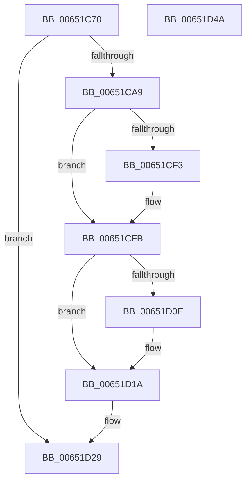

# EtwpCoverageRecordAtHighIrql

- RVA: `0x00651C70`–`0x00651D4B` (길이 `219` bytes)
- VA: `0x0000000140651C70`
- 실행 섹션: `.text`
- PDB 이름 있음: `예`; PDB Function 태그: `아니요`
- unwind 정보 RVA: `0x000D3A84`
- 디코드: `49`개 명령, `219/219` bytes 표시
- 미해석 바이트: `0` (있으면 어셈블리에 `.byte`로 보존)

> 이 문서는 커널 이미지의 기계어와 PDB 기호를 분석해 생성했습니다. 4번과 5번은 함수 원형과 자료형을 바이너리 사용 방식에서 추정한 C 해석이며 원본 소스 복구 결과는 아닙니다.

## 1. Dependencies

- 직접 호출 지점: **6**; 고유 호출 대상: **6**
- 직접 호출자로 확인된 함수: **1**
- RIP 상대 이미지 참조: **2**

### Outgoing calls
- `0x00651C9C` → [EtwpCoverageValidateCP](../46/EtwpCoverageValidateCP_function_0046068C.md) (function, `0x0046068C`)
- `0x00651CC9` → [RtlStringCchCopyA](../46/RtlStringCchCopyA_function_00460628.md) (function, `0x00460628`)
- `0x00651CF6` → [KiRaiseIrqlProcessIrqlFlags](../4F/KiRaiseIrqlProcessIrqlFlags_function_004F56FC.md) (function, `0x004F56FC`)
- `0x00651D00` → [EtwTelemetryCoverageReport](../46/EtwTelemetryCoverageReport_function_00460430.md) (function, `0x00460430`)
- `0x00651D15` → [KiLowerIrqlProcessIrqlFlags](../4F/KiLowerIrqlProcessIrqlFlags_function_004F5698.md) (function, `0x004F5698`)
- `0x00651D34` → [_security_check_cookie](../6A/_security_check_cookie_function_006AC640.md) (function, `0x006AC640`)

### Direct callers
- [sub_00B2A52C](../../page/B2/Unknown_function_00B2A52C.md) at `0x00B2A58E`

### Static image references
- `0x00651C7D` → RVA `0x00E0A740` (`.data`; read)
- `0x00651CEA` → RVA `0x00FC6D20` (`ALMOSTRO`; read)

## 2. Other-region calls and transfers

- 다른 실행 섹션으로 향하는 call: **0**
- 별도 외부 분기/꼬리 이동을 확인하지 못했습니다.

## 3. Assembly (complete function range)

```asm
00651C70  48 89 5C 24 10                  mov qword ptr [rsp + 0x10], rbx
00651C75  57                              push rdi
00651C76  48 81 EC 90 00 00 00            sub rsp, 0x90
00651C7D  48 8B 05 BC 8A 7B 00            mov rax, qword ptr [rip + 0x7b8abc]
00651C84  48 33 C4                        xor rax, rsp
00651C87  48 89 84 24 80 00 00 00         mov qword ptr [rsp + 0x80], rax
00651C8F  83 64 24 20 00                  and dword ptr [rsp + 0x20], 0
00651C94  48 8D 54 24 20                  lea rdx, [rsp + 0x20]
00651C99  48 8B D9                        mov rbx, rcx
00651C9C  E8 EB E9 E0 FF                  call 0x14046068c
00651CA1  85 C0                           test eax, eax
00651CA3  0F 84 80 00 00 00               je 0x140651d29
00651CA9  0F 10 03                        movups xmm0, xmmword ptr [rbx]
00651CAC  48 8D 4C 24 40                  lea rcx, [rsp + 0x40]
00651CB1  4C 8B 03                        mov r8, qword ptr [rbx]
00651CB4  F2 0F 10 4B 10                  movsd xmm1, qword ptr [rbx + 0x10]
00651CB9  BA 40 00 00 00                  mov edx, 0x40
00651CBE  0F 11 44 24 28                  movups xmmword ptr [rsp + 0x28], xmm0
00651CC3  F2 0F 11 4C 24 38               movsd qword ptr [rsp + 0x38], xmm1
00651CC9  E8 5A E9 E0 FF                  call 0x140460628
00651CCE  83 64 24 34 00                  and dword ptr [rsp + 0x34], 0
00651CD3  4C 8D 54 24 40                  lea r10, [rsp + 0x40]
00651CD8  4C 89 54 24 28                  mov qword ptr [rsp + 0x28], r10
00651CDD  44 0F 20 C7                     mov rdi, cr8
00651CE1  BA 02 00 00 00                  mov edx, 2
00651CE6  44 0F 22 C2                     mov cr8, rdx
00651CEA  83 3D 2F 50 97 00 00            cmp dword ptr [rip + 0x97502f], 0
00651CF1  74 08                           je 0x140651cfb
00651CF3  40 8A CF                        mov cl, dil
00651CF6  E8 01 3A EA FF                  call 0x1404f56fc
00651CFB  48 8D 4C 24 28                  lea rcx, [rsp + 0x28]
00651D00  E8 2B E7 E0 FF                  call 0x140460430
00651D05  83 3D 14 50 97 00 00            cmp dword ptr [rip + 0x975014], 0
00651D0C  74 0C                           je 0x140651d1a
00651D0E  44 0F 20 C1                     mov rcx, cr8
00651D12  40 8A D7                        mov dl, dil
00651D15  E8 7E 39 EA FF                  call 0x1404f5698
00651D1A  40 0F B6 C7                     movzx eax, dil
00651D1E  44 0F 22 C0                     mov cr8, rax
00651D22  8B 44 24 34                     mov eax, dword ptr [rsp + 0x34]
00651D26  89 43 0C                        mov dword ptr [rbx + 0xc], eax
00651D29  48 8B 8C 24 80 00 00 00         mov rcx, qword ptr [rsp + 0x80]
00651D31  48 33 CC                        xor rcx, rsp
00651D34  E8 07 A9 05 00                  call 0x1406ac640
00651D39  48 8B 9C 24 A8 00 00 00         mov rbx, qword ptr [rsp + 0xa8]
00651D41  48 81 C4 90 00 00 00            add rsp, 0x90
00651D48  5F                              pop rdi
00651D49  C3                              ret
00651D4A  CC                              int3
```

## 4. C-style interpretation (structured pseudocode)

```c
__int64 __fastcall EtwpCoverageRecordAtHighIrql(__int64 a1)
{
    __int64 result;
    __int64 v_rsp;
    unsigned __int64 v_stack_m18;
    unsigned __int64 v_stack_m58;
    unsigned __int64 v_stack_m60;
    unsigned int v_stack_m64;
    unsigned __int64 v_stack_m70;
    unsigned int v_stack_m78;
    unsigned __int64 v_stack_p10;

    v_stack_p10 = v_rbx;
    v_rsp = (v_rsp) - (144);
    result = (*(unsigned __int64 *)(v_rip + 8096444)) ^ (v_rsp);
    v_stack_m18 = result;
    result = EtwpCoverageValidateCP(a1, v_stack_m78, a3, a4);
    if ((unsigned int)(result) == 0) goto loc_00651D29;
    v_stack_m70 = v_xmm0;
    v_stack_m60 = v_xmm1;
    result = RtlStringCchCopyA(v_stack_m58, 64, *(unsigned __int64 *)(a1), a4);
    v_stack_m70 = v_stack_m58;
    if ((*(unsigned int *)(v_rip + 9916463)) != 0) {
        a1 = (unsigned __int8)(v_cr8);
        result = KiRaiseIrqlProcessIrqlFlags(a1, 2, *(unsigned __int64 *)(a1), a4);
    }
    result = EtwTelemetryCoverageReport(v_stack_m70, 2, *(unsigned __int64 *)(a1), a4);
    if ((*(unsigned int *)(v_rip + 9916436)) != 0) {
        a1 = 2;
        a2 = (unsigned __int8)(v_cr8);
        result = KiLowerIrqlProcessIrqlFlags(a1, a2, *(unsigned __int64 *)(a1), a4);
    }
    *(unsigned int *)(a1 + 12) = (unsigned int)((unsigned int)(v_stack_m64));
loc_00651D29:
    a1 = (v_stack_m18) ^ (v_rsp);
    result = _security_check_cookie(a1, a2, *(unsigned __int64 *)(a1), a4);
    v_rsp = (v_rsp) + (144);
    return result;
}
```

## 5. (Beta) C Style

```c
int64_t EtwpCoverageRecordAtHighIrql(void *Arg1)
{
    uint8_t *arg1 = (uint8_t *)Arg1;

    int64_t result;
    int64_t local_rsp;
    uint64_t v_stack_m18;
    uint64_t v_stack_m58;
    uint64_t v_stack_m60;
    uint32_t v_stack_m64;
    uint64_t v_stack_m70;
    uint32_t v_stack_m78;
    uint64_t v_stack_p10;

    v_stack_p10 = local_rbx;
    local_rsp = (local_rsp) - (144);
    result = (*(uint64_t *)(v_rip + 0x7B8ABC)) ^ (local_rsp);
    v_stack_m18 = result;
    result = EtwpCoverageValidateCP(Arg1, v_stack_m78, a3, a4);
    if ((uint32_t)(result) == 0) goto loc_00651D29;
    v_stack_m70 = v_xmm0;
    v_stack_m60 = v_xmm1;
    result = RtlStringCchCopyA(v_stack_m58, 64, *(uint64_t *)(arg1), a4);
    v_stack_m70 = v_stack_m58;
    if ((*(uint32_t *)(v_rip + 0x97502F)) != 0) {
        Arg1 = (uint8_t)(v_cr8);
        result = KiRaiseIrqlProcessIrqlFlags(Arg1, 2, *(uint64_t *)(arg1), a4);
    }
    result = EtwTelemetryCoverageReport(v_stack_m70, 2, *(uint64_t *)(arg1), a4);
    if ((*(uint32_t *)(v_rip + 0x975014)) != 0) {
        Arg1 = 2;
        a2 = (uint8_t)(v_cr8);
        result = KiLowerIrqlProcessIrqlFlags(Arg1, a2, *(uint64_t *)(arg1), a4);
    }
    *(uint32_t *)(arg1 + 0xC) = (uint32_t)((uint32_t)(v_stack_m64));
loc_00651D29:
    Arg1 = (v_stack_m18) ^ (local_rsp);
    result = _security_check_cookie(Arg1, a2, *(uint64_t *)(arg1), a4);
    local_rsp = (local_rsp) + (144);
    return result;
}
```

### 관측된 메모리 오프셋

구조체 형식이 확인되지 않은 접근은 인자 기준의 오프셋으로만 기록했습니다.

| 기준 인자 | 오프셋 표현 | 폭 (bit) | 접근 |
|---|---:|---:|---|
| `Arg1` | `+ 0x0` | `64` | `R` |
| `Arg1` | `+ 0x0` | `128` | `R` |
| `Arg1` | `+ 0xC` | `32` | `W` |
| `Arg1` | `+ 0x10` | `64` | `R` |

## 6. Execution-region graph

[열기: 2D/3D 그래프와 함수 탐색 컨트롤 패널](../../../control-panel.html?section=text&rva=0x00651C70&view=graph)

- 2D 그래프는 위에서 아래로 흐르고, 3D 그래프는 빈 공간을 드래그해 회전합니다. Shift+드래그는 이동, 휠은 확대·축소, 함수 노드 선택은 대상 보고서 이동입니다.

### Static fallback


