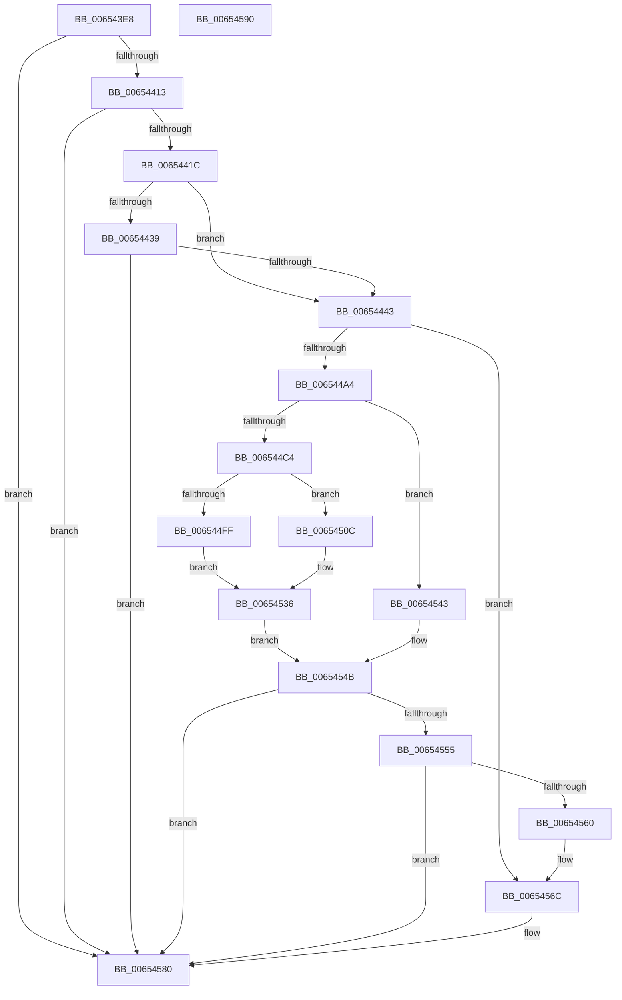

# EtwpCoverageSamplerReadyThread

- RVA: `0x006543E8`–`0x00654591` (길이 `425` bytes)
- VA: `0x00000001406543E8`
- 실행 섹션: `.text`
- PDB 이름 있음: `예`; PDB Function 태그: `아니요`
- unwind 정보 RVA: `0x0008E1D0`
- 디코드: `108`개 명령, `425/425` bytes 표시
- 미해석 바이트: `0` (있으면 어셈블리에 `.byte`로 보존)

> 이 문서는 커널 이미지의 기계어와 PDB 기호를 분석해 생성했습니다. 4번과 5번은 함수 원형과 자료형을 바이너리 사용 방식에서 추정한 C 해석이며 원본 소스 복구 결과는 아닙니다.

## 1. Dependencies

- 직접 호출 지점: **1**; 고유 호출 대상: **1**
- 직접 호출자로 확인된 함수: **1**
- RIP 상대 이미지 참조: **1**

### Outgoing calls
- `0x0065457B` → [EtwpCovSampCaptureSample](EtwpCovSampCaptureSample_function_00653F24.md) (function, `0x00653F24`)

### Direct callers
- [EtwTraceReadyThread](../25/EtwTraceReadyThread_function_00251F70.md) at `0x0025210A`

### Static image references
- `0x00654400` → RVA `0x00EFF1E8` (`.data`; read)

## 2. Other-region calls and transfers

- 다른 실행 섹션으로 향하는 call: **0**
- 별도 외부 분기/꼬리 이동을 확인하지 못했습니다.

## 3. Assembly (complete function range)

```asm
006543E8  48 89 5C 24 08                  mov qword ptr [rsp + 8], rbx
006543ED  48 89 74 24 18                  mov qword ptr [rsp + 0x18], rsi
006543F2  57                              push rdi
006543F3  48 83 EC 20                     sub rsp, 0x20
006543F7  65 48 8B 04 25 88 01 00 00      mov rax, qword ptr gs:[0x188]
00654400  4C 8B 05 E1 AD 8A 00            mov r8, qword ptr [rip + 0x8aade1]
00654407  49 8B 10                        mov rdx, qword ptr [r8]
0065440A  48 3B D0                        cmp rdx, rax
0065440D  0F 84 6D 01 00 00               je 0x140654580
00654413  48 3B D1                        cmp rdx, rcx
00654416  0F 84 64 01 00 00               je 0x140654580
0065441C  65 48 8B 0C 25 20 00 00 00      mov rcx, qword ptr gs:[0x20]
00654425  BE 01 00 00 00                  mov esi, 1
0065442A  65 48 8B 04 25 88 01 00 00      mov rax, qword ptr gs:[0x188]
00654433  48 3B 41 18                     cmp rax, qword ptr [rcx + 0x18]
00654437  75 0A                           jne 0x140654443
00654439  40 38 71 20                     cmp byte ptr [rcx + 0x20], sil
0065443D  0F 86 3D 01 00 00               jbe 0x140654580
00654443  49 8B 40 08                     mov rax, qword ptr [r8 + 8]
00654447  8B D6                           mov edx, esi
00654449  65 4C 8B 04 25 20 00 00 00      mov r8, qword ptr gs:[0x20]
00654452  44 8B C8                        mov r9d, eax
00654455  C1 E8 0D                        shr eax, 0xd
00654458  25 FF FF 03 00                  and eax, 0x3ffff
0065445D  49 C1 E9 04                     shr r9, 4
00654461  0F BD C8                        bsr ecx, eax
00654464  41 81 E1 FF 01 00 00            and r9d, 0x1ff
0065446B  D3 E2                           shl edx, cl
0065446D  83 C1 FE                        add ecx, -2
00654470  33 D0                           xor edx, eax
00654472  89 4C 24 38                     mov dword ptr [rsp + 0x38], ecx
00654476  49 8B 80 B0 8B 00 00            mov rax, qword ptr [r8 + 0x8bb0]
0065447D  4E 8D 1C CD 0F 00 00 00         lea r11, [r9*8 + 0xf]
00654485  48 8B 04 C8                     mov rax, qword ptr [rax + rcx*8]
00654489  4C 03 5C D0 08                  add r11, qword ptr [rax + rdx*8 + 8]
0065448E  49 83 E3 F0                     and r11, 0xfffffffffffffff0
00654492  4D 8D 83 E0 00 00 00            lea r8, [r11 + 0xe0]
00654499  41 8B 38                        mov edi, dword ptr [r8]
0065449C  85 FF                           test edi, edi
0065449E  0F 84 C8 00 00 00               je 0x14065456c
006544A4  45 8B 48 14                     mov r9d, dword ptr [r8 + 0x14]
006544A8  48 BB 20 03 00 00 80 F7 FF FF   movabs rbx, 0xfffff78000000320
006544B2  8B 1B                           mov ebx, dword ptr [rbx]
006544B4  8B C3                           mov eax, ebx
006544B6  41 8B 50 04                     mov edx, dword ptr [r8 + 4]
006544BA  2B C2                           sub eax, edx
006544BC  41 8B 48 08                     mov ecx, dword ptr [r8 + 8]
006544C0  3B C1                           cmp eax, ecx
006544C2  76 7F                           jbe 0x140654543
006544C4  41 89 58 04                     mov dword ptr [r8 + 4], ebx
006544C8  44 03 CF                        add r9d, edi
006544CB  41 8B 40 0C                     mov eax, dword ptr [r8 + 0xc]
006544CF  44 3B C8                        cmp r9d, eax
006544D2  41 0F 4E C1                     cmovle eax, r9d
006544D6  41 89 40 14                     mov dword ptr [r8 + 0x14], eax
006544DA  44 8B C8                        mov r9d, eax
006544DD  41 8B 48 1C                     mov ecx, dword ptr [r8 + 0x1c]
006544E1  8D 04 3F                        lea eax, [rdi + rdi]
006544E4  45 8B 50 10                     mov r10d, dword ptr [r8 + 0x10]
006544E8  44 03 D1                        add r10d, ecx
006544EB  41 D1 EA                        shr r10d, 1
006544EE  45 89 50 1C                     mov dword ptr [r8 + 0x1c], r10d
006544F2  41 C7 40 10 00 00 00 00         mov dword ptr [r8 + 0x10], 0
006544FA  44 3B D0                        cmp r10d, eax
006544FD  73 0D                           jae 0x14065450c
006544FF  41 89 70 20                     mov dword ptr [r8 + 0x20], esi
00654503  44 8B D6                        mov r10d, esi
00654506  41 89 70 18                     mov dword ptr [r8 + 0x18], esi
0065450A  EB 2A                           jmp 0x140654536
0065450C  33 D2                           xor edx, edx
0065450E  8D 4F 01                        lea ecx, [rdi + 1]
00654511  41 8B C2                        mov eax, r10d
00654514  F7 F1                           div ecx
00654516  41 89 40 20                     mov dword ptr [r8 + 0x20], eax
0065451A  44 8B D0                        mov r10d, eax
0065451D  41 8B 48 24                     mov ecx, dword ptr [r8 + 0x24]
00654521  33 CB                           xor ecx, ebx
00654523  69 D1 93 01 00 01               imul edx, ecx, 0x1000193
00654529  8D 0C 00                        lea ecx, [rax + rax]
0065452C  23 CA                           and ecx, edx
0065452E  41 89 50 24                     mov dword ptr [r8 + 0x24], edx
00654532  41 89 48 18                     mov dword ptr [r8 + 0x18], ecx
00654536  B8 18 00 00 00                  mov eax, 0x18
0065453B  49 8B C8                        mov rcx, r8
0065453E  48 03 C8                        add rcx, rax
00654541  EB 08                           jmp 0x14065454b
00654543  45 8B 50 20                     mov r10d, dword ptr [r8 + 0x20]
00654547  49 8D 48 18                     lea rcx, [r8 + 0x18]
0065454B  F0 41 01 70 10                  lock add dword ptr [r8 + 0x10], esi
00654550  45 85 C9                        test r9d, r9d
00654553  7E 2B                           jle 0x140654580
00654555  83 C8 FF                        or eax, 0xffffffff
00654558  F0 0F C1 01                     lock xadd dword ptr [rcx], eax
0065455C  2B C6                           sub eax, esi
0065455E  7F 20                           jg 0x140654580
00654560  41 8D 41 FF                     lea eax, [r9 - 1]
00654564  41 89 40 14                     mov dword ptr [r8 + 0x14], eax
00654568  45 89 50 18                     mov dword ptr [r8 + 0x18], r10d
0065456C  F0 41 01 B3 48 01 00 00         lock add dword ptr [r11 + 0x148], esi
00654574  BA 08 00 00 30                  mov edx, 0x30000008
00654579  33 C9                           xor ecx, ecx
0065457B  E8 A4 F9 FF FF                  call 0x140653f24
00654580  48 8B 5C 24 30                  mov rbx, qword ptr [rsp + 0x30]
00654585  48 8B 74 24 40                  mov rsi, qword ptr [rsp + 0x40]
0065458A  48 83 C4 20                     add rsp, 0x20
0065458E  5F                              pop rdi
0065458F  C3                              ret
00654590  CC                              int3
```

## 4. C-style interpretation (structured pseudocode)

```c
__int64 __fastcall EtwpCoverageSamplerReadyThread(__int64 a1)
{
    __int64 result;
    __int64 v_r10;
    __int64 v_r11;
    __int64 v_rsp;
    unsigned int v_stack_p10;
    unsigned __int64 v_stack_p18;
    unsigned __int64 v_stack_p8;

    v_stack_p8 = v_rbx;
    v_stack_p18 = v_rsi;
    v_rsp = (v_rsp) - (32);
    if ((*(unsigned __int64 *)(*(unsigned __int64 *)(v_rip + 9088481))) == (*(unsigned __int64 *)(gs_base + (0 + 392)))) goto loc_00654580;
    if ((*(unsigned __int64 *)(*(unsigned __int64 *)(v_rip + 9088481))) == a1) goto loc_00654580;
    if ((*(unsigned __int64 *)(gs_base + (0 + 392))) != (*(unsigned __int64 *)(*(unsigned __int64 *)(gs_base + (0 + 32)) + 24))) goto loc_00654443;
    if ((*(unsigned __int8 *)(*(unsigned __int64 *)(gs_base + (0 + 32)) + 32)) <= 1) goto loc_00654580;
loc_00654443:
    result = (unsigned int)((*(unsigned __int64 *)(*(unsigned __int64 *)(v_rip + 9088481) + 8)) >> (13));
    result = (unsigned int)((result) & (0x3FFFFULL));
    a4 = ((unsigned int)((unsigned int)(*(unsigned __int64 *)(*(unsigned __int64 *)(v_rip + 9088481) + 8)))) >> (4);
    a4 = (unsigned int)((a4) & (511));
    a2 = (unsigned int)((1) << ((unsigned __int8)(*(unsigned __int64 *)(gs_base + (0 + 32)))));
    a1 = (unsigned int)((*(unsigned __int64 *)(gs_base + (0 + 32))) + (-2));
    a2 = (unsigned int)((a2) ^ ((unsigned int)(result)));
    v_stack_p10 = (unsigned int)(a1);
    v_r11 = (a4 * 8 + 15) + (*(unsigned __int64 *)(*(unsigned __int64 *)(*(unsigned __int64 *)(*(unsigned __int64 *)(gs_base + (0 + 32)) + 35760) + a1 * 8) + a2 * 8 + 8));
    v_r11 = (v_r11) & (-16);
    if ((unsigned int)((unsigned int)(*(unsigned int *)(v_r11 + 224))) == 0) goto loc_0065456C;
    result = (unsigned int)(((unsigned int)((unsigned int)((unsigned int)(*(unsigned int *)(v_rbx))))) - ((unsigned int)((unsigned int)(*(unsigned int *)(v_r11 + 224 + 4)))));
    if (((unsigned int)(result)) <= ((unsigned int)((unsigned int)(*(unsigned int *)(v_r11 + 224 + 8))))) goto loc_00654543;
    *(unsigned int *)(v_r11 + 224 + 4) = (unsigned int)((unsigned int)(*(unsigned int *)(v_rbx)));
    a4 = (unsigned int)(((unsigned int)(*(unsigned int *)(v_r11 + 224 + 20))) + ((unsigned int)((unsigned int)(*(unsigned int *)(v_r11 + 224)))));
    result = (unsigned int)(*(unsigned int *)(v_r11 + 224 + 12));
    if (((unsigned int)(a4)) <= ((unsigned int)((unsigned int)(*(unsigned int *)(v_r11 + 224 + 12))))) { result = (unsigned int)(a4); }
    *(unsigned int *)(v_r11 + 224 + 20) = (unsigned int)(result);
    v_r10 = (unsigned int)(((unsigned int)(*(unsigned int *)(v_r11 + 224 + 16))) + ((unsigned int)((unsigned int)(*(unsigned int *)(v_r11 + 224 + 28)))));
    v_r10 = (unsigned int)((v_r10) >> (1));
    *(unsigned int *)(v_r11 + 224 + 28) = (unsigned int)(v_r10);
    *(unsigned int *)(v_r11 + 224 + 16) = 0;
    if (((unsigned int)(v_r10)) >= ((unsigned int)((unsigned int)(*(unsigned int *)(v_r11 + 224)) + (unsigned int)(*(unsigned int *)(v_r11 + 224)) * 1))) goto loc_0065450C;
    *(unsigned int *)(v_r11 + 224 + 32) = 1;
    *(unsigned int *)(v_r11 + 224 + 24) = 1;
    goto loc_00654536;
loc_0065450C:
    a2 = 0;
    *(unsigned int *)(v_r11 + 224 + 32) = 1;
    a1 = (unsigned int)(((unsigned int)(*(unsigned int *)(v_r11 + 224 + 36))) ^ ((unsigned int)((unsigned int)(*(unsigned int *)(v_rbx)))));
    a2 = (unsigned int)((a2) * ((unsigned int)(a1)));
    a1 = (unsigned int)((1 + 1 * 1) & ((unsigned int)(a2)));
    *(unsigned int *)(v_r11 + 224 + 36) = (unsigned int)(a2);
    *(unsigned int *)(v_r11 + 224 + 24) = (unsigned int)(a1);
loc_00654536:
    a1 = (v_r11 + 224) + (24);
    goto loc_0065454B;
loc_00654543:
loc_0065454B:
    if (condition_is_less_or_equal) goto loc_00654580;
    result = (unsigned int)((24) | (0xFFFFFFFFULL));
    result = (unsigned int)((result) - (1));
    if (condition_is_greater) goto loc_00654580;
    *(unsigned int *)(v_r11 + 224 + 20) = (unsigned int)((unsigned int)((unsigned int)(result)) - 1);
    *(unsigned int *)(v_r11 + 224 + 24) = (unsigned int)((unsigned int)(*(unsigned int *)(v_r11 + 224 + 32)));
loc_0065456C:
    a1 = 0;
    result = EtwpCovSampCaptureSample(a1, (unsigned int)(0x30000008ULL), v_r11 + 224, (unsigned int)((unsigned int)(result)));
loc_00654580:
    v_rsp = (v_rsp) + (32);
    return result;
}
```

## 5. (Beta) C Style

```c
int64_t EtwpCoverageSamplerReadyThread(int64_t Arg1)
{
    int64_t result;
    int64_t local_r10;
    int64_t local_r11;
    int64_t local_rsp;
    uint32_t v_stack_p10;
    uint64_t v_stack_p18;
    uint64_t v_stack_p8;

    v_stack_p8 = local_rbx;
    v_stack_p18 = local_rsi;
    local_rsp = (local_rsp) - (32);
    if ((*(uint64_t *)(*(uint64_t *)(v_rip + 0x8AADE1))) == (*(uint64_t *)(gs_base + (0 + 0x188)))) goto loc_00654580;
    if ((*(uint64_t *)(*(uint64_t *)(v_rip + 0x8AADE1))) == Arg1) goto loc_00654580;
    if ((*(uint64_t *)(gs_base + (0 + 0x188))) != (*(uint64_t *)(*(uint64_t *)(gs_base + (0 + 0x20)) + 0x18))) goto loc_00654443;
    if ((*(uint8_t *)(*(uint64_t *)(gs_base + (0 + 0x20)) + 0x20)) <= 1) goto loc_00654580;
loc_00654443:
    result = (uint32_t)((*(uint64_t *)(*(uint64_t *)(v_rip + 0x8AADE1) + 0x8)) >> (13));
    result = (uint32_t)((result) & (0x3FFFFULL));
    a4 = ((uint32_t)((uint32_t)(*(uint64_t *)(*(uint64_t *)(v_rip + 0x8AADE1) + 0x8)))) >> (4);
    a4 = (uint32_t)((a4) & (511));
    a2 = (uint32_t)((1) << ((uint8_t)(*(uint64_t *)(gs_base + (0 + 0x20)))));
    Arg1 = (uint32_t)((*(uint64_t *)(gs_base + (0 + 0x20))) + (-2));
    a2 = (uint32_t)((a2) ^ ((uint32_t)(result)));
    v_stack_p10 = (uint32_t)(Arg1);
    local_r11 = (a4 * 8 + 15) + (*(uint64_t *)(*(uint64_t *)(*(uint64_t *)(*(uint64_t *)(gs_base + (0 + 0x20)) + 0x8BB0) + Arg1 * 8) + a2 * 8 + 0x8));
    local_r11 = (local_r11) & (-16);
    if ((uint32_t)((uint32_t)(*(uint32_t *)(local_r11 + 0xE0))) == 0) goto loc_0065456C;
    result = (uint32_t)(((uint32_t)((uint32_t)((uint32_t)(*(uint32_t *)(local_rbx))))) - ((uint32_t)((uint32_t)(*(uint32_t *)(local_r11 + 0xE0 + 0x4)))));
    if (((uint32_t)(result)) <= ((uint32_t)((uint32_t)(*(uint32_t *)(local_r11 + 0xE0 + 0x8))))) goto loc_00654543;
    *(uint32_t *)(local_r11 + 0xE0 + 0x4) = (uint32_t)((uint32_t)(*(uint32_t *)(local_rbx)));
    a4 = (uint32_t)(((uint32_t)(*(uint32_t *)(local_r11 + 0xE0 + 0x14))) + ((uint32_t)((uint32_t)(*(uint32_t *)(local_r11 + 0xE0)))));
    result = (uint32_t)(*(uint32_t *)(local_r11 + 0xE0 + 0xC));
    if (((uint32_t)(a4)) <= ((uint32_t)((uint32_t)(*(uint32_t *)(local_r11 + 0xE0 + 0xC))))) { result = (uint32_t)(a4); }
    *(uint32_t *)(local_r11 + 0xE0 + 0x14) = (uint32_t)(result);
    local_r10 = (uint32_t)(((uint32_t)(*(uint32_t *)(local_r11 + 0xE0 + 0x10))) + ((uint32_t)((uint32_t)(*(uint32_t *)(local_r11 + 0xE0 + 0x1C)))));
    local_r10 = (uint32_t)((local_r10) >> (1));
    *(uint32_t *)(local_r11 + 0xE0 + 0x1C) = (uint32_t)(local_r10);
    *(uint32_t *)(local_r11 + 0xE0 + 0x10) = 0;
    if (((uint32_t)(local_r10)) >= ((uint32_t)((uint32_t)(*(uint32_t *)(local_r11 + 0xE0)) + (uint32_t)(*(uint32_t *)(local_r11 + 0xE0)) * 1))) goto loc_0065450C;
    *(uint32_t *)(local_r11 + 0xE0 + 0x20) = 1;
    *(uint32_t *)(local_r11 + 0xE0 + 0x18) = 1;
    goto loc_00654536;
loc_0065450C:
    a2 = 0;
    *(uint32_t *)(local_r11 + 0xE0 + 0x20) = 1;
    Arg1 = (uint32_t)(((uint32_t)(*(uint32_t *)(local_r11 + 0xE0 + 0x24))) ^ ((uint32_t)((uint32_t)(*(uint32_t *)(local_rbx)))));
    a2 = (uint32_t)((a2) * ((uint32_t)(Arg1)));
    Arg1 = (uint32_t)((1 + 1 * 1) & ((uint32_t)(a2)));
    *(uint32_t *)(local_r11 + 0xE0 + 0x24) = (uint32_t)(a2);
    *(uint32_t *)(local_r11 + 0xE0 + 0x18) = (uint32_t)(Arg1);
loc_00654536:
    Arg1 = (local_r11 + 224) + (24);
    goto loc_0065454B;
loc_00654543:
loc_0065454B:
    if (condition_is_less_or_equal) goto loc_00654580;
    result = (uint32_t)((24) | (0xFFFFFFFFULL));
    result = (uint32_t)((result) - (1));
    if (condition_is_greater) goto loc_00654580;
    *(uint32_t *)(local_r11 + 0xE0 + 0x14) = (uint32_t)((uint32_t)((uint32_t)(result)) - 1);
    *(uint32_t *)(local_r11 + 0xE0 + 0x18) = (uint32_t)((uint32_t)(*(uint32_t *)(local_r11 + 0xE0 + 0x20)));
loc_0065456C:
    Arg1 = 0;
    result = EtwpCovSampCaptureSample(Arg1, (uint32_t)(0x30000008ULL), local_r11 + 224, (uint32_t)((uint32_t)(result)));
loc_00654580:
    local_rsp = (local_rsp) + (32);
    return result;
}
```

## 6. Execution-region graph

[열기: 2D/3D 그래프와 함수 탐색 컨트롤 패널](../../../control-panel.html?section=text&rva=0x006543E8&view=graph)

- 2D 그래프는 위에서 아래로 흐르고, 3D 그래프는 빈 공간을 드래그해 회전합니다. Shift+드래그는 이동, 휠은 확대·축소, 함수 노드 선택은 대상 보고서 이동입니다.

### Static fallback


