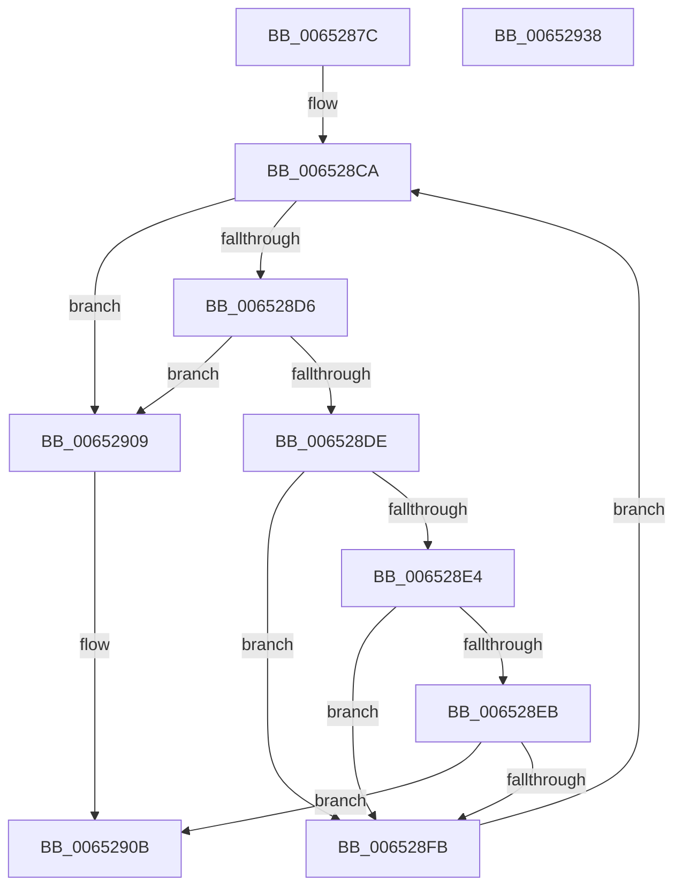

# EtwpCreateKeyTreeForPath

- RVA: `0x0065287C`–`0x00652939` (길이 `189` bytes)
- VA: `0x000000014065287C`
- 실행 섹션: `.text`
- PDB 이름 있음: `예`; PDB Function 태그: `아니요`
- unwind 정보 RVA: `0x000D3C70`
- 디코드: `53`개 명령, `189/189` bytes 표시
- 미해석 바이트: `0` (있으면 어셈블리에 `.byte`로 보존)

> 이 문서는 커널 이미지의 기계어와 PDB 기호를 분석해 생성했습니다. 4번과 5번은 함수 원형과 자료형을 바이너리 사용 방식에서 추정한 C 해석이며 원본 소스 복구 결과는 아닙니다.

## 1. Dependencies

- 직접 호출 지점: **3**; 고유 호출 대상: **3**
- 직접 호출자로 확인된 함수: **1**
- RIP 상대 이미지 참조: **1**

### Outgoing calls
- `0x006528C2` → [memset](../6C/memset_function_006C6C40.md) (function, `0x006C6C40`)
- `0x006528F0` → [EtwpCreateKey](EtwpCreateKey_function_006527D4.md) (function, `0x006527D4`)
- `0x00652916` → [_security_check_cookie](../6A/_security_check_cookie_function_006AC640.md) (function, `0x006AC640`)

### Direct callers
- [EtwStartAutoLogger](../../page/7B/EtwStartAutoLogger_function_007BD2F8.md) at `0x007BD5E4`

### Static image references
- `0x00652897` → RVA `0x00E0A740` (`.data`; read)

## 2. Other-region calls and transfers

- 다른 실행 섹션으로 향하는 call: **0**
- 별도 외부 분기/꼬리 이동을 확인하지 못했습니다.

## 3. Assembly (complete function range)

```asm
0065287C  48 89 5C 24 08                  mov qword ptr [rsp + 8], rbx
00652881  48 89 6C 24 10                  mov qword ptr [rsp + 0x10], rbp
00652886  48 89 74 24 18                  mov qword ptr [rsp + 0x18], rsi
0065288B  57                              push rdi
0065288C  41 56                           push r14
0065288E  41 57                           push r15
00652890  48 81 EC 30 02 00 00            sub rsp, 0x230
00652897  48 8B 05 A2 7E 7B 00            mov rax, qword ptr [rip + 0x7b7ea2]
0065289E  48 33 C4                        xor rax, rsp
006528A1  48 89 84 24 20 02 00 00         mov qword ptr [rsp + 0x220], rax
006528A9  45 33 FF                        xor r15d, r15d
006528AC  4C 8B F1                        mov r14, rcx
006528AF  48 8D 4C 24 20                  lea rcx, [rsp + 0x20]
006528B4  33 D2                           xor edx, edx
006528B6  41 B8 00 02 00 00               mov r8d, 0x200
006528BC  41 8B F7                        mov esi, r15d
006528BF  41 8B DF                        mov ebx, r15d
006528C2  E8 79 43 07 00                  call 0x1406c6c40
006528C7  41 8B FF                        mov edi, r15d
006528CA  8B EF                           mov ebp, edi
006528CC  41 0F B7 04 6E                  movzx eax, word ptr [r14 + rbp*2]
006528D1  66 85 C0                        test ax, ax
006528D4  74 33                           je 0x140652909
006528D6  81 FF 00 01 00 00               cmp edi, 0x100
006528DC  73 2B                           jae 0x140652909
006528DE  66 83 F8 5C                     cmp ax, 0x5c
006528E2  75 17                           jne 0x1406528fb
006528E4  FF C6                           inc esi
006528E6  83 FE 03                        cmp esi, 3
006528E9  76 10                           jbe 0x1406528fb
006528EB  48 8D 4C 24 20                  lea rcx, [rsp + 0x20]
006528F0  E8 DF FE FF FF                  call 0x1406527d4
006528F5  8B D8                           mov ebx, eax
006528F7  85 C0                           test eax, eax
006528F9  78 10                           js 0x14065290b
006528FB  41 0F B7 0C 6E                  movzx ecx, word ptr [r14 + rbp*2]
00652900  FF C7                           inc edi
00652902  66 89 4C 6C 20                  mov word ptr [rsp + rbp*2 + 0x20], cx
00652907  EB C1                           jmp 0x1406528ca
00652909  8B C3                           mov eax, ebx
0065290B  48 8B 8C 24 20 02 00 00         mov rcx, qword ptr [rsp + 0x220]
00652913  48 33 CC                        xor rcx, rsp
00652916  E8 25 9D 05 00                  call 0x1406ac640
0065291B  4C 8D 9C 24 30 02 00 00         lea r11, [rsp + 0x230]
00652923  49 8B 5B 20                     mov rbx, qword ptr [r11 + 0x20]
00652927  49 8B 6B 28                     mov rbp, qword ptr [r11 + 0x28]
0065292B  49 8B 73 30                     mov rsi, qword ptr [r11 + 0x30]
0065292F  49 8B E3                        mov rsp, r11
00652932  41 5F                           pop r15
00652934  41 5E                           pop r14
00652936  5F                              pop rdi
00652937  C3                              ret
00652938  CC                              int3
```

## 4. C-style interpretation (structured pseudocode)

```c
__int64 __fastcall EtwpCreateKeyTreeForPath(__int64 a1, int a2)
{
    __int64 result;
    __int64 v_r15;
    __int64 v_rdi;
    __int64 v_rsi;
    __int64 v_rsp;
    unsigned __int64 v_stack_m18;
    unsigned __int64 v_stack_m228;
    unsigned __int64 v_stack_m28;
    unsigned __int64 v_stack_p10;
    unsigned __int64 v_stack_p18;
    unsigned __int64 v_stack_p8;

    v_stack_p8 = v_rbx;
    v_stack_p10 = v_rbp;
    v_stack_p18 = v_rsi;
    v_rsp = (v_rsp) - (560);
    result = (*(unsigned __int64 *)(v_rip + 8093346)) ^ (v_rsp);
    v_stack_m28 = result;
    v_r15 = 0;
    a2 = 0;
    result = memset(v_stack_m228, a2, 512, a4);
loc_006528CA:
    if ((unsigned __int16)(*(unsigned __int16 *)(a1 + 0 * 2)) == 0) goto loc_00652909;
    if (0 >= 256) goto loc_00652909;
    if (((unsigned __int16)(*(unsigned __int16 *)(a1 + 0 * 2))) != 92) goto loc_006528FB;
    v_rsi = (unsigned int)((0) + 1);
    if (((unsigned int)(v_rsi)) <= 3) goto loc_006528FB;
    result = EtwpCreateKey(v_stack_m228, a2, 512, a4);
    if (sign_flag) goto loc_0065290B;
loc_006528FB:
    v_rdi = (unsigned int)((0) + 1);
    *(unsigned __int16 *)(v_rsp + 0 * 2 + 32) = (unsigned __int16)(*(unsigned __int16 *)(a1 + 0 * 2));
    goto loc_006528CA;
loc_00652909:
loc_0065290B:
    a1 = (v_stack_m28) ^ (v_rsp);
    result = _security_check_cookie(a1, a2, 512, a4);
    return result;
}
```

## 5. (Beta) C Style

```c
int64_t EtwpCreateKeyTreeForPath(void *Arg1, int32_t Arg2)
{
    uint8_t *arg1 = (uint8_t *)Arg1;

    int64_t result;
    int64_t local_r15;
    int64_t local_rdi;
    int64_t local_rsi;
    int64_t local_rsp;
    uint64_t v_stack_m18;
    uint64_t v_stack_m228;
    uint64_t v_stack_m28;
    uint64_t v_stack_p10;
    uint64_t v_stack_p18;
    uint64_t v_stack_p8;

    v_stack_p8 = local_rbx;
    v_stack_p10 = local_rbp;
    v_stack_p18 = local_rsi;
    local_rsp = (local_rsp) - (560);
    result = (*(uint64_t *)(v_rip + 0x7B7EA2)) ^ (local_rsp);
    v_stack_m28 = result;
    local_r15 = 0;
    Arg2 = 0;
    result = memset(v_stack_m228, Arg2, 512, a4);
loc_006528CA:
    if ((uint16_t)(*(uint16_t *)(arg1 + 0x0 * 2)) == 0) goto loc_00652909;
    if (0 >= 256) goto loc_00652909;
    if (((uint16_t)(*(uint16_t *)(arg1 + 0x0 * 2))) != 92) goto loc_006528FB;
    local_rsi = (uint32_t)((0) + 1);
    if (((uint32_t)(local_rsi)) <= 3) goto loc_006528FB;
    result = EtwpCreateKey(v_stack_m228, Arg2, 512, a4);
    if (sign_flag) goto loc_0065290B;
loc_006528FB:
    local_rdi = (uint32_t)((0) + 1);
    *(uint16_t *)(local_rsp + 0x0 * 2 + 0x20) = (uint16_t)(*(uint16_t *)(arg1 + 0x0 * 2));
    goto loc_006528CA;
loc_00652909:
loc_0065290B:
    Arg1 = (v_stack_m28) ^ (local_rsp);
    result = _security_check_cookie(Arg1, Arg2, 512, a4);
    return result;
}
```

### 관측된 메모리 오프셋

구조체 형식이 확인되지 않은 접근은 인자 기준의 오프셋으로만 기록했습니다.

| 기준 인자 | 오프셋 표현 | 폭 (bit) | 접근 |
|---|---:|---:|---|
| `Arg1` | `+ 0x0 + rbp*2` | `16` | `R` |

## 6. Execution-region graph

[열기: 2D/3D 그래프와 함수 탐색 컨트롤 패널](../../../control-panel.html?section=text&rva=0x0065287C&view=graph)

- 2D 그래프는 위에서 아래로 흐르고, 3D 그래프는 빈 공간을 드래그해 회전합니다. Shift+드래그는 이동, 휠은 확대·축소, 함수 노드 선택은 대상 보고서 이동입니다.

### Static fallback


