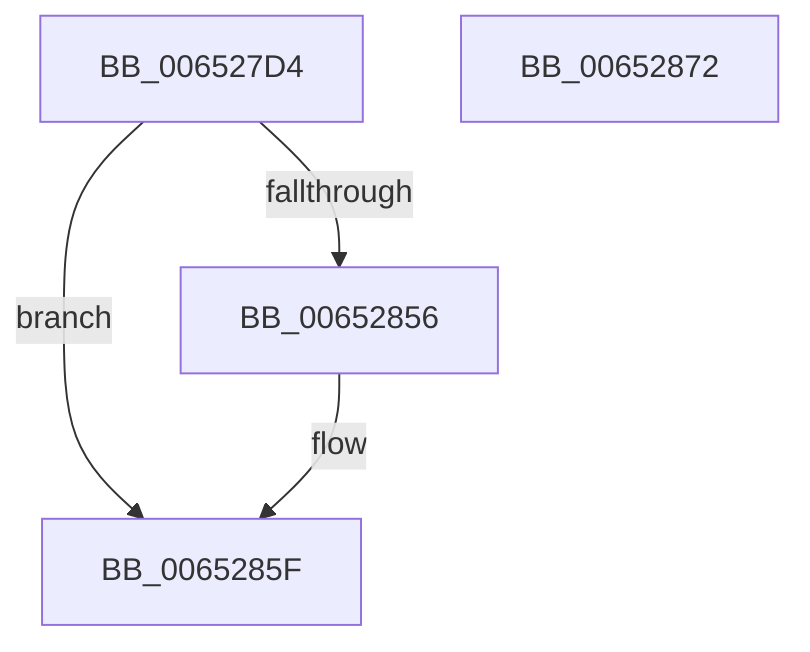

# EtwpCreateKey

- RVA: `0x006527D4`–`0x00652873` (길이 `159` bytes)
- VA: `0x00000001406527D4`
- 실행 섹션: `.text`
- PDB 이름 있음: `예`; PDB Function 태그: `아니요`
- unwind 정보 RVA: `0x000B3F9C`
- 디코드: `40`개 명령, `159/159` bytes 표시
- 미해석 바이트: `0` (있으면 어셈블리에 `.byte`로 보존)

> 이 문서는 커널 이미지의 기계어와 PDB 기호를 분석해 생성했습니다. 4번과 5번은 함수 원형과 자료형을 바이너리 사용 방식에서 추정한 C 해석이며 원본 소스 복구 결과는 아닙니다.

## 1. Dependencies

- 직접 호출 지점: **3**; 고유 호출 대상: **3**
- 직접 호출자로 확인된 함수: **1**
- RIP 상대 이미지 참조: **0**

### Outgoing calls
- `0x00652802` → [RtlInitUnicodeString](../42/RtlInitUnicodeString_function_0042A780.md) (function, `0x0042A780`)
- `0x0065284B` → [ZwCreateKey](../6A/ZwCreateKey_function_006AD470.md) (function, `0x006AD470`)
- `0x0065285A` → [ZwClose](../6A/ZwClose_function_006AD2B0.md) (function, `0x006AD2B0`)

### Direct callers
- [EtwpCreateKeyTreeForPath](EtwpCreateKeyTreeForPath_function_0065287C.md) at `0x006528F0`

### Static image references
- 디코드된 RIP-relative 메모리 참조가 없습니다.

## 2. Other-region calls and transfers

- 다른 실행 섹션으로 향하는 call: **0**
- 별도 외부 분기/꼬리 이동을 확인하지 못했습니다.

## 3. Assembly (complete function range)

```asm
006527D4  48 89 5C 24 08                  mov qword ptr [rsp + 8], rbx
006527D9  55                              push rbp
006527DA  48 8B EC                        mov rbp, rsp
006527DD  48 81 EC 80 00 00 00            sub rsp, 0x80
006527E4  48 83 65 18 00                  and qword ptr [rbp + 0x18], 0
006527E9  33 C0                           xor eax, eax
006527EB  21 45 EC                        and dword ptr [rbp - 0x14], eax
006527EE  0F 57 C0                        xorps xmm0, xmm0
006527F1  48 8B D1                        mov rdx, rcx
006527F4  89 45 D4                        mov dword ptr [rbp - 0x2c], eax
006527F7  21 45 D4                        and dword ptr [rbp - 0x2c], eax
006527FA  48 8D 4D C0                     lea rcx, [rbp - 0x40]
006527FE  0F 11 45 C0                     movups xmmword ptr [rbp - 0x40], xmm0
00652802  E8 79 7F DD FF                  call 0x14042a780
00652807  48 83 64 24 30 00               and qword ptr [rsp + 0x30], 0
0065280D  48 8D 45 C0                     lea rax, [rbp - 0x40]
00652811  83 64 24 28 00                  and dword ptr [rsp + 0x28], 0
00652816  4C 8D 45 D0                     lea r8, [rbp - 0x30]
0065281A  48 83 65 D8 00                  and qword ptr [rbp - 0x28], 0
0065281F  48 8D 4D 18                     lea rcx, [rbp + 0x18]
00652823  48 83 64 24 20 00               and qword ptr [rsp + 0x20], 0
00652829  0F 57 C0                        xorps xmm0, xmm0
0065282C  45 33 C9                        xor r9d, r9d
0065282F  48 89 45 E0                     mov qword ptr [rbp - 0x20], rax
00652833  BA 3F 00 0F 00                  mov edx, 0xf003f
00652838  C7 45 D0 30 00 00 00            mov dword ptr [rbp - 0x30], 0x30
0065283F  F3 0F 7F 45 F0                  movdqu xmmword ptr [rbp - 0x10], xmm0
00652844  C7 45 E8 40 02 00 00            mov dword ptr [rbp - 0x18], 0x240
0065284B  E8 20 AC 05 00                  call 0x1406ad470
00652850  8B D8                           mov ebx, eax
00652852  85 C0                           test eax, eax
00652854  78 09                           js 0x14065285f
00652856  48 8B 4D 18                     mov rcx, qword ptr [rbp + 0x18]
0065285A  E8 51 AA 05 00                  call 0x1406ad2b0
0065285F  8B C3                           mov eax, ebx
00652861  48 8B 9C 24 90 00 00 00         mov rbx, qword ptr [rsp + 0x90]
00652869  48 81 C4 80 00 00 00            add rsp, 0x80
00652870  5D                              pop rbp
00652871  C3                              ret
00652872  CC                              int3
```

## 4. C-style interpretation (structured pseudocode)

```c
__int64 __fastcall EtwpCreateKey(__int64 a1, __int64 a2, __int64 a3, int a4)
{
    __int64 result;
    __int64 v_rsp;
    unsigned __int64 v_stack_m18;
    unsigned int v_stack_m1C;
    unsigned int v_stack_m20;
    unsigned __int64 v_stack_m28;
    unsigned __int64 v_stack_m30;
    unsigned int v_stack_m34;
    unsigned __int64 v_stack_m38;
    unsigned __int64 v_stack_m48;
    unsigned __int64 v_stack_m58;
    unsigned int v_stack_m60;
    unsigned __int64 v_stack_m68;
    unsigned __int64 v_stack_p10;
    unsigned __int64 v_stack_p8;

    v_stack_p8 = v_rbx;
    v_rsp = (v_rsp) - (128);
    result = 0;
    v_stack_m34 = 0;
    v_stack_m48 = v_xmm0;
    result = RtlInitUnicodeString(v_stack_m48, a1, a3, a4);
    a4 = 0;
    v_stack_m28 = v_stack_m48;
    v_stack_m38 = 48;
    v_stack_m18 = v_xmm0;
    v_stack_m20 = 576;
    result = ZwCreateKey(v_stack_p10, (unsigned int)(0xF003FULL), v_stack_m38, a4);
    if (!(sign_flag)) {
        a1 = v_stack_p10;
        result = ZwClose(a1, (unsigned int)(0xF003FULL), v_stack_m38, a4);
    }
    v_rsp = (v_rsp) + (128);
    return (unsigned int)((unsigned int)((unsigned int)((unsigned int)(result))));
}
```

## 5. (Beta) C Style

```c
int64_t EtwpCreateKey(int64_t Arg1, int64_t Arg2, int64_t Arg3, int32_t Arg4)
{
    int64_t result;
    int64_t local_rsp;
    uint64_t v_stack_m18;
    uint32_t v_stack_m1C;
    uint32_t v_stack_m20;
    uint64_t v_stack_m28;
    uint64_t v_stack_m30;
    uint32_t v_stack_m34;
    uint64_t v_stack_m38;
    uint64_t v_stack_m48;
    uint64_t v_stack_m58;
    uint32_t v_stack_m60;
    uint64_t v_stack_m68;
    uint64_t v_stack_p10;
    uint64_t v_stack_p8;

    v_stack_p8 = local_rbx;
    local_rsp = (local_rsp) - (128);
    result = 0;
    v_stack_m34 = 0;
    v_stack_m48 = v_xmm0;
    result = RtlInitUnicodeString(v_stack_m48, Arg1, Arg3, Arg4);
    Arg4 = 0;
    v_stack_m28 = v_stack_m48;
    v_stack_m38 = 48;
    v_stack_m18 = v_xmm0;
    v_stack_m20 = 576;
    result = ZwCreateKey(v_stack_p10, (uint32_t)(0xF003FULL), v_stack_m38, Arg4);
    if (!(sign_flag)) {
        Arg1 = v_stack_p10;
        result = ZwClose(Arg1, (uint32_t)(0xF003FULL), v_stack_m38, Arg4);
    }
    local_rsp = (local_rsp) + (128);
    return (uint32_t)((uint32_t)((uint32_t)((uint32_t)(result))));
}
```

## 6. Execution-region graph

[열기: 2D/3D 그래프와 함수 탐색 컨트롤 패널](../../../control-panel.html?section=text&rva=0x006527D4&view=graph)

- 2D 그래프는 위에서 아래로 흐르고, 3D 그래프는 빈 공간을 드래그해 회전합니다. Shift+드래그는 이동, 휠은 확대·축소, 함수 노드 선택은 대상 보고서 이동입니다.

### Static fallback


