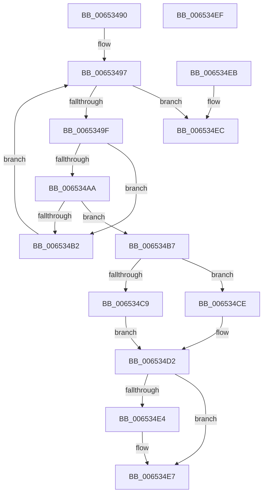

# EtwpDequeueBufferPendingCompressionFromQueue

- RVA: `0x00653490`–`0x006534F0` (길이 `96` bytes)
- VA: `0x0000000140653490`
- 실행 섹션: `.text`
- PDB 이름 있음: `예`; PDB Function 태그: `아니요`
- unwind 정보 RVA: `0x000DB714`
- 디코드: `35`개 명령, `96/96` bytes 표시
- 미해석 바이트: `0` (있으면 어셈블리에 `.byte`로 보존)

> 이 문서는 커널 이미지의 기계어와 PDB 기호를 분석해 생성했습니다. 4번과 5번은 함수 원형과 자료형을 바이너리 사용 방식에서 추정한 C 해석이며 원본 소스 복구 결과는 아닙니다.

## 1. Dependencies

- 직접 호출 지점: **0**; 고유 호출 대상: **0**
- 직접 호출자로 확인된 함수: **1**
- RIP 상대 이미지 참조: **0**

### Outgoing calls
- 직접 디코드된 call 명령이 없습니다.

### Direct callers
- [EtwpDequeueBufferPendingCompression](EtwpDequeueBufferPendingCompression_function_006533E8.md) at `0x00653437`
- [EtwpDequeueBufferPendingCompression](EtwpDequeueBufferPendingCompression_function_006533E8.md) at `0x0065344B`

### Static image references
- 디코드된 RIP-relative 메모리 참조가 없습니다.

## 2. Other-region calls and transfers

- 다른 실행 섹션으로 향하는 call: **0**
- 별도 외부 분기/꼬리 이동을 확인하지 못했습니다.

## 3. Assembly (complete function range)

```asm
00653490  4C 8B D1                        mov r10, rcx
00653493  4C 8D 49 08                     lea r9, [rcx + 8]
00653497  49 8B 09                        mov rcx, qword ptr [r9]
0065349A  48 85 C9                        test rcx, rcx
0065349D  74 4D                           je 0x1406534ec
0065349F  4C 8D 59 E0                     lea r11, [rcx - 0x20]
006534A3  41 83 7B 2C 04                  cmp dword ptr [r11 + 0x2c], 4
006534A8  75 08                           jne 0x1406534b2
006534AA  41 8A 43 34                     mov al, byte ptr [r11 + 0x34]
006534AE  84 C0                           test al, al
006534B0  79 05                           jns 0x1406534b7
006534B2  4C 8B C9                        mov r9, rcx
006534B5  EB E0                           jmp 0x140653497
006534B7  F0 FF 0A                        lock dec dword ptr [rdx]
006534BA  49 8B 09                        mov rcx, qword ptr [r9]
006534BD  48 8B 01                        mov rax, qword ptr [rcx]
006534C0  49 89 01                        mov qword ptr [r9], rax
006534C3  48 83 39 00                     cmp qword ptr [rcx], 0
006534C7  75 05                           jne 0x1406534ce
006534C9  4D 89 0A                        mov qword ptr [r10], r9
006534CC  EB 04                           jmp 0x1406534d2
006534CE  48 83 21 00                     and qword ptr [rcx], 0
006534D2  49 8B 09                        mov rcx, qword ptr [r9]
006534D5  49 8D 50 20                     lea rdx, [r8 + 0x20]
006534D9  48 89 0A                        mov qword ptr [rdx], rcx
006534DC  49 89 11                        mov qword ptr [r9], rdx
006534DF  4D 3B 0A                        cmp r9, qword ptr [r10]
006534E2  75 03                           jne 0x1406534e7
006534E4  49 89 12                        mov qword ptr [r10], rdx
006534E7  49 8B C3                        mov rax, r11
006534EA  C3                              ret
006534EB  CC                              int3
006534EC  33 C0                           xor eax, eax
006534EE  C3                              ret
006534EF  CC                              int3
```

## 4. C-style interpretation (structured pseudocode)

```c
__int64 __fastcall EtwpDequeueBufferPendingCompressionFromQueue(__int64 a1, __int64 a2, __int64 a3)
{
    __int64 result;

loc_00653497:
    if (*(unsigned __int64 *)(a1 + 8) == 0) goto loc_006534EC;
    if ((*(unsigned int *)(*(unsigned __int64 *)(a1 + 8) - 32 + 44)) != 4) goto loc_006534B2;
    if (!sign_flag) goto loc_006534B7;
loc_006534B2:
    goto loc_00653497;
loc_006534B7:
    *(unsigned __int64 *)(*(unsigned __int64 *)(a1 + 8)) = *(unsigned __int64 *)(*(unsigned __int64 *)(*(unsigned __int64 *)(a1 + 8)));
    if ((*(unsigned __int64 *)(*(unsigned __int64 *)(*(unsigned __int64 *)(a1 + 8)))) != 0) goto loc_006534CE;
    *(unsigned __int64 *)(a1) = *(unsigned __int64 *)(a1 + 8);
    goto loc_006534D2;
loc_006534CE:
loc_006534D2:
    *(unsigned __int64 *)(a3 + 32) = *(unsigned __int64 *)(*(unsigned __int64 *)(a1 + 8));
    *(unsigned __int64 *)(*(unsigned __int64 *)(a1 + 8)) = a3 + 32;
    if ((*(unsigned __int64 *)(a1 + 8)) == (*(unsigned __int64 *)(a1))) {
        *(unsigned __int64 *)(a1) = a3 + 32;
    }
    return *(unsigned __int64 *)(a1 + 8) - 32;
loc_006534EC:
    result = 0;
    return result;
}
```

## 5. (Beta) C Style

```c
int64_t EtwpDequeueBufferPendingCompressionFromQueue(void *Arg1, void *Arg2, void *Arg3)
{
    uint8_t *arg1 = (uint8_t *)Arg1;
    uint8_t *arg2 = (uint8_t *)Arg2;
    uint8_t *arg3 = (uint8_t *)Arg3;

    int64_t result;

loc_00653497:
    if (*(uint64_t *)(arg1 + 0x8) == 0) goto loc_006534EC;
    if ((*(uint32_t *)(*(uint64_t *)(arg1 + 0x8) - 0x20 + 0x2C)) != 4) goto loc_006534B2;
    if (!sign_flag) goto loc_006534B7;
loc_006534B2:
    goto loc_00653497;
loc_006534B7:
    *(uint64_t *)(*(uint64_t *)(arg1 + 0x8)) = *(uint64_t *)(*(uint64_t *)(*(uint64_t *)(arg1 + 0x8)));
    if ((*(uint64_t *)(*(uint64_t *)(*(uint64_t *)(arg1 + 0x8)))) != 0) goto loc_006534CE;
    *(uint64_t *)(arg1) = *(uint64_t *)(arg1 + 0x8);
    goto loc_006534D2;
loc_006534CE:
loc_006534D2:
    *(uint64_t *)(arg3 + 0x20) = *(uint64_t *)(*(uint64_t *)(arg1 + 0x8));
    *(void **)(*(uint64_t *)(arg1 + 0x8)) = Arg3 + 32;
    if ((*(uint64_t *)(arg1 + 0x8)) == (*(uint64_t *)(arg1))) {
        *(void **)(arg1) = Arg3 + 32;
    }
    return *(uint64_t *)(arg1 + 0x8) - 32;
loc_006534EC:
    result = 0;
    return result;
}
```

### 관측된 메모리 오프셋

구조체 형식이 확인되지 않은 접근은 인자 기준의 오프셋으로만 기록했습니다.

| 기준 인자 | 오프셋 표현 | 폭 (bit) | 접근 |
|---|---:|---:|---|
| `Arg1` | `+ 0x0` | `64` | `R` |
| `Arg1` | `+ 0x0` | `64` | `W` |
| `Arg1` | `+ 0x8` | `64` | `R` |
| `Arg2` | `+ 0x0` | `32` | `R/W` |
| `Arg3` | `+ 0x0` | `64` | `W` |
| `Arg3` | `+ 0x20` | `64` | `R` |

## 6. Execution-region graph

[열기: 2D/3D 그래프와 함수 탐색 컨트롤 패널](../../../control-panel.html?section=text&rva=0x00653490&view=graph)

- 2D 그래프는 위에서 아래로 흐르고, 3D 그래프는 빈 공간을 드래그해 회전합니다. Shift+드래그는 이동, 휠은 확대·축소, 함수 노드 선택은 대상 보고서 이동입니다.

### Static fallback


