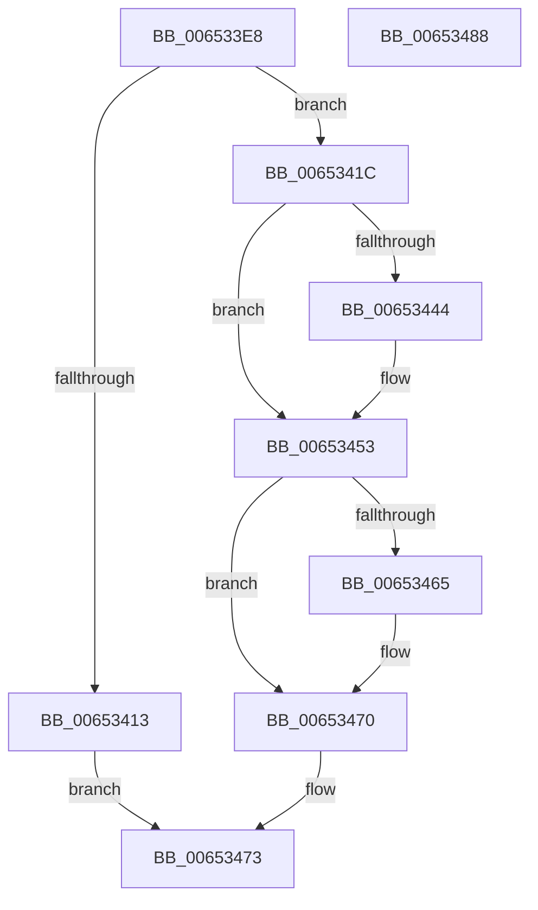

# EtwpDequeueBufferPendingCompression

- RVA: `0x006533E8`–`0x00653489` (길이 `161` bytes)
- VA: `0x00000001406533E8`
- 실행 섹션: `.text`
- PDB 이름 있음: `예`; PDB Function 태그: `아니요`
- unwind 정보 RVA: `0x000B6A1C`
- 디코드: `46`개 명령, `161/161` bytes 표시
- 미해석 바이트: `0` (있으면 어셈블리에 `.byte`로 보존)

> 이 문서는 커널 이미지의 기계어와 PDB 기호를 분석해 생성했습니다. 4번과 5번은 함수 원형과 자료형을 바이너리 사용 방식에서 추정한 C 해석이며 원본 소스 복구 결과는 아닙니다.

## 1. Dependencies

- 직접 호출 지점: **7**; 고유 호출 대상: **6**
- 직접 호출자로 확인된 함수: **1**
- RIP 상대 이미지 참조: **0**

### Outgoing calls
- `0x00653403` → [EtwpGetPlaceholderBuffer](EtwpGetPlaceholderBuffer_function_00653694.md) (function, `0x00653694`)
- `0x00653413` → [EtwpDisableCompression](EtwpDisableCompression_function_006534F8.md) (function, `0x006534F8`)
- `0x00653421` → [EtwpLockBufferList](../3E/EtwpLockBufferList_function_003EB49C.md) (function, `0x003EB49C`)
- `0x00653437` → [EtwpDequeueBufferPendingCompressionFromQueue](EtwpDequeueBufferPendingCompressionFromQueue_function_00653490.md) (function, `0x00653490`)
- `0x0065344B` → [EtwpDequeueBufferPendingCompressionFromQueue](EtwpDequeueBufferPendingCompressionFromQueue_function_00653490.md) (function, `0x00653490`)
- `0x0065345B` → [EtwpUnlockBufferList](../2D/EtwpUnlockBufferList_function_002DFC28.md) (function, `0x002DFC28`)
- `0x0065346B` → [EtwpInsertPlaceholderBuffer](EtwpInsertPlaceholderBuffer_function_00653718.md) (function, `0x00653718`)

### Direct callers
- [EtwpCompressPendingBuffers](EtwpCompressPendingBuffers_function_00653140.md) at `0x0065319D`

### Static image references
- 디코드된 RIP-relative 메모리 참조가 없습니다.

## 2. Other-region calls and transfers

- 다른 실행 섹션으로 향하는 call: **0**
- 별도 외부 분기/꼬리 이동을 확인하지 못했습니다.

## 3. Assembly (complete function range)

```asm
006533E8  48 8B C4                        mov rax, rsp
006533EB  48 89 58 08                     mov qword ptr [rax + 8], rbx
006533EF  48 89 68 18                     mov qword ptr [rax + 0x18], rbp
006533F3  48 89 70 20                     mov qword ptr [rax + 0x20], rsi
006533F7  57                              push rdi
006533F8  48 83 EC 20                     sub rsp, 0x20
006533FC  48 8B D9                        mov rbx, rcx
006533FF  C6 40 10 00                     mov byte ptr [rax + 0x10], 0
00653403  E8 8C 02 00 00                  call 0x140653694
00653408  48 8B F8                        mov rdi, rax
0065340B  48 8B CB                        mov rcx, rbx
0065340E  48 85 C0                        test rax, rax
00653411  75 09                           jne 0x14065341c
00653413  E8 E0 00 00 00                  call 0x1406534f8
00653418  33 C0                           xor eax, eax
0065341A  EB 57                           jmp 0x140653473
0065341C  48 8D 54 24 38                  lea rdx, [rsp + 0x38]
00653421  E8 76 80 D9 FF                  call 0x1403eb49c
00653426  48 8D AB E4 00 00 00            lea rbp, [rbx + 0xe4]
0065342D  4C 8B C7                        mov r8, rdi
00653430  48 8B D5                        mov rdx, rbp
00653433  48 8D 4B 40                     lea rcx, [rbx + 0x40]
00653437  E8 54 00 00 00                  call 0x140653490
0065343C  48 8B F0                        mov rsi, rax
0065343F  48 85 C0                        test rax, rax
00653442  75 0F                           jne 0x140653453
00653444  48 8D 4B 30                     lea rcx, [rbx + 0x30]
00653448  48 8B D5                        mov rdx, rbp
0065344B  E8 40 00 00 00                  call 0x140653490
00653450  48 8B F0                        mov rsi, rax
00653453  48 8D 54 24 38                  lea rdx, [rsp + 0x38]
00653458  48 8B CB                        mov rcx, rbx
0065345B  E8 C8 C7 C8 FF                  call 0x1402dfc28
00653460  48 85 F6                        test rsi, rsi
00653463  75 0B                           jne 0x140653470
00653465  48 8B D7                        mov rdx, rdi
00653468  48 8B CB                        mov rcx, rbx
0065346B  E8 A8 02 00 00                  call 0x140653718
00653470  48 8B C6                        mov rax, rsi
00653473  48 8B 5C 24 30                  mov rbx, qword ptr [rsp + 0x30]
00653478  48 8B 6C 24 40                  mov rbp, qword ptr [rsp + 0x40]
0065347D  48 8B 74 24 48                  mov rsi, qword ptr [rsp + 0x48]
00653482  48 83 C4 20                     add rsp, 0x20
00653486  5F                              pop rdi
00653487  C3                              ret
00653488  CC                              int3
```

## 4. C-style interpretation (structured pseudocode)

```c
__int64 __fastcall EtwpDequeueBufferPendingCompression(__int64 a1)
{
    __int64 result;
    __int64 v_rsi;
    __int64 v_rsp;
    unsigned __int64 v_stack_p10;
    unsigned __int64 v_stack_p18;
    unsigned __int64 v_stack_p20;
    unsigned __int64 v_stack_p8;

    *(unsigned __int64 *)(v_rsp + 8) = v_rbx;
    *(unsigned __int64 *)(v_rsp + 24) = v_rbp;
    *(unsigned __int64 *)(v_rsp + 32) = v_rsi;
    v_rsp = (v_rsp) - (32);
    *(unsigned __int8 *)(v_rsp + 16) = 0;
    result = EtwpGetPlaceholderBuffer(a1, a2, a3, a4);
    if (result != 0) goto loc_0065341C;
    result = EtwpDisableCompression(a1, a2, a3, a4);
    result = 0;
    goto loc_00653473;
loc_0065341C:
    result = EtwpLockBufferList(a1, v_stack_p10, a3, a4);
    result = EtwpDequeueBufferPendingCompressionFromQueue(a1 + 64, a1 + 228, result, a4);
    v_rsi = result;
    if (result == 0) {
        a1 = a1 + 48;
        a2 = a1 + 228;
        result = EtwpDequeueBufferPendingCompressionFromQueue(a1, a2, result, a4);
        v_rsi = result;
    }
    result = EtwpUnlockBufferList(a1, v_stack_p10, result, a4);
    if (v_rsi == 0) {
        a2 = result;
        a1 = a1;
        result = EtwpInsertPlaceholderBuffer(a1, a2, result, a4);
    }
loc_00653473:
    v_rsp = (v_rsp) + (32);
    return v_rsi;
}
```

## 5. (Beta) C Style

```c
int64_t EtwpDequeueBufferPendingCompression(void *Arg1)
{
    uint8_t *arg1 = (uint8_t *)Arg1;

    int64_t result;
    int64_t local_rsi;
    int64_t local_rsp;
    uint64_t v_stack_p10;
    uint64_t v_stack_p18;
    uint64_t v_stack_p20;
    uint64_t v_stack_p8;

    *(uint64_t *)(local_rsp + 0x8) = local_rbx;
    *(uint64_t *)(local_rsp + 0x18) = local_rbp;
    *(uint64_t *)(local_rsp + 0x20) = local_rsi;
    local_rsp = (local_rsp) - (32);
    *(uint8_t *)(local_rsp + 0x10) = 0;
    result = EtwpGetPlaceholderBuffer(Arg1, a2, a3, a4);
    if (result != 0) goto loc_0065341C;
    result = EtwpDisableCompression(Arg1, a2, a3, a4);
    result = 0;
    goto loc_00653473;
loc_0065341C:
    result = EtwpLockBufferList(Arg1, v_stack_p10, a3, a4);
    result = EtwpDequeueBufferPendingCompressionFromQueue(Arg1 + 64, Arg1 + 228, result, a4);
    local_rsi = result;
    if (result == 0) {
        Arg1 = Arg1 + 48;
        a2 = Arg1 + 228;
        result = EtwpDequeueBufferPendingCompressionFromQueue(Arg1, a2, result, a4);
        local_rsi = result;
    }
    result = EtwpUnlockBufferList(Arg1, v_stack_p10, result, a4);
    if (local_rsi == 0) {
        a2 = result;
        Arg1 = Arg1;
        result = EtwpInsertPlaceholderBuffer(Arg1, a2, result, a4);
    }
loc_00653473:
    local_rsp = (local_rsp) + (32);
    return local_rsi;
}
```

### 관측된 메모리 오프셋

구조체 형식이 확인되지 않은 접근은 인자 기준의 오프셋으로만 기록했습니다.

| 기준 인자 | 오프셋 표현 | 폭 (bit) | 접근 |
|---|---:|---:|---|
| `Arg1` | `+ 0x30` | `64` | `R` |
| `Arg1` | `+ 0x40` | `64` | `R` |
| `Arg1` | `+ 0xE4` | `64` | `R` |

## 6. Execution-region graph

[열기: 2D/3D 그래프와 함수 탐색 컨트롤 패널](../../../control-panel.html?section=text&rva=0x006533E8&view=graph)

- 2D 그래프는 위에서 아래로 흐르고, 3D 그래프는 빈 공간을 드래그해 회전합니다. Shift+드래그는 이동, 휠은 확대·축소, 함수 노드 선택은 대상 보고서 이동입니다.

### Static fallback


