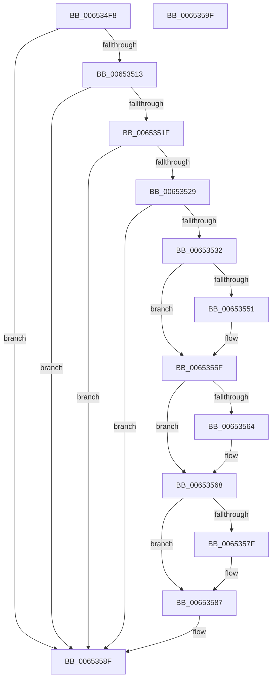

# EtwpDisableCompression

- RVA: `0x006534F8`–`0x006535A0` (길이 `168` bytes)
- VA: `0x00000001406534F8`
- 실행 섹션: `.text`
- PDB 이름 있음: `예`; PDB Function 태그: `아니요`
- unwind 정보 RVA: `0x00060BC4`
- 디코드: `49`개 명령, `168/168` bytes 표시
- 미해석 바이트: `0` (있으면 어셈블리에 `.byte`로 보존)

> 이 문서는 커널 이미지의 기계어와 PDB 기호를 분석해 생성했습니다. 4번과 5번은 함수 원형과 자료형을 바이너리 사용 방식에서 추정한 C 해석이며 원본 소스 복구 결과는 아닙니다.

## 1. Dependencies

- 직접 호출 지점: **6**; 고유 호출 대상: **6**
- 직접 호출자로 확인된 함수: **2**
- RIP 상대 이미지 참조: **0**

### Outgoing calls
- `0x00653529` → [KeGetEffectiveIrql](../2F/KeGetEffectiveIrql_function_002F8030.md) (function, `0x002F8030`)
- `0x00653541` → [KeAbPreAcquire](../21/KeAbPreAcquire_function_00210230.md) (function, `0x00210230`)
- `0x0065355A` → [ExfAcquirePushLockExclusiveEx](../20/ExfAcquirePushLockExclusiveEx_function_0020FC90.md) (function, `0x0020FC90`)
- `0x0065356B` → [EtwpRelinquishCompressionTarget](EtwpRelinquishCompressionTarget_function_00653818.md) (function, `0x00653818`)
- `0x00653582` → [ExfTryToWakePushLock](../26/ExfTryToWakePushLock_function_00265DD0.md) (function, `0x00265DD0`)
- `0x0065358A` → [KeAbPostRelease](../2E/KeAbPostRelease_function_002E1600.md) (function, `0x002E1600`)

### Direct callers
- [EtwpDequeueFreeBuffer](../3E/EtwpDequeueFreeBuffer_function_003EB1F0.md) at `0x003EB3C8`
- [EtwpDequeueBufferPendingCompression](EtwpDequeueBufferPendingCompression_function_006533E8.md) at `0x00653413`

### Static image references
- 디코드된 RIP-relative 메모리 참조가 없습니다.

## 2. Other-region calls and transfers

- 다른 실행 섹션으로 향하는 call: **0**
- 별도 외부 분기/꼬리 이동을 확인하지 못했습니다.

## 3. Assembly (complete function range)

```asm
006534F8  48 89 5C 24 08                  mov qword ptr [rsp + 8], rbx
006534FD  48 89 74 24 10                  mov qword ptr [rsp + 0x10], rsi
00653502  57                              push rdi
00653503  48 83 EC 20                     sub rsp, 0x20
00653507  83 B9 A4 05 00 00 01            cmp dword ptr [rcx + 0x5a4], 1
0065350E  48 8B F9                        mov rdi, rcx
00653511  74 7C                           je 0x14065358f
00653513  33 C0                           xor eax, eax
00653515  87 81 98 05 00 00               xchg dword ptr [rcx + 0x598], eax
0065351B  85 C0                           test eax, eax
0065351D  74 70                           je 0x14065358f
0065351F  8B 81 78 05 00 00               mov eax, dword ptr [rcx + 0x578]
00653525  85 C0                           test eax, eax
00653527  75 66                           jne 0x14065358f
00653529  E8 02 4B CA FF                  call 0x1402f8030
0065352E  3C 02                           cmp al, 2
00653530  73 5D                           jae 0x14065358f
00653532  48 8D 9F 80 05 00 00            lea rbx, [rdi + 0x580]
00653539  45 33 C0                        xor r8d, r8d
0065353C  48 8B CB                        mov rcx, rbx
0065353F  33 D2                           xor edx, edx
00653541  E8 EA CC BB FF                  call 0x140210230
00653546  F0 48 0F BA 2B 00               lock bts qword ptr [rbx], 0
0065354C  48 8B F0                        mov rsi, rax
0065354F  73 0E                           jae 0x14065355f
00653551  4C 8B C3                        mov r8, rbx
00653554  48 8B D0                        mov rdx, rax
00653557  48 8B CB                        mov rcx, rbx
0065355A  E8 31 C7 BB FF                  call 0x14020fc90
0065355F  48 85 F6                        test rsi, rsi
00653562  74 04                           je 0x140653568
00653564  C6 46 0A 01                     mov byte ptr [rsi + 0xa], 1
00653568  48 8B CF                        mov rcx, rdi
0065356B  E8 A8 02 00 00                  call 0x140653818
00653570  48 83 C8 FF                     or rax, 0xffffffffffffffff
00653574  F0 48 0F C1 03                  lock xadd qword ptr [rbx], rax
00653579  24 06                           and al, 6
0065357B  3C 02                           cmp al, 2
0065357D  75 08                           jne 0x140653587
0065357F  48 8B CB                        mov rcx, rbx
00653582  E8 49 28 C1 FF                  call 0x140265dd0
00653587  48 8B CB                        mov rcx, rbx
0065358A  E8 71 E0 C8 FF                  call 0x1402e1600
0065358F  48 8B 5C 24 30                  mov rbx, qword ptr [rsp + 0x30]
00653594  48 8B 74 24 38                  mov rsi, qword ptr [rsp + 0x38]
00653599  48 83 C4 20                     add rsp, 0x20
0065359D  5F                              pop rdi
0065359E  C3                              ret
0065359F  CC                              int3
```

## 4. C-style interpretation (structured pseudocode)

```c
__int64 __fastcall EtwpDisableCompression(__int64 a1, int a2, int a3)
{
    __int64 result;
    __int64 v_rsp;
    unsigned __int64 v_stack_p10;
    unsigned __int64 v_stack_p8;

    v_stack_p8 = v_rbx;
    v_stack_p10 = v_rsi;
    v_rsp = (v_rsp) - (32);
    if ((*(unsigned int *)(a1 + 1444)) == 1) goto loc_0065358F;
    result = 0;
    if (0 == 0) goto loc_0065358F;
    if ((unsigned int)((unsigned int)(*(unsigned int *)(a1 + 1400))) != 0) goto loc_0065358F;
    result = KeGetEffectiveIrql(a1, a2, a3, a4);
    if (((unsigned __int8)(result)) >= 2) goto loc_0065358F;
    a3 = 0;
    a2 = 0;
    result = KeAbPreAcquire(a1 + 1408, a2, a3, a4);
    if (!(condition_is_above_or_equal)) {
        a3 = a1 + 1408;
        a2 = result;
        a1 = a1 + 1408;
        result = ExfAcquirePushLockExclusiveEx(a1, a2, a3, a4);
    }
    if (result != 0) {
        *(unsigned __int8 *)(result + 10) = 1;
    }
    result = EtwpRelinquishCompressionTarget(a1, a2, a3, a4);
    result = (result) | (-1);
    result = (unsigned __int8)((result) & (6));
    if (((unsigned __int8)(result)) == 2) {
        a1 = a1 + 1408;
        result = ExfTryToWakePushLock(a1, a2, a3, a4);
    }
    result = KeAbPostRelease(a1 + 1408, a2, a3, a4);
loc_0065358F:
    v_rsp = (v_rsp) + (32);
    return result;
}
```

## 5. (Beta) C Style

```c
int64_t EtwpDisableCompression(void *Arg1, int32_t Arg2, int32_t Arg3)
{
    uint8_t *arg1 = (uint8_t *)Arg1;

    int64_t result;
    int64_t local_rsp;
    uint64_t v_stack_p10;
    uint64_t v_stack_p8;

    v_stack_p8 = local_rbx;
    v_stack_p10 = local_rsi;
    local_rsp = (local_rsp) - (32);
    if ((*(uint32_t *)(arg1 + 0x5A4)) == 1) goto loc_0065358F;
    result = 0;
    if (0 == 0) goto loc_0065358F;
    if ((uint32_t)((uint32_t)(*(uint32_t *)(arg1 + 0x578))) != 0) goto loc_0065358F;
    result = KeGetEffectiveIrql(Arg1, Arg2, Arg3, a4);
    if (((uint8_t)(result)) >= 2) goto loc_0065358F;
    Arg3 = 0;
    Arg2 = 0;
    result = KeAbPreAcquire(Arg1 + 1408, Arg2, Arg3, a4);
    if (!(condition_is_above_or_equal)) {
        Arg3 = Arg1 + 1408;
        Arg2 = result;
        Arg1 = Arg1 + 1408;
        result = ExfAcquirePushLockExclusiveEx(Arg1, Arg2, Arg3, a4);
    }
    if (result != 0) {
        *(uint8_t *)(result + 0xA) = 1;
    }
    result = EtwpRelinquishCompressionTarget(Arg1, Arg2, Arg3, a4);
    result = (result) | (-1);
    result = (uint8_t)((result) & (6));
    if (((uint8_t)(result)) == 2) {
        Arg1 = Arg1 + 1408;
        result = ExfTryToWakePushLock(Arg1, Arg2, Arg3, a4);
    }
    result = KeAbPostRelease(Arg1 + 1408, Arg2, Arg3, a4);
loc_0065358F:
    local_rsp = (local_rsp) + (32);
    return result;
}
```

### 관측된 메모리 오프셋

구조체 형식이 확인되지 않은 접근은 인자 기준의 오프셋으로만 기록했습니다.

| 기준 인자 | 오프셋 표현 | 폭 (bit) | 접근 |
|---|---:|---:|---|
| `Arg1` | `+ 0x0` | `64` | `R/W` |
| `Arg1` | `+ 0x578` | `32` | `R` |
| `Arg1` | `+ 0x580` | `64` | `R` |
| `Arg1` | `+ 0x598` | `32` | `R/W` |
| `Arg1` | `+ 0x5A4` | `32` | `R` |

## 6. Execution-region graph

[열기: 2D/3D 그래프와 함수 탐색 컨트롤 패널](../../../control-panel.html?section=text&rva=0x006534F8&view=graph)

- 2D 그래프는 위에서 아래로 흐르고, 3D 그래프는 빈 공간을 드래그해 회전합니다. Shift+드래그는 이동, 휠은 확대·축소, 함수 노드 선택은 대상 보고서 이동입니다.

### Static fallback


