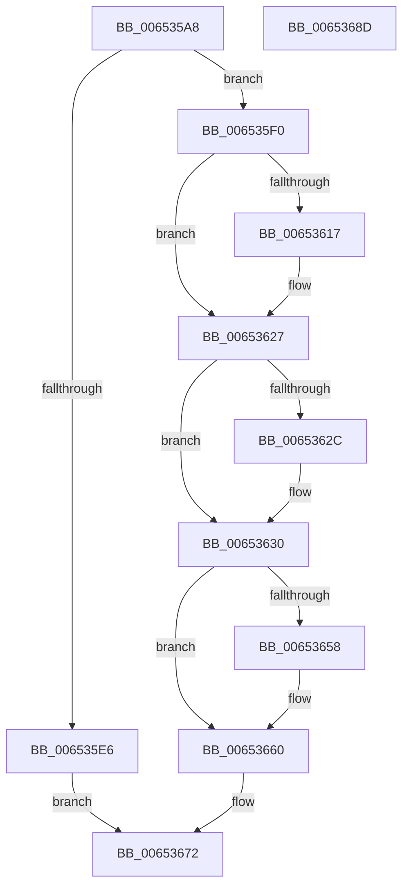

# EtwpGetCompressionSettings

- RVA: `0x006535A8`–`0x0065368E` (길이 `230` bytes)
- VA: `0x00000001406535A8`
- 실행 섹션: `.text`
- PDB 이름 있음: `예`; PDB Function 태그: `아니요`
- unwind 정보 RVA: `0x0006B074`
- 디코드: `65`개 명령, `230/230` bytes 표시
- 미해석 바이트: `0` (있으면 어셈블리에 `.byte`로 보존)

> 이 문서는 커널 이미지의 기계어와 PDB 기호를 분석해 생성했습니다. 4번과 5번은 함수 원형과 자료형을 바이너리 사용 방식에서 추정한 C 해석이며 원본 소스 복구 결과는 아닙니다.

## 1. Dependencies

- 직접 호출 지점: **7**; 고유 호출 대상: **7**
- 직접 호출자로 확인된 함수: **1**
- RIP 상대 이미지 참조: **0**

### Outgoing calls
- `0x006535C8` → [PsGetCurrentServerSiloGlobals](../2F/PsGetCurrentServerSiloGlobals_function_002FE1F0.md) (function, `0x002FE1F0`)
- `0x006535D9` → [EtwpAcquireLoggerContextByLoggerId](../../page/93/EtwpAcquireLoggerContextByLoggerId_function_00932920.md) (function, `0x00932920`)
- `0x00653602` → [KeAbPreAcquire](../21/KeAbPreAcquire_function_00210230.md) (function, `0x00210230`)
- `0x00653622` → [ExfAcquirePushLockSharedEx](../21/ExfAcquirePushLockSharedEx_function_0021044C.md) (function, `0x0021044C`)
- `0x0065365B` → [ExfReleasePushLockShared](../26/ExfReleasePushLockShared_function_00263440.md) (function, `0x00263440`)
- `0x00653663` → [KeAbPostRelease](../2E/KeAbPostRelease_function_002E1600.md) (function, `0x002E1600`)
- `0x0065366D` → [EtwpReleaseLoggerContext](../../page/A0/EtwpReleaseLoggerContext_function_00A04160.md) (function, `0x00A04160`)

### Direct callers
- [NtTraceControl](../../page/A9/NtTraceControl_function_00A9ED40.md) at `0x00A9F549`

### Static image references
- 디코드된 RIP-relative 메모리 참조가 없습니다.

## 2. Other-region calls and transfers

- 다른 실행 섹션으로 향하는 call: **2**
  - `0x006535D9` → [EtwpAcquireLoggerContextByLoggerId](../../page/93/EtwpAcquireLoggerContextByLoggerId_function_00932920.md) (`.text` → `PAGE`)
  - `0x0065366D` → [EtwpReleaseLoggerContext](../../page/A0/EtwpReleaseLoggerContext_function_00A04160.md) (`.text` → `PAGE`)
- 별도 외부 분기/꼬리 이동을 확인하지 못했습니다.

## 3. Assembly (complete function range)

```asm
006535A8  48 89 5C 24 10                  mov qword ptr [rsp + 0x10], rbx
006535AD  48 89 6C 24 18                  mov qword ptr [rsp + 0x18], rbp
006535B2  48 89 74 24 20                  mov qword ptr [rsp + 0x20], rsi
006535B7  57                              push rdi
006535B8  41 56                           push r14
006535BA  41 57                           push r15
006535BC  48 83 EC 20                     sub rsp, 0x20
006535C0  0F B7 19                        movzx ebx, word ptr [rcx]
006535C3  4C 8B F2                        mov r14, rdx
006535C6  33 FF                           xor edi, edi
006535C8  E8 23 AC CA FF                  call 0x1402fe1f0
006535CD  45 33 C0                        xor r8d, r8d
006535D0  8B D3                           mov edx, ebx
006535D2  48 8B 88 40 03 00 00            mov rcx, qword ptr [rax + 0x340]
006535D9  E8 42 F3 2D 00                  call 0x140932920
006535DE  48 8B F0                        mov rsi, rax
006535E1  48 85 C0                        test rax, rax
006535E4  75 0A                           jne 0x1406535f0
006535E6  BF 0D 00 00 C0                  mov edi, 0xc000000d
006535EB  E9 82 00 00 00                  jmp 0x140653672
006535F0  41 89 1E                        mov dword ptr [r14], ebx
006535F3  45 33 C0                        xor r8d, r8d
006535F6  48 8D 98 80 05 00 00            lea rbx, [rax + 0x580]
006535FD  33 D2                           xor edx, edx
006535FF  48 8B CB                        mov rcx, rbx
00653602  E8 29 CC BB FF                  call 0x140210230
00653607  48 8B E8                        mov rbp, rax
0065360A  33 C0                           xor eax, eax
0065360C  44 8D 78 11                     lea r15d, [rax + 0x11]
00653610  F0 4C 0F B1 3B                  lock cmpxchg qword ptr [rbx], r15
00653615  74 10                           je 0x140653627
00653617  4C 8B CB                        mov r9, rbx
0065361A  4C 8B C5                        mov r8, rbp
0065361D  33 D2                           xor edx, edx
0065361F  48 8B CB                        mov rcx, rbx
00653622  E8 25 CE BB FF                  call 0x14021044c
00653627  48 85 ED                        test rbp, rbp
0065362A  74 04                           je 0x140653630
0065362C  C6 45 0A 01                     mov byte ptr [rbp + 0xa], 1
00653630  8B 8E A0 05 00 00               mov ecx, dword ptr [rsi + 0x5a0]
00653636  41 89 4E 04                     mov dword ptr [r14 + 4], ecx
0065363A  8B 8E 9C 05 00 00               mov ecx, dword ptr [rsi + 0x59c]
00653640  41 89 4E 08                     mov dword ptr [r14 + 8], ecx
00653644  8B 96 A4 05 00 00               mov edx, dword ptr [rsi + 0x5a4]
0065364A  41 89 56 0C                     mov dword ptr [r14 + 0xc], edx
0065364E  49 8B C7                        mov rax, r15
00653651  F0 48 0F B1 3B                  lock cmpxchg qword ptr [rbx], rdi
00653656  74 08                           je 0x140653660
00653658  48 8B CB                        mov rcx, rbx
0065365B  E8 E0 FD C0 FF                  call 0x140263440
00653660  48 8B CB                        mov rcx, rbx
00653663  E8 98 DF C8 FF                  call 0x1402e1600
00653668  33 D2                           xor edx, edx
0065366A  48 8B CE                        mov rcx, rsi
0065366D  E8 EE 0A 3B 00                  call 0x140a04160
00653672  48 8B 5C 24 48                  mov rbx, qword ptr [rsp + 0x48]
00653677  8B C7                           mov eax, edi
00653679  48 8B 6C 24 50                  mov rbp, qword ptr [rsp + 0x50]
0065367E  48 8B 74 24 58                  mov rsi, qword ptr [rsp + 0x58]
00653683  48 83 C4 20                     add rsp, 0x20
00653687  41 5F                           pop r15
00653689  41 5E                           pop r14
0065368B  5F                              pop rdi
0065368C  C3                              ret
0065368D  CC                              int3
```

## 4. C-style interpretation (structured pseudocode)

```c
__int64 __fastcall EtwpGetCompressionSettings(__int64 a1, __int64 a2, int a3)
{
    __int64 result;
    __int64 v_rdi;
    __int64 v_rsp;
    unsigned __int64 v_stack_p10;
    unsigned __int64 v_stack_p18;
    unsigned __int64 v_stack_p20;

    v_stack_p10 = v_rbx;
    v_stack_p18 = v_rbp;
    v_stack_p20 = v_rsi;
    v_rsp = (v_rsp) - (32);
    v_rdi = 0;
    result = PsGetCurrentServerSiloGlobals(a1, a2, a3, a4);
    a3 = 0;
    result = EtwpAcquireLoggerContextByLoggerId(*(unsigned __int64 *)(result + 832), (unsigned int)((unsigned int)(*(unsigned __int16 *)(a1))), a3, a4);
    if (result != 0) goto loc_006535F0;
    goto loc_00653672;
loc_006535F0:
    *(unsigned int *)(a2) = (unsigned int)(*(unsigned __int16 *)(a1));
    a3 = 0;
    a2 = 0;
    result = KeAbPreAcquire(result + 1408, a2, a3, a4);
    result = 0;
    if (!(condition_is_equal)) {
        a4 = result + 1408;
        a3 = 0;
        a2 = 0;
        a1 = result + 1408;
        result = ExfAcquirePushLockSharedEx(a1, a2, a3, a4);
    }
    if (result != 0) {
        *(unsigned __int8 *)(result + 10) = 1;
    }
    *(unsigned int *)(a2 + 4) = (unsigned int)((unsigned int)(*(unsigned int *)(result + 1440)));
    *(unsigned int *)(a2 + 8) = (unsigned int)((unsigned int)(*(unsigned int *)(result + 1436)));
    *(unsigned int *)(a2 + 12) = (unsigned int)((unsigned int)(*(unsigned int *)(result + 1444)));
    result = result + 17;
    if (result != 0) {
        a1 = result + 1408;
        result = ExfReleasePushLockShared(a1, (unsigned int)(*(unsigned int *)(result + 1444)), a3, a4);
    }
    result = KeAbPostRelease(result + 1408, (unsigned int)(*(unsigned int *)(result + 1444)), a3, a4);
    a2 = 0;
    result = EtwpReleaseLoggerContext(result, a2, a3, a4);
loc_00653672:
    v_rsp = (v_rsp) + (32);
    return (unsigned int)((unsigned int)((unsigned int)(0xC000000DULL)));
}
```

## 5. (Beta) C Style

```c
int64_t EtwpGetCompressionSettings(void *Arg1, void *Arg2, int32_t Arg3)
{
    uint8_t *arg1 = (uint8_t *)Arg1;
    uint8_t *arg2 = (uint8_t *)Arg2;

    int64_t result;
    int64_t local_rdi;
    int64_t local_rsp;
    uint64_t v_stack_p10;
    uint64_t v_stack_p18;
    uint64_t v_stack_p20;

    v_stack_p10 = local_rbx;
    v_stack_p18 = local_rbp;
    v_stack_p20 = local_rsi;
    local_rsp = (local_rsp) - (32);
    local_rdi = 0;
    result = PsGetCurrentServerSiloGlobals(Arg1, Arg2, Arg3, a4);
    Arg3 = 0;
    result = EtwpAcquireLoggerContextByLoggerId(*(uint64_t *)(result + 0x340), (uint32_t)((uint32_t)(*(uint16_t *)(arg1))), Arg3, a4);
    if (result != 0) goto loc_006535F0;
    goto loc_00653672;
loc_006535F0:
    *(uint32_t *)(arg2) = (uint32_t)(*(uint16_t *)(arg1));
    Arg3 = 0;
    Arg2 = 0;
    result = KeAbPreAcquire(result + 1408, Arg2, Arg3, a4);
    result = 0;
    if (!(condition_is_equal)) {
        a4 = result + 1408;
        Arg3 = 0;
        Arg2 = 0;
        Arg1 = result + 1408;
        result = ExfAcquirePushLockSharedEx(Arg1, Arg2, Arg3, a4);
    }
    if (result != 0) {
        *(uint8_t *)(result + 0xA) = 1;
    }
    *(uint32_t *)(arg2 + 0x4) = (uint32_t)((uint32_t)(*(uint32_t *)(result + 0x5A0)));
    *(uint32_t *)(arg2 + 0x8) = (uint32_t)((uint32_t)(*(uint32_t *)(result + 0x59C)));
    *(uint32_t *)(arg2 + 0xC) = (uint32_t)((uint32_t)(*(uint32_t *)(result + 0x5A4)));
    result = result + 17;
    if (result != 0) {
        Arg1 = result + 1408;
        result = ExfReleasePushLockShared(Arg1, (uint32_t)(*(uint32_t *)(result + 0x5A4)), Arg3, a4);
    }
    result = KeAbPostRelease(result + 1408, (uint32_t)(*(uint32_t *)(result + 0x5A4)), Arg3, a4);
    Arg2 = 0;
    result = EtwpReleaseLoggerContext(result, Arg2, Arg3, a4);
loc_00653672:
    local_rsp = (local_rsp) + (32);
    return (uint32_t)((uint32_t)((uint32_t)(0xC000000DULL)));
}
```

### 관측된 메모리 오프셋

구조체 형식이 확인되지 않은 접근은 인자 기준의 오프셋으로만 기록했습니다.

| 기준 인자 | 오프셋 표현 | 폭 (bit) | 접근 |
|---|---:|---:|---|
| `Arg1` | `+ 0x0` | `16` | `R` |
| `Arg2` | `+ 0x0` | `32` | `W` |
| `Arg2` | `+ 0x4` | `32` | `W` |
| `Arg2` | `+ 0x8` | `32` | `W` |
| `Arg2` | `+ 0xC` | `32` | `W` |

## 6. Execution-region graph

[열기: 2D/3D 그래프와 함수 탐색 컨트롤 패널](../../../control-panel.html?section=text&rva=0x006535A8&view=graph)

- 2D 그래프는 위에서 아래로 흐르고, 3D 그래프는 빈 공간을 드래그해 회전합니다. Shift+드래그는 이동, 휠은 확대·축소, 함수 노드 선택은 대상 보고서 이동입니다.

### Static fallback


