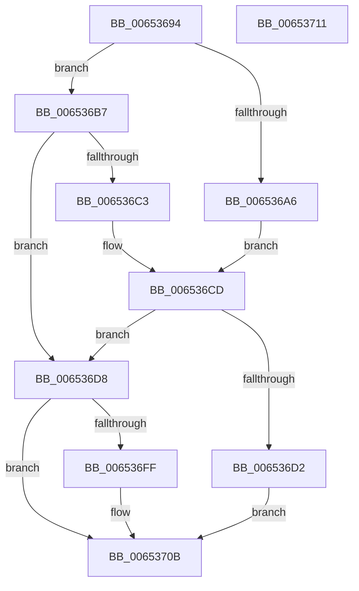

# EtwpGetPlaceholderBuffer

- RVA: `0x00653694`–`0x00653712` (길이 `126` bytes)
- VA: `0x0000000140653694`
- 실행 섹션: `.text`
- PDB 이름 있음: `예`; PDB Function 태그: `아니요`
- unwind 정보 RVA: `0x0005CF00`
- 디코드: `34`개 명령, `126/126` bytes 표시
- 미해석 바이트: `0` (있으면 어셈블리에 `.byte`로 보존)

> 이 문서는 커널 이미지의 기계어와 PDB 기호를 분석해 생성했습니다. 4번과 5번은 함수 원형과 자료형을 바이너리 사용 방식에서 추정한 C 해석이며 원본 소스 복구 결과는 아닙니다.

## 1. Dependencies

- 직접 호출 지점: **3**; 고유 호출 대상: **3**
- 직접 호출자로 확인된 함수: **1**
- RIP 상대 이미지 참조: **0**

### Outgoing calls
- `0x0065369D` → [Feature_218004792__private_IsEnabledDeviceUsageNoInline](../64/Feature_218004792__private_IsEnabledDeviceUsageNoInline_function_0064F3EC.md) (function, `0x0064F3EC`)
- `0x006536AD` → [ExpInterlockedPopEntrySList](../6B/ExpInterlockedPopEntrySList_function_006BA570.md) (function, `0x006BA570`)
- `0x006536F5` → [ExAllocatePool2](../../poolcode/B8/ExAllocatePool2_function_00B820F0.md) (function, `0x00B820F0`)

### Direct callers
- [EtwpDequeueBufferPendingCompression](EtwpDequeueBufferPendingCompression_function_006533E8.md) at `0x00653403`

### Static image references
- 디코드된 RIP-relative 메모리 참조가 없습니다.

## 2. Other-region calls and transfers

- 다른 실행 섹션으로 향하는 call: **1**
  - `0x006536F5` → [ExAllocatePool2](../../poolcode/B8/ExAllocatePool2_function_00B820F0.md) (`.text` → `POOLCODE`)
- 별도 외부 분기/꼬리 이동을 확인하지 못했습니다.

## 3. Assembly (complete function range)

```asm
00653694  40 53                           push rbx
00653696  48 83 EC 20                     sub rsp, 0x20
0065369A  48 8B D9                        mov rbx, rcx
0065369D  E8 4A BD FF FF                  call 0x14064f3ec
006536A2  85 C0                           test eax, eax
006536A4  74 11                           je 0x1406536b7
006536A6  48 8D 8B B0 05 00 00            lea rcx, [rbx + 0x5b0]
006536AD  E8 BE 6E 06 00                  call 0x1406ba570
006536B2  48 8B D0                        mov rdx, rax
006536B5  EB 16                           jmp 0x1406536cd
006536B7  48 8B 93 A8 05 00 00            mov rdx, qword ptr [rbx + 0x5a8]
006536BE  48 85 D2                        test rdx, rdx
006536C1  74 15                           je 0x1406536d8
006536C3  48 8B 02                        mov rax, qword ptr [rdx]
006536C6  48 89 83 A8 05 00 00            mov qword ptr [rbx + 0x5a8], rax
006536CD  48 85 D2                        test rdx, rdx
006536D0  74 06                           je 0x1406536d8
006536D2  48 8D 42 E0                     lea rax, [rdx - 0x20]
006536D6  EB 33                           jmp 0x14065370b
006536D8  83 BB 2C 01 00 00 01            cmp dword ptr [rbx + 0x12c], 1
006536DF  B8 40 00 00 00                  mov eax, 0x40
006536E4  B9 00 01 00 00                  mov ecx, 0x100
006536E9  41 B8 45 74 77 42               mov r8d, 0x42777445
006536EF  0F 45 C8                        cmovne ecx, eax
006536F2  8D 50 08                        lea edx, [rax + 8]
006536F5  E8 F6 E9 52 00                  call 0x140b820f0
006536FA  48 85 C0                        test rax, rax
006536FD  74 0C                           je 0x14065370b
006536FF  48 83 60 20 00                  and qword ptr [rax + 0x20], 0
00653704  C7 40 2C 06 00 00 00            mov dword ptr [rax + 0x2c], 6
0065370B  48 83 C4 20                     add rsp, 0x20
0065370F  5B                              pop rbx
00653710  C3                              ret
00653711  CC                              int3
```

## 4. C-style interpretation (structured pseudocode)

```c
__int64 __fastcall EtwpGetPlaceholderBuffer(__int64 a1)
{
    __int64 result;
    __int64 v_rsp;

    v_rsp = (v_rsp) - (32);
    result = Feature_218004792__private_IsEnabledDeviceUsageNoInline(a1, a2, a3, a4);
    if ((unsigned int)(result) == 0) goto loc_006536B7;
    result = ExpInterlockedPopEntrySList(a1 + 1456, a2, a3, a4);
    goto loc_006536CD;
loc_006536B7:
    if (*(unsigned __int64 *)(a1 + 1448) == 0) goto loc_006536D8;
    *(unsigned __int64 *)(a1 + 1448) = *(unsigned __int64 *)(*(unsigned __int64 *)(a1 + 1448));
loc_006536CD:
    if (*(unsigned __int64 *)(a1 + 1448) == 0) goto loc_006536D8;
    goto loc_0065370B;
loc_006536D8:
    a1 = 256;
    if ((*(unsigned int *)(a1 + 300)) != 1) { a1 = 64; }
    result = ExAllocatePool2(a1, 64 + 8, (unsigned int)(0x42777445ULL), a4);
    if (result != 0) {
        *(unsigned int *)(result + 44) = 6;
    }
    v_rsp = (v_rsp) + (32);
    return result;
}
```

## 5. (Beta) C Style

```c
int64_t EtwpGetPlaceholderBuffer(void *Arg1)
{
    uint8_t *arg1 = (uint8_t *)Arg1;

    int64_t result;
    int64_t local_rsp;

    local_rsp = (local_rsp) - (32);
    result = Feature_218004792__private_IsEnabledDeviceUsageNoInline(Arg1, a2, a3, a4);
    if ((uint32_t)(result) == 0) goto loc_006536B7;
    result = ExpInterlockedPopEntrySList(Arg1 + 1456, a2, a3, a4);
    goto loc_006536CD;
loc_006536B7:
    if (*(uint64_t *)(arg1 + 0x5A8) == 0) goto loc_006536D8;
    *(uint64_t *)(arg1 + 0x5A8) = *(uint64_t *)(*(uint64_t *)(arg1 + 0x5A8));
loc_006536CD:
    if (*(uint64_t *)(arg1 + 0x5A8) == 0) goto loc_006536D8;
    goto loc_0065370B;
loc_006536D8:
    Arg1 = 256;
    if ((*(uint32_t *)(arg1 + 0x12C)) != 1) { Arg1 = 64; }
    result = ExAllocatePool2(Arg1, 64 + 8, (uint32_t)(0x42777445ULL), a4);
    if (result != 0) {
        *(uint32_t *)(result + 0x2C) = 6;
    }
    local_rsp = (local_rsp) + (32);
    return result;
}
```

### 관측된 메모리 오프셋

구조체 형식이 확인되지 않은 접근은 인자 기준의 오프셋으로만 기록했습니다.

| 기준 인자 | 오프셋 표현 | 폭 (bit) | 접근 |
|---|---:|---:|---|
| `Arg1` | `+ 0x12C` | `32` | `R` |
| `Arg1` | `+ 0x5A8` | `64` | `R` |
| `Arg1` | `+ 0x5A8` | `64` | `W` |
| `Arg1` | `+ 0x5B0` | `64` | `R` |

## 6. Execution-region graph

[열기: 2D/3D 그래프와 함수 탐색 컨트롤 패널](../../../control-panel.html?section=text&rva=0x00653694&view=graph)

- 2D 그래프는 위에서 아래로 흐르고, 3D 그래프는 빈 공간을 드래그해 회전합니다. Shift+드래그는 이동, 휠은 확대·축소, 함수 노드 선택은 대상 보고서 이동입니다.

### Static fallback


