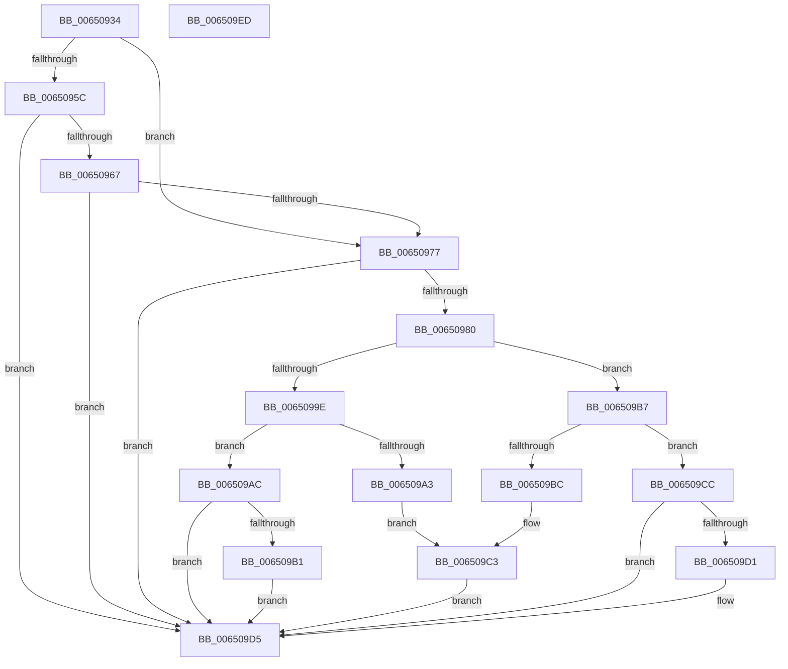

# EtwpGetScsiPassThroughCdb

- RVA: `0x00650934`–`0x006509EE` (길이 `186` bytes)
- VA: `0x0000000140650934`
- 실행 섹션: `.text`
- PDB 이름 있음: `예`; PDB Function 태그: `아니요`
- unwind 정보 RVA: `0x0005C954`
- 디코드: `55`개 명령, `186/186` bytes 표시
- 미해석 바이트: `0` (있으면 어셈블리에 `.byte`로 보존)

> 이 문서는 커널 이미지의 기계어와 PDB 기호를 분석해 생성했습니다. 4번과 5번은 함수 원형과 자료형을 바이너리 사용 방식에서 추정한 C 해석이며 원본 소스 복구 결과는 아닙니다.

## 1. Dependencies

- 직접 호출 지점: **1**; 고유 호출 대상: **1**
- 직접 호출자로 확인된 함수: **2**
- RIP 상대 이미지 참조: **0**

### Outgoing calls
- `0x00650995` → [IoIs32bitProcess](../40/IoIs32bitProcess_function_0040DFE0.md) (function, `0x0040DFE0`)

### Direct callers
- [EtwpTraceOpticalIo](EtwpTraceOpticalIo_function_00650DF0.md) at `0x00650E99`
- [EtwpTraceOpticalIoInit](EtwpTraceOpticalIoInit_function_006510A0.md) at `0x006510DE`

### Static image references
- 디코드된 RIP-relative 메모리 참조가 없습니다.

## 2. Other-region calls and transfers

- 다른 실행 섹션으로 향하는 call: **0**
- 별도 외부 분기/꼬리 이동을 확인하지 못했습니다.

## 3. Assembly (complete function range)

```asm
00650934  48 89 5C 24 08                  mov qword ptr [rsp + 8], rbx
00650939  48 89 6C 24 10                  mov qword ptr [rsp + 0x10], rbp
0065093E  48 89 74 24 18                  mov qword ptr [rsp + 0x18], rsi
00650943  57                              push rdi
00650944  48 83 EC 20                     sub rsp, 0x20
00650948  48 8B B1 B8 00 00 00            mov rsi, qword ptr [rcx + 0xb8]
0065094F  33 DB                           xor ebx, ebx
00650951  8B 56 18                        mov edx, dword ptr [rsi + 0x18]
00650954  81 FA 04 D0 04 00               cmp edx, 0x4d004
0065095A  74 1B                           je 0x140650977
0065095C  8D 82 EC 2F FB FF               lea eax, [rdx - 0x4d014]
00650962  83 F8 34                        cmp eax, 0x34
00650965  77 6E                           ja 0x1406509d5
00650967  49 B8 01 00 00 00 00 00 11 00   movabs r8, 0x11000000000001
00650971  49 0F A3 C0                     bt r8, rax
00650975  73 5E                           jae 0x1406509d5
00650977  48 8B 79 18                     mov rdi, qword ptr [rcx + 0x18]
0065097B  48 85 FF                        test rdi, rdi
0065097E  74 55                           je 0x1406509d5
00650980  8B 76 10                        mov esi, dword ptr [rsi + 0x10]
00650983  8D 82 BC 2F FB FF               lea eax, [rdx - 0x4d044]
00650989  83 E0 FB                        and eax, 0xfffffffb
0065098C  F7 D8                           neg eax
0065098E  40 1A ED                        sbb bpl, bpl
00650991  40 80 E5 01                     and bpl, 1
00650995  E8 46 D6 DB FF                  call 0x14040dfe0
0065099A  84 C0                           test al, al
0065099C  74 19                           je 0x1406509b7
0065099E  40 84 ED                        test bpl, bpl
006509A1  74 09                           je 0x1406509ac
006509A3  48 8D 47 1C                     lea rax, [rdi + 0x1c]
006509A7  83 FE 2C                        cmp esi, 0x2c
006509AA  EB 17                           jmp 0x1406509c3
006509AC  83 FE 34                        cmp esi, 0x34
006509AF  72 24                           jb 0x1406509d5
006509B1  48 8D 5F 30                     lea rbx, [rdi + 0x30]
006509B5  EB 1E                           jmp 0x1406509d5
006509B7  40 84 ED                        test bpl, bpl
006509BA  74 10                           je 0x1406509cc
006509BC  48 8D 47 24                     lea rax, [rdi + 0x24]
006509C0  83 FE 38                        cmp esi, 0x38
006509C3  48 0F 42 C3                     cmovb rax, rbx
006509C7  48 8B D8                        mov rbx, rax
006509CA  EB 09                           jmp 0x1406509d5
006509CC  83 FE 40                        cmp esi, 0x40
006509CF  72 04                           jb 0x1406509d5
006509D1  48 8D 5F 38                     lea rbx, [rdi + 0x38]
006509D5  48 8B 6C 24 38                  mov rbp, qword ptr [rsp + 0x38]
006509DA  48 8B C3                        mov rax, rbx
006509DD  48 8B 5C 24 30                  mov rbx, qword ptr [rsp + 0x30]
006509E2  48 8B 74 24 40                  mov rsi, qword ptr [rsp + 0x40]
006509E7  48 83 C4 20                     add rsp, 0x20
006509EB  5F                              pop rdi
006509EC  C3                              ret
006509ED  CC                              int3
```

## 4. C-style interpretation (structured pseudocode)

```c
__int64 __fastcall EtwpGetScsiPassThroughCdb(__int64 a1)
{
    __int64 result;
    __int64 v_rbp;
    __int64 v_rbx;
    __int64 v_rsp;
    unsigned __int64 v_stack_p10;
    unsigned __int64 v_stack_p18;
    unsigned __int64 v_stack_p8;

    v_stack_p8 = v_rbx;
    v_stack_p10 = v_rbp;
    v_stack_p18 = v_rsi;
    v_rsp = (v_rsp) - (32);
    v_rbx = 0;
    if (((unsigned int)((unsigned int)(*(unsigned int *)(*(unsigned __int64 *)(a1 + 184) + 24)))) == 0x4D004ULL) goto loc_00650977;
    if (((unsigned int)((unsigned int)(*(unsigned int *)(*(unsigned __int64 *)(a1 + 184) + 24)) - 315412)) > 52) goto loc_006509D5;
    if (((unsigned int)((unsigned int)(*(unsigned int *)(*(unsigned __int64 *)(a1 + 184) + 24)) - 315412)) >= 52) goto loc_006509D5;
loc_00650977:
    if (*(unsigned __int64 *)(a1 + 24) == 0) goto loc_006509D5;
    result = (unsigned int)(((unsigned int)(*(unsigned int *)(*(unsigned __int64 *)(a1 + 184) + 24)) - 315460) & (0xFFFFFFFBULL));
    result = (unsigned int)(-(result));
    v_rbp = (unsigned __int8)((v_rbp) & (1));
    result = IoIs32bitProcess(a1, (unsigned int)(*(unsigned int *)(*(unsigned __int64 *)(a1 + 184) + 24)), a3, a4);
    if ((unsigned __int8)(result) == 0) goto loc_006509B7;
    if ((unsigned __int8)(v_rbp) == 0) goto loc_006509AC;
    goto loc_006509C3;
loc_006509AC:
    if (((unsigned int)((unsigned int)(*(unsigned int *)(*(unsigned __int64 *)(a1 + 184) + 16)))) < 52) goto loc_006509D5;
    goto loc_006509D5;
loc_006509B7:
    if ((unsigned __int8)(v_rbp) == 0) goto loc_006509CC;
loc_006509C3:
    result = *(unsigned __int64 *)(a1 + 24) + 36;
    if (((unsigned int)((unsigned int)(*(unsigned int *)(*(unsigned __int64 *)(a1 + 184) + 16)))) < 56) { result = *(unsigned __int64 *)(a1 + 24) + 48; }
    goto loc_006509D5;
loc_006509CC:
    v_rbx = result;
    if (((unsigned int)((unsigned int)(*(unsigned int *)(*(unsigned __int64 *)(a1 + 184) + 16)))) >= 64) {
        v_rbx = *(unsigned __int64 *)(a1 + 24) + 56;
    }
    v_rsp = (v_rsp) + (32);
    return v_rbx;
}
```

## 5. (Beta) C Style

```c
int64_t EtwpGetScsiPassThroughCdb(void *Arg1)
{
    uint8_t *arg1 = (uint8_t *)Arg1;

    int64_t result;
    int64_t local_rbp;
    int64_t local_rbx;
    int64_t local_rsp;
    uint64_t v_stack_p10;
    uint64_t v_stack_p18;
    uint64_t v_stack_p8;

    v_stack_p8 = local_rbx;
    v_stack_p10 = local_rbp;
    v_stack_p18 = local_rsi;
    local_rsp = (local_rsp) - (32);
    local_rbx = 0;
    if (((uint32_t)((uint32_t)(*(uint32_t *)(*(uint64_t *)(arg1 + 0xB8) + 0x18)))) == 0x4D004ULL) goto loc_00650977;
    if (((uint32_t)((uint32_t)(*(uint32_t *)(*(uint64_t *)(arg1 + 0xB8) + 0x18)) - 315412)) > 52) goto loc_006509D5;
    if (((uint32_t)((uint32_t)(*(uint32_t *)(*(uint64_t *)(arg1 + 0xB8) + 0x18)) - 315412)) >= 52) goto loc_006509D5;
loc_00650977:
    if (*(uint64_t *)(arg1 + 0x18) == 0) goto loc_006509D5;
    result = (uint32_t)(((uint32_t)(*(uint32_t *)(*(uint64_t *)(arg1 + 0xB8) + 0x18)) - 315460) & (0xFFFFFFFBULL));
    result = (uint32_t)(-(result));
    local_rbp = (uint8_t)((local_rbp) & (1));
    result = IoIs32bitProcess(Arg1, (uint32_t)(*(uint32_t *)(*(uint64_t *)(arg1 + 0xB8) + 0x18)), a3, a4);
    if ((uint8_t)(result) == 0) goto loc_006509B7;
    if ((uint8_t)(local_rbp) == 0) goto loc_006509AC;
    goto loc_006509C3;
loc_006509AC:
    if (((uint32_t)((uint32_t)(*(uint32_t *)(*(uint64_t *)(arg1 + 0xB8) + 0x10)))) < 52) goto loc_006509D5;
    goto loc_006509D5;
loc_006509B7:
    if ((uint8_t)(local_rbp) == 0) goto loc_006509CC;
loc_006509C3:
    result = *(uint64_t *)(arg1 + 0x18) + 36;
    if (((uint32_t)((uint32_t)(*(uint32_t *)(*(uint64_t *)(arg1 + 0xB8) + 0x10)))) < 56) { result = *(uint64_t *)(arg1 + 0x18) + 48; }
    goto loc_006509D5;
loc_006509CC:
    local_rbx = result;
    if (((uint32_t)((uint32_t)(*(uint32_t *)(*(uint64_t *)(arg1 + 0xB8) + 0x10)))) >= 64) {
        local_rbx = *(uint64_t *)(arg1 + 0x18) + 56;
    }
    local_rsp = (local_rsp) + (32);
    return local_rbx;
}
```

### 관측된 메모리 오프셋

구조체 형식이 확인되지 않은 접근은 인자 기준의 오프셋으로만 기록했습니다.

| 기준 인자 | 오프셋 표현 | 폭 (bit) | 접근 |
|---|---:|---:|---|
| `Arg1` | `+ 0x18` | `64` | `R` |
| `Arg1` | `+ 0xB8` | `64` | `R` |

## 6. Execution-region graph

[열기: 2D/3D 그래프와 함수 탐색 컨트롤 패널](../../../control-panel.html?section=text&rva=0x00650934&view=graph)

- 2D 그래프는 위에서 아래로 흐르고, 3D 그래프는 빈 공간을 드래그해 회전합니다. Shift+드래그는 이동, 휠은 확대·축소, 함수 노드 선택은 대상 보고서 이동입니다.

### Static fallback


