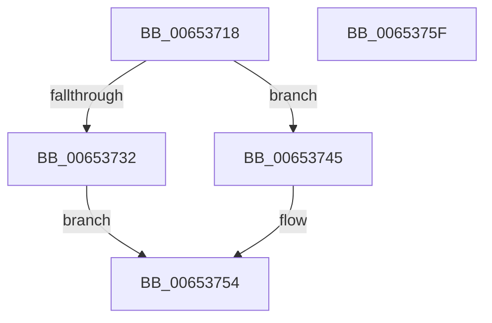

# EtwpInsertPlaceholderBuffer

- RVA: `0x00653718`–`0x00653760` (길이 `72` bytes)
- VA: `0x0000000140653718`
- 실행 섹션: `.text`
- PDB 이름 있음: `예`; PDB Function 태그: `아니요`
- unwind 정보 RVA: `0x0005CAAC`
- 디코드: `20`개 명령, `72/72` bytes 표시
- 미해석 바이트: `0` (있으면 어셈블리에 `.byte`로 보존)

> 이 문서는 커널 이미지의 기계어와 PDB 기호를 분석해 생성했습니다. 4번과 5번은 함수 원형과 자료형을 바이너리 사용 방식에서 추정한 C 해석이며 원본 소스 복구 결과는 아닙니다.

## 1. Dependencies

- 직접 호출 지점: **2**; 고유 호출 대상: **2**
- 직접 호출자로 확인된 함수: **4**
- RIP 상대 이미지 참조: **0**

### Outgoing calls
- `0x00653729` → [Feature_218004792__private_IsEnabledDeviceUsageNoInline](../64/Feature_218004792__private_IsEnabledDeviceUsageNoInline_function_0064F3EC.md) (function, `0x0064F3EC`)
- `0x0065374F` → [ExpInterlockedPushEntrySList](../6B/ExpInterlockedPushEntrySList_function_006BA5B0.md) (function, `0x006BA5B0`)

### Direct callers
- [EtwpDequeueBuffer](../3E/EtwpDequeueBuffer_function_003EB434.md) at `0x003EB477`
- [EtwpInitializeCompression](../4E/EtwpInitializeCompression_function_004EC774.md) at `0x004EC8AE`
- [EtwpDequeueBufferPendingCompression](EtwpDequeueBufferPendingCompression_function_006533E8.md) at `0x0065346B`
- [sub_006DFED2](../6D/Unknown_function_006DFED2.md) at `0x006DFF39`

### Static image references
- 디코드된 RIP-relative 메모리 참조가 없습니다.

## 2. Other-region calls and transfers

- 다른 실행 섹션으로 향하는 call: **0**
- 별도 외부 분기/꼬리 이동을 확인하지 못했습니다.

## 3. Assembly (complete function range)

```asm
00653718  48 89 5C 24 08                  mov qword ptr [rsp + 8], rbx
0065371D  57                              push rdi
0065371E  48 83 EC 20                     sub rsp, 0x20
00653722  48 8B D9                        mov rbx, rcx
00653725  48 8D 7A 20                     lea rdi, [rdx + 0x20]
00653729  E8 BE BC FF FF                  call 0x14064f3ec
0065372E  85 C0                           test eax, eax
00653730  75 13                           jne 0x140653745
00653732  48 8B 83 A8 05 00 00            mov rax, qword ptr [rbx + 0x5a8]
00653739  48 89 07                        mov qword ptr [rdi], rax
0065373C  48 89 BB A8 05 00 00            mov qword ptr [rbx + 0x5a8], rdi
00653743  EB 0F                           jmp 0x140653754
00653745  48 8D 8B B0 05 00 00            lea rcx, [rbx + 0x5b0]
0065374C  48 8B D7                        mov rdx, rdi
0065374F  E8 5C 6E 06 00                  call 0x1406ba5b0
00653754  48 8B 5C 24 30                  mov rbx, qword ptr [rsp + 0x30]
00653759  48 83 C4 20                     add rsp, 0x20
0065375D  5F                              pop rdi
0065375E  C3                              ret
0065375F  CC                              int3
```

## 4. C-style interpretation (structured pseudocode)

```c
__int64 __fastcall EtwpInsertPlaceholderBuffer(__int64 a1, __int64 a2)
{
    __int64 result;
    __int64 v_rsp;
    unsigned __int64 v_stack_p8;

    v_stack_p8 = v_rbx;
    v_rsp = (v_rsp) - (32);
    result = Feature_218004792__private_IsEnabledDeviceUsageNoInline(a1, a2, a3, a4);
    if ((unsigned int)(result) != 0) goto loc_00653745;
    *(unsigned __int64 *)(a2 + 32) = *(unsigned __int64 *)(a1 + 1448);
    *(unsigned __int64 *)(a1 + 1448) = a2 + 32;
    goto loc_00653754;
loc_00653745:
    result = ExpInterlockedPushEntrySList(a1 + 1456, a2 + 32, a3, a4);
loc_00653754:
    v_rsp = (v_rsp) + (32);
    return result;
}
```

## 5. (Beta) C Style

```c
int64_t EtwpInsertPlaceholderBuffer(void *Arg1, void *Arg2)
{
    uint8_t *arg1 = (uint8_t *)Arg1;
    uint8_t *arg2 = (uint8_t *)Arg2;

    int64_t result;
    int64_t local_rsp;
    uint64_t v_stack_p8;

    v_stack_p8 = local_rbx;
    local_rsp = (local_rsp) - (32);
    result = Feature_218004792__private_IsEnabledDeviceUsageNoInline(Arg1, Arg2, a3, a4);
    if ((uint32_t)(result) != 0) goto loc_00653745;
    *(uint64_t *)(arg2 + 0x20) = *(uint64_t *)(arg1 + 0x5A8);
    *(void **)(arg1 + 0x5A8) = Arg2 + 32;
    goto loc_00653754;
loc_00653745:
    result = ExpInterlockedPushEntrySList(Arg1 + 1456, Arg2 + 32, a3, a4);
loc_00653754:
    local_rsp = (local_rsp) + (32);
    return result;
}
```

### 관측된 메모리 오프셋

구조체 형식이 확인되지 않은 접근은 인자 기준의 오프셋으로만 기록했습니다.

| 기준 인자 | 오프셋 표현 | 폭 (bit) | 접근 |
|---|---:|---:|---|
| `Arg1` | `+ 0x5A8` | `64` | `R` |
| `Arg1` | `+ 0x5A8` | `64` | `W` |
| `Arg1` | `+ 0x5B0` | `64` | `R` |
| `Arg2` | `+ 0x0` | `64` | `W` |
| `Arg2` | `+ 0x20` | `64` | `R` |

## 6. Execution-region graph

[열기: 2D/3D 그래프와 함수 탐색 컨트롤 패널](../../../control-panel.html?section=text&rva=0x00653718&view=graph)

- 2D 그래프는 위에서 아래로 흐르고, 3D 그래프는 빈 공간을 드래그해 회전합니다. Shift+드래그는 이동, 휠은 확대·축소, 함수 노드 선택은 대상 보고서 이동입니다.

### Static fallback


