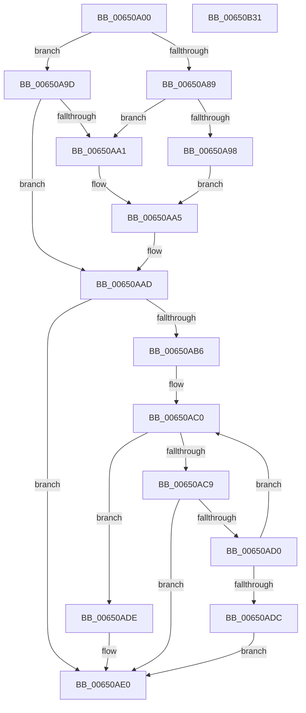

# EtwpProfileInterrupt

- RVA: `0x00650A00`–`0x00650B32` (길이 `306` bytes)
- VA: `0x0000000140650A00`
- 실행 섹션: `.text`
- PDB 이름 있음: `예`; PDB Function 태그: `아니요`
- unwind 정보 RVA: `0x000D3780`
- 디코드: `73`개 명령, `306/306` bytes 표시
- 미해석 바이트: `0` (있으면 어셈블리에 `.byte`로 보존)

> 이 문서는 커널 이미지의 기계어와 PDB 기호를 분석해 생성했습니다. 4번과 5번은 함수 원형과 자료형을 바이너리 사용 방식에서 추정한 C 해석이며 원본 소스 복구 결과는 아닙니다.

## 1. Dependencies

- 직접 호출 지점: **2**; 고유 호출 대상: **2**
- 직접 호출자로 확인된 함수: **0**
- RIP 상대 이미지 참조: **1**

### Outgoing calls
- `0x00650B15` → [EtwTraceSiloKernelEvent](../22/EtwTraceSiloKernelEvent_function_002242A0.md) (function, `0x002242A0`)
- `0x00650B21` → [_security_check_cookie](../6A/_security_check_cookie_function_006AC640.md) (function, `0x006AC640`)

### Direct callers
- 이 함수 시작 RVA로 연결되는 직접 call은 확인되지 않았습니다. 간접 호출은 완전히 역산할 수 없습니다.

### Static image references
- `0x00650A0D` → RVA `0x00E0A740` (`.data`; read)

## 2. Other-region calls and transfers

- 다른 실행 섹션으로 향하는 call: **0**
- 별도 외부 분기/꼬리 이동을 확인하지 못했습니다.

## 3. Assembly (complete function range)

```asm
00650A00  48 89 5C 24 08                  mov qword ptr [rsp + 8], rbx
00650A05  55                              push rbp
00650A06  48 8B EC                        mov rbp, rsp
00650A09  48 83 EC 60                     sub rsp, 0x60
00650A0D  48 8B 05 2C 9D 7B 00            mov rax, qword ptr [rip + 0x7b9d2c]
00650A14  48 33 C4                        xor rax, rsp
00650A17  48 89 45 F0                     mov qword ptr [rbp - 0x10], rax
00650A1B  65 4C 8B 0C 25 88 01 00 00      mov r9, qword ptr gs:[0x188]
00650A24  48 B8 FF FF FE FF FF 7F 00 00   movabs rax, 0x7ffffffeffff
00650A2E  48 8B 91 68 01 00 00            mov rdx, qword ptr [rcx + 0x168]
00650A35  41 B8 02 DA 10 02               mov r8d, 0x210da02
00650A3B  48 3B D0                        cmp rdx, rax
00650A3E  B9 02 D2 10 02                  mov ecx, 0x210d202
00650A43  BB 01 00 00 00                  mov ebx, 1
00650A48  41 8B 81 10 05 00 00            mov eax, dword ptr [r9 + 0x510]
00650A4F  41 0F 47 C8                     cmova ecx, r8d
00650A53  4D 8B 99 20 02 00 00            mov r11, qword ptr [r9 + 0x220]
00650A5A  C6 45 DE 00                     mov byte ptr [rbp - 0x22], 0
00650A5E  89 45 D8                        mov dword ptr [rbp - 0x28], eax
00650A61  45 8A 81 C3 00 00 00            mov r8b, byte ptr [r9 + 0xc3]
00650A68  41 C0 E0 03                     shl r8b, 3
00650A6C  44 88 45 DE                     mov byte ptr [rbp - 0x22], r8b
00650A70  48 89 55 D0                     mov qword ptr [rbp - 0x30], rdx
00650A74  66 89 5D DC                     mov word ptr [rbp - 0x24], bx
00650A78  65 4C 8B 14 25 20 00 00 00      mov r10, qword ptr gs:[0x20]
00650A81  41 8A 42 20                     mov al, byte ptr [r10 + 0x20]
00650A85  3C 02                           cmp al, 2
00650A87  75 14                           jne 0x140650a9d
00650A89  65 8B 04 25 3C 3A 00 00         mov eax, dword ptr gs:[0x3a3c]
00650A91  A9 01 00 01 00                  test eax, 0x10001
00650A96  74 09                           je 0x140650aa1
00650A98  44 0A C3                        or r8b, bl
00650A9B  EB 08                           jmp 0x140650aa5
00650A9D  3A C3                           cmp al, bl
00650A9F  76 0C                           jbe 0x140650aad
00650AA1  41 80 C8 02                     or r8b, 2
00650AA5  0F BA F1 0E                     btr ecx, 0xe
00650AA9  44 88 45 DE                     mov byte ptr [rbp - 0x22], r8b
00650AAD  49 8B 51 68                     mov rdx, qword ptr [r9 + 0x68]
00650AB1  48 85 D2                        test rdx, rdx
00650AB4  74 2A                           je 0x140650ae0
00650AB6  41 8B 82 D8 00 00 00            mov eax, dword ptr [r10 + 0xd8]
00650ABD  48 03 C2                        add rax, rdx
00650AC0  81 78 7C FF 00 00 00            cmp dword ptr [rax + 0x7c], 0xff
00650AC7  77 15                           ja 0x140650ade
00650AC9  8A 50 7C                        mov dl, byte ptr [rax + 0x7c]
00650ACC  84 D2                           test dl, dl
00650ACE  75 10                           jne 0x140650ae0
00650AD0  48 8B 80 A0 01 00 00            mov rax, qword ptr [rax + 0x1a0]
00650AD7  48 85 C0                        test rax, rax
00650ADA  75 E4                           jne 0x140650ac0
00650ADC  EB 02                           jmp 0x140650ae0
00650ADE  B2 FF                           mov dl, 0xff
00650AE0  83 65 EC 00                     and dword ptr [rbp - 0x14], 0
00650AE4  48 8D 45 D0                     lea rax, [rbp - 0x30]
00650AE8  88 55 DF                        mov byte ptr [rbp - 0x21], dl
00650AEB  41 B9 02 00 00 20               mov r9d, 0x20000002
00650AF1  89 4C 24 28                     mov dword ptr [rsp + 0x28], ecx
00650AF5  48 8D 55 E0                     lea rdx, [rbp - 0x20]
00650AF9  48 89 45 E0                     mov qword ptr [rbp - 0x20], rax
00650AFD  44 8B C3                        mov r8d, ebx
00650B00  C7 45 E8 10 00 00 00            mov dword ptr [rbp - 0x18], 0x10
00650B07  49 8B 8B F0 05 00 00            mov rcx, qword ptr [r11 + 0x5f0]
00650B0E  66 C7 44 24 20 2E 0F            mov word ptr [rsp + 0x20], 0xf2e
00650B15  E8 86 37 BD FF                  call 0x1402242a0
00650B1A  48 8B 4D F0                     mov rcx, qword ptr [rbp - 0x10]
00650B1E  48 33 CC                        xor rcx, rsp
00650B21  E8 1A BB 05 00                  call 0x1406ac640
00650B26  48 8B 5C 24 70                  mov rbx, qword ptr [rsp + 0x70]
00650B2B  48 83 C4 60                     add rsp, 0x60
00650B2F  5D                              pop rbp
00650B30  C3                              ret
00650B31  CC                              int3
```

## 4. C-style interpretation (structured pseudocode)

```c
__int64 __fastcall EtwpProfileInterrupt(__int64 a1)
{
    __int64 result;
    __int64 v_rsp;
    unsigned __int64 v_stack_m18;
    unsigned int v_stack_m1C;
    unsigned int v_stack_m20;
    unsigned __int64 v_stack_m28;
    unsigned __int8 v_stack_m29;
    unsigned __int8 v_stack_m2A;
    unsigned __int16 v_stack_m2C;
    unsigned int v_stack_m30;
    unsigned __int64 v_stack_m38;
    unsigned int v_stack_m40;
    unsigned __int16 v_stack_m48;
    unsigned __int64 v_stack_p8;

    v_stack_p8 = v_rbx;
    v_rsp = (v_rsp) - (96);
    result = (*(unsigned __int64 *)(v_rip + 8101164)) ^ (v_rsp);
    v_stack_m18 = result;
    a1 = (unsigned int)(0x210D202ULL);
    if ((*(unsigned __int64 *)(a1 + 360)) > result) { a1 = (unsigned int)((unsigned int)(0x210DA02ULL)); }
    v_stack_m2A = 0;
    v_stack_m30 = (unsigned int)((unsigned int)(*(unsigned int *)(*(unsigned __int64 *)(gs_base + (0 + 392)) + 1296)));
    a3 = (unsigned __int8)((*(unsigned __int8 *)(*(unsigned __int64 *)(gs_base + (0 + 392)) + 195)) << (3));
    v_stack_m2A = (unsigned __int8)(a3);
    v_stack_m38 = *(unsigned __int64 *)(a1 + 360);
    v_stack_m2C = 1;
    if (((unsigned __int8)(*(unsigned __int8 *)(*(unsigned __int64 *)(gs_base + (0 + 32)) + 32))) != 2) goto loc_00650A9D;
    if ((((unsigned int)((unsigned int)(*(unsigned int *)(gs_base + (0 + 14908))))) & (0x10001ULL)) == 0) goto loc_00650AA1;
    a3 = (unsigned __int8)((a3) | (1));
    goto loc_00650AA5;
loc_00650A9D:
    if (((unsigned __int8)((unsigned int)(*(unsigned int *)(gs_base + (0 + 14908))))) <= 1) goto loc_00650AAD;
loc_00650AA1:
    a3 = (unsigned __int8)((a3) | (2));
loc_00650AA5:
    v_stack_m2A = (unsigned __int8)(a3);
loc_00650AAD:
    if (*(unsigned __int64 *)(*(unsigned __int64 *)(gs_base + (0 + 392)) + 104) == 0) goto loc_00650AE0;
    result = ((unsigned int)(*(unsigned int *)(*(unsigned __int64 *)(gs_base + (0 + 32)) + 216))) + (*(unsigned __int64 *)(*(unsigned __int64 *)(gs_base + (0 + 392)) + 104));
loc_00650AC0:
    if ((*(unsigned int *)(result + 124)) > 255) goto loc_00650ADE;
    if ((unsigned __int8)(*(unsigned __int8 *)(result + 124)) != 0) goto loc_00650AE0;
    if (*(unsigned __int64 *)(result + 416) != 0) goto loc_00650AC0;
    goto loc_00650AE0;
loc_00650ADE:
loc_00650AE0:
    v_stack_m29 = 255;
    v_stack_m40 = (unsigned int)(a1);
    v_stack_m28 = v_stack_m38;
    v_stack_m20 = 16;
    v_stack_m48 = 0xF2EULL;
    result = EtwTraceSiloKernelEvent(*(unsigned __int64 *)(*(unsigned __int64 *)(*(unsigned __int64 *)(gs_base + (0 + 392)) + 544) + 1520), v_stack_m28, 1, (unsigned int)(0x20000002ULL));
    a1 = (v_stack_m18) ^ (v_rsp);
    result = _security_check_cookie(a1, v_stack_m28, 1, (unsigned int)(0x20000002ULL));
    v_rsp = (v_rsp) + (96);
    return result;
}
```

## 5. (Beta) C Style

```c
int64_t EtwpProfileInterrupt(void *Arg1)
{
    uint8_t *arg1 = (uint8_t *)Arg1;

    int64_t result;
    int64_t local_rsp;
    uint64_t v_stack_m18;
    uint32_t v_stack_m1C;
    uint32_t v_stack_m20;
    uint64_t v_stack_m28;
    uint8_t v_stack_m29;
    uint8_t v_stack_m2A;
    uint16_t v_stack_m2C;
    uint32_t v_stack_m30;
    uint64_t v_stack_m38;
    uint32_t v_stack_m40;
    uint16_t v_stack_m48;
    uint64_t v_stack_p8;

    v_stack_p8 = local_rbx;
    local_rsp = (local_rsp) - (96);
    result = (*(uint64_t *)(v_rip + 0x7B9D2C)) ^ (local_rsp);
    v_stack_m18 = result;
    Arg1 = (uint32_t)(0x210D202ULL);
    if ((*(uint64_t *)(arg1 + 0x168)) > result) { Arg1 = (uint32_t)((uint32_t)(0x210DA02ULL)); }
    v_stack_m2A = 0;
    v_stack_m30 = (uint32_t)((uint32_t)(*(uint32_t *)(*(uint64_t *)(gs_base + (0 + 0x188)) + 0x510)));
    a3 = (uint8_t)((*(uint8_t *)(*(uint64_t *)(gs_base + (0 + 0x188)) + 0xC3)) << (3));
    v_stack_m2A = (uint8_t)(a3);
    v_stack_m38 = *(uint64_t *)(arg1 + 0x168);
    v_stack_m2C = 1;
    if (((uint8_t)(*(uint8_t *)(*(uint64_t *)(gs_base + (0 + 0x20)) + 0x20))) != 2) goto loc_00650A9D;
    if ((((uint32_t)((uint32_t)(*(uint32_t *)(gs_base + (0 + 0x3A3C))))) & (0x10001ULL)) == 0) goto loc_00650AA1;
    a3 = (uint8_t)((a3) | (1));
    goto loc_00650AA5;
loc_00650A9D:
    if (((uint8_t)((uint32_t)(*(uint32_t *)(gs_base + (0 + 0x3A3C))))) <= 1) goto loc_00650AAD;
loc_00650AA1:
    a3 = (uint8_t)((a3) | (2));
loc_00650AA5:
    v_stack_m2A = (uint8_t)(a3);
loc_00650AAD:
    if (*(uint64_t *)(*(uint64_t *)(gs_base + (0 + 0x188)) + 0x68) == 0) goto loc_00650AE0;
    result = ((uint32_t)(*(uint32_t *)(*(uint64_t *)(gs_base + (0 + 0x20)) + 0xD8))) + (*(uint64_t *)(*(uint64_t *)(gs_base + (0 + 0x188)) + 0x68));
loc_00650AC0:
    if ((*(uint32_t *)(result + 0x7C)) > 255) goto loc_00650ADE;
    if ((uint8_t)(*(uint8_t *)(result + 0x7C)) != 0) goto loc_00650AE0;
    if (*(uint64_t *)(result + 0x1A0) != 0) goto loc_00650AC0;
    goto loc_00650AE0;
loc_00650ADE:
loc_00650AE0:
    v_stack_m29 = 255;
    v_stack_m40 = (uint32_t)(Arg1);
    v_stack_m28 = v_stack_m38;
    v_stack_m20 = 16;
    v_stack_m48 = 0xF2EULL;
    result = EtwTraceSiloKernelEvent(*(uint64_t *)(*(uint64_t *)(*(uint64_t *)(gs_base + (0 + 0x188)) + 0x220) + 0x5F0), v_stack_m28, 1, (uint32_t)(0x20000002ULL));
    Arg1 = (v_stack_m18) ^ (local_rsp);
    result = _security_check_cookie(Arg1, v_stack_m28, 1, (uint32_t)(0x20000002ULL));
    local_rsp = (local_rsp) + (96);
    return result;
}
```

### 관측된 메모리 오프셋

구조체 형식이 확인되지 않은 접근은 인자 기준의 오프셋으로만 기록했습니다.

| 기준 인자 | 오프셋 표현 | 폭 (bit) | 접근 |
|---|---:|---:|---|
| `Arg1` | `+ 0x168` | `64` | `R` |

## 6. Execution-region graph

[열기: 2D/3D 그래프와 함수 탐색 컨트롤 패널](../../../control-panel.html?section=text&rva=0x00650A00&view=graph)

- 2D 그래프는 위에서 아래로 흐르고, 3D 그래프는 빈 공간을 드래그해 회전합니다. Shift+드래그는 이동, 휠은 확대·축소, 함수 노드 선택은 대상 보고서 이동입니다.

### Static fallback


