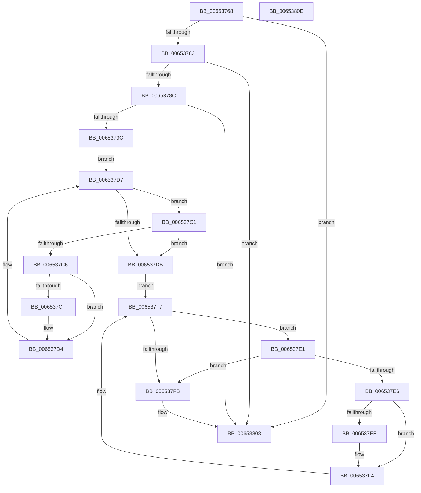

# EtwpReenableCompression

- RVA: `0x00653768`–`0x0065380F` (길이 `167` bytes)
- VA: `0x0000000140653768`
- 실행 섹션: `.text`
- PDB 이름 있음: `예`; PDB Function 태그: `아니요`
- unwind 정보 RVA: `0x0005CF00`
- 디코드: `49`개 명령, `167/167` bytes 표시
- 미해석 바이트: `0` (있으면 어셈블리에 `.byte`로 보존)

> 이 문서는 커널 이미지의 기계어와 PDB 기호를 분석해 생성했습니다. 4번과 5번은 함수 원형과 자료형을 바이너리 사용 방식에서 추정한 C 해석이며 원본 소스 복구 결과는 아닙니다.

## 1. Dependencies

- 직접 호출 지점: **4**; 고유 호출 대상: **4**
- 직접 호출자로 확인된 함수: **2**
- RIP 상대 이미지 참조: **0**

### Outgoing calls
- `0x00653783` → [KeGetEffectiveIrql](../2F/KeGetEffectiveIrql_function_002F8030.md) (function, `0x002F8030`)
- `0x006537A4` → [EtwpLockBufferList](../3E/EtwpLockBufferList_function_003EB49C.md) (function, `0x003EB49C`)
- `0x006537B0` → [EtwpQueryUsedProcessorCount](../3E/EtwpQueryUsedProcessorCount_function_003EB940.md) (function, `0x003EB940`)
- `0x00653803` → [EtwpUnlockBufferList](../2D/EtwpUnlockBufferList_function_002DFC28.md) (function, `0x002DFC28`)

### Direct callers
- [EtwpReserveTraceBuffer](../2F/EtwpReserveTraceBuffer_function_002FC8C0.md) at `0x002FCE43`
- [EtwpPrepareDirtyBuffer](../2F/EtwpPrepareDirtyBuffer_function_002FE750.md) at `0x002FE7C8`

### Static image references
- 디코드된 RIP-relative 메모리 참조가 없습니다.

## 2. Other-region calls and transfers

- 다른 실행 섹션으로 향하는 call: **0**
- 별도 외부 분기/꼬리 이동을 확인하지 못했습니다.

## 3. Assembly (complete function range)

```asm
00653768  40 53                           push rbx
0065376A  48 83 EC 20                     sub rsp, 0x20
0065376E  83 B9 A4 05 00 00 02            cmp dword ptr [rcx + 0x5a4], 2
00653775  48 8B D9                        mov rbx, rcx
00653778  C6 44 24 30 00                  mov byte ptr [rsp + 0x30], 0
0065377D  0F 84 85 00 00 00               je 0x140653808
00653783  E8 A8 48 CA FF                  call 0x1402f8030
00653788  3C 02                           cmp al, 2
0065378A  73 7C                           jae 0x140653808
0065378C  B8 01 00 00 00                  mov eax, 1
00653791  87 83 98 05 00 00               xchg dword ptr [rbx + 0x598], eax
00653797  83 F8 01                        cmp eax, 1
0065379A  74 6C                           je 0x140653808
0065379C  48 8D 54 24 30                  lea rdx, [rsp + 0x30]
006537A1  48 8B CB                        mov rcx, rbx
006537A4  E8 F3 7C D9 FF                  call 0x1403eb49c
006537A9  48 8B 53 48                     mov rdx, qword ptr [rbx + 0x48]
006537AD  48 8B CB                        mov rcx, rbx
006537B0  E8 8B 81 D9 FF                  call 0x1403eb940
006537B5  41 83 C8 FF                     or r8d, 0xffffffff
006537B9  41 B9 80 00 00 00               mov r9d, 0x80
006537BF  EB 16                           jmp 0x1406537d7
006537C1  48 85 D2                        test rdx, rdx
006537C4  74 15                           je 0x1406537db
006537C6  41 03 C0                        add eax, r8d
006537C9  83 7A 0C 04                     cmp dword ptr [rdx + 0xc], 4
006537CD  75 05                           jne 0x1406537d4
006537CF  66 44 09 4A 14                  or word ptr [rdx + 0x14], r9w
006537D4  48 8B 12                        mov rdx, qword ptr [rdx]
006537D7  85 C0                           test eax, eax
006537D9  75 E6                           jne 0x1406537c1
006537DB  48 8B 4B 38                     mov rcx, qword ptr [rbx + 0x38]
006537DF  EB 16                           jmp 0x1406537f7
006537E1  48 85 C9                        test rcx, rcx
006537E4  74 15                           je 0x1406537fb
006537E6  41 03 C0                        add eax, r8d
006537E9  83 79 0C 04                     cmp dword ptr [rcx + 0xc], 4
006537ED  75 05                           jne 0x1406537f4
006537EF  66 44 09 49 14                  or word ptr [rcx + 0x14], r9w
006537F4  48 8B 09                        mov rcx, qword ptr [rcx]
006537F7  85 C0                           test eax, eax
006537F9  75 E6                           jne 0x1406537e1
006537FB  48 8D 54 24 30                  lea rdx, [rsp + 0x30]
00653800  48 8B CB                        mov rcx, rbx
00653803  E8 20 C4 C8 FF                  call 0x1402dfc28
00653808  48 83 C4 20                     add rsp, 0x20
0065380C  5B                              pop rbx
0065380D  C3                              ret
0065380E  CC                              int3
```

## 4. C-style interpretation (structured pseudocode)

```c
__int64 __fastcall EtwpReenableCompression(__int64 a1, __int64 a2, int a3)
{
    __int64 result;
    __int64 v_rsp;
    unsigned __int8 v_stack_p8;

    v_rsp = (v_rsp) - (32);
    v_stack_p8 = 0;
    if ((*(unsigned int *)(a1 + 1444)) == 2) goto loc_00653808;
    result = KeGetEffectiveIrql(a1, a2, a3, a4);
    if (((unsigned __int8)(result)) >= 2) goto loc_00653808;
    if (1 == 1) goto loc_00653808;
    result = EtwpLockBufferList(a1, v_stack_p8, a3, a4);
    result = EtwpQueryUsedProcessorCount(a1, *(unsigned __int64 *)(a1 + 72), a3, a4);
    a3 = (unsigned int)((a3) | (0xFFFFFFFFULL));
    goto loc_006537D7;
loc_006537C1:
    if (*(unsigned __int64 *)(a1 + 72) == 0) goto loc_006537DB;
    result = (unsigned int)((result) + (a3));
    if ((*(unsigned int *)(*(unsigned __int64 *)(a1 + 72) + 12)) == 4) {
    }
loc_006537D7:
    if ((unsigned int)(result) != 0) goto loc_006537C1;
loc_006537DB:
    goto loc_006537F7;
loc_006537E1:
    if (*(unsigned __int64 *)(a1 + 56) == 0) goto loc_006537FB;
    result = (unsigned int)((result) + (a3));
    if ((*(unsigned int *)(*(unsigned __int64 *)(a1 + 56) + 12)) == 4) {
    }
loc_006537F7:
    if ((unsigned int)(result) != 0) goto loc_006537E1;
loc_006537FB:
    result = EtwpUnlockBufferList(a1, v_stack_p8, a3, 128);
loc_00653808:
    v_rsp = (v_rsp) + (32);
    return result;
}
```

## 5. (Beta) C Style

```c
int64_t EtwpReenableCompression(void *Arg1, int64_t Arg2, int32_t Arg3)
{
    uint8_t *arg1 = (uint8_t *)Arg1;

    int64_t result;
    int64_t local_rsp;
    uint8_t v_stack_p8;

    local_rsp = (local_rsp) - (32);
    v_stack_p8 = 0;
    if ((*(uint32_t *)(arg1 + 0x5A4)) == 2) goto loc_00653808;
    result = KeGetEffectiveIrql(Arg1, Arg2, Arg3, a4);
    if (((uint8_t)(result)) >= 2) goto loc_00653808;
    if (1 == 1) goto loc_00653808;
    result = EtwpLockBufferList(Arg1, v_stack_p8, Arg3, a4);
    result = EtwpQueryUsedProcessorCount(Arg1, *(uint64_t *)(arg1 + 0x48), Arg3, a4);
    Arg3 = (uint32_t)((Arg3) | (0xFFFFFFFFULL));
    goto loc_006537D7;
loc_006537C1:
    if (*(uint64_t *)(arg1 + 0x48) == 0) goto loc_006537DB;
    result = (uint32_t)((result) + (Arg3));
    if ((*(uint32_t *)(*(uint64_t *)(arg1 + 0x48) + 0xC)) == 4) {
    }
loc_006537D7:
    if ((uint32_t)(result) != 0) goto loc_006537C1;
loc_006537DB:
    goto loc_006537F7;
loc_006537E1:
    if (*(uint64_t *)(arg1 + 0x38) == 0) goto loc_006537FB;
    result = (uint32_t)((result) + (Arg3));
    if ((*(uint32_t *)(*(uint64_t *)(arg1 + 0x38) + 0xC)) == 4) {
    }
loc_006537F7:
    if ((uint32_t)(result) != 0) goto loc_006537E1;
loc_006537FB:
    result = EtwpUnlockBufferList(Arg1, v_stack_p8, Arg3, 128);
loc_00653808:
    local_rsp = (local_rsp) + (32);
    return result;
}
```

### 관측된 메모리 오프셋

구조체 형식이 확인되지 않은 접근은 인자 기준의 오프셋으로만 기록했습니다.

| 기준 인자 | 오프셋 표현 | 폭 (bit) | 접근 |
|---|---:|---:|---|
| `Arg1` | `+ 0x38` | `64` | `R` |
| `Arg1` | `+ 0x48` | `64` | `R` |
| `Arg1` | `+ 0x598` | `32` | `R/W` |
| `Arg1` | `+ 0x5A4` | `32` | `R` |

## 6. Execution-region graph

[열기: 2D/3D 그래프와 함수 탐색 컨트롤 패널](../../../control-panel.html?section=text&rva=0x00653768&view=graph)

- 2D 그래프는 위에서 아래로 흐르고, 3D 그래프는 빈 공간을 드래그해 회전합니다. Shift+드래그는 이동, 휠은 확대·축소, 함수 노드 선택은 대상 보고서 이동입니다.

### Static fallback


