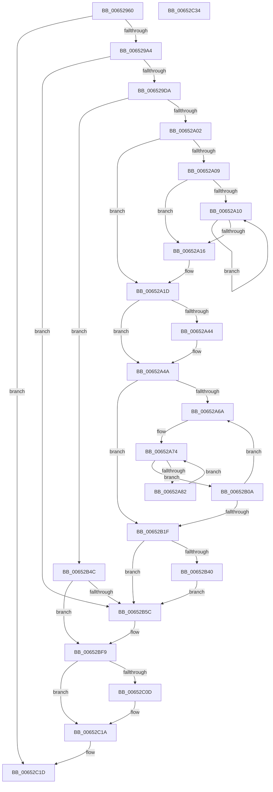

# EtwpRegisterPartitionPages

- RVA: `0x00652960`–`0x00652C35` (길이 `725` bytes)
- VA: `0x0000000140652960`
- 실행 섹션: `.text`
- PDB 이름 있음: `예`; PDB Function 태그: `아니요`
- unwind 정보 RVA: `0x0008DF5C`
- 디코드: `192`개 명령, `725/725` bytes 표시
- 미해석 바이트: `0` (있으면 어셈블리에 `.byte`로 보존)

> 이 문서는 커널 이미지의 기계어와 PDB 기호를 분석해 생성했습니다. 4번과 5번은 함수 원형과 자료형을 바이너리 사용 방식에서 추정한 C 해석이며 원본 소스 복구 결과는 아닙니다.

## 1. Dependencies

- 직접 호출 지점: **6**; 고유 호출 대상: **4**
- 직접 호출자로 확인된 함수: **1**
- RIP 상대 이미지 참조: **7**

### Outgoing calls
- `0x00652993` → [ExAllocatePool2](../../poolcode/B8/ExAllocatePool2_function_00B820F0.md) (function, `0x00B820F0`)
- `0x006529B7` → [ExAcquireSpinLockExclusive](../24/ExAcquireSpinLockExclusive_function_00248690.md) (function, `0x00248690`)
- `0x006529F1` → [ExAllocatePool2](../../poolcode/B8/ExAllocatePool2_function_00B820F0.md) (function, `0x00B820F0`)
- `0x00652B45` → [ExFreePoolWithTag](../../poolcode/B8/ExFreePoolWithTag_function_00B82870.md) (function, `0x00B82870`)
- `0x00652C03` → [ExReleaseSpinLockExclusive](../2C/ExReleaseSpinLockExclusive_function_002C0EF0.md) (function, `0x002C0EF0`)
- `0x00652C15` → [ExFreePoolWithTag](../../poolcode/B8/ExFreePoolWithTag_function_00B82870.md) (function, `0x00B82870`)

### Direct callers
- [EtwpAllocatePartitionMemory](../3E/EtwpAllocatePartitionMemory_function_003EB12C.md) at `0x003EB1A3`

### Static image references
- `0x006529A4` → RVA `0x00EFF130` (`.data`; read)
- `0x006529BC` → RVA `0x00EFF124` (`.data`; read)
- `0x006529CE` → RVA `0x00EFF120` (`.data`; read)
- `0x00652A6A` → RVA `0x00EFF128` (`.data`; read)
- `0x00652B2E` → RVA `0x00EFF128` (`.data`; write)
- `0x00652B35` → RVA `0x00EFF124` (`.data`; write)
- `0x00652BF3` → RVA `0x00EFF120` (`.data`; read/write)

## 2. Other-region calls and transfers

- 다른 실행 섹션으로 향하는 call: **4**
  - `0x00652993` → [ExAllocatePool2](../../poolcode/B8/ExAllocatePool2_function_00B820F0.md) (`.text` → `POOLCODE`)
  - `0x006529F1` → [ExAllocatePool2](../../poolcode/B8/ExAllocatePool2_function_00B820F0.md) (`.text` → `POOLCODE`)
  - `0x00652B45` → [ExFreePoolWithTag](../../poolcode/B8/ExFreePoolWithTag_function_00B82870.md) (`.text` → `POOLCODE`)
  - `0x00652C15` → [ExFreePoolWithTag](../../poolcode/B8/ExFreePoolWithTag_function_00B82870.md) (`.text` → `POOLCODE`)
- 별도 외부 분기/꼬리 이동을 확인하지 못했습니다.

## 3. Assembly (complete function range)

```asm
00652960  48 89 5C 24 08                  mov qword ptr [rsp + 8], rbx
00652965  48 89 6C 24 10                  mov qword ptr [rsp + 0x10], rbp
0065296A  56                              push rsi
0065296B  57                              push rdi
0065296C  41 54                           push r12
0065296E  41 56                           push r14
00652970  41 57                           push r15
00652972  48 83 EC 20                     sub rsp, 0x20
00652976  45 33 E4                        xor r12d, r12d
00652979  48 8B EA                        mov rbp, rdx
0065297C  49 8B D8                        mov rbx, r8
0065297F  4C 8B F1                        mov r14, rcx
00652982  41 B8 45 74 77 4F               mov r8d, 0x4f777445
00652988  41 8A FC                        mov dil, r12b
0065298B  41 8D 54 24 20                  lea edx, [r12 + 0x20]
00652990  8D 4A 20                        lea ecx, [rdx + 0x20]
00652993  E8 58 F7 52 00                  call 0x140b820f0
00652998  48 8B F0                        mov rsi, rax
0065299B  48 85 C0                        test rax, rax
0065299E  0F 84 79 02 00 00               je 0x140652c1d
006529A4  48 8D 0D 85 C7 8A 00            lea rcx, [rip + 0x8ac785]
006529AB  48 89 58 08                     mov qword ptr [rax + 8], rbx
006529AF  48 89 68 10                     mov qword ptr [rax + 0x10], rbp
006529B3  4C 89 70 18                     mov qword ptr [rax + 0x18], r14
006529B7  E8 D4 5C BF FF                  call 0x140248690
006529BC  8B 1D 62 C7 8A 00               mov ebx, dword ptr [rip + 0x8ac762]
006529C2  48 83 CD FF                     or rbp, 0xffffffffffffffff
006529C6  C1 EB 05                        shr ebx, 5
006529C9  44 8A F8                        mov r15b, al
006529CC  03 DB                           add ebx, ebx
006529CE  39 1D 4C C7 8A 00               cmp dword ptr [rip + 0x8ac74c], ebx
006529D4  0F 82 82 01 00 00               jb 0x140652b5c
006529DA  8D 45 05                        lea eax, [rbp + 5]
006529DD  41 B8 45 74 77 42               mov r8d, 0x42777445
006529E3  3B D8                           cmp ebx, eax
006529E5  8D 4D 41                        lea ecx, [rbp + 0x41]
006529E8  0F 42 D8                        cmovb ebx, eax
006529EB  8B D3                           mov edx, ebx
006529ED  48 C1 E2 03                     shl rdx, 3
006529F1  E8 FA F6 52 00                  call 0x140b820f0
006529F6  4C 8B C0                        mov r8, rax
006529F9  48 85 C0                        test rax, rax
006529FC  0F 84 4A 01 00 00               je 0x140652b4c
00652A02  8D 43 FF                        lea eax, [rbx - 1]
00652A05  85 C3                           test ebx, eax
00652A07  74 14                           je 0x140652a1d
00652A09  83 C9 FF                        or ecx, 0xffffffff
00652A0C  85 DB                           test ebx, ebx
00652A0E  74 06                           je 0x140652a16
00652A10  FF C1                           inc ecx
00652A12  D1 EB                           shr ebx, 1
00652A14  75 FA                           jne 0x140652a10
00652A16  BB 01 00 00 00                  mov ebx, 1
00652A1B  D3 E3                           shl ebx, cl
00652A1D  B8 00 00 00 04                  mov eax, 0x4000000
00652A22  3B D8                           cmp ebx, eax
00652A24  0F 47 D8                        cmova ebx, eax
00652A27  48 8D 05 F2 C6 8A 00            lea rax, [rip + 0x8ac6f2]
00652A2E  48 83 C8 01                     or rax, 1
00652A32  8B CB                           mov ecx, ebx
00652A34  49 8D 14 D8                     lea rdx, [r8 + rbx*8]
00652A38  4C 3B C2                        cmp r8, rdx
00652A3B  49 0F 47 CC                     cmova rcx, r12
00652A3F  48 85 C9                        test rcx, rcx
00652A42  74 06                           je 0x140652a4a
00652A44  49 8B F8                        mov rdi, r8
00652A47  F3 48 AB                        rep stosq qword ptr [rdi], rax
00652A4A  8B 15 D4 C6 8A 00               mov edx, dword ptr [rip + 0x8ac6d4]
00652A50  4C 8B D5                        mov r10, rbp
00652A53  8B CA                           mov ecx, edx
00652A55  41 8B FC                        mov edi, r12d
00652A58  83 E1 1F                        and ecx, 0x1f
00652A5B  49 D3 E2                        shl r10, cl
00652A5E  F7 C2 E0 FF FF FF               test edx, 0xffffffe0
00652A64  0F 86 B5 00 00 00               jbe 0x140652b1f
00652A6A  4C 8B 35 B7 C6 8A 00            mov r14, qword ptr [rip + 0x8ac6b7]
00652A71  44 8B DF                        mov r11d, edi
00652A74  4F 8B 0C DE                     mov r9, qword ptr [r14 + r11*8]
00652A78  41 F6 C1 01                     test r9b, 1
00652A7C  0F 85 88 00 00 00               jne 0x140652b0a
00652A82  49 8B 01                        mov rax, qword ptr [r9]
00652A85  4B 89 04 DE                     mov qword ptr [r14 + r11*8], rax
00652A89  49 8B 41 08                     mov rax, qword ptr [r9 + 8]
00652A8D  49 23 C2                        and rax, r10
00652A90  48 89 44 24 68                  mov qword ptr [rsp + 0x68], rax
00652A95  0F B6 C0                        movzx eax, al
00652A98  48 05 CB 5D B1 00               add rax, 0xb15dcb
00652A9E  48 6B C8 25                     imul rcx, rax, 0x25
00652AA2  0F B6 44 24 69                  movzx eax, byte ptr [rsp + 0x69]
00652AA7  48 03 C8                        add rcx, rax
00652AAA  0F B6 44 24 6A                  movzx eax, byte ptr [rsp + 0x6a]
00652AAF  48 6B D1 25                     imul rdx, rcx, 0x25
00652AB3  48 03 D0                        add rdx, rax
00652AB6  0F B6 44 24 6B                  movzx eax, byte ptr [rsp + 0x6b]
00652ABB  48 6B CA 25                     imul rcx, rdx, 0x25
00652ABF  48 03 C8                        add rcx, rax
00652AC2  0F B6 44 24 6C                  movzx eax, byte ptr [rsp + 0x6c]
00652AC7  48 6B D1 25                     imul rdx, rcx, 0x25
00652ACB  48 03 D0                        add rdx, rax
00652ACE  0F B6 44 24 6D                  movzx eax, byte ptr [rsp + 0x6d]
00652AD3  48 6B CA 25                     imul rcx, rdx, 0x25
00652AD7  48 03 C8                        add rcx, rax
00652ADA  0F B6 44 24 6E                  movzx eax, byte ptr [rsp + 0x6e]
00652ADF  48 6B D1 25                     imul rdx, rcx, 0x25
00652AE3  48 03 D0                        add rdx, rax
00652AE6  0F B6 44 24 6F                  movzx eax, byte ptr [rsp + 0x6f]
00652AEB  48 6B CA 25                     imul rcx, rdx, 0x25
00652AEF  8D 53 FF                        lea edx, [rbx - 1]
00652AF2  48 03 C1                        add rax, rcx
00652AF5  8B C0                           mov eax, eax
00652AF7  48 23 D0                        and rdx, rax
00652AFA  49 8B 04 D0                     mov rax, qword ptr [r8 + rdx*8]
00652AFE  49 89 01                        mov qword ptr [r9], rax
00652B01  4D 89 0C D0                     mov qword ptr [r8 + rdx*8], r9
00652B05  E9 6A FF FF FF                  jmp 0x140652a74
00652B0A  8B 15 14 C6 8A 00               mov edx, dword ptr [rip + 0x8ac614]
00652B10  FF C7                           inc edi
00652B12  8B C2                           mov eax, edx
00652B14  C1 E8 05                        shr eax, 5
00652B17  3B F8                           cmp edi, eax
00652B19  0F 82 4B FF FF FF               jb 0x140652a6a
00652B1F  48 8B 0D 02 C6 8A 00            mov rcx, qword ptr [rip + 0x8ac602]
00652B26  83 E2 1F                        and edx, 0x1f
00652B29  C1 E3 05                        shl ebx, 5
00652B2C  0B D3                           or edx, ebx
00652B2E  4C 89 05 F3 C5 8A 00            mov qword ptr [rip + 0x8ac5f3], r8
00652B35  89 15 E9 C5 8A 00               mov dword ptr [rip + 0x8ac5e9], edx
00652B3B  48 85 C9                        test rcx, rcx
00652B3E  74 1C                           je 0x140652b5c
00652B40  BA 45 74 77 42                  mov edx, 0x42777445
00652B45  E8 26 FD 52 00                  call 0x140b82870
00652B4A  EB 10                           jmp 0x140652b5c
00652B4C  F7 05 CE C5 8A 00 E0 FF FF FF   test dword ptr [rip + 0x8ac5ce], 0xffffffe0
00652B56  0F 84 9D 00 00 00               je 0x140652bf9
00652B5C  8B 0D C2 C5 8A 00               mov ecx, dword ptr [rip + 0x8ac5c2]
00652B62  44 8B C1                        mov r8d, ecx
00652B65  48 8B 3D BC C5 8A 00            mov rdi, qword ptr [rip + 0x8ac5bc]
00652B6C  83 E1 1F                        and ecx, 0x1f
00652B6F  48 D3 E5                        shl rbp, cl
00652B72  48 23 6E 08                     and rbp, qword ptr [rsi + 8]
00652B76  48 89 6C 24 68                  mov qword ptr [rsp + 0x68], rbp
00652B7B  40 0F B6 C5                     movzx eax, bpl
00652B7F  48 05 CB 5D B1 00               add rax, 0xb15dcb
00652B85  41 C1 E8 05                     shr r8d, 5
00652B89  48 6B C8 25                     imul rcx, rax, 0x25
00652B8D  0F B6 44 24 69                  movzx eax, byte ptr [rsp + 0x69]
00652B92  41 FF C8                        dec r8d
00652B95  48 03 C8                        add rcx, rax
00652B98  0F B6 44 24 6A                  movzx eax, byte ptr [rsp + 0x6a]
00652B9D  48 6B D1 25                     imul rdx, rcx, 0x25
00652BA1  48 03 D0                        add rdx, rax
00652BA4  0F B6 44 24 6B                  movzx eax, byte ptr [rsp + 0x6b]
00652BA9  48 6B CA 25                     imul rcx, rdx, 0x25
00652BAD  48 03 C8                        add rcx, rax
00652BB0  0F B6 44 24 6C                  movzx eax, byte ptr [rsp + 0x6c]
00652BB5  48 6B D1 25                     imul rdx, rcx, 0x25
00652BB9  48 03 D0                        add rdx, rax
00652BBC  0F B6 44 24 6D                  movzx eax, byte ptr [rsp + 0x6d]
00652BC1  48 6B CA 25                     imul rcx, rdx, 0x25
00652BC5  48 03 C8                        add rcx, rax
00652BC8  0F B6 44 24 6E                  movzx eax, byte ptr [rsp + 0x6e]
00652BCD  48 6B D1 25                     imul rdx, rcx, 0x25
00652BD1  48 03 D0                        add rdx, rax
00652BD4  0F B6 44 24 6F                  movzx eax, byte ptr [rsp + 0x6f]
00652BD9  48 6B D2 25                     imul rdx, rdx, 0x25
00652BDD  48 03 C2                        add rax, rdx
00652BE0  8B C0                           mov eax, eax
00652BE2  4C 23 C0                        and r8, rax
00652BE5  4A 8B 04 C7                     mov rax, qword ptr [rdi + r8*8]
00652BE9  48 89 06                        mov qword ptr [rsi], rax
00652BEC  4A 89 34 C7                     mov qword ptr [rdi + r8*8], rsi
00652BF0  40 B7 01                        mov dil, 1
00652BF3  FF 05 27 C5 8A 00               inc dword ptr [rip + 0x8ac527]
00652BF9  41 8A D7                        mov dl, r15b
00652BFC  48 8D 0D 2D C5 8A 00            lea rcx, [rip + 0x8ac52d]
00652C03  E8 E8 E2 C6 FF                  call 0x1402c0ef0
00652C08  40 84 FF                        test dil, dil
00652C0B  75 0D                           jne 0x140652c1a
00652C0D  BA 45 74 77 4F                  mov edx, 0x4f777445
00652C12  48 8B CE                        mov rcx, rsi
00652C15  E8 56 FC 52 00                  call 0x140b82870
00652C1A  40 8A C7                        mov al, dil
00652C1D  48 8B 5C 24 50                  mov rbx, qword ptr [rsp + 0x50]
00652C22  48 8B 6C 24 58                  mov rbp, qword ptr [rsp + 0x58]
00652C27  48 83 C4 20                     add rsp, 0x20
00652C2B  41 5F                           pop r15
00652C2D  41 5E                           pop r14
00652C2F  41 5C                           pop r12
00652C31  5F                              pop rdi
00652C32  5E                              pop rsi
00652C33  C3                              ret
00652C34  CC                              int3
```

## 4. C-style interpretation (structured pseudocode)

```c
__int64 __fastcall EtwpRegisterPartitionPages(__int64 a1, __int64 a2, __int64 a3)
{
    __int64 result;
    __int64 v_r10;
    __int64 v_r12;
    __int64 v_rbp;
    __int64 v_rbx;
    __int64 v_rdi;
    __int64 v_rsp;
    unsigned __int64 v_stack_p10;
    unsigned __int64 v_stack_p20;
    unsigned __int8 v_stack_p21;
    unsigned __int8 v_stack_p22;
    unsigned __int8 v_stack_p23;
    unsigned __int8 v_stack_p24;
    unsigned __int8 v_stack_p25;
    unsigned __int8 v_stack_p26;
    unsigned __int8 v_stack_p27;
    unsigned __int64 v_stack_p8;

    v_stack_p8 = v_rbx;
    v_stack_p10 = v_rbp;
    v_rsp = (v_rsp) - (32);
    v_r12 = 0;
    result = ExAllocatePool2(v_r12 + 32 + 32, v_r12 + 32, (unsigned int)(0x4F777445ULL), a4);
    if (result == 0) goto loc_00652C1D;
    *(unsigned __int64 *)(result + 8) = a3;
    *(unsigned __int64 *)(result + 16) = a2;
    *(unsigned __int64 *)(result + 24) = a1;
    result = ExAcquireSpinLockExclusive(v_rip + 9095045, v_r12 + 32, (unsigned int)(0x4F777445ULL), a4);
    v_rbp = (a2) | (-1);
    v_rbx = (unsigned int)(((unsigned int)(*(unsigned int *)(v_rip + 9095010))) >> (5));
    v_rbx = (unsigned int)((v_rbx) + ((unsigned int)(v_rbx)));
    if ((*(unsigned int *)(v_rip + 9094988)) < ((unsigned int)(v_rbx))) goto loc_00652B5C;
    if (((unsigned int)(v_rbx)) < ((unsigned int)(v_rbp + 5))) { v_rbx = (unsigned int)(v_rbp + 5); }
    a2 = ((unsigned int)((unsigned int)(v_rbx))) << (3);
    result = ExAllocatePool2(v_rbp + 65, a2, (unsigned int)(0x42777445ULL), a4);
    if (result == 0) goto loc_00652B4C;
    if ((((unsigned int)(v_rbx)) & ((unsigned int)(v_rbx - 1))) == 0) goto loc_00652A1D;
    a1 = (unsigned int)((v_rbp + 65) | (0xFFFFFFFFULL));
    if ((unsigned int)(v_rbx) == 0) goto loc_00652A16;
loc_00652A10:
    a1 = (unsigned int)((a1) + 1);
    v_rbx = (unsigned int)((v_rbx) >> (1));
    if (condition_is_not_equal) goto loc_00652A10;
loc_00652A16:
    v_rbx = (unsigned int)((1) << ((unsigned __int8)(a1)));
loc_00652A1D:
    if (((unsigned int)(v_rbx)) > ((unsigned int)((unsigned int)(0x4000000ULL)))) { v_rbx = (unsigned int)((unsigned int)(0x4000000ULL)); }
    result = (v_rip + 9094898) | (1);
    a1 = (unsigned int)((unsigned int)(v_rbx));
    if (result > (result + v_rbx * 8)) { a1 = 0; }
    v_rdi = 0;
    if (a1 != 0) {
        v_rdi = result;
    }
    a1 = (unsigned int)(((unsigned int)((unsigned int)((unsigned int)(*(unsigned int *)(v_rip + 9094868))))) & (31));
    v_r10 = (v_rbp) << ((unsigned __int8)(a1));
    if (condition_is_below_or_equal) goto loc_00652B1F;
loc_00652A6A:
loc_00652A74:
    if ((((unsigned __int8)(*(unsigned __int64 *)(*(unsigned __int64 *)(v_rip + 9094839) + 0 * 8))) & (1)) != 0) goto loc_00652B0A;
    *(unsigned __int64 *)(*(unsigned __int64 *)(v_rip + 9094839) + 0 * 8) = *(unsigned __int64 *)(*(unsigned __int64 *)(*(unsigned __int64 *)(v_rip + 9094839) + 0 * 8));
    result = (*(unsigned __int64 *)(*(unsigned __int64 *)(*(unsigned __int64 *)(v_rip + 9094839) + 0 * 8) + 8)) & (v_r10);
    v_stack_p20 = result;
    result = ((unsigned __int8)(result)) + (0xB15DCBULL);
    a1 = (a1) * (result);
    a1 = (a1) + (v_stack_p21);
    a2 = ((unsigned int)(*(unsigned int *)(v_rip + 9094868))) * (a1);
    a2 = (a2) + (v_stack_p22);
    a1 = (a1) * (a2);
    a1 = (a1) + (v_stack_p23);
    a2 = (a2) * (a1);
    a2 = (a2) + (v_stack_p24);
    a1 = (a1) * (a2);
    a1 = (a1) + (v_stack_p25);
    a2 = (a2) * (a1);
    a2 = (a2) + (v_stack_p26);
    a1 = (a1) * (a2);
    result = (v_stack_p27) + (a1);
    a2 = (v_rbx - 1) & ((unsigned int)((unsigned int)(result)));
    *(unsigned __int64 *)(*(unsigned __int64 *)(*(unsigned __int64 *)(v_rip + 9094839) + 0 * 8)) = *(unsigned __int64 *)(result + a2 * 8);
    *(unsigned __int64 *)(result + a2 * 8) = *(unsigned __int64 *)(*(unsigned __int64 *)(v_rip + 9094839) + 0 * 8);
    goto loc_00652A74;
loc_00652B0A:
    v_rdi = (unsigned int)((0) + 1);
    result = (unsigned int)(((unsigned int)((unsigned int)((unsigned int)(*(unsigned int *)(v_rip + 9094676))))) >> (5));
    if (((unsigned int)(v_rdi)) < ((unsigned int)(result))) goto loc_00652A6A;
loc_00652B1F:
    a2 = (unsigned int)(((unsigned int)(*(unsigned int *)(v_rip + 9094676))) & (31));
    v_rbx = (unsigned int)((v_rbx) << (5));
    a2 = (unsigned int)((a2) | ((unsigned int)(v_rbx)));
    *(unsigned __int64 *)(v_rip + 9094643) = result;
    *(unsigned int *)(v_rip + 9094633) = (unsigned int)(a2);
    if (*(unsigned __int64 *)(v_rip + 9094658) == 0) goto loc_00652B5C;
    result = ExFreePoolWithTag(*(unsigned __int64 *)(v_rip + 9094658), (unsigned int)(0x42777445ULL), result, *(unsigned __int64 *)(*(unsigned __int64 *)(v_rip + 9094839) + 0 * 8));
    goto loc_00652B5C;
loc_00652B4C:
    if (((*(unsigned int *)(v_rip + 9094606)) & (0xFFFFFFE0ULL)) != 0) {
        a1 = *(unsigned int *)(v_rip + 9094594);
        a3 = (unsigned int)(a1);
        v_rdi = *(unsigned __int64 *)(v_rip + 9094588);
        a1 = (unsigned int)((a1) & (31));
        v_rbp = (v_rbp) << ((unsigned __int8)(a1));
        v_rbp = (v_rbp) & (*(unsigned __int64 *)(result + 8));
        v_stack_p20 = v_rbp;
        result = (unsigned __int8)(v_rbp);
        result = (result) + (0xB15DCBULL);
        a3 = (unsigned int)((a3) >> (5));
        a1 = (a1) * (result);
        result = v_stack_p21;
        a3 = (unsigned int)((a3) - 1);
        a1 = (a1) + (result);
        result = v_stack_p22;
        a2 = ((unsigned int)(0x42777445ULL)) * (a1);
        a2 = (a2) + (result);
        result = v_stack_p23;
        a1 = (a1) * (a2);
        a1 = (a1) + (result);
        result = v_stack_p24;
        a2 = (a2) * (a1);
        a2 = (a2) + (result);
        result = v_stack_p25;
        a1 = (a1) * (a2);
        a1 = (a1) + (result);
        result = v_stack_p26;
        a2 = (a2) * (a1);
        a2 = (a2) + (result);
        result = v_stack_p27;
        a2 = (a2) * (a2);
        result = (result) + (a2);
        result = (unsigned int)(result);
        a3 = (a3) & (result);
        result = *(unsigned __int64 *)(v_rdi + a3 * 8);
        *(unsigned __int64 *)(result) = result;
        *(unsigned __int64 *)(v_rdi + a3 * 8) = result;
        v_rdi = 1;
    }
    result = ExReleaseSpinLockExclusive(v_rip + 9094445, (unsigned __int8)((unsigned __int8)(result)), a3, *(unsigned __int64 *)(*(unsigned __int64 *)(v_rip + 9094839) + 0 * 8));
    if ((unsigned __int8)(v_rdi) == 0) {
        a2 = 0x4F777445ULL;
        a1 = result;
        result = ExFreePoolWithTag(a1, a2, a3, *(unsigned __int64 *)(*(unsigned __int64 *)(v_rip + 9094839) + 0 * 8));
    }
loc_00652C1D:
    v_rsp = (v_rsp) + (32);
    return (unsigned __int8)(v_rdi);
}
```

## 5. (Beta) C Style

```c
int64_t EtwpRegisterPartitionPages(int64_t Arg1, void *Arg2, int64_t Arg3)
{
    uint8_t *arg2 = (uint8_t *)Arg2;

    int64_t result;
    int64_t local_r10;
    int64_t local_r12;
    int64_t local_rbp;
    int64_t local_rbx;
    int64_t local_rdi;
    int64_t local_rsp;
    uint64_t v_stack_p10;
    uint64_t v_stack_p20;
    uint8_t v_stack_p21;
    uint8_t v_stack_p22;
    uint8_t v_stack_p23;
    uint8_t v_stack_p24;
    uint8_t v_stack_p25;
    uint8_t v_stack_p26;
    uint8_t v_stack_p27;
    uint64_t v_stack_p8;

    v_stack_p8 = local_rbx;
    v_stack_p10 = local_rbp;
    local_rsp = (local_rsp) - (32);
    local_r12 = 0;
    result = ExAllocatePool2(local_r12 + 32 + 32, local_r12 + 32, (uint32_t)(0x4F777445ULL), a4);
    if (result == 0) goto loc_00652C1D;
    *(uint64_t *)(result + 0x8) = Arg3;
    *(void **)(result + 0x10) = Arg2;
    *(uint64_t *)(result + 0x18) = Arg1;
    result = ExAcquireSpinLockExclusive(v_rip + 9095045, local_r12 + 32, (uint32_t)(0x4F777445ULL), a4);
    local_rbp = (Arg2) | (-1);
    local_rbx = (uint32_t)(((uint32_t)(*(uint32_t *)(v_rip + 0x8AC762))) >> (5));
    local_rbx = (uint32_t)((local_rbx) + ((uint32_t)(local_rbx)));
    if ((*(uint32_t *)(v_rip + 0x8AC74C)) < ((uint32_t)(local_rbx))) goto loc_00652B5C;
    if (((uint32_t)(local_rbx)) < ((uint32_t)(local_rbp + 5))) { local_rbx = (uint32_t)(local_rbp + 5); }
    Arg2 = ((uint32_t)((uint32_t)(local_rbx))) << (3);
    result = ExAllocatePool2(local_rbp + 65, Arg2, (uint32_t)(0x42777445ULL), a4);
    if (result == 0) goto loc_00652B4C;
    if ((((uint32_t)(local_rbx)) & ((uint32_t)(local_rbx - 1))) == 0) goto loc_00652A1D;
    Arg1 = (uint32_t)((local_rbp + 65) | (0xFFFFFFFFULL));
    if ((uint32_t)(local_rbx) == 0) goto loc_00652A16;
loc_00652A10:
    Arg1 = (uint32_t)((Arg1) + 1);
    local_rbx = (uint32_t)((local_rbx) >> (1));
    if (condition_is_not_equal) goto loc_00652A10;
loc_00652A16:
    local_rbx = (uint32_t)((1) << ((uint8_t)(Arg1)));
loc_00652A1D:
    if (((uint32_t)(local_rbx)) > ((uint32_t)((uint32_t)(0x4000000ULL)))) { local_rbx = (uint32_t)((uint32_t)(0x4000000ULL)); }
    result = (v_rip + 9094898) | (1);
    Arg1 = (uint32_t)((uint32_t)(local_rbx));
    if (result > (result + local_rbx * 8)) { Arg1 = 0; }
    local_rdi = 0;
    if (Arg1 != 0) {
        local_rdi = result;
    }
    Arg1 = (uint32_t)(((uint32_t)((uint32_t)((uint32_t)(*(uint32_t *)(v_rip + 0x8AC6D4))))) & (31));
    local_r10 = (local_rbp) << ((uint8_t)(Arg1));
    if (condition_is_below_or_equal) goto loc_00652B1F;
loc_00652A6A:
loc_00652A74:
    if ((((uint8_t)(*(uint64_t *)(*(uint64_t *)(v_rip + 0x8AC6B7) + 0x0 * 8))) & (1)) != 0) goto loc_00652B0A;
    *(uint64_t *)(*(uint64_t *)(v_rip + 0x8AC6B7) + 0x0 * 8) = *(uint64_t *)(*(uint64_t *)(*(uint64_t *)(v_rip + 0x8AC6B7) + 0x0 * 8));
    result = (*(uint64_t *)(*(uint64_t *)(*(uint64_t *)(v_rip + 0x8AC6B7) + 0x0 * 8) + 0x8)) & (local_r10);
    v_stack_p20 = result;
    result = ((uint8_t)(result)) + (0xB15DCBULL);
    Arg1 = (Arg1) * (result);
    Arg1 = (Arg1) + (v_stack_p21);
    Arg2 = ((uint32_t)(*(uint32_t *)(v_rip + 0x8AC6D4))) * (Arg1);
    Arg2 = (Arg2) + (v_stack_p22);
    Arg1 = (Arg1) * (Arg2);
    Arg1 = (Arg1) + (v_stack_p23);
    Arg2 = (Arg2) * (Arg1);
    Arg2 = (Arg2) + (v_stack_p24);
    Arg1 = (Arg1) * (Arg2);
    Arg1 = (Arg1) + (v_stack_p25);
    Arg2 = (Arg2) * (Arg1);
    Arg2 = (Arg2) + (v_stack_p26);
    Arg1 = (Arg1) * (Arg2);
    result = (v_stack_p27) + (Arg1);
    Arg2 = (local_rbx - 1) & ((uint32_t)((uint32_t)(result)));
    *(uint64_t *)(*(uint64_t *)(*(uint64_t *)(v_rip + 0x8AC6B7) + 0x0 * 8)) = *(uint64_t *)(result + arg2 * 8);
    *(uint64_t *)(result + arg2 * 8) = *(uint64_t *)(*(uint64_t *)(v_rip + 0x8AC6B7) + 0x0 * 8);
    goto loc_00652A74;
loc_00652B0A:
    local_rdi = (uint32_t)((0) + 1);
    result = (uint32_t)(((uint32_t)((uint32_t)((uint32_t)(*(uint32_t *)(v_rip + 0x8AC614))))) >> (5));
    if (((uint32_t)(local_rdi)) < ((uint32_t)(result))) goto loc_00652A6A;
loc_00652B1F:
    Arg2 = (uint32_t)(((uint32_t)(*(uint32_t *)(v_rip + 0x8AC614))) & (31));
    local_rbx = (uint32_t)((local_rbx) << (5));
    Arg2 = (uint32_t)((Arg2) | ((uint32_t)(local_rbx)));
    *(uint64_t *)(v_rip + 0x8AC5F3) = result;
    *(uint32_t *)(v_rip + 0x8AC5E9) = (uint32_t)(Arg2);
    if (*(uint64_t *)(v_rip + 0x8AC602) == 0) goto loc_00652B5C;
    result = ExFreePoolWithTag(*(uint64_t *)(v_rip + 0x8AC602), (uint32_t)(0x42777445ULL), result, *(uint64_t *)(*(uint64_t *)(v_rip + 0x8AC6B7) + 0x0 * 8));
    goto loc_00652B5C;
loc_00652B4C:
    if (((*(uint32_t *)(v_rip + 0x8AC5CE)) & (0xFFFFFFE0ULL)) != 0) {
        Arg1 = *(uint32_t *)(v_rip + 0x8AC5C2);
        Arg3 = (uint32_t)(Arg1);
        local_rdi = *(uint64_t *)(v_rip + 0x8AC5BC);
        Arg1 = (uint32_t)((Arg1) & (31));
        local_rbp = (local_rbp) << ((uint8_t)(Arg1));
        local_rbp = (local_rbp) & (*(uint64_t *)(result + 0x8));
        v_stack_p20 = local_rbp;
        result = (uint8_t)(local_rbp);
        result = (result) + (0xB15DCBULL);
        Arg3 = (uint32_t)((Arg3) >> (5));
        Arg1 = (Arg1) * (result);
        result = v_stack_p21;
        Arg3 = (uint32_t)((Arg3) - 1);
        Arg1 = (Arg1) + (result);
        result = v_stack_p22;
        Arg2 = ((uint32_t)(0x42777445ULL)) * (Arg1);
        Arg2 = (Arg2) + (result);
        result = v_stack_p23;
        Arg1 = (Arg1) * (Arg2);
        Arg1 = (Arg1) + (result);
        result = v_stack_p24;
        Arg2 = (Arg2) * (Arg1);
        Arg2 = (Arg2) + (result);
        result = v_stack_p25;
        Arg1 = (Arg1) * (Arg2);
        Arg1 = (Arg1) + (result);
        result = v_stack_p26;
        Arg2 = (Arg2) * (Arg1);
        Arg2 = (Arg2) + (result);
        result = v_stack_p27;
        Arg2 = (Arg2) * (Arg2);
        result = (result) + (Arg2);
        result = (uint32_t)(result);
        Arg3 = (Arg3) & (result);
        result = *(uint64_t *)(local_rdi + Arg3 * 8);
        *(uint64_t *)(result) = result;
        *(uint64_t *)(local_rdi + Arg3 * 8) = result;
        local_rdi = 1;
    }
    result = ExReleaseSpinLockExclusive(v_rip + 9094445, (uint8_t)((uint8_t)(result)), Arg3, *(uint64_t *)(*(uint64_t *)(v_rip + 0x8AC6B7) + 0x0 * 8));
    if ((uint8_t)(local_rdi) == 0) {
        Arg2 = 0x4F777445ULL;
        Arg1 = result;
        result = ExFreePoolWithTag(Arg1, Arg2, Arg3, *(uint64_t *)(*(uint64_t *)(v_rip + 0x8AC6B7) + 0x0 * 8));
    }
loc_00652C1D:
    local_rsp = (local_rsp) + (32);
    return (uint8_t)(local_rdi);
}
```

### 관측된 메모리 오프셋

구조체 형식이 확인되지 않은 접근은 인자 기준의 오프셋으로만 기록했습니다.

| 기준 인자 | 오프셋 표현 | 폭 (bit) | 접근 |
|---|---:|---:|---|
| `Arg2` | `+ 0x5` | `32` | `R` |
| `Arg2` | `+ 0x41` | `32` | `R` |

## 6. Execution-region graph

[열기: 2D/3D 그래프와 함수 탐색 컨트롤 패널](../../../control-panel.html?section=text&rva=0x00652960&view=graph)

- 2D 그래프는 위에서 아래로 흐르고, 3D 그래프는 빈 공간을 드래그해 회전합니다. Shift+드래그는 이동, 휠은 확대·축소, 함수 노드 선택은 대상 보고서 이동입니다.

### Static fallback


