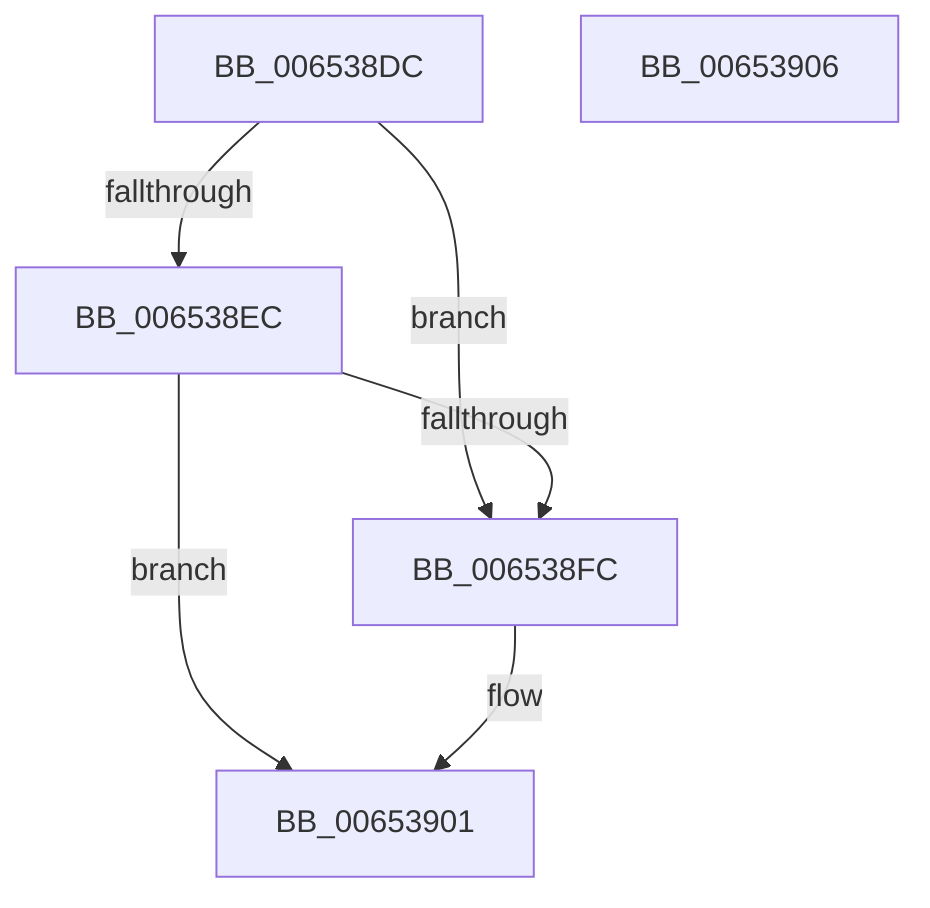

# EtwpRotateCompressionTargetIfNeeded

- RVA: `0x006538DC`–`0x00653907` (길이 `43` bytes)
- VA: `0x00000001406538DC`
- 실행 섹션: `.text`
- PDB 이름 있음: `예`; PDB Function 태그: `아니요`
- unwind 정보 RVA: `0x0005C788`
- 디코드: `13`개 명령, `43/43` bytes 표시
- 미해석 바이트: `0` (있으면 어셈블리에 `.byte`로 보존)

> 이 문서는 커널 이미지의 기계어와 PDB 기호를 분석해 생성했습니다. 4번과 5번은 함수 원형과 자료형을 바이너리 사용 방식에서 추정한 C 해석이며 원본 소스 복구 결과는 아닙니다.

## 1. Dependencies

- 직접 호출 지점: **1**; 고유 호출 대상: **1**
- 직접 호출자로 확인된 함수: **2**
- RIP 상대 이미지 참조: **0**

### Outgoing calls
- `0x006538FC` → [EtwpRotateCompressionTarget](EtwpRotateCompressionTarget_function_00653868.md) (function, `0x00653868`)

### Direct callers
- [EtwpCompressBuffer](EtwpCompressBuffer_function_00652DBC.md) at `0x00652E25`
- [EtwpCompressPendingBuffers](EtwpCompressPendingBuffers_function_00653140.md) at `0x0065318B`

### Static image references
- 디코드된 RIP-relative 메모리 참조가 없습니다.

## 2. Other-region calls and transfers

- 다른 실행 섹션으로 향하는 call: **0**
- 별도 외부 분기/꼬리 이동을 확인하지 못했습니다.

## 3. Assembly (complete function range)

```asm
006538DC  48 83 EC 28                     sub rsp, 0x28
006538E0  48 8B 81 88 05 00 00            mov rax, qword ptr [rcx + 0x588]
006538E7  48 85 C0                        test rax, rax
006538EA  74 10                           je 0x1406538fc
006538EC  8B 40 08                        mov eax, dword ptr [rax + 8]
006538EF  8B 51 04                        mov edx, dword ptr [rcx + 4]
006538F2  2B D0                           sub edx, eax
006538F4  81 FA 48 01 00 00               cmp edx, 0x148
006538FA  77 05                           ja 0x140653901
006538FC  E8 67 FF FF FF                  call 0x140653868
00653901  48 83 C4 28                     add rsp, 0x28
00653905  C3                              ret
00653906  CC                              int3
```

## 4. C-style interpretation (structured pseudocode)

```c
__int64 __fastcall EtwpRotateCompressionTargetIfNeeded(__int64 a1)
{
    __int64 result;
    __int64 v_rsp;

    v_rsp = (v_rsp) - (40);
    if (*(unsigned __int64 *)(a1 + 1416) == 0) goto loc_006538FC;
    a2 = (unsigned int)(((unsigned int)(*(unsigned int *)(a1 + 4))) - ((unsigned int)((unsigned int)(*(unsigned int *)(*(unsigned __int64 *)(a1 + 1416) + 8)))));
    result = (unsigned int)(*(unsigned int *)(*(unsigned __int64 *)(a1 + 1416) + 8));
    if (((unsigned int)(a2)) <= 328) {
        result = EtwpRotateCompressionTarget(a1, a2, a3, a4);
    }
    v_rsp = (v_rsp) + (40);
    return result;
}
```

## 5. (Beta) C Style

```c
int64_t EtwpRotateCompressionTargetIfNeeded(void *Arg1)
{
    uint8_t *arg1 = (uint8_t *)Arg1;

    int64_t result;
    int64_t local_rsp;

    local_rsp = (local_rsp) - (40);
    if (*(uint64_t *)(arg1 + 0x588) == 0) goto loc_006538FC;
    a2 = (uint32_t)(((uint32_t)(*(uint32_t *)(arg1 + 0x4))) - ((uint32_t)((uint32_t)(*(uint32_t *)(*(uint64_t *)(arg1 + 0x588) + 0x8)))));
    result = (uint32_t)(*(uint32_t *)(*(uint64_t *)(arg1 + 0x588) + 0x8));
    if (((uint32_t)(a2)) <= 328) {
        result = EtwpRotateCompressionTarget(Arg1, a2, a3, a4);
    }
    local_rsp = (local_rsp) + (40);
    return result;
}
```

### 관측된 메모리 오프셋

구조체 형식이 확인되지 않은 접근은 인자 기준의 오프셋으로만 기록했습니다.

| 기준 인자 | 오프셋 표현 | 폭 (bit) | 접근 |
|---|---:|---:|---|
| `Arg1` | `+ 0x4` | `32` | `R` |
| `Arg1` | `+ 0x588` | `64` | `R` |

## 6. Execution-region graph

[열기: 2D/3D 그래프와 함수 탐색 컨트롤 패널](../../../control-panel.html?section=text&rva=0x006538DC&view=graph)

- 2D 그래프는 위에서 아래로 흐르고, 3D 그래프는 빈 공간을 드래그해 회전합니다. Shift+드래그는 이동, 휠은 확대·축소, 함수 노드 선택은 대상 보고서 이동입니다.

### Static fallback


