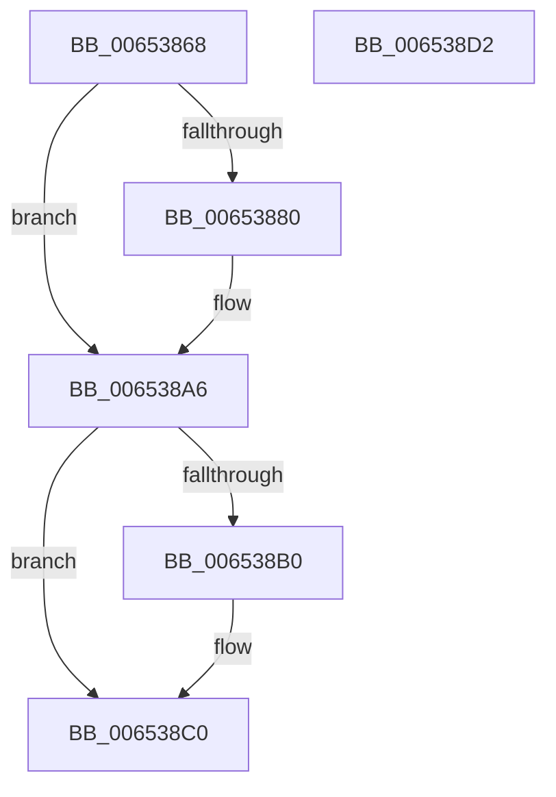

# EtwpRotateCompressionTarget

- RVA: `0x00653868`–`0x006538D3` (길이 `107` bytes)
- VA: `0x0000000140653868`
- 실행 섹션: `.text`
- PDB 이름 있음: `예`; PDB Function 태그: `아니요`
- unwind 정보 RVA: `0x0005CAAC`
- 디코드: `28`개 명령, `107/107` bytes 표시
- 미해석 바이트: `0` (있으면 어셈블리에 `.byte`로 보존)

> 이 문서는 커널 이미지의 기계어와 PDB 기호를 분석해 생성했습니다. 4번과 5번은 함수 원형과 자료형을 바이너리 사용 방식에서 추정한 C 해석이며 원본 소스 복구 결과는 아닙니다.

## 1. Dependencies

- 직접 호출 지점: **4**; 고유 호출 대상: **4**
- 직접 호출자로 확인된 함수: **2**
- RIP 상대 이미지 참조: **0**

### Outgoing calls
- `0x00653880` → [EtwpGetLoggerTimeStamp](../37/EtwpGetLoggerTimeStamp_function_0037E690.md) (function, `0x0037E690`)
- `0x006538A1` → [EtwpEnqueueAvailableBuffer](../2F/EtwpEnqueueAvailableBuffer_function_002FE7DC.md) (function, `0x002FE7DC`)
- `0x006538B3` → [EtwpDequeueFreeBuffer](../3E/EtwpDequeueFreeBuffer_function_003EB1F0.md) (function, `0x003EB1F0`)
- `0x006538BB` → [Feature_218004792__private_IsEnabledDeviceUsageNoInline](../64/Feature_218004792__private_IsEnabledDeviceUsageNoInline_function_0064F3EC.md) (function, `0x0064F3EC`)

### Direct callers
- [EtwpCompressBuffer](EtwpCompressBuffer_function_00652DBC.md) at `0x00653053`
- [EtwpRotateCompressionTargetIfNeeded](EtwpRotateCompressionTargetIfNeeded_function_006538DC.md) at `0x006538FC`

### Static image references
- 디코드된 RIP-relative 메모리 참조가 없습니다.

## 2. Other-region calls and transfers

- 다른 실행 섹션으로 향하는 call: **0**
- 별도 외부 분기/꼬리 이동을 확인하지 못했습니다.

## 3. Assembly (complete function range)

```asm
00653868  48 89 5C 24 08                  mov qword ptr [rsp + 8], rbx
0065386D  57                              push rdi
0065386E  48 83 EC 20                     sub rsp, 0x20
00653872  33 FF                           xor edi, edi
00653874  48 8B D9                        mov rbx, rcx
00653877  48 39 B9 88 05 00 00            cmp qword ptr [rcx + 0x588], rdi
0065387E  74 26                           je 0x1406538a6
00653880  E8 0B AE D2 FF                  call 0x14037e690
00653885  48 8B D0                        mov rdx, rax
00653888  44 8D 47 05                     lea r8d, [rdi + 5]
0065388C  48 8B 83 88 05 00 00            mov rax, qword ptr [rbx + 0x588]
00653893  48 8B CB                        mov rcx, rbx
00653896  48 89 50 10                     mov qword ptr [rax + 0x10], rdx
0065389A  48 8B 93 88 05 00 00            mov rdx, qword ptr [rbx + 0x588]
006538A1  E8 36 AF CA FF                  call 0x1402fe7dc
006538A6  8B 83 98 05 00 00               mov eax, dword ptr [rbx + 0x598]
006538AC  85 C0                           test eax, eax
006538AE  74 10                           je 0x1406538c0
006538B0  48 8B CB                        mov rcx, rbx
006538B3  E8 38 79 D9 FF                  call 0x1403eb1f0
006538B8  48 8B F8                        mov rdi, rax
006538BB  E8 2C BB FF FF                  call 0x14064f3ec
006538C0  48 89 BB 88 05 00 00            mov qword ptr [rbx + 0x588], rdi
006538C7  48 8B 5C 24 30                  mov rbx, qword ptr [rsp + 0x30]
006538CC  48 83 C4 20                     add rsp, 0x20
006538D0  5F                              pop rdi
006538D1  C3                              ret
006538D2  CC                              int3
```

## 4. C-style interpretation (structured pseudocode)

```c
__int64 __fastcall EtwpRotateCompressionTarget(__int64 a1)
{
    __int64 result;
    __int64 v_rdi;
    __int64 v_rsp;
    unsigned __int64 v_stack_p8;

    v_stack_p8 = v_rbx;
    v_rsp = (v_rsp) - (32);
    v_rdi = 0;
    if ((*(unsigned __int64 *)(a1 + 1416)) != 0) {
        result = EtwpGetLoggerTimeStamp(a1, a2, a3, a4);
        a2 = result;
        a3 = v_rdi + 5;
        result = *(unsigned __int64 *)(a1 + 1416);
        a1 = a1;
        *(unsigned __int64 *)(result + 16) = a2;
        a2 = *(unsigned __int64 *)(a1 + 1416);
        result = EtwpEnqueueAvailableBuffer(a1, a2, a3, a4);
    }
    result = (unsigned int)(*(unsigned int *)(a1 + 1432));
    if ((unsigned int)((unsigned int)(*(unsigned int *)(a1 + 1432))) != 0) {
        a1 = a1;
        result = EtwpDequeueFreeBuffer(a1, a2, a3, a4);
        v_rdi = result;
        result = Feature_218004792__private_IsEnabledDeviceUsageNoInline(a1, a2, a3, a4);
    }
    *(unsigned __int64 *)(a1 + 1416) = v_rdi;
    v_rsp = (v_rsp) + (32);
    return result;
}
```

## 5. (Beta) C Style

```c
int64_t EtwpRotateCompressionTarget(void *Arg1)
{
    uint8_t *arg1 = (uint8_t *)Arg1;

    int64_t result;
    int64_t local_rdi;
    int64_t local_rsp;
    uint64_t v_stack_p8;

    v_stack_p8 = local_rbx;
    local_rsp = (local_rsp) - (32);
    local_rdi = 0;
    if ((*(uint64_t *)(arg1 + 0x588)) != 0) {
        result = EtwpGetLoggerTimeStamp(Arg1, a2, a3, a4);
        a2 = result;
        a3 = local_rdi + 5;
        result = *(uint64_t *)(arg1 + 0x588);
        Arg1 = Arg1;
        *(uint64_t *)(result + 0x10) = a2;
        a2 = *(uint64_t *)(arg1 + 0x588);
        result = EtwpEnqueueAvailableBuffer(Arg1, a2, a3, a4);
    }
    result = (uint32_t)(*(uint32_t *)(arg1 + 0x598));
    if ((uint32_t)((uint32_t)(*(uint32_t *)(arg1 + 0x598))) != 0) {
        Arg1 = Arg1;
        result = EtwpDequeueFreeBuffer(Arg1, a2, a3, a4);
        local_rdi = result;
        result = Feature_218004792__private_IsEnabledDeviceUsageNoInline(Arg1, a2, a3, a4);
    }
    *(uint64_t *)(arg1 + 0x588) = local_rdi;
    local_rsp = (local_rsp) + (32);
    return result;
}
```

### 관측된 메모리 오프셋

구조체 형식이 확인되지 않은 접근은 인자 기준의 오프셋으로만 기록했습니다.

| 기준 인자 | 오프셋 표현 | 폭 (bit) | 접근 |
|---|---:|---:|---|
| `Arg1` | `+ 0x588` | `64` | `R` |
| `Arg1` | `+ 0x588` | `64` | `W` |
| `Arg1` | `+ 0x598` | `32` | `R` |

## 6. Execution-region graph

[열기: 2D/3D 그래프와 함수 탐색 컨트롤 패널](../../../control-panel.html?section=text&rva=0x00653868&view=graph)

- 2D 그래프는 위에서 아래로 흐르고, 3D 그래프는 빈 공간을 드래그해 회전합니다. Shift+드래그는 이동, 휠은 확대·축소, 함수 노드 선택은 대상 보고서 이동입니다.

### Static fallback


