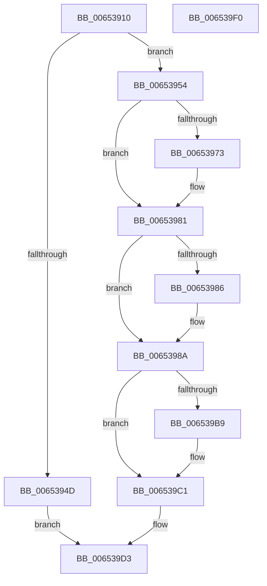

# EtwpSetCompressionSettings

- RVA: `0x00653910`–`0x006539F1` (길이 `225` bytes)
- VA: `0x0000000140653910`
- 실행 섹션: `.text`
- PDB 이름 있음: `예`; PDB Function 태그: `아니요`
- unwind 정보 RVA: `0x0005E6B4`
- 디코드: `61`개 명령, `225/225` bytes 표시
- 미해석 바이트: `0` (있으면 어셈블리에 `.byte`로 보존)

> 이 문서는 커널 이미지의 기계어와 PDB 기호를 분석해 생성했습니다. 4번과 5번은 함수 원형과 자료형을 바이너리 사용 방식에서 추정한 C 해석이며 원본 소스 복구 결과는 아닙니다.

## 1. Dependencies

- 직접 호출 지점: **7**; 고유 호출 대상: **7**
- 직접 호출자로 확인된 함수: **1**
- RIP 상대 이미지 참조: **0**

### Outgoing calls
- `0x0065392E` → [PsGetCurrentServerSiloGlobals](../2F/PsGetCurrentServerSiloGlobals_function_002FE1F0.md) (function, `0x002FE1F0`)
- `0x00653940` → [EtwpAcquireLoggerContextByLoggerId](../../page/93/EtwpAcquireLoggerContextByLoggerId_function_00932920.md) (function, `0x00932920`)
- `0x00653963` → [KeAbPreAcquire](../21/KeAbPreAcquire_function_00210230.md) (function, `0x00210230`)
- `0x0065397C` → [ExfAcquirePushLockExclusiveEx](../20/ExfAcquirePushLockExclusiveEx_function_0020FC90.md) (function, `0x0020FC90`)
- `0x006539BC` → [ExfTryToWakePushLock](../26/ExfTryToWakePushLock_function_00265DD0.md) (function, `0x00265DD0`)
- `0x006539C4` → [KeAbPostRelease](../2E/KeAbPostRelease_function_002E1600.md) (function, `0x002E1600`)
- `0x006539CE` → [EtwpReleaseLoggerContext](../../page/A0/EtwpReleaseLoggerContext_function_00A04160.md) (function, `0x00A04160`)

### Direct callers
- [NtTraceControl](../../page/A9/NtTraceControl_function_00A9ED40.md) at `0x00A9F56E`

### Static image references
- 디코드된 RIP-relative 메모리 참조가 없습니다.

## 2. Other-region calls and transfers

- 다른 실행 섹션으로 향하는 call: **2**
  - `0x00653940` → [EtwpAcquireLoggerContextByLoggerId](../../page/93/EtwpAcquireLoggerContextByLoggerId_function_00932920.md) (`.text` → `PAGE`)
  - `0x006539CE` → [EtwpReleaseLoggerContext](../../page/A0/EtwpReleaseLoggerContext_function_00A04160.md) (`.text` → `PAGE`)
- 별도 외부 분기/꼬리 이동을 확인하지 못했습니다.

## 3. Assembly (complete function range)

```asm
00653910  48 8B C4                        mov rax, rsp
00653913  48 89 58 08                     mov qword ptr [rax + 8], rbx
00653917  48 89 68 10                     mov qword ptr [rax + 0x10], rbp
0065391B  48 89 70 18                     mov qword ptr [rax + 0x18], rsi
0065391F  48 89 78 20                     mov qword ptr [rax + 0x20], rdi
00653923  41 56                           push r14
00653925  48 83 EC 20                     sub rsp, 0x20
00653929  4C 8B F1                        mov r14, rcx
0065392C  33 FF                           xor edi, edi
0065392E  E8 BD A8 CA FF                  call 0x1402fe1f0
00653933  41 8B 16                        mov edx, dword ptr [r14]
00653936  45 33 C0                        xor r8d, r8d
00653939  48 8B 88 40 03 00 00            mov rcx, qword ptr [rax + 0x340]
00653940  E8 DB EF 2D 00                  call 0x140932920
00653945  48 8B F0                        mov rsi, rax
00653948  48 85 C0                        test rax, rax
0065394B  75 07                           jne 0x140653954
0065394D  BF 0D 00 00 C0                  mov edi, 0xc000000d
00653952  EB 7F                           jmp 0x1406539d3
00653954  48 8D 98 80 05 00 00            lea rbx, [rax + 0x580]
0065395B  45 33 C0                        xor r8d, r8d
0065395E  48 8B CB                        mov rcx, rbx
00653961  33 D2                           xor edx, edx
00653963  E8 C8 C8 BB FF                  call 0x140210230
00653968  F0 48 0F BA 2B 00               lock bts qword ptr [rbx], 0
0065396E  48 8B E8                        mov rbp, rax
00653971  73 0E                           jae 0x140653981
00653973  4C 8B C3                        mov r8, rbx
00653976  48 8B D0                        mov rdx, rax
00653979  48 8B CB                        mov rcx, rbx
0065397C  E8 0F C3 BB FF                  call 0x14020fc90
00653981  48 85 ED                        test rbp, rbp
00653984  74 04                           je 0x14065398a
00653986  C6 45 0A 01                     mov byte ptr [rbp + 0xa], 1
0065398A  41 8B 46 04                     mov eax, dword ptr [r14 + 4]
0065398E  89 86 A0 05 00 00               mov dword ptr [rsi + 0x5a0], eax
00653994  41 8B 46 08                     mov eax, dword ptr [r14 + 8]
00653998  89 86 9C 05 00 00               mov dword ptr [rsi + 0x59c], eax
0065399E  41 8B 46 0C                     mov eax, dword ptr [r14 + 0xc]
006539A2  89 86 A4 05 00 00               mov dword ptr [rsi + 0x5a4], eax
006539A8  48 83 CA FF                     or rdx, 0xffffffffffffffff
006539AC  F0 48 0F C1 13                  lock xadd qword ptr [rbx], rdx
006539B1  80 E2 06                        and dl, 6
006539B4  80 FA 02                        cmp dl, 2
006539B7  75 08                           jne 0x1406539c1
006539B9  48 8B CB                        mov rcx, rbx
006539BC  E8 0F 24 C1 FF                  call 0x140265dd0
006539C1  48 8B CB                        mov rcx, rbx
006539C4  E8 37 DC C8 FF                  call 0x1402e1600
006539C9  33 D2                           xor edx, edx
006539CB  48 8B CE                        mov rcx, rsi
006539CE  E8 8D 07 3B 00                  call 0x140a04160
006539D3  48 8B 5C 24 30                  mov rbx, qword ptr [rsp + 0x30]
006539D8  8B C7                           mov eax, edi
006539DA  48 8B 7C 24 48                  mov rdi, qword ptr [rsp + 0x48]
006539DF  48 8B 6C 24 38                  mov rbp, qword ptr [rsp + 0x38]
006539E4  48 8B 74 24 40                  mov rsi, qword ptr [rsp + 0x40]
006539E9  48 83 C4 20                     add rsp, 0x20
006539ED  41 5E                           pop r14
006539EF  C3                              ret
006539F0  CC                              int3
```

## 4. C-style interpretation (structured pseudocode)

```c
__int64 __fastcall EtwpSetCompressionSettings(__int64 a1, __int64 a2, int a3)
{
    __int64 result;
    __int64 v_rdi;
    __int64 v_rsp;
    unsigned __int64 v_stack_p10;
    unsigned __int64 v_stack_p18;
    unsigned __int64 v_stack_p20;
    unsigned __int64 v_stack_p8;

    *(unsigned __int64 *)(v_rsp + 8) = v_rbx;
    *(unsigned __int64 *)(v_rsp + 16) = v_rbp;
    *(unsigned __int64 *)(v_rsp + 24) = v_rsi;
    *(unsigned __int64 *)(v_rsp + 32) = v_rdi;
    v_rsp = (v_rsp) - (32);
    v_rdi = 0;
    result = PsGetCurrentServerSiloGlobals(a1, a2, a3, a4);
    a3 = 0;
    result = EtwpAcquireLoggerContextByLoggerId(*(unsigned __int64 *)(result + 832), (unsigned int)(*(unsigned int *)(a1)), a3, a4);
    if (result != 0) goto loc_00653954;
    goto loc_006539D3;
loc_00653954:
    a3 = 0;
    a2 = 0;
    result = KeAbPreAcquire(result + 1408, a2, a3, a4);
    if (!(condition_is_above_or_equal)) {
        a3 = result + 1408;
        a2 = result;
        a1 = result + 1408;
        result = ExfAcquirePushLockExclusiveEx(a1, a2, a3, a4);
    }
    if (result != 0) {
        *(unsigned __int8 *)(result + 10) = 1;
    }
    *(unsigned int *)(result + 1440) = (unsigned int)((unsigned int)(*(unsigned int *)(a1 + 4)));
    *(unsigned int *)(result + 1436) = (unsigned int)((unsigned int)(*(unsigned int *)(a1 + 8)));
    *(unsigned int *)(result + 1444) = (unsigned int)((unsigned int)(*(unsigned int *)(a1 + 12)));
    a2 = (a2) | (-1);
    a2 = (unsigned __int8)((a2) & (6));
    result = (unsigned int)(*(unsigned int *)(a1 + 12));
    if (((unsigned __int8)(a2)) == 2) {
        a1 = result + 1408;
        result = ExfTryToWakePushLock(a1, a2, a3, a4);
    }
    result = KeAbPostRelease(result + 1408, a2, a3, a4);
    a2 = 0;
    result = EtwpReleaseLoggerContext(result, a2, a3, a4);
loc_006539D3:
    v_rsp = (v_rsp) + (32);
    return (unsigned int)((unsigned int)((unsigned int)(0xC000000DULL)));
}
```

## 5. (Beta) C Style

```c
int64_t EtwpSetCompressionSettings(void *Arg1, int64_t Arg2, int32_t Arg3)
{
    uint8_t *arg1 = (uint8_t *)Arg1;

    int64_t result;
    int64_t local_rdi;
    int64_t local_rsp;
    uint64_t v_stack_p10;
    uint64_t v_stack_p18;
    uint64_t v_stack_p20;
    uint64_t v_stack_p8;

    *(uint64_t *)(local_rsp + 0x8) = local_rbx;
    *(uint64_t *)(local_rsp + 0x10) = local_rbp;
    *(uint64_t *)(local_rsp + 0x18) = local_rsi;
    *(uint64_t *)(local_rsp + 0x20) = local_rdi;
    local_rsp = (local_rsp) - (32);
    local_rdi = 0;
    result = PsGetCurrentServerSiloGlobals(Arg1, Arg2, Arg3, a4);
    Arg3 = 0;
    result = EtwpAcquireLoggerContextByLoggerId(*(uint64_t *)(result + 0x340), (uint32_t)(*(uint32_t *)(arg1)), Arg3, a4);
    if (result != 0) goto loc_00653954;
    goto loc_006539D3;
loc_00653954:
    Arg3 = 0;
    Arg2 = 0;
    result = KeAbPreAcquire(result + 1408, Arg2, Arg3, a4);
    if (!(condition_is_above_or_equal)) {
        Arg3 = result + 1408;
        Arg2 = result;
        Arg1 = result + 1408;
        result = ExfAcquirePushLockExclusiveEx(Arg1, Arg2, Arg3, a4);
    }
    if (result != 0) {
        *(uint8_t *)(result + 0xA) = 1;
    }
    *(uint32_t *)(result + 0x5A0) = (uint32_t)((uint32_t)(*(uint32_t *)(arg1 + 0x4)));
    *(uint32_t *)(result + 0x59C) = (uint32_t)((uint32_t)(*(uint32_t *)(arg1 + 0x8)));
    *(uint32_t *)(result + 0x5A4) = (uint32_t)((uint32_t)(*(uint32_t *)(arg1 + 0xC)));
    Arg2 = (Arg2) | (-1);
    Arg2 = (uint8_t)((Arg2) & (6));
    result = (uint32_t)(*(uint32_t *)(arg1 + 0xC));
    if (((uint8_t)(Arg2)) == 2) {
        Arg1 = result + 1408;
        result = ExfTryToWakePushLock(Arg1, Arg2, Arg3, a4);
    }
    result = KeAbPostRelease(result + 1408, Arg2, Arg3, a4);
    Arg2 = 0;
    result = EtwpReleaseLoggerContext(result, Arg2, Arg3, a4);
loc_006539D3:
    local_rsp = (local_rsp) + (32);
    return (uint32_t)((uint32_t)((uint32_t)(0xC000000DULL)));
}
```

### 관측된 메모리 오프셋

구조체 형식이 확인되지 않은 접근은 인자 기준의 오프셋으로만 기록했습니다.

| 기준 인자 | 오프셋 표현 | 폭 (bit) | 접근 |
|---|---:|---:|---|
| `Arg1` | `+ 0x0` | `32` | `R` |
| `Arg1` | `+ 0x4` | `32` | `R` |
| `Arg1` | `+ 0x8` | `32` | `R` |
| `Arg1` | `+ 0xC` | `32` | `R` |

## 6. Execution-region graph

[열기: 2D/3D 그래프와 함수 탐색 컨트롤 패널](../../../control-panel.html?section=text&rva=0x00653910&view=graph)

- 2D 그래프는 위에서 아래로 흐르고, 3D 그래프는 빈 공간을 드래그해 회전합니다. Shift+드래그는 이동, 휠은 확대·축소, 함수 노드 선택은 대상 보고서 이동입니다.

### Static fallback


