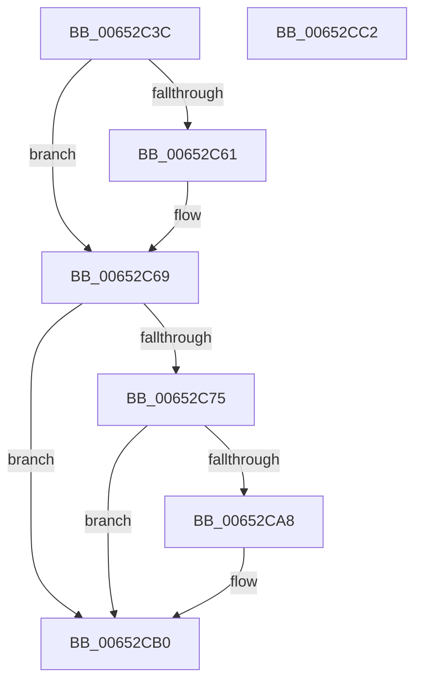

# EtwpSetPartitionContext

- RVA: `0x00652C3C`–`0x00652CC3` (길이 `135` bytes)
- VA: `0x0000000140652C3C`
- 실행 섹션: `.text`
- PDB 이름 있음: `예`; PDB Function 태그: `아니요`
- unwind 정보 RVA: `0x000717F8`
- 디코드: `36`개 명령, `135/135` bytes 표시
- 미해석 바이트: `0` (있으면 어셈블리에 `.byte`로 보존)

> 이 문서는 커널 이미지의 기계어와 PDB 기호를 분석해 생성했습니다. 4번과 5번은 함수 원형과 자료형을 바이너리 사용 방식에서 추정한 C 해석이며 원본 소스 복구 결과는 아닙니다.

## 1. Dependencies

- 직접 호출 지점: **2**; 고유 호출 대상: **2**
- 직접 호출자로 확인된 함수: **1**
- RIP 상대 이미지 참조: **0**

### Outgoing calls
- `0x00652C61` → [PsDereferencePartition](../34/PsDereferencePartition_function_00342E70.md) (function, `0x00342E70`)
- `0x00652C9D` → [PsReferencePartitionByHandle](../../page/90/PsReferencePartitionByHandle_function_0090337C.md) (function, `0x0090337C`)

### Direct callers
- [EtwpStartLogger](../../page/A9/EtwpStartLogger_function_00A99D80.md) at `0x00A9A743`

### Static image references
- 디코드된 RIP-relative 메모리 참조가 없습니다.

## 2. Other-region calls and transfers

- 다른 실행 섹션으로 향하는 call: **1**
  - `0x00652C9D` → [PsReferencePartitionByHandle](../../page/90/PsReferencePartitionByHandle_function_0090337C.md) (`.text` → `PAGE`)
- 별도 외부 분기/꼬리 이동을 확인하지 못했습니다.

## 3. Assembly (complete function range)

```asm
00652C3C  48 89 5C 24 10                  mov qword ptr [rsp + 0x10], rbx
00652C41  48 89 74 24 18                  mov qword ptr [rsp + 0x18], rsi
00652C46  57                              push rdi
00652C47  48 83 EC 30                     sub rsp, 0x30
00652C4B  48 83 64 24 40 00               and qword ptr [rsp + 0x40], 0
00652C51  48 8B D9                        mov rbx, rcx
00652C54  48 8B 09                        mov rcx, qword ptr [rcx]
00652C57  33 FF                           xor edi, edi
00652C59  48 8B F2                        mov rsi, rdx
00652C5C  48 85 C9                        test rcx, rcx
00652C5F  74 08                           je 0x140652c69
00652C61  E8 0A 02 CF FF                  call 0x140342e70
00652C66  48 21 3B                        and qword ptr [rbx], rdi
00652C69  48 8D 46 02                     lea rax, [rsi + 2]
00652C6D  48 A9 FD FF FF FF               test rax, -3
00652C73  74 3B                           je 0x140652cb0
00652C75  65 48 8B 04 25 88 01 00 00      mov rax, qword ptr gs:[0x188]
00652C7E  BA 02 00 00 00                  mov edx, 2
00652C83  41 B9 45 74 77 6F               mov r9d, 0x6f777445
00652C89  48 8B CE                        mov rcx, rsi
00652C8C  44 8A 80 32 02 00 00            mov r8b, byte ptr [rax + 0x232]
00652C93  48 8D 44 24 40                  lea rax, [rsp + 0x40]
00652C98  48 89 44 24 20                  mov qword ptr [rsp + 0x20], rax
00652C9D  E8 DA 06 2B 00                  call 0x14090337c
00652CA2  8B F8                           mov edi, eax
00652CA4  85 C0                           test eax, eax
00652CA6  78 08                           js 0x140652cb0
00652CA8  48 8B 4C 24 40                  mov rcx, qword ptr [rsp + 0x40]
00652CAD  48 89 0B                        mov qword ptr [rbx], rcx
00652CB0  48 8B 5C 24 48                  mov rbx, qword ptr [rsp + 0x48]
00652CB5  8B C7                           mov eax, edi
00652CB7  48 8B 74 24 50                  mov rsi, qword ptr [rsp + 0x50]
00652CBC  48 83 C4 30                     add rsp, 0x30
00652CC0  5F                              pop rdi
00652CC1  C3                              ret
00652CC2  CC                              int3
```

## 4. C-style interpretation (structured pseudocode)

```c
__int64 __fastcall EtwpSetPartitionContext(__int64 a1, __int64 a2)
{
    __int64 result;
    __int64 v_rdi;
    __int64 v_rsp;
    unsigned __int64 v_stack_m18;
    unsigned __int64 v_stack_p10;
    unsigned __int64 v_stack_p18;
    unsigned __int64 v_stack_p8;

    v_stack_p10 = v_rbx;
    v_stack_p18 = v_rsi;
    v_rsp = (v_rsp) - (48);
    v_rdi = 0;
    if (*(unsigned __int64 *)(a1) != 0) {
        result = PsDereferencePartition(*(unsigned __int64 *)(a1), a2, a3, a4);
    }
    if (((a2 + 2) & (-3)) == 0) goto loc_00652CB0;
    v_stack_m18 = v_stack_p8;
    result = PsReferencePartitionByHandle(a2, 2, *(unsigned __int8 *)(*(unsigned __int64 *)(gs_base + (0 + 392)) + 562), (unsigned int)(0x6F777445ULL));
    if (!(sign_flag)) {
        a1 = v_stack_p8;
        *(unsigned __int64 *)(a1) = a1;
    }
    v_rsp = (v_rsp) + (48);
    return (unsigned int)((unsigned int)((unsigned int)((unsigned int)(result))));
}
```

## 5. (Beta) C Style

```c
int64_t EtwpSetPartitionContext(void *Arg1, void *Arg2)
{
    uint8_t *arg1 = (uint8_t *)Arg1;
    uint8_t *arg2 = (uint8_t *)Arg2;

    int64_t result;
    int64_t local_rdi;
    int64_t local_rsp;
    uint64_t v_stack_m18;
    uint64_t v_stack_p10;
    uint64_t v_stack_p18;
    uint64_t v_stack_p8;

    v_stack_p10 = local_rbx;
    v_stack_p18 = local_rsi;
    local_rsp = (local_rsp) - (48);
    local_rdi = 0;
    if (*(uint64_t *)(arg1) != 0) {
        result = PsDereferencePartition(*(uint64_t *)(arg1), Arg2, a3, a4);
    }
    if (((Arg2 + 2) & (-3)) == 0) goto loc_00652CB0;
    v_stack_m18 = v_stack_p8;
    result = PsReferencePartitionByHandle(Arg2, 2, *(uint8_t *)(*(uint64_t *)(gs_base + (0 + 0x188)) + 0x232), (uint32_t)(0x6F777445ULL));
    if (!(sign_flag)) {
        Arg1 = v_stack_p8;
        *(void **)(arg1) = Arg1;
    }
    local_rsp = (local_rsp) + (48);
    return (uint32_t)((uint32_t)((uint32_t)((uint32_t)(result))));
}
```

### 관측된 메모리 오프셋

구조체 형식이 확인되지 않은 접근은 인자 기준의 오프셋으로만 기록했습니다.

| 기준 인자 | 오프셋 표현 | 폭 (bit) | 접근 |
|---|---:|---:|---|
| `Arg1` | `+ 0x0` | `64` | `R` |
| `Arg1` | `+ 0x0` | `64` | `R/W` |
| `Arg1` | `+ 0x0` | `64` | `W` |
| `Arg2` | `+ 0x2` | `64` | `R` |

## 6. Execution-region graph

[열기: 2D/3D 그래프와 함수 탐색 컨트롤 패널](../../../control-panel.html?section=text&rva=0x00652C3C&view=graph)

- 2D 그래프는 위에서 아래로 흐르고, 3D 그래프는 빈 공간을 드래그해 회전합니다. Shift+드래그는 이동, 휠은 확대·축소, 함수 노드 선택은 대상 보고서 이동입니다.

### Static fallback


